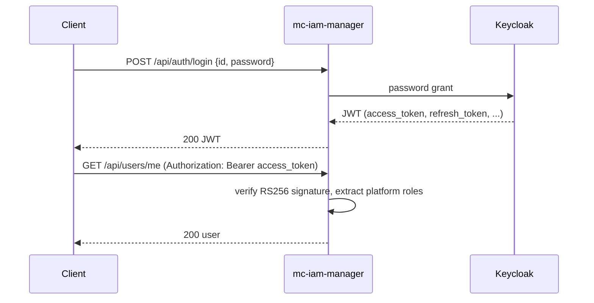

# API Reference

mc-iam-manager exposes a REST API built with [Echo](https://echo.labstack.com/). All routes are registered in [`src/main.go`](https://github.com/m-cmp/mc-iam-manager/blob/main/src/main.go). The OpenAPI (Swagger 2.0) spec is generated from handler annotations with [swag](https://github.com/swaggo/swag).

- Default listen port: `MC_IAM_MANAGER_PORT` (falls back to `5000`)
- API prefix: `/api` (with two exceptions: `/readyz` and `/swagger/*`)
- Auth scheme: `Authorization: Bearer <access_token>` (a Keycloak-issued JWT)

## Swagger UI

| Item | Value |
|---|---|
| Route | `GET /swagger/*` ([`src/main.go`](https://github.com/m-cmp/mc-iam-manager/blob/main/src/main.go), via `echoSwagger.WrapHandler`) |
| UI | `http://<host>:<MC_IAM_MANAGER_PORT>/swagger/index.html` |
| Spec served to the UI | `/swagger/doc.json`, compiled into the binary from [`src/docs/docs.go`](https://github.com/m-cmp/mc-iam-manager/blob/main/src/docs/docs.go) |

> [!WARNING]
> **Swagger UI needs a token.** The global auth middleware in `src/main.go` skips only `/readyz`, `/initial-admin` and six `/api/auth/*` paths. `/swagger/*` is not on that list, so a plain browser request to `/swagger/index.html` gets `401 {"message":"Authorization header is required"}`.
> Workarounds: send the header through a header-injecting browser extension or a proxy, or open the spec file in a local Swagger viewer (for example `npx @redocly/cli preview-docs src/docs/swagger.yaml` or [editor.swagger.io](https://editor.swagger.io)).

> [!NOTE]
> The online docs linked from the README (`https://m-cmp.github.io/mc-iam-manager/swagger/`) serve an old spec (title `mc-iam-manager`, version `1.0.0`, 46 paths). They are not generated from `main`. Use the files in `src/docs/` instead.

## Spec Files

| File | Status |
|---|---|
| [`src/docs/swagger.json`](https://github.com/m-cmp/mc-iam-manager/blob/main/src/docs/swagger.json) | **Canonical.** Read by the registry consistency test |
| [`src/docs/swagger.yaml`](https://github.com/m-cmp/mc-iam-manager/blob/main/src/docs/swagger.yaml) | Canonical, YAML form. Input to `tool/swagger-to-actions` ([`frameworks.yaml`](https://github.com/m-cmp/mc-iam-manager/blob/main/tool/swagger-to-actions/frameworks.yaml)) |
| [`src/docs/docs.go`](https://github.com/m-cmp/mc-iam-manager/blob/main/src/docs/docs.go) | Canonical. Go package imported by `main.go`; this is what Swagger UI serves |
| [`docs/swagger.json`](https://github.com/m-cmp/mc-iam-manager/blob/main/docs/swagger.json), [`docs/swagger.yaml`](https://github.com/m-cmp/mc-iam-manager/blob/main/docs/swagger.yaml), [`docs/docs.go`](https://github.com/m-cmp/mc-iam-manager/blob/main/docs/docs.go) | **Stale copy.** It has drifted from `src/docs/` |

How far the copy has drifted (as of v0.7.0): `docs/swagger.json` lists 233 operations and `src/docs/swagger.json` lists 232. The extra one is `GET /api/setup/initial-role-menu-permission` (`initializeMenuPermissions`, deprecated). No route for it exists in `src/main.go`. Treat `src/docs/` as the only source of truth.

## Regenerating the Spec

The go.mod pins `github.com/swaggo/swag v1.16.4`, so install the matching CLI:

```bash
go install github.com/swaggo/swag/cmd/swag@v1.16.4

cd src
swag init --output ./docs
```

This is the command given in the [README](https://github.com/m-cmp/mc-iam-manager/blob/main/readme.md) and in the failure hints of [`src/registry_consistency_test.go`](https://github.com/m-cmp/mc-iam-manager/blob/main/src/registry_consistency_test.go). The test hint also says to copy the output to `docs/`. If you keep that copy, run `cp src/docs/* docs/` afterwards.

After regenerating, run `cd src && go test -run TestRegistryConsistency .`. The test checks three things against each other: the routes in `main.go`, the `@Router`/`@Id` annotations together with `swagger.json`, and the MCMP API seed files (see [Development and Testing](Development-and-Testing#adding-a-new-api)).

## Known Issue: `basePath` Does Not Match the Routes

The general annotations on `main()` in [`src/main.go`](https://github.com/m-cmp/mc-iam-manager/blob/main/src/main.go) declare:

```go
// @host localhost
// @BasePath /api/v1
```

The routes themselves are mounted under `basePath := "/api"`, and every `@Router` annotation already carries the full path (for example `@Router /api/auth/login [post]`). So the generated spec has `"basePath": "/api/v1"`, `"host": "localhost"` and paths such as `/api/auth/login`.

What this breaks:

- **"Try it out" in Swagger UI** sends requests to `http://localhost/api/v1/api/auth/login`. The path is doubled and wrong (no `/api/v1` route exists), and the host is fixed to `localhost` on port 80. Every call returns 404 or a connection error. Use curl or another client instead.
- **Generated clients** (for example openapi-generator) build the same wrong URLs unless you override `basePath` and host.
- **The MCMP API registry is not affected.** `tool/swagger-to-actions` writes `resourcePath` straight from the path keys (for example `/api/mcmp-apis`), and those match the real routes.

Fix (not yet applied): change the annotation to `@BasePath /` and set `@host` correctly, or remove it, then regenerate.

## Route Groups

Counts are taken from `src/main.go`, with commented-out lines excluded: **241 routes** in total. The spec documents 232 operations. The 9 undocumented routes are `/swagger/*`, the 7 `/api/groups` routes that reuse organization handlers (swag allows only one `@Router` per handler), and `GET /api/users/id/{userId}/groups`.

Authorization levels (from [`src/middleware/permission.go`](https://github.com/m-cmp/mc-iam-manager/blob/main/src/middleware/permission.go)):

| Middleware | Allowed platform roles |
|---|---|
| Token only | any authenticated user |
| `PlatformRoleMiddleware(Read)` | any authenticated user |
| `PlatformRoleMiddleware(Write)` | `admin`, `platformAdmin` |
| `PlatformRoleMiddleware(Manage)` | `platformAdmin` |
| `PlatformAdminMiddleware` | `platformAdmin` |

| Prefix | Routes | Auth / middleware | Purpose |
|---|---:|---|---|
| `/readyz` | 1 | Public | Health check (`?status=` for per-component checks) |
| `/swagger/*` | 1 | Token required (see warning above) | Swagger UI |
| `/api/auth` | 7 | Public, except `GET /temp-credential-csps` (token) | Login, logout, refresh, validate, JWKS certs, signup |
| `/api/initial-admin` | 1 | Public | Creates the first platform admin |
| `/api/company` | 5 | Read for `GET`, PlatformAdmin for writes | Company profile (singleton) |
| `/api/setup` | 12 | PlatformAdmin (group) | Seeding and sync: menus, role-menu permissions, MCMP APIs, projects, organizations, backup and restore |
| `/api/workspaces` | 22 | Token; Write on most; PlatformAdmin on project assign/unassign | Workspace CRUD, members, workspace ticket, temporary CSP credentials, invitations |
| `/api/projects` | 9 | Write / Manage; PlatformAdmin on assign/unassign | Project CRUD, workspace mapping |
| `/api/roles` | 48 | Token; Write or Manage on mutations (some sub-role CRUD has no extra check) | Platform, workspace and CSP roles, assignments, mappings, role-to-MC-IAM-permission links |
| `/api/users` | 37 | Token; Read / Write; PlatformAdmin on (de)activate, withdraw, groups, effective roles | User CRUD, `me` endpoints, user menus and workspaces, organizations and groups |
| `/api/invitations` | 3 | Write | Admin approval of workspace invitations |
| `/api/menus` | 9 | Token; Write / PlatformAdmin on mutations | Menu CRUD, menu tree, menu-to-platform-role mapping |
| `/api/resource-types/cloud-resources` | 5 | PlatformAdmin (group) | Cloud resource type registry |
| `/api/permissions/mciam` | 5 | Read (group); Write on mutations | MC-IAM permission CRUD |
| `/api/mcmp-apis` | 14 | Manage on most; `POST /call` checks inside the handler; Read / Manage on `/permission-action-mappings` (7 of the 14) | MCMP API registry, API gateway call, permission-action mappings |
| `/api/csp-accounts` | 8 | Read (group); PlatformAdmin on mutations | CSP account management |
| `/api/csp-idp-configs` | 10 | Read (group); PlatformAdmin on mutations | CSP identity provider (OIDC/SAML) configs |
| `/api/organizations` | 11 | Write (group) | Organization tree |
| `/api/groups` | 19 | Write (group) | Alias of organizations, plus group users, platform roles and workspace mappings |
| `/api/csp-policies` | 10 | Read (group); PlatformAdmin on mutations | CSP policy sync, attach and detach |
| `/api/csp/iam` | 4 | PlatformAdmin (group) | Direct CSP IAM role CRUD |

For the permission model behind these levels, see [Authentication and Authorization](Authentication-and-Authorization) and [MCMP API Permissions](MCMP-API-Permissions).

> [!NOTE]
> The skip check in `src/main.go` uses `path == skipPath || strings.HasSuffix(path, skipPath)`. Any request path that *ends with* a public path (for example `.../readyz`) also skips token validation.

## Response and Error Format

The API has no single response envelope. Expect these shapes:

| Source | Shape | Example |
|---|---|---|
| Most handler errors (the dominant pattern in `src/handler/`) | `{"error": "<message>"}` | `{"error": "Please enter user ID and password"}` |
| Auth and permission middleware (`echo.NewHTTPError`) | `{"message": "<message>"}` | `401 {"message":"Invalid token"}`; `403` messages from `permission.go` are in Korean |
| Some handlers ([`model.Response`](https://github.com/m-cmp/mc-iam-manager/blob/main/src/model/request.go)) | `{"error": bool, "message": "..."}` | |
| Validation-style errors ([`model.ErrorResponse`](https://github.com/m-cmp/mc-iam-manager/blob/main/src/model/error.go)) | `{"success": false, "error": "...", "fields": {...}, "code": "VALIDATION_FAILED"}` | codes `DUPLICATE_EMAIL`, `VALIDATION_FAILED`, `SERVER_ERROR` |
| Success | Resource JSON or list (no wrapper) | |

When `MC_IAM_MANAGER_DEBUG=true` ([`src/config/debug.go`](https://github.com/m-cmp/mc-iam-manager/blob/main/src/config/debug.go)), Echo debug mode is on and error responses can include internal error strings. Keep it off outside local development.

## Calling the API with curl



```bash
IAM=http://localhost:5000   # http://<host>:${MC_IAM_MANAGER_PORT}

# 1. Login. The body uses "id", not "username" (idp.UserLogin)
TOKEN_JSON=$(curl -s -X POST "$IAM/api/auth/login" \
  -H "Content-Type: application/json" \
  -d '{"id":"<MC_IAM_MANAGER_PLATFORMADMIN_ID>","password":"<MC_IAM_MANAGER_PLATFORMADMIN_PASSWORD>"}')

ACCESS_TOKEN=$(echo "$TOKEN_JSON" | jq -r .access_token)
REFRESH_TOKEN=$(echo "$TOKEN_JSON" | jq -r .refresh_token)

# 2. Call an authenticated endpoint
curl -s "$IAM/api/users/me" -H "Authorization: Bearer $ACCESS_TOKEN"

# 3. List endpoints mostly use POST .../list with a filter body
curl -s -X POST "$IAM/api/workspaces/list" \
  -H "Authorization: Bearer $ACCESS_TOKEN" -H "Content-Type: application/json" -d '{}'

# 4. Refresh
curl -s -X POST "$IAM/api/auth/refresh" \
  -H "Content-Type: application/json" -d "{\"refresh_token\":\"$REFRESH_TOKEN\"}"
```

Notes:

- The login response is the Keycloak token object returned as-is (`access_token`, `refresh_token`, `expires_in`, ...).
- The header must be exactly `Bearer <token>`. The scheme is case-sensitive and must be followed by a single space ([`src/middleware/auth.go`](https://github.com/m-cmp/mc-iam-manager/blob/main/src/middleware/auth.go)).
- Login is rejected with `403` when the Keycloak account is disabled or pending approval.

For validating these tokens in another service, see [Token Validation for Services](Token-Validation-for-Services).
