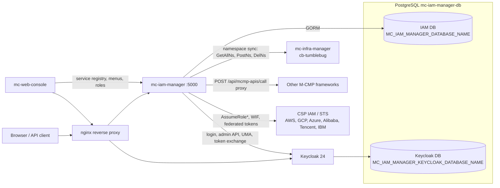
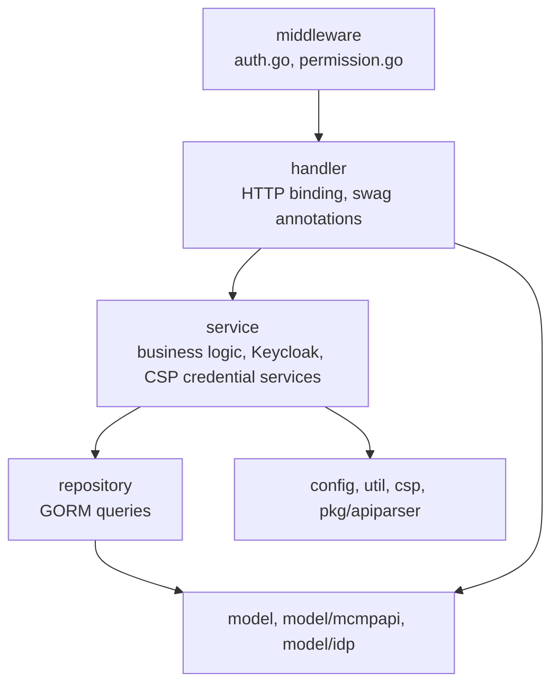
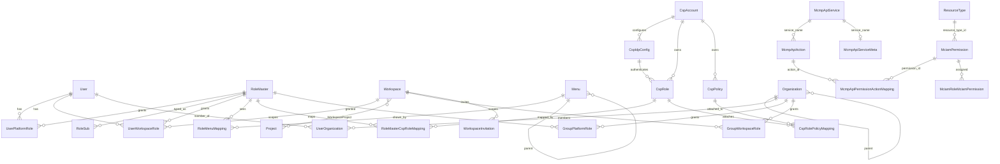
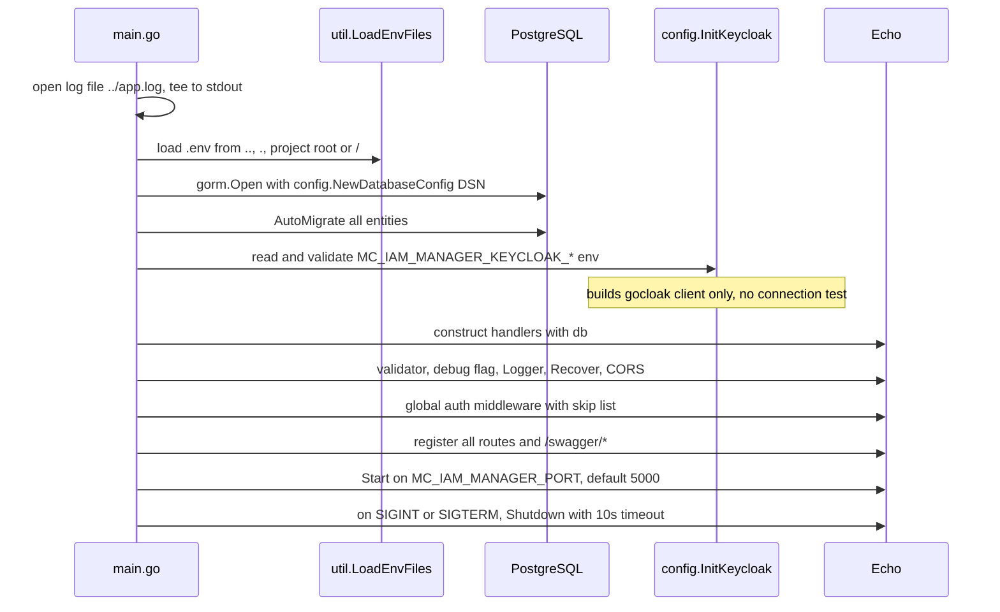

# Architecture

mc-iam-manager is the identity and access management service of M-CMP. It wraps Keycloak (authentication, realm roles, token issuance) and keeps the M-CMP authorization model (platform/workspace roles, workspaces, projects, menus, API registry, CSP role mappings) in its own PostgreSQL database.

- Language / runtime: Go 1.25 ([src/go.mod](https://github.com/m-cmp/mc-iam-manager/blob/main/src/go.mod))
- HTTP: Echo v4, Swagger via swaggo (`/swagger/*`)
- Persistence: GORM + PostgreSQL, schema managed by `AutoMigrate` at startup
- Identity provider: Keycloak 24 (image `quay.io/keycloak/keycloak:24.0.1` in [docker-compose.yaml](https://github.com/m-cmp/mc-iam-manager/blob/main/docker-compose.yaml)) accessed with gocloak v13
- Tokens: golang-jwt v5 (local RS256 validation)
- CSP SDKs: AWS SDK v2 (IAM, STS), Google Cloud IAM; other CSP STS endpoints are called over plain HTTPS

## Component View

| Component | Role | Source |
|---|---|---|
| mc-iam-manager | REST API, authorization model, Keycloak and CSP orchestration | [src/main.go](https://github.com/m-cmp/mc-iam-manager/blob/main/src/main.go) |
| Keycloak | Users, passwords, realm roles (= platform roles), groups (= organizations), token issuance, SAML/OIDC clients | [src/config/keycloak.go](https://github.com/m-cmp/mc-iam-manager/blob/main/src/config/keycloak.go) |
| PostgreSQL | One instance, two databases: IAM DB and Keycloak DB, created by [dockerfiles/postgres/init-db.sh](https://github.com/m-cmp/mc-iam-manager/blob/main/dockerfiles/postgres/init-db.sh) | [src/config/database.go](https://github.com/m-cmp/mc-iam-manager/blob/main/src/config/database.go) |
| nginx | TLS termination and reverse proxy for mc-iam-manager and Keycloak | [conf/mc-iam-manager/nginx.template.conf](https://github.com/m-cmp/mc-iam-manager/blob/main/conf/mc-iam-manager/nginx.template.conf) |
| mc-infra-manager | Namespace source for project sync (`/api/setup/sync-projects`, project create/delete) | [src/service/project_service.go](https://github.com/m-cmp/mc-iam-manager/blob/main/src/service/project_service.go) |
| mc-web-console | Main consumer: login, menu tree, role/user screens, framework service registry | [MCMP API Permissions](MCMP-API-Permissions) |
| CSP IAM / STS | Target of temporary credential issuance and AWS IAM role management | [CSP Integration](CSP-Integration) |

Deployment variants (standalone vs. mc-admin-cli) are described in [Deployment Modes](Deployment-Modes).

## Layered Structure

Handlers are constructed with the shared `*gorm.DB` and build their own services; there is no DI container. Keycloak access goes through the global `config.KC` ([src/config/keycloak.go](https://github.com/m-cmp/mc-iam-manager/blob/main/src/config/keycloak.go)) and `service.KeycloakService` ([src/service/keycloak_service.go](https://github.com/m-cmp/mc-iam-manager/blob/main/src/service/keycloak_service.go)).

## Package Map

| Path | Contents |
|---|---|
| [src/main.go](https://github.com/m-cmp/mc-iam-manager/blob/main/src/main.go) | Bootstrap, `AutoMigrate`, Echo setup, every route registration |
| [src/config](https://github.com/m-cmp/mc-iam-manager/tree/main/src/config) | DB DSN (`database.go`), Keycloak config, admin-token cache and public key (`keycloak.go`), `MC_IAM_MANAGER_DEBUG` (`debug.go`) |
| [src/constants](https://github.com/m-cmp/mc-iam-manager/blob/main/src/constants/constants.go) | Role types (`platform`, `workspace`, `csp`), auth methods (`OIDC`, `SAML`, `SECRET_KEY`), CSP types, `CspRoleNamePrefix` |
| [src/middleware](https://github.com/m-cmp/mc-iam-manager/tree/main/src/middleware) | `AuthMiddleware`, `PlatformRoleMiddleware`, `PlatformAdminMiddleware` (wired); `AdminMiddleware`, `WorkspaceRoleMiddleware` (defined, not wired) |
| [src/handler](https://github.com/m-cmp/mc-iam-manager/tree/main/src/handler) | One handler per domain (auth, admin, user, role, workspace, project, menu, mcmpapi, csp_*, organization, group_role, company, health) |
| [src/service](https://github.com/m-cmp/mc-iam-manager/tree/main/src/service) | Domain services, `keycloak_service.go`, per-CSP `*_credential_service.go` |
| [src/repository](https://github.com/m-cmp/mc-iam-manager/tree/main/src/repository) | GORM repositories |
| [src/model](https://github.com/m-cmp/mc-iam-manager/tree/main/src/model) | Entities and request/response DTOs; `model/mcmpapi` (API registry), `model/idp` (login DTOs) |
| [src/util](https://github.com/m-cmp/mc-iam-manager/tree/main/src/util) | `token.go` (local JWT validation), `jwt_util.go`, `common.go` (`.env` loader, asset path) |
| [src/csp](https://github.com/m-cmp/mc-iam-manager/tree/main/src/csp) | `IAMClient` interface; `aws` (used by `/api/csp/iam`), `gcp` (implemented, not wired to any route) |
| [src/pkg/apiparser](https://github.com/m-cmp/mc-iam-manager/tree/main/src/pkg/apiparser) | Swagger/OpenAPI parser used by `POST /api/mcmp-apis/import` |
| [asset](https://github.com/m-cmp/mc-iam-manager/tree/main/asset) | Seed data: `menu/`, `mcmpapi/`, `organization/` |
| [conf/mc-iam-manager](https://github.com/m-cmp/mc-iam-manager/tree/main/conf/mc-iam-manager) | Preset and setup scripts (`0_preset_*.sh`, `1_setup_auto.sh`, `1_setup_manual.sh`), nginx templates, `api.yaml` |
| [tool/swagger-to-actions](https://github.com/m-cmp/mc-iam-manager/tree/main/tool/swagger-to-actions) | CLI that generates `service-actions.yaml` |
| [iamtokenvalidator](https://github.com/m-cmp/mc-iam-manager/tree/main/iamtokenvalidator) | Go module other services use to validate mc-iam-manager tokens, see [Token Validation for Services](Token-Validation-for-Services) |
| [scripts](https://github.com/m-cmp/mc-iam-manager/tree/main/scripts) | `demo/` RBAC scripts, `migration/` manual SQL, `sync-wiki.sh` |

## Domain Model

All tables are created by `AutoMigrate` in [src/main.go](https://github.com/m-cmp/mc-iam-manager/blob/main/src/main.go). Entity names below are the Go struct names.

Standalone tables: `Company` (singleton), `TempCredential` (cached CSP credentials).

| Entity | Table | Notes |
|---|---|---|
| `User` | `mcmp_users` | Only `username`, `kc_id`, `status`, `description` are stored; email/name/enabled live in Keycloak |
| `RoleMaster` / `RoleSub` | `mcmp_role_masters` / `mcmp_role_subs` | One role name, typed by one or more subs: `platform`, `workspace`, `csp` |
| `UserPlatformRole` | `mcmp_user_platform_roles` | Mirrored to a Keycloak realm role on assignment |
| `UserWorkspaceRole` | `mcmp_user_workspace_roles` | DB only; key is (user, workspace, role) |
| `Workspace`, `Project`, `WorkspaceProject` | `mcmp_workspaces`, `mcmp_projects`, `mcmp_workspace_projects` | `Project.nsid` = mc-infra-manager namespace |
| `Menu`, `RoleMenuMapping` | `mcmp_menus`, `mcmp_role_menu_mappings` | See [Menu and Role Permission](Menu-and-Role-Permission) |
| `McmpApiService`, `McmpApiAction`, `McmpApiServiceMeta`, `McmpApiPermissionActionMapping` | `mcmp_api_services`, `mcmp_api_actions`, `mcmp_api_service_meta`, `mcmp_api_permission_action_mappings` | See [MCMP API Permissions](MCMP-API-Permissions) |
| `ResourceType`, `MciamPermission`, `MciamRoleMciamPermission` | `mcmp_resource_types`, `mcmp_mciam_permissions`, `mcmp_mciam_role_permissions` | Permission id format `<framework_id>:<resource_type_id>:<action>` |
| `CspAccount`, `CspIdpConfig`, `CspRole`, `CspPolicy`, `CspRolePolicyMapping`, `RoleMasterCspRoleMapping`, `TempCredential` | `mcmp_csp_accounts`, `mcmp_csp_idp_configs`, `mcmp_role_csp_roles`, `mcmp_csp_policies`, `mcmp_csp_role_policy_mappings`, `mcmp_role_csp_role_mappings`, `mcmp_temp_credentials` | See [CSP Integration](CSP-Integration) |
| `Organization`, `UserOrganization`, `GroupPlatformRole`, `GroupWorkspaceRole`, `Company` | `mcmp_organizations`, `mcmp_user_organizations`, `mcmp_group_platform_roles`, `mcmp_group_workspace_roles`, `mcmp_companies` | See [Organizations, Groups and Company](Organizations-Groups-Company) |
| `WorkspaceInvitation` | `mcmp_workspace_invitations` | Invite / accept / approve flow |

Schema changes beyond `AutoMigrate` are shipped as manual SQL in [scripts/migration](https://github.com/m-cmp/mc-iam-manager/tree/main/scripts/migration).

## Startup Sequence

1. **Logging**: `../app.log` relative to the working directory, plus stdout.
2. **Environment**: [`util.LoadEnvFiles`](https://github.com/m-cmp/mc-iam-manager/blob/main/src/util/common.go) tries `../.env`, `./.env`, `<root>/.env`, `/.env`; process environment always wins over missing files.
3. **Database**: DSN from `MC_IAM_MANAGER_DATABASE_URL`, or from `MC_IAM_MANAGER_DATABASE_HOST`, `MC_IAM_MANAGER_DATABASE_PORT`, `MC_IAM_MANAGER_DATABASE_USER`, `MC_IAM_MANAGER_DATABASE_PASSWORD`, `MC_IAM_MANAGER_DATABASE_NAME`, `MC_IAM_MANAGER_DATABASE_SSLMODE`.
4. **AutoMigrate** of every entity in the table above; startup aborts on failure.
5. **Keycloak**: `InitKeycloak` fails fast if `MC_IAM_MANAGER_KEYCLOAK_HOST`, `MC_IAM_MANAGER_KEYCLOAK_REALM`, `MC_IAM_MANAGER_KEYCLOAK_CLIENT_NAME`, `MC_IAM_MANAGER_KEYCLOAK_CLIENT_SECRET`, `MC_IAM_MANAGER_KEYCLOAK_OIDC_CLIENT_ID`, `MC_IAM_MANAGER_KEYCLOAK_OIDC_CLIENT_NAME` or `MC_IAM_MANAGER_KEYCLOAK_OIDC_CLIENT_SECRET` is empty. The realm, clients and platform admin are **not** created at startup; that happens in `POST /api/initial-admin` (see [Initial Setup](Initial-Setup)).
6. **Echo**: `e.Debug = MC_IAM_MANAGER_DEBUG`, request logger, panic recovery, permissive CORS (`echomiddleware.CORS()` defaults).
7. **Routes**: the global auth middleware and every route group are registered inline in `main.go`; the authorization matrix is in [Authentication and Authorization](Authentication-and-Authorization#middleware-to-route-matrix).

See [Configuration Reference](Configuration-Reference) for all environment variables.
