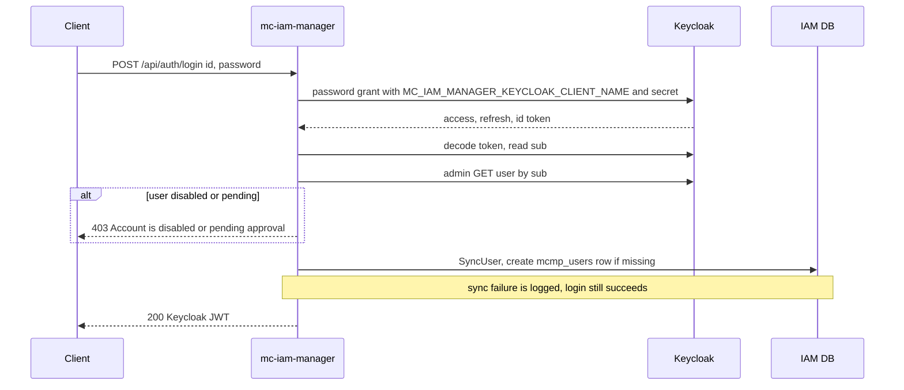
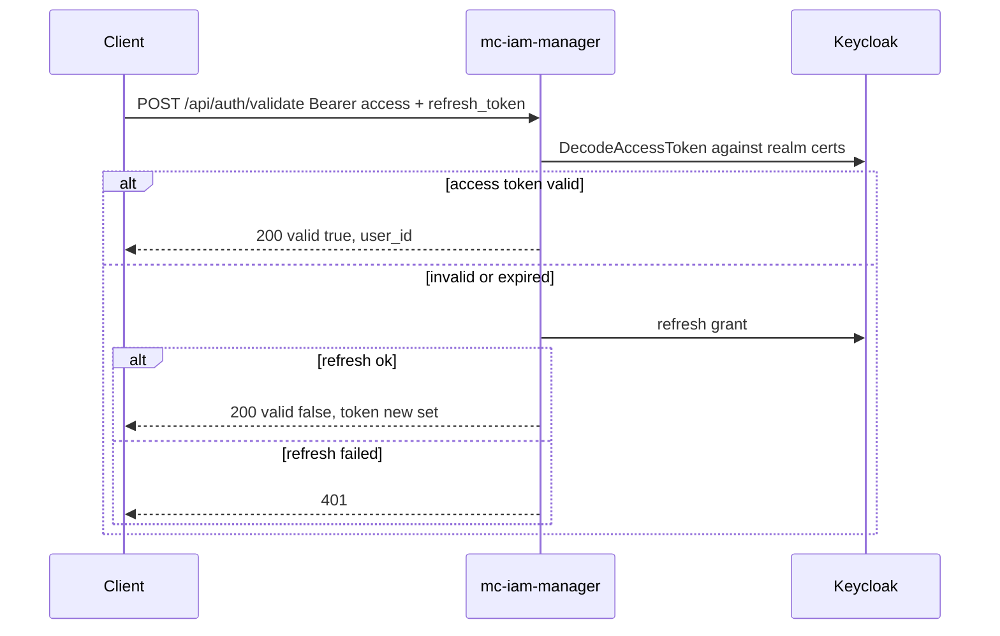
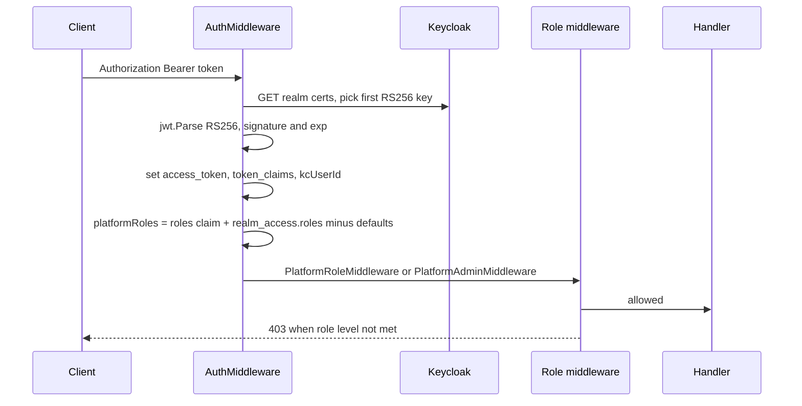
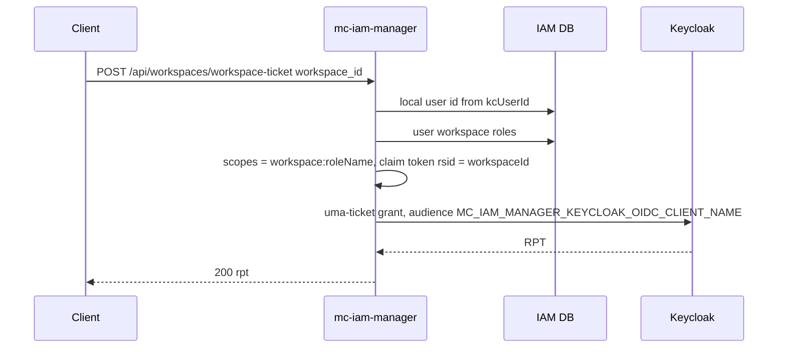

# Authentication and Authorization

Authentication is delegated to Keycloak; mc-iam-manager issues no tokens of its own. Every protected request carries a Keycloak access token that mc-iam-manager validates locally (RS256) and from which it reads the user's **platform roles**. Workspace roles live only in the IAM DB.

Key sources: [src/main.go](https://github.com/m-cmp/mc-iam-manager/blob/main/src/main.go), [src/handler/auth_handler.go](https://github.com/m-cmp/mc-iam-manager/blob/main/src/handler/auth_handler.go), [src/middleware/auth.go](https://github.com/m-cmp/mc-iam-manager/blob/main/src/middleware/auth.go), [src/middleware/permission.go](https://github.com/m-cmp/mc-iam-manager/blob/main/src/middleware/permission.go), [src/util/token.go](https://github.com/m-cmp/mc-iam-manager/blob/main/src/util/token.go).

## Endpoints

| Method | Path | Auth | Purpose |
|---|---|---|---|
| POST | `/api/auth/login` | public | Body `{"id": "...", "password": "..."}`; returns the Keycloak token set |
| POST | `/api/auth/refresh` | public | Body `{"refresh_token": "..."}`; Keycloak refresh grant |
| POST | `/api/auth/logout` | public | Returns 200 only; see caveats |
| POST | `/api/auth/validate` | public (handler validates) | Bearer access token + body `refresh_token`; returns `valid: true` or a refreshed token |
| GET | `/api/auth/certs` | public | Keycloak realm JWKS, for services that validate tokens themselves |
| POST | `/api/auth/signup` | public | Creates a disabled (pending) Keycloak user |
| GET | `/api/auth/temp-credential-csps` | token | Static list of CSP temporary-credential methods |
| POST | `/api/workspaces/workspace-ticket` | token | Requests a Keycloak UMA RPT for one workspace |
| POST | `/api/initial-admin` | **public** | Bootstraps realm, clients, platform admin, seeds (see below) |

The public paths come from `skipAuthPaths` in [src/main.go](https://github.com/m-cmp/mc-iam-manager/blob/main/src/main.go): `/readyz`, `/initial-admin`, `/api/auth/login`, `/api/auth/logout`, `/api/auth/refresh`, `/api/auth/validate`, `/api/auth/certs`, `/api/auth/signup`. Matching is `path == skip || strings.HasSuffix(path, skip)`.

## Login

- Client used: `MC_IAM_MANAGER_KEYCLOAK_CLIENT_NAME` / `MC_IAM_MANAGER_KEYCLOAK_CLIENT_SECRET` ([src/service/keycloak_service.go](https://github.com/m-cmp/mc-iam-manager/blob/main/src/service/keycloak_service.go) `Login`).
- Token lifetime is the realm setting; `MC_IAM_MANAGER_ACCESS_TOKEN_LIFESPAN` (seconds, default 1800, minimum 300) is applied when the realm is created ([src/config/keycloak.go](https://github.com/m-cmp/mc-iam-manager/blob/main/src/config/keycloak.go)).

## Refresh, Validate, Logout

- `POST /api/auth/refresh` calls the Keycloak refresh grant directly.
- `POST /api/auth/logout` does **not** revoke the Keycloak session; it returns `{"message":"Logged out successfully"}` and relies on the client discarding tokens.

## Request Authentication

[`util.ValidateToken`](https://github.com/m-cmp/mc-iam-manager/blob/main/src/util/token.go):

- Requires `alg = RS256` and a `kid` header.
- Fetches the realm certs from Keycloak through [`KeycloakConfig.GetPublicKey`](https://github.com/m-cmp/mc-iam-manager/blob/main/src/config/keycloak.go) and uses the **first RS256 key**; the token `kid` is logged but not used to select the key.
- Checks signature and the standard time claims (golang-jwt defaults). `iss` and `aud` are logged, not enforced.

[`AuthMiddleware`](https://github.com/m-cmp/mc-iam-manager/blob/main/src/middleware/auth.go) then builds `platformRoles` from the top-level `roles` claim and `realm_access.roles`, excluding `offline_access`, `uma_authorization` and `default-roles-<realm>`.

Other services can validate the same tokens against `GET /api/auth/certs`; see [Token Validation for Services](Token-Validation-for-Services).

## Role Model

| Role type | Stored in | Effect |
|---|---|---|
| Platform role | `mcmp_role_masters` + `mcmp_role_subs (platform)` + `mcmp_user_platform_roles`, **mirrored as a Keycloak realm role** | Appears in `realm_access.roles`; drives the route middleware and the user menu tree |
| Workspace role | `mcmp_user_workspace_roles` (and `mcmp_group_workspace_roles` via groups) | DB only; drives workspace membership, project visibility, CSP role mapping |
| CSP role | `mcmp_role_csp_roles` + `mcmp_role_csp_role_mappings` | Maps a workspace role to a CSP IAM role for temporary credentials, see [CSP Integration](CSP-Integration) |

- Assigning a platform role (`POST /api/roles/assign/platform-role`) writes the DB row and assigns the Keycloak realm role, creating it if missing ([src/handler/role_handler.go](https://github.com/m-cmp/mc-iam-manager/blob/main/src/handler/role_handler.go)).
- Group platform roles are added to the Keycloak group, so members receive them in their token ([src/service/group_role_service.go](https://github.com/m-cmp/mc-iam-manager/blob/main/src/service/group_role_service.go)).
- Predefined platform roles come from `MC_IAM_MANAGER_PREDEFINED_PLATFORM_ROLE` (sample: `admin,operator,viewer,billadmin,billviewer` in [.env_sample](https://github.com/m-cmp/mc-iam-manager/blob/main/.env_sample)). Each is created as a Keycloak realm role and as a DB role with both `platform` and `workspace` subs.
- `platformAdmin` is a Keycloak realm role assigned to the initial admin; it is not in the predefined DB role list.

### Route Middleware Levels

The middleware checks **role names hard-coded in Go**, not DB permissions ([src/middleware/permission.go](https://github.com/m-cmp/mc-iam-manager/blob/main/src/middleware/permission.go)):

| Middleware | Allows |
|---|---|
| `PlatformRoleMiddleware(Read)` | Any authenticated user |
| `PlatformRoleMiddleware(Write)` | `admin` or `platformAdmin` |
| `PlatformRoleMiddleware(Manage)` | `platformAdmin` |
| `PlatformAdminMiddleware` | `platformAdmin` |

`AdminMiddleware` ([src/middleware/admin.go](https://github.com/m-cmp/mc-iam-manager/blob/main/src/middleware/admin.go)) and `WorkspaceRoleMiddleware` ([src/middleware/workspace_role_middleware.go](https://github.com/m-cmp/mc-iam-manager/blob/main/src/middleware/workspace_role_middleware.go)) are defined but not attached to any route. Some handlers add their own checks, for example `POST /api/mcmp-apis/call` (see [MCMP API Permissions](MCMP-API-Permissions#calling-a-framework-api)) and temporary credentials (workspace role required).

## Middleware to Route Matrix

Derived from [src/main.go](https://github.com/m-cmp/mc-iam-manager/blob/main/src/main.go). "Token" means only `AuthMiddleware` applies. `Admin` = `PlatformAdminMiddleware`; `R`/`W`/`M` = `PlatformRoleMiddleware(Read/Write/Manage)`.

| Route group | Group-level | Per-route |
|---|---|---|
| `/readyz`, `/api/auth/{login,logout,refresh,validate,certs,signup}`, `/api/initial-admin` | public | — |
| `/api/auth/temp-credential-csps` | Token | — |
| `/api/company` | Token | GET `R`; POST, PUT, DELETE, `/activate` `Admin` |
| `/api/setup/*` | `Admin` | — |
| `/api/workspaces` | Token | `/list`, PUT/DELETE `/id/:workspaceId`, `/users/list`, `/users-roles/list`, `/roles/list`, `/projects/list`, `/id/:workspaceId/projects/list`, `/id/:workspaceId/users/id/:userId`, POST/DELETE `/id/:id/users` `W`; `/assign/projects`, `/unassign/projects` `Admin`; create (POST ``), GET `/id/:workspaceId`, `/name/:workspaceName`, `/workspace-ticket`, `/temporary-credentials`, `/credentials/validate`, `/id/:workspaceId/users/list`, `/id/:wsId/invitations` Token |
| `/api/projects` | Token | `/list`, GET `/id/:projectId`, `/id/:projectId/workspaces` `W`; create, PUT, DELETE `M`; `/assign/workspaces`, `/unassign/workspaces` `Admin`; GET `/name/:projectName` Token |
| `/api/roles` | Token | create, PUT/DELETE `/id/:roleId`, `/id/:roleId/assign`, `/id/:roleId/unassign`, `/assign|unassign/platform-role`, `/assign|unassign/workspace-role`, `/:roleType/:roleId/mciam-permissions/:permissionId`, `/mappings/*-roles/id/:roleId/groups` `W`; POST/DELETE `/csp-roles` `M`; GET `/:roleType/:roleId/mciam-permissions` `R`; **all other `/roles/*` routes (platform-roles, workspace-roles, csp, csp-roles/master, mappings lists) Token** |
| `/api/users` | Token | `/list`, GET `/id/:userId`, `/kc/:kcUserId`, `/name/:username`, `/id/:userId/workspaces/*`, GET `/id/:userId/organizations` `R`; create, PUT, DELETE, `/status`, `/password`, POST/DELETE `/id/:userId/organizations` `W`; `/deactivate`, `/activate`, `/withdraw`, `/id/:userId/groups*`, `/effective-platform-roles`, `/access-summary` `Admin`; `/me*`, `/menus-tree/list`, `/menus/list`, `/workspaces/*` (self) Token |
| `/api/invitations` | Token | all `W` |
| `/api/menus` | Token | create `W`, `/platform-roles/list` `W`; PUT/DELETE `/id/:menuId`, POST/DELETE `/platform-roles` `Admin`; `/list`, `/menus-tree/list`, GET `/id/:menuId` Token |
| `/api/resource-types/cloud-resources` | `Admin` | — |
| `/api/permissions/mciam` | `R` | create, PUT, DELETE `W` |
| `/api/mcmp-apis` | Token | `/list`, `/activate`, create, PUT, `/import`, `/test/...` `M`; `/call` Token + handler check |
| `/api/mcmp-apis/permission-action-mappings` | Token | reads `R`; create, PUT, DELETE `M` |
| `/api/csp-accounts`, `/api/csp-idp-configs`, `/api/csp-policies` | `R` | writes, validate, test, activate/deactivate, sync, attach/detach `Admin` |
| `/api/organizations`, `/api/groups` | `W` | — |
| `/api/csp/iam` | `Admin` | — |
| `/swagger/*` | Token (not in skip list) | — |

## Workspace Ticket (UMA RPT)

`POST /api/workspaces/workspace-ticket` with body `{"workspace_id": "<id>"}` ([src/handler/auth_handler.go](https://github.com/m-cmp/mc-iam-manager/blob/main/src/handler/auth_handler.go) `WorkspaceTicket`):

The RPT is a Keycloak-issued token whose `authorization.permissions` claim is evaluated by Keycloak's authorization services for the OIDC client. `POST /api/mcmp-apis/call` expects an RPT-style token with a permission `rsname = <serviceName>` and scope `<actionName>`.

## Initial Admin

`POST /api/initial-admin` ([src/handler/admin_handler.go](https://github.com/m-cmp/mc-iam-manager/blob/main/src/handler/admin_handler.go) `SetupInitialAdmin`) runs with the Keycloak master admin (`MC_IAM_MANAGER_KEYCLOAK_ADMIN` / `MC_IAM_MANAGER_KEYCLOAK_ADMIN_PASSWORD`):

1. Create realm and client if missing, create the platform admin user (`MC_IAM_MANAGER_PLATFORMADMIN_ID`, `MC_IAM_MANAGER_PLATFORMADMIN_PASSWORD`, names, email), assign realm role `platformAdmin`.
2. Sync the admin into `mcmp_users`.
3. Create predefined realm roles and DB roles from `MC_IAM_MANAGER_PREDEFINED_PLATFORM_ROLE`.
4. Create the default workspace `MC_IAM_MANAGER_DEFAULT_WORKSPACE_NAME` (fallback `ws01`).
5. Seed menus and role-menu mappings (first install only), organizations, and the default company.

Most step failures are logged and ignored; the call still returns 200. The setup scripts call it as step 1 ([conf/mc-iam-manager/1_setup_auto.sh](https://github.com/m-cmp/mc-iam-manager/blob/main/conf/mc-iam-manager/1_setup_auto.sh)); see [Initial Setup](Initial-Setup).

> [!IMPORTANT]
> `/api/initial-admin` is a bootstrap endpoint intended for installation time. Restrict access to it at the reverse proxy once the platform is initialized.

## Known Caveats

- `/swagger/*` is not in the skip list, so the Swagger UI also requires a Bearer token.
- `WorkspaceRoleMiddleware` and the `IssueWorkspaceTicket` service method it calls are placeholders (the latter returns a synthetic ticket and is marked TODO); the `WorkspaceTicket` model is not part of `AutoMigrate`.
- The workspace-ticket handler loads the user's roles across **all** workspaces (`GetUserWorkspaceRoles(userID, 0)`) and formats scopes with Go `%v`, which does not produce a JSON array.
