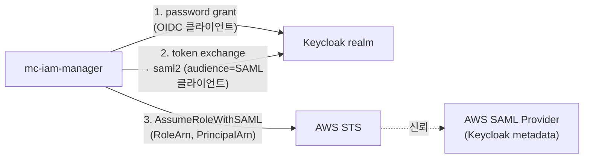

# AWS SAML 임시자격증명 구성 절차

> 기준: mc-iam-manager **develop (0.7.4 예정)** 동작. Keycloak 24.0.1에서 확인했습니다.
> 이 문서는 AWS + **SAML** 방식만 다룹니다. 공통 단계(Keycloak OIDC 클라이언트, AWS OIDC Provider, 관리용 Role, CSP Account, OIDC IdP Config)는 [CSP 임시자격증명 설정·발급 절차](CSP-Temporary-Credential-Guide-ko)를 먼저 끝내야 합니다. 개념·API 목록은 [CSP Integration](CSP-Integration)을 참고하세요.

## 개요

SAML 방식에서 mc-iam-manager는 아래 순서로 자격증명을 발급합니다.

1. Keycloak에 플랫폼 관리자 계정(`MC_IAM_MANAGER_PLATFORMADMIN_ID`·`PASSWORD`)으로 password grant 해서 사용자 토큰을 받습니다.
2. 그 토큰을 RFC 8693 토큰 교환으로 **SAML 2.0 assertion**으로 바꿉니다. 이때 audience는 CSP Role의 `extendedConfig.saml_client_id`입니다.
3. assertion을 `SAMLResponse`로 감싸 AWS STS `AssumeRoleWithSAML`에 전달합니다. `PrincipalArn`은 CSP Role의 **IDP Identifier**(SAML Provider ARN)입니다.



OIDC 방식과 다른 점:

- SAML IdP Config에는 관리용 Role을 두지 않습니다. 대상 Role 생성·조회·신뢰 정책 수정 같은 AWS 작업은 **같은 CSP Account의 활성 AWS OIDC IdP Config**(`config.role_arn` = 관리용 Role)로 합니다. 그래서 OIDC 구성이 먼저 있어야 합니다.
- assertion은 플랫폼 관리자 세션으로 만들기 때문에, STS 세션 이름(`RoleSessionName`)이 **발급을 요청한 사용자가 아니라 플랫폼 관리자 계정 이름**이 됩니다. CloudTrail에서 사용자를 구분하려면 mc-iam-manager 로그를 함께 봐야 합니다.
- AWS 콘솔 로그인(SSO)용이 아니라 서버가 STS를 호출하는 용도입니다.

| 단계 | 수행 위치 | 작업 | 빈도 |
|---|---|---|---|
| 1 | **Keycloak Admin Console** | SAML 클라이언트(`urn:amazon:webservices`) 생성, 토큰 교환 권한 | 대상 Role마다 1회 (아래 1-2 참고) |
| 2 | **Provider(AWS) 콘솔** | SAML Provider 등록 (Keycloak metadata) | 환경마다 1회 |
| 3 | **브라우저 개발자 도구** | SAML IdP Config 등록 | 환경마다 1회 |
| 4 | **브라우저 개발자 도구** | 대상 CSP Role 생성 (AWS Role·SAML 신뢰 정책 자동 생성), 권한 정책 연결 | 역할마다 |
| 5 | **mc-web-console**, **브라우저 개발자 도구** | 역할 ↔ CSP Role 매핑(`authMethod` SAML), 사용자 할당 | 필요할 때 |
| 6 | **브라우저 개발자 도구**, **CloudShell** | 발급·검증 | 필요할 때 |
| 7 | **브라우저 개발자 도구** | 신뢰 정책 점검·재동기화 | 문제가 있을 때 |

### mc-web-console 화면 지원 현황과 대안

| 단계 | 작업 | mc-web-console 화면 | mc-iam-manager API 대안 |
|---|---|---|---|
| 1 | Keycloak SAML 클라이언트·권한 | ❌ 화면 없음 | ❌ 없음 → Keycloak Admin Console |
| 2 | AWS SAML Provider 등록 | ❌ 화면 없음 | ❌ 없음 → AWS 콘솔 |
| 3 | SAML IdP Config 등록 | ❌ 화면 없음 | ✅ `POST /api/csp-idp-configs` |
| 4-1 | 대상 CSP Role 생성 (SAML) | ❌ 화면 없음 (`cspIdpConfigId`·`extendedConfig` 입력란 없음) | ✅ `POST /api/roles/csp` |
| 4-2 | 권한 정책 연결 | ⚠️ OIDC와 같음 ([기본 절차 5-2](CSP-Temporary-Credential-Guide-ko)) | ✅ `POST /api/csp-policies/attach` |
| 5-1 | 역할 ↔ CSP Role 매핑 (SAML) | ⚠️ Roles 화면 CSP Role Mapping에서 Auth Method SAML 선택 가능. 단 4-1에서 만든 Role 이름을 고를 것 | ✅ `POST /api/roles/csp-roles` |
| 5-2 | 사용자 워크스페이스 역할 할당 | ✅ Workspaces → 멤버 추가 | `POST /api/roles/assign/workspace-role` |
| 6 | 발급·단계별 진단 | ❌ 화면 없음 | ✅ `POST /api/workspaces/temporary-credentials`, `POST /api/workspaces/credentials/validate` |
| 7 | 신뢰 정책 점검·재동기화, readiness | ❌ 화면 없음 | ✅ `POST /api/roles/csp/check`, `POST /api/csp-target-roles/id/{id}/trust-policy/sync`, `POST /api/csp-idp-configs/id/{id}/trust-policy/{check,sync}`, `GET /api/csp-accounts/id/{id}/readiness` |

API 호출은 [개발자 도구에서 API 호출하기](CSP-Temporary-Credential-Guide-ko#개발자-도구에서-api-호출하기)의 `api()` 도우미를 씁니다. 플랫폼 관리자 토큰이 필요합니다.

### 표기

[기본 표기](CSP-Temporary-Credential-Guide-ko#표기)에 아래를 더합니다. 실제 계정 정보는 문서·티켓·채팅에 남기지 마세요.

| 표기 | 의미 | 예 (가상) |
|---|---|---|
| `<KC>` | Keycloak 외부 URL | `https://<KC_DOMAIN>/auth` |
| `<SAML_CLIENT>` | Keycloak SAML 클라이언트 ID | `urn:amazon:webservices` |
| `<SAML_PROVIDER>` | AWS SAML Provider 이름 | `mciam-keycloak-saml` |
| `<SAML_PROVIDER_ARN>` | SAML Provider ARN | `arn:aws:iam::<ACCOUNT_ID>:saml-provider/<SAML_PROVIDER>` |
| `<TARGET_ROLE>` | 대상(사용자용) Role 이름. `mciam-`로 시작 | `mciam-ec2ro-saml` |
| `<TARGET_ROLE_ARN>` | 대상 Role ARN | `arn:aws:iam::<ACCOUNT_ID>:role/<TARGET_ROLE>` |
| `<SAML_IDP_CONFIG_ID>` | 3단계에서 만든 SAML IdP Config id | `8` |

---

## 0. 사전 조건

| 항목 | 확인 |
|---|---|
| OIDC 구성 | [기본 절차](CSP-Temporary-Credential-Guide-ko) 1~4단계 완료. 같은 CSP Account에 **활성 AWS OIDC IdP Config**(`config.role_arn` = 관리용 Role)가 있어야 합니다. |
| 관리용 Role 권한 | inline 정책에 `iam:GetSAMLProvider`(`saml-provider/*`)와 `iam:CreateRole`·`iam:GetRole`·`iam:UpdateAssumeRolePolicy`(`role/mciam-*`). [기본 절차 3-2](CSP-Temporary-Credential-Guide-ko#3-2-없으면-관리용-role-생성)의 정책에 이미 들어 있습니다. |
| Keycloak 기능 | 기동 옵션 `KC_FEATURES=token-exchange,admin-fine-grained-authz` (mc-admin-cli 기본 compose에 포함) |
| OIDC 클라이언트 | `<OIDC_CLIENT>`의 **Direct access grants ON** (SAML 교환 1단계 password grant에 필요) |
| 플랫폼 관리자 env | 서버의 `MC_IAM_MANAGER_PLATFORMADMIN_ID`·`MC_IAM_MANAGER_PLATFORMADMIN_PASSWORD`가 실제 Keycloak 계정과 맞아야 합니다. 설치 때 넣은 값입니다. |

SAML 경로에 따로 필요한 서버 환경변수는 없습니다. `SAML_CLIENT_ID_AWS`는 설정 누락 오류 메시지의 예시 값으로만 쓰이고, 실제 값은 CSP Role의 `extendedConfig.saml_client_id`입니다.

Keycloak 기능 확인 (CLI):

<details>
<summary>CLI로 할 때</summary>

```bash
KC=https://<KC_DOMAIN>/auth
KCA=$(curl -s -X POST "$KC/realms/master/protocol/openid-connect/token" \
  -d grant_type=password -d client_id=admin-cli \
  -d username="<KEYCLOAK_ADMIN>" --data-urlencode password="<KEYCLOAK_ADMIN_PASSWORD>" | jq -r .access_token)
curl -s "$KC/admin/serverinfo" -H "Authorization: Bearer $KCA" \
  | jq -c '[.features[] | select(.name|test("TOKEN_EXCHANGE|ADMIN_FINE")) | {name,enabled}]'
# [{"name":"ADMIN_FINE_GRAINED_AUTHZ","enabled":true},{"name":"TOKEN_EXCHANGE","enabled":true}]
```

</details>

---

## 1. Keycloak SAML 클라이언트 (❌ 화면 없음, API 대안 없음)

> **수행 위치: Keycloak Admin Console** (`<KC>/admin/`) → realm `<REALM>`

### 1-1. 클라이언트 생성

AWS는 assertion의 Audience가 `urn:amazon:webservices`여야 받습니다. 그래서 클라이언트 ID를 `urn:amazon:webservices`로 만들고, 같은 값을 4단계 CSP Role의 `extendedConfig.saml_client_id`에 넣습니다.

**Clients → Create client**

| 화면 | 항목 | 값 |
|---|---|---|
| General settings | Client type | **SAML** |
| | Client ID | `urn:amazon:webservices` |
| Login settings | Root URL | (비움) |
| | Home URL | `https://signin.aws.amazon.com/saml` |
| | Valid redirect URIs | `https://signin.aws.amazon.com/saml` |
| | IDP-Initiated SSO URL name | `amazon-aws` |
| | Master SAML Processing URL (Admin URL) | `https://signin.aws.amazon.com/saml` |

저장 후 클라이언트 설정:

| 탭 | 항목 | 값 | 이유 |
|---|---|---|---|
| Settings → SAML capabilities | Name ID format | `persistent`, **Force name ID format ON** | AWS 요구 |
| | Include AuthnStatement | ON | |
| Settings → Signature and Encryption | Sign documents / Sign assertions | ON / ON, 알고리즘 `RSA_SHA256` | |
| Keys | Client signature required | **OFF** | 서버 간 토큰 교환이라 클라이언트 서명이 없음 |
| Client scopes → Setup | Full scope allowed | OFF | |

> **Admin URL(Master SAML Processing URL)을 반드시 넣으세요.** 서버 쪽 토큰 교환에서는 이 값으로 assertion의 `Recipient`를 채웁니다. 비우면 교환이 `Client requires assertion consumer url set up`으로 실패합니다.

### 1-2. Mapper 3개

**Client scopes → `urn:amazon:webservices-dedicated` → Add mapper → By configuration**

| Mapper type | Name | 설정 |
|---|---|---|
| Hardcoded attribute | `aws-role` | Attribute name `https://aws.amazon.com/SAML/Attributes/Role`, Name format `URI Reference`, Value `<TARGET_ROLE_ARN>,<SAML_PROVIDER_ARN>` |
| User Property | `aws-role-session-name` | Property `username`, Attribute name `https://aws.amazon.com/SAML/Attributes/RoleSessionName`, Name format `URI Reference` |
| Hardcoded attribute | `aws-session-duration` | Attribute name `https://aws.amazon.com/SAML/Attributes/SessionDuration`, Name format `URI Reference`, Value `3600` |

- `Role` 값은 **Role ARN, Provider ARN** 순서로 쉼표로 잇고 공백을 넣지 않습니다. AWS는 `AssumeRoleWithSAML`의 RoleArn·PrincipalArn 쌍이 이 속성 값 중에 있어야 받아들입니다.
- 이 문서에서 확인한 구성은 **SAML 클라이언트 하나 = 대상 Role 하나**입니다(Hardcoded attribute). Keycloak 24의 Role list mapper는 속성 이름 설정을 무시해 이 용도로 쓸 수 없습니다.
- `RoleSessionName`은 assertion을 만든 Keycloak 사용자 이름이고, mc-iam-manager에서는 항상 플랫폼 관리자 계정입니다([개요](#개요) 참고).

### 1-3. 토큰 교환 권한 (`<OIDC_CLIENT>` → SAML 클라이언트)

mc-iam-manager는 `<OIDC_CLIENT>`로 토큰 교환을 요청합니다. SAML 클라이언트가 이 클라이언트의 교환 요청을 허용해야 합니다.

1. Clients → `urn:amazon:webservices` → **Permissions** 탭 → **Permissions enabled ON**
   - realm에서 처음 켜면 Keycloak이 `realm-management` 클라이언트에 Authorization 설정을 자동으로 만듭니다. 다른 클라이언트 동작에는 영향이 없고, SAML 클라이언트를 지워도 이 설정은 남습니다.
2. 같은 탭의 `token-exchange` permission 클릭 → **Policies**에 `<OIDC_CLIENT>`만 허용하는 **Client** policy를 만들어 연결 → Save
   - policy는 Clients → `realm-management` → Authorization → Policies 에서 Create client policy 로도 만들 수 있습니다(예: 이름 `aws-saml-exchange`, Clients `<OIDC_CLIENT>`).
   - permission을 다시 저장할 때 이름을 바꾸면 연결이 깨집니다.

<details>
<summary>CLI로 할 때 (1-1 ~ 1-3)</summary>

```bash
# KC, KCA 는 0단계 CLI 참고. REALM, ACCOUNT_ID, TARGET_ROLE, SAML_PROVIDER 를 설정합니다.
curl -s -X POST "$KC/admin/realms/$REALM/clients" -H "Authorization: Bearer $KCA" -H 'Content-Type: application/json' -d '{
 "clientId":"urn:amazon:webservices","protocol":"saml","enabled":true,
 "redirectUris":["https://signin.aws.amazon.com/saml"],
 "adminUrl":"https://signin.aws.amazon.com/saml","baseUrl":"https://signin.aws.amazon.com/saml",
 "fullScopeAllowed":false,
 "attributes":{"saml.assertion.signature":"true","saml.server.signature":"true","saml.client.signature":"false",
  "saml.authnstatement":"true","saml_name_id_format":"persistent","saml_force_name_id_format":"true",
  "saml.signature.algorithm":"RSA_SHA256","saml_idp_initiated_sso_url_name":"amazon-aws"},
 "protocolMappers":[
  {"name":"aws-role","protocol":"saml","protocolMapper":"saml-hardcode-attribute-mapper","config":{
    "attribute.name":"https://aws.amazon.com/SAML/Attributes/Role","attribute.nameformat":"URI Reference",
    "attribute.value":"arn:aws:iam::'$ACCOUNT_ID':role/'$TARGET_ROLE',arn:aws:iam::'$ACCOUNT_ID':saml-provider/'$SAML_PROVIDER'"}},
  {"name":"aws-role-session-name","protocol":"saml","protocolMapper":"saml-user-property-mapper","config":{
    "user.attribute":"username","attribute.name":"https://aws.amazon.com/SAML/Attributes/RoleSessionName","attribute.nameformat":"URI Reference"}},
  {"name":"aws-session-duration","protocol":"saml","protocolMapper":"saml-hardcode-attribute-mapper","config":{
    "attribute.name":"https://aws.amazon.com/SAML/Attributes/SessionDuration","attribute.nameformat":"URI Reference","attribute.value":"3600"}}
 ]}'

SC=$(curl -s "$KC/admin/realms/$REALM/clients?clientId=urn:amazon:webservices" -H "Authorization: Bearer $KCA" | jq -r '.[0].id')
RM=$(curl -s "$KC/admin/realms/$REALM/clients?clientId=realm-management" -H "Authorization: Bearer $KCA" | jq -r '.[0].id')
OC=$(curl -s "$KC/admin/realms/$REALM/clients?clientId=<OIDC_CLIENT>" -H "Authorization: Bearer $KCA" | jq -r '.[0].id')

# 권한 활성화 → token-exchange permission id
PERM=$(curl -s -X PUT "$KC/admin/realms/$REALM/clients/$SC/management/permissions" -H "Authorization: Bearer $KCA" \
  -H 'Content-Type: application/json' -d '{"enabled":true}' | jq -r '.scopePermissions["token-exchange"]')
# <OIDC_CLIENT> 만 허용하는 client policy
POL=$(curl -s -X POST "$KC/admin/realms/$REALM/clients/$RM/authz/resource-server/policy/client" -H "Authorization: Bearer $KCA" \
  -H 'Content-Type: application/json' -d '{"name":"aws-saml-exchange","logic":"POSITIVE","clients":["'$OC'"]}' | jq -r .id)
# permission 에 policy 연결 (기존 내용 유지)
CUR=$(curl -s "$KC/admin/realms/$REALM/clients/$RM/authz/resource-server/permission/scope/$PERM" -H "Authorization: Bearer $KCA")
curl -s -X PUT "$KC/admin/realms/$REALM/clients/$RM/authz/resource-server/permission/scope/$PERM" -H "Authorization: Bearer $KCA" \
  -H 'Content-Type: application/json' -d "$(echo "$CUR" | jq -c --arg p "$POL" '. + {policies:[$p]}')"
```

</details>

### 1-4. assertion 발급 확인 (선택)

mc-iam-manager가 하는 것과 같은 두 단계를 직접 호출해 봅니다(CLI).

<details>
<summary>CLI로 할 때</summary>

```bash
UT=$(curl -s -X POST "$KC/realms/$REALM/protocol/openid-connect/token" -d grant_type=password -d client_id=<OIDC_CLIENT> \
  --data-urlencode client_secret="<OIDC_CLIENT_SECRET>" -d username="<PLATFORMADMIN_ID>" --data-urlencode password="<PLATFORMADMIN_PASSWORD>" | jq -r .access_token)
curl -s -X POST "$KC/realms/$REALM/protocol/openid-connect/token" \
  -d grant_type=urn:ietf:params:oauth:grant-type:token-exchange -d client_id=<OIDC_CLIENT> --data-urlencode client_secret="<OIDC_CLIENT_SECRET>" \
  -d subject_token="$UT" -d subject_token_type=urn:ietf:params:oauth:token-type:access_token \
  -d requested_token_type=urn:ietf:params:oauth:token-type:saml2 -d audience=urn:amazon:webservices \
  | jq -r .access_token | tr '_-' '/+' | base64 -d 2>/dev/null | grep -o 'Recipient="[^"]*"\|<saml:Audience>[^<]*\|<saml:Issuer>[^<]*'
# <saml:Issuer>https://<KC_DOMAIN>/auth/realms/<REALM>
# Recipient="https://signin.aws.amazon.com/saml"
# <saml:Audience>urn:amazon:webservices
```

`403 access_denied`면 1-3 권한, `Client requires assertion consumer url set up`이면 1-1의 Admin URL을 확인합니다.

</details>

---

## 2. AWS SAML Provider 등록 (환경마다 1회, ❌ 화면 없음, API 대안 없음)

> **수행 위치: Provider(AWS) 콘솔** → **IAM** → **Identity providers**

1. 브라우저로 `<ISSUER>/protocol/saml/descriptor`를 열어 XML로 저장합니다.
   - 파일의 `entityID`가 `https://<KC_DOMAIN>/auth/realms/<REALM>`(assertion Issuer)과 같아야 합니다.
2. **Add provider** → Provider type **SAML** → Provider name `<SAML_PROVIDER>` → Metadata document에 1번 파일 업로드 → **Add provider**
3. 상세 화면의 ARN이 `<SAML_PROVIDER_ARN>`입니다.

- Keycloak realm 서명 키를 바꾸면 metadata를 다시 올려야 합니다(Provider 상세 → Replace metadata).
- 1-2 mapper의 `Role` 값에 이 ARN이 들어가야 합니다.

<details>
<summary>CLI로 할 때</summary>

```bash
curl -s "$KC/realms/$REALM/protocol/saml/descriptor" > kc-descriptor.xml
grep -o 'entityID="[^"]*"' kc-descriptor.xml
aws iam create-saml-provider --name "<SAML_PROVIDER>" --saml-metadata-document file://kc-descriptor.xml
# 서명 키를 바꾼 뒤: aws iam update-saml-provider --saml-provider-arn <SAML_PROVIDER_ARN> --saml-metadata-document file://kc-descriptor.xml
```

</details>

---

## 3. mc-iam-manager: SAML IdP Config 등록 (❌ 화면 없음 → API로)

> **수행 위치: 브라우저 개발자 도구**

```js
await api('POST', '/api/csp-idp-configs', {
  name: 'aws-saml',
  csp_account_id: <CSP_ACCOUNT_ID>,          // 숫자. OIDC IdP Config 와 같은 계정
  auth_method: 'SAML',
  config: {
    saml_provider_arn: '<SAML_PROVIDER_ARN>',
    metadata_url: '<ISSUER>/protocol/saml/descriptor'   // 참고용
  },
  description: 'Keycloak SAML trust for AWS'
});
```

| `config` 키 | 필수 | 용도 |
|---|---|---|
| `saml_provider_arn` | 예 | 대상 Role 생성 시 신뢰 정책 `Federated`, 신뢰 정책 검증·재동기화 기대값, 발급 사전 확인 |
| `metadata_url` | 아니오 | 참고용. 코드에서 읽지 않습니다. |
| `role_arn` | 넣지 않음 | 관리용 자격증명은 같은 계정의 활성 OIDC IdP Config를 씁니다. |

응답의 `id`가 `<SAML_IDP_CONFIG_ID>`입니다. 연결 테스트(`/test`)는 SAML을 지원하지 않습니다. 대신 6-2 진단 API를 씁니다.

---

## 4. 대상 CSP Role (역할마다)

### 4-1. 생성 (❌ 화면 없음 → API로, AWS Role 자동 생성)

```js
await api('POST', '/api/roles/csp', {
  cspRoleName: '<TARGET_ROLE>',
  cspType: 'aws',
  authMethod: 'SAML',
  cspIdpConfigId: <SAML_IDP_CONFIG_ID>,
  extendedConfig: { saml_client_id: 'urn:amazon:webservices' }
});
```

mc-iam-manager가 관리용 Role로 AWS에 Role을 만들고, 신뢰 정책을 SAML IdP Config 값으로 넣습니다.

```json
{
  "Effect": "Allow",
  "Principal": { "Federated": "<SAML_PROVIDER_ARN>" },
  "Action": "sts:AssumeRoleWithSAML",
  "Condition": { "StringEquals": { "SAML:aud": "https://signin.aws.amazon.com/saml" } }
}
```

- 저장되는 값: IDP Identifier = `<SAML_PROVIDER_ARN>`, IAM Identifier = `<TARGET_ROLE_ARN>`, origin = `created`.
- `extendedConfig.saml_client_id`가 없으면 발급 시 `[설정 누락: DB] ... saml_client_id 미등록`으로 실패합니다. 나중에 넣을 때는 `PUT /api/roles/csp/id/<CSP_ROLE_ID>`.
- **AWS에서 직접 만든 Role을 등록**한 경우(origin `registered`)에는 신뢰 정책을 위 문장과 맞춰야 합니다. AWS 콘솔에서 고치거나, 7-2 재동기화를 `allowRegistered: true`로 실행합니다.

### 4-2. 권한 정책

권한 정책 연결은 OIDC Role과 같습니다([기본 절차 5-2](CSP-Temporary-Credential-Guide-ko)). 발급 주체 확인(`get-caller-identity`)만 할 거면 정책이 없어도 됩니다.

---

## 5. 역할 매핑과 사용자 할당

### 5-1. 역할 ↔ CSP Role 매핑 (⚠️ 화면 또는 API)

mc-web-console Roles 화면의 CSP Role Mapping에서 Auth Method를 SAML로 고르고 4-1의 `<TARGET_ROLE>`을 넣어도 됩니다. 화면은 `extendedConfig.saml_client_id`를 보내지 않으므로, 아직 없는 Role 이름을 넣어 화면에서 새로 만들게 하지 말고 4-1에서 만든 Role을 고르세요. API로는:

```js
await api('POST', '/api/roles/list', {});        // 역할 id 확인
await api('POST', '/api/roles/csp-roles', { roleId: '<ROLE_ID>', cspType: 'aws', cspRoleId: '<CSP_ROLE_ID>', authMethod: 'SAML' });
await api('GET', '/api/roles/csp-roles/id/<ROLE_ID>');   // 매핑 확인
```

- 한 역할에 같은 CSP의 OIDC Role과 SAML Role을 함께 매핑할 수 있습니다. 발급 요청의 `authMethod`로 고릅니다.
- 같은 역할 + CSP + 인증방식 조합에는 하나만 매핑합니다.

### 5-2. 사용자 할당

OIDC와 같습니다([기본 절차 6-2](CSP-Temporary-Credential-Guide-ko)).

---

## 6. 발급과 검증

### 6-1. 발급 (❌ 화면 없음 → API로)

발급받을 사용자 토큰으로:

```js
var cred = await api('POST', '/api/workspaces/temporary-credentials',
  { workspaceId: '<WORKSPACE_ID>', cspType: 'aws', authMethod: 'SAML', region: 'ap-northeast-2' });
```

발급 전에 mc-iam-manager가 세 가지를 확인합니다(서버 로그 `[CSP_CREDENTIAL] Check 1~3`).

| 확인 | 내용 | 실패하면 |
|---|---|---|
| Check 1 | CSP Role에 `extendedConfig.saml_client_id`가 있는가 | 발급 중단, `saml_client_id 미등록` |
| Check 2 | Keycloak에 그 SAML 클라이언트가 있는가 | 발급 중단 |
| Check 3 | 발급에 쓸 SAML Provider가 AWS에 있는가 (관리용 자격증명으로 `GetSAMLProvider`) | **CSP Role의 IDP Identifier(실제 발급에 쓰는 ARN)가 AWS에 없으면 400 `invalid_request`로 중단**, STS는 호출하지 않습니다. IdP Config의 `saml_provider_arn`만 틀리거나 권한 부족(AccessDenied) 등으로 확인하지 못한 경우는 경고만 남기고 발급을 계속합니다. |

CloudShell에서 확인([기본 절차 7-2](CSP-Temporary-Credential-Guide-ko)와 같은 방법):

```bash
aws sts get-caller-identity --query Arn --output text
# arn:aws:sts::<ACCOUNT_ID>:assumed-role/<TARGET_ROLE>/<플랫폼 관리자 계정 이름>
```

### 6-2. 단계별 진단 (❌ 화면 없음 → API로)

```js
await api('POST', '/api/workspaces/credentials/validate', { workspaceId: '<WORKSPACE_ID>', cspType: 'aws', authMethod: 'SAML' });
```

정상이면 `valid: true`이고 7단계가 모두 `ok`입니다. 실패한 단계에는 조치 안내가 붙습니다.

| 단계 | 이름 | 보는 것 |
|---|---|---|
| 1 | DB 매핑 조회 | 사용자 → 워크스페이스 역할 → SAML CSP Role 매핑 |
| 2 | CspRole 설정 확인 | IAM Identifier, IDP Identifier, `saml_client_id` |
| 3 | Keycloak SAML 클라이언트 확인 | 클라이언트·mapper |
| 4 | SAML Assertion 발급 및 검증 | 토큰 교환 결과 |
| 5 | AWS SAML Provider 확인 | 관리용 자격증명으로 Provider 조회 |
| 6 | IAM Role SAML Trust 확인 | 신뢰 정책이 SAML IdP Config 기대값과 맞는지 |
| 7 | 임시자격증명 발급 | 실제 `AssumeRoleWithSAML` |

---

## 7. 신뢰 정책 점검·재동기화

대상 Role의 신뢰 정책이 IdP Config와 어긋났을 때(누가 AWS 콘솔에서 고쳤거나, Provider를 다시 만들었거나) 찾아서 바로잡는 방법입니다.

판정 값: `ok`(맞음), `missing`(이 Provider를 신뢰하는 문장 없음), `mismatch`(문장은 있으나 Action·`SAML:aud`가 다름), `not_found`(AWS에 Role 없음), `error`(조회 실패). IAM이 쓰지 않은 다른 문장은 `extra`로 알려 주기만 하고 판정에 영향을 주지 않습니다.

### 7-1. 점검 (읽기만)

```js
// Role 하나 (authMethod 를 꼭 넣습니다. 생략하면 OIDC 로 보고 SAML Config 와 맞지 않는다고 판정합니다)
await api('POST', '/api/roles/csp/check', { cspRoles: [
  { cspType: 'aws', authMethod: 'SAML', cspRoleName: '<TARGET_ROLE>', cspIdpConfigId: <SAML_IDP_CONFIG_ID> } ] });

// SAML IdP Config 에 소속된 Role 전체
await api('POST', '/api/csp-idp-configs/id/<SAML_IDP_CONFIG_ID>/trust-policy/check');

// 계정 단위 준비 상태 (cspRoles[].trustPolicy 에 Role 별 판정과 nextAction)
await api('GET', '/api/csp-accounts/id/<CSP_ACCOUNT_ID>/readiness?checkIssue=true');
```

- readiness의 실제 발급 검사(`checkIssue=true`)는 AWS OIDC Role만 대상입니다. SAML Role은 발급 검사가 `not_applicable`이지만 `trustPolicy` 판정은 나옵니다.
- AWS를 실제로 조회하는 판정은 플랫폼 관리자일 때만 합니다. 그 외에는 `skipped`입니다.

### 7-2. 재동기화 (플랫폼 관리자)

```js
// 변경안만 보기 (기본 dryRun: true, AWS 쓰기 없음)
await api('POST', '/api/csp-target-roles/id/<CSP_ROLE_ID>/trust-policy/sync', {});
// 반영
await api('POST', '/api/csp-target-roles/id/<CSP_ROLE_ID>/trust-policy/sync', { dryRun: false });
// AWS 에서 직접 만들어 등록한 Role(origin registered)
await api('POST', '/api/csp-target-roles/id/<CSP_ROLE_ID>/trust-policy/sync', { dryRun: false, allowRegistered: true });

// SAML IdP Config 소속 Role 일괄 (항목별 결과, 하나가 실패해도 계속)
await api('POST', '/api/csp-idp-configs/id/<SAML_IDP_CONFIG_ID>/trust-policy/sync', { dryRun: false });
```

- IAM이 관리하는 문장만 고칩니다. 같은 Role의 다른 문장(예: OIDC 문장, 다른 서비스용 문장)은 그대로 둡니다.
- 응답 `changes[].change`: `statement_added`(문장 추가), `action_added`, `aud_set`(`SAML:aud` 설정), `aud_removed`.
- 일괄 결과 `items[].status`: `unchanged`, `would_change`(dryRun), `applied`, `registered_role`(`allowRegistered` 필요), `protected`(관리용 Role, 변경 안 함), `not_found`, `invalid_request`, `error`.
- 관리용 Role은 바꾸지 않습니다(단건은 409).
- `PUT /api/csp/iam/roles/{roleName}` 등 `/api/csp/iam/roles` 쓰기 API는 신뢰 정책을 통째로 덮어쓰던 문제로 막혀 있습니다(400). 신뢰 정책은 이 재동기화 API로 고칩니다.

---

## 8. 자주 나는 오류

| 증상 | 원인 | 조치 |
|---|---|---|
| 발급 400 `invalid_request` "SAML provider ... does not exist in AWS" | 발급에 쓸 Provider(CSP Role IDP Identifier)가 AWS에 없음 | 2단계 Provider ARN과 IdP Config `saml_provider_arn`, CSP Role IDP Identifier를 맞추거나 Provider를 등록 |
| 서버 로그 Check 3 WARN 후 발급 성공 | 관리용 Role에 `iam:GetSAMLProvider` 권한이 없거나, IdP Config `saml_provider_arn`만 틀림 | 권한 추가, IdP Config 수정. 발급은 Role의 IDP Identifier로 하므로 막지 않음 |
| `[설정 누락: DB] ... saml_client_id 미등록` | CSP Role `extendedConfig.saml_client_id` 없음 | `PUT /api/roles/csp/id/<id>`로 `urn:amazon:webservices` 입력 |
| `Keycloak SAML exchange returned HTTP 403` (`access_denied`) | 토큰 교환 권한에 `<OIDC_CLIENT>` policy가 없음 | 1-3 |
| `Client requires assertion consumer url set up` | SAML 클라이언트 Admin URL 없음 | 1-1 |
| `failed to get user token for SAML exchange` | `<OIDC_CLIENT>` Direct access grants OFF, 또는 플랫폼 관리자 env가 실제 계정과 다름 | 0단계 |
| STS `InvalidIdentityToken` / `AccessDenied` (`AssumeRoleWithSAML`) | ① Provider metadata와 realm 서명 키 불일치 ② mapper `Role` 값에 RoleArn,PrincipalArn 쌍이 없음 ③ 신뢰 정책 `SAML:aud` 틀림 | ① metadata 재업로드 ② 1-2 ③ 7-1 점검 후 7-2 재동기화 |
| check·readiness `mismatch` "no SAML:aud condition" | 신뢰 정책에서 `SAML:aud` 조건이 빠짐 | 7-2 재동기화 (`aud_set`) |
| check가 SAML Role을 invalid로 판정 | check 요청에 `authMethod: 'SAML'`을 넣지 않음 | 7-1 |
| `403 No suitable CSP role mapping found` | 역할에 SAML 매핑이 없거나 발급 요청 `authMethod`가 다름 | 5-1 |

---

## 9. 정리

만든 순서의 역순으로 지웁니다.

```js
await api('DELETE', '/api/roles/unassign/workspace-role', { username: '<USER>', roleId: '<ROLE_ID>', workspaceId: '<WORKSPACE_ID>' });
await api('DELETE', '/api/roles/csp-roles', { roleId: '<ROLE_ID>', cspType: 'aws', cspRoleId: '<CSP_ROLE_ID>', authMethod: 'SAML' });
await api('DELETE', '/api/roles/csp/id/<CSP_ROLE_ID>');       // origin created 면 AWS Role 도 삭제
await api('DELETE', '/api/csp-idp-configs/id/<SAML_IDP_CONFIG_ID>');
```

- CSP Role에 권한 정책이 붙어 있으면 mc-iam-manager가 먼저 해제한 뒤 Role을 지웁니다. AWS에서 직접 붙인 정책이 남아 있으면 AWS가 `DeleteConflict`로 거부하니 AWS 콘솔에서 먼저 떼어 냅니다.
- AWS: IAM → Identity providers → `<SAML_PROVIDER>` → Delete (다른 IdP Config가 쓰지 않는지 먼저 확인)
- Keycloak: Clients → `urn:amazon:webservices` → Delete. 클라이언트의 permission도 함께 지워지지만, 직접 만든 client policy(`realm-management` → Authorization → Policies)는 따로 지웁니다.

## 관련 문서

- [CSP 임시자격증명 설정·발급 절차](CSP-Temporary-Credential-Guide-ko): 공통 단계, AWS + OIDC
- [CSP Integration](CSP-Integration): 엔티티, 지원 매트릭스, API 목록 (영문)
- [Troubleshooting](Troubleshooting) ([KO](Troubleshooting-ko))
