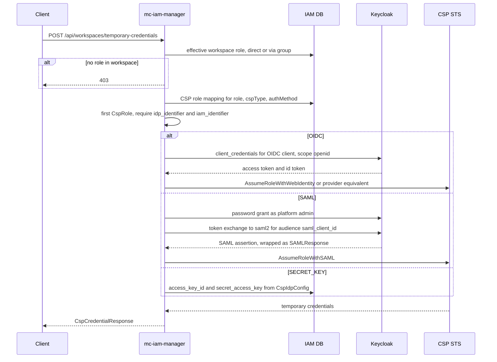

# CSP Integration

mc-iam-manager issues short-lived CSP credentials to users based on their **workspace role**. The chain is:

```
user ──(workspace role)──▶ RoleMaster ──(RoleMasterCspRoleMapping, auth method)──▶ CspRole ──▶ CspIdpConfig ──▶ CspAccount
```

Keycloak is the identity provider trusted by each CSP (OIDC or SAML). For `SECRET_KEY` the stored static keys are returned instead.

Key sources: [src/service/csp_credential_service.go](https://github.com/m-cmp/mc-iam-manager/blob/main/src/service/csp_credential_service.go), the per-CSP `*_credential_service.go` files in [src/service](https://github.com/m-cmp/mc-iam-manager/tree/main/src/service), [src/service/csp_role_service.go](https://github.com/m-cmp/mc-iam-manager/blob/main/src/service/csp_role_service.go), [src/constants/constants.go](https://github.com/m-cmp/mc-iam-manager/blob/main/src/constants/constants.go).

## Entities

| Entity (table) | Purpose | Key fields |
|---|---|---|
| `CspAccount` (`mcmp_csp_accounts`) | A cloud account | `csp_type` (`aws`, `gcp`, `azure`, `alibaba`, `tencent`, `ibm`, `ncp`, `nhn`, `kt`, `openstack`), `account_info` JSON |
| `CspIdpConfig` (`mcmp_csp_idp_configs`) | Trust / auth configuration for an account | `auth_method` (`OIDC`, `SAML`, `SECRET_KEY`), `config` JSON, `is_active` |
| `CspRole` (`mcmp_role_csp_roles`) | A CSP IAM role usable for federation | `name`, `csp_type`, `idp_identifier` (provider ARN / WIF audience), `iam_identifier` (role ARN / service account), `csp_idp_config_id`, `extended_config` JSON |
| `RoleMasterCspRoleMapping` (`mcmp_role_csp_role_mappings`) | Workspace role → CSP role | PK (`role_id`, `auth_method`, `csp_role_id`) |
| `CspPolicy`, `CspRolePolicyMapping` | Policies attached to CSP roles | `policy_type` (`inline`, `managed`, `custom`), `policy_arn`, `policy_doc` |
| `TempCredential` (`mcmp_temp_credentials`) | Cached AWS credentials used by the server itself when creating AWS IAM roles | `provider`, `auth_type`, keys, `expires_at` |

`account_info` keys validated on create ([src/service/csp_account_service.go](https://github.com/m-cmp/mc-iam-manager/blob/main/src/service/csp_account_service.go) `validateAccountInfo`): AWS / Alibaba `account_id`; GCP `project_id`; Tencent `app_id`; Azure `subscription_id` and `tenant_id`; optional `region`. IBM, NCP, NHN, KT, OpenStack are not validated yet.

`config` keys read by the code ([src/model/csp_idp_config.go](https://github.com/m-cmp/mc-iam-manager/blob/main/src/model/csp_idp_config.go) and the credential dispatcher):

| Key | Used for |
|---|---|
| `role_arn` | AWS role for connection test and for `/api/csp/iam` |
| `audience` | Alibaba OIDC audience |
| `tenant_id`, `client_id` | Azure OIDC federated credential |
| `secret_id`, `secret_key` | Tencent STS request signing (OIDC and SAML) |
| `profile_id` | IBM trusted profile |
| `access_key_id`, `secret_access_key` | `SECRET_KEY` method |
| `oidc_provider_arn`, `saml_provider_arn`, `issuer_url`, `metadata_url`, `sts_endpoint`, ... | Descriptive / test helpers |

## Support Matrix

From the dispatcher `GetTemporaryCredentials` in [src/service/csp_credential_service.go](https://github.com/m-cmp/mc-iam-manager/blob/main/src/service/csp_credential_service.go) and the credential services:

| CSP | Temp credential via OIDC | via SAML | SECRET_KEY | Server-side IAM role create | Validate API (`/credentials/validate`) | Credential returned |
|---|---|---|---|---|---|---|
| AWS | STS `AssumeRoleWithWebIdentity` | STS `AssumeRoleWithSAML` | yes | yes (`mciam-` prefix, trust policy generated) | OIDC, SAML, SECRET_KEY | access key, secret, session token |
| GCP | STS token exchange + `generateAccessToken` (WIF) | same, `saml2` subject | yes | no (DB record only) | OIDC | OAuth2 access token |
| Alibaba | STS `AssumeRoleWithOIDC` | STS `AssumeRoleWithSAML` | yes | no | — | access key, secret, security token |
| Azure | `login.microsoftonline.com` federated credential | — | yes | no | — | ARM access token |
| Tencent | STS `AssumeRoleWithWebIdentity` | STS `AssumeRoleWithSAML` | yes | no | — | tmp secret id/key, token |
| IBM | IAM trusted profile token | — | yes | no | — | IAM access token |
| NCP, NHN, KT, OpenStack | — | — | yes | no | — | static keys |

When the CSP role has no linked `CspIdpConfig`, AWS, GCP and Alibaba default to OIDC; others then fail with `unsupported auth method`.

## Temporary Credential Issuance

`POST /api/workspaces/temporary-credentials` (token required), body `{"workspaceId": "1", "cspType": "aws", "region": "ap-northeast-2", "authMethod": "OIDC"}` (`authMethod` optional).



Details:

- **Authorization** is decided by mc-iam-manager (workspace role → CSP role mapping). The token presented to the CSP is a **service-account token** of the OIDC client (`MC_IAM_MANAGER_KEYCLOAK_OIDC_CLIENT_NAME` / `MC_IAM_MANAGER_KEYCLOAK_OIDC_CLIENT_SECRET`, `client_credentials`), not the end user's token ([src/service/keycloak_service.go](https://github.com/m-cmp/mc-iam-manager/blob/main/src/service/keycloak_service.go) `GetImpersonationTokenByServiceAccount`). AWS records the user in the role session name `mciam-<kcUserId>-<unix>`.
- GCP, Alibaba and Tencent receive the **ID token** (single `aud`); AWS, Azure and IBM receive the access token.
- **SAML** uses a password grant with `MC_IAM_MANAGER_PLATFORMADMIN_ID` / `MC_IAM_MANAGER_PLATFORMADMIN_PASSWORD` to obtain a user session, then RFC 8693 token exchange to `urn:ietf:params:oauth:token-type:saml2` (`GetSamlAssertionByServiceAccount`). The Keycloak OIDC client needs token-exchange permission for the SAML client.
- For AWS and Alibaba SAML the CSP role must have `extended_config.saml_client_id` (the Keycloak SAML client id, e.g. `urn:amazon:webservices`); otherwise the call fails with a message that suggests the value from `SAML_CLIENT_ID_AWS` / `SAML_CLIENT_ID_ALIBABA`. GCP and Tencent SAML fall back to `idp_identifier` as the audience.
- Tencent uses the provider **name** (the part after the last `/` of `idp_identifier`) as `ProviderId`.
- AWS region: request `region`, else `AWS_REGION`.

`POST /api/workspaces/credentials/validate` runs the same chain step by step and returns per-step results and remediation hints ([src/service/csp_validation_service.go](https://github.com/m-cmp/mc-iam-manager/blob/main/src/service/csp_validation_service.go)).

## CSP Roles and Mappings

| Method | Path | Middleware | Purpose |
|---|---|---|---|
| POST | `/api/roles/csp` | token | Create a CSP role (`CreateCspRoleRequest`: `cspRoleName`, `cspType`, `authMethod`, `idpIdentifier`, `iamIdentifier`, `cspIdpConfigId`, `extendedConfig`) |
| POST | `/api/roles/csp/batch` | token | Create several |
| POST | `/api/roles/csp/list`, GET `/api/roles/csp/id/:roleId`, `/name/:roleName` | token | Read |
| PUT / DELETE | `/api/roles/csp/id/:roleId` | token | Update / delete |
| POST / DELETE | `/api/roles/csp-roles` | Manage | Add / remove workspace role ↔ CSP role mappings |
| POST | `/api/roles/csp-roles/list`, GET `/api/roles/csp-roles/id/:roleId` | token | Read mappings |
| POST | `/api/roles/csp-roles/master`, PUT/DELETE `/api/roles/csp-roles/master/id/:roleId` | token | Manage the CSP-type `RoleMaster` |

`CreateCspRole` ([src/service/csp_role_service.go](https://github.com/m-cmp/mc-iam-manager/blob/main/src/service/csp_role_service.go)):

1. Prefixes the name with `mciam-` (`constants.CspRoleNamePrefix`) if missing.
2. **AWS**: creates the IAM role in AWS using server credentials obtained via the active AWS OIDC `CspIdpConfig` (`role_arn`), with a generated trust policy:
   - OIDC: `Federated: arn:aws:iam::<MC_IAM_MANAGER_AWS_ACCOUNT_ID>:oidc-provider/<keycloak external host>/realms/<realm>`, condition `<host>/realms/<realm>:aud = MC_IAM_MANAGER_KEYCLOAK_OIDC_CLIENT_ID`.
   - SAML: `Federated: <idpIdentifier>`, `SAML:aud = https://signin.aws.amazon.com/saml`.
3. **Other CSPs**: stores the DB record only. The admin creates the role, provider and trust relation in the CSP console and registers the ARN / identifiers.
4. For SAML roles of AWS / Alibaba, checks that the Keycloak SAML client `SAML_CLIENT_ID_AWS` / `SAML_CLIENT_ID_ALIBABA` exists (warning only).

## CSP Accounts, IdP Configs, Policies

| Group | Middleware | Endpoints |
|---|---|---|
| `/api/csp-accounts` | Read; writes `PlatformAdminMiddleware` | `/list`, create, GET/PUT/DELETE `/id/:accountId`, `/validate`, `/activate`, `/deactivate` |
| `/api/csp-idp-configs` | Read; writes `PlatformAdminMiddleware` | `/list`, create, GET/PUT/DELETE `/id/:configId`, `/test`, `/activate`, `/deactivate`, `/summary`, `/health-check` |
| `/api/csp-policies` | Read; writes `PlatformAdminMiddleware` | `/list`, create, GET/PUT/DELETE `/id/:policyId`, `/document`, `/sync`, `/attach`, `/detach`, `/role/:roleId` |
| `/api/csp/iam` | `PlatformAdminMiddleware` | POST `/roles`, GET/PUT/DELETE `/roles/:roleName`, query `csp_account_id` |
| `/api/auth/temp-credential-csps` | token | Static method list |

- Account validation checks each mapped AWS role (provider exists, trust policy, caller identity); other CSPs get a generic check.
- IdP config `test`: AWS OIDC (STS `AssumeRoleWithWebIdentity` with `role_arn` or `MC_IAM_MANAGER_AWS_IDENTITY_ROLE_ARN`) and AWS `SECRET_KEY`; GCP/Azure OIDC and all SAML tests return "not implemented".
- Policy sync: AWS only.
- `/api/csp/iam`: AWS only, via [src/csp/aws/iam.go](https://github.com/m-cmp/mc-iam-manager/blob/main/src/csp/aws/iam.go); it assumes the IdP config `role_arn` with the **caller's** access token at `AWS_STS_ENDPOINT` (default `https://sts.amazonaws.com`). [src/csp/gcp/iam.go](https://github.com/m-cmp/mc-iam-manager/blob/main/src/csp/gcp/iam.go) implements the same interface but is not wired.

## CSP-Side Setup (Outline)

1. In the CSP IAM console, register Keycloak as an identity provider:
   - OIDC issuer `https://<MC_IAM_MANAGER_KEYCLOAK_EXTERNAL_URL host>/realms/<MC_IAM_MANAGER_KEYCLOAK_REALM>`, audience `MC_IAM_MANAGER_KEYCLOAK_OIDC_CLIENT_ID` (AWS, Alibaba, Tencent, GCP WIF pool, Azure federated credential, IBM trusted profile), or
   - SAML metadata from the Keycloak SAML client (AWS, Alibaba, Tencent, GCP).
2. Create IAM roles named with the `mciam-` prefix (AWS can be created by mc-iam-manager), attach permissions, and set the trust relation to the provider.
3. In mc-iam-manager: create the CSP account, the IdP config, the CSP role (with `idpIdentifier`, `iamIdentifier`, `cspIdpConfigId`, and `extendedConfig.saml_client_id` for SAML), then map workspace roles to it.

## Environment Variables

| Variable | Read in | Purpose |
|---|---|---|
| `MC_IAM_MANAGER_KEYCLOAK_OIDC_CLIENT_ID` | [csp_role_service.go](https://github.com/m-cmp/mc-iam-manager/blob/main/src/service/csp_role_service.go), [keycloak.go](https://github.com/m-cmp/mc-iam-manager/blob/main/src/config/keycloak.go) | Audience in the AWS OIDC trust policy |
| `MC_IAM_MANAGER_KEYCLOAK_OIDC_CLIENT_NAME`, `MC_IAM_MANAGER_KEYCLOAK_OIDC_CLIENT_SECRET` | [keycloak.go](https://github.com/m-cmp/mc-iam-manager/blob/main/src/config/keycloak.go) | Service-account login for OIDC federation and token exchange |
| `MC_IAM_MANAGER_KEYCLOAK_EXTERNAL_URL` | [keycloak.go](https://github.com/m-cmp/mc-iam-manager/blob/main/src/config/keycloak.go) | Issuer host in generated trust policies (falls back to `MC_IAM_MANAGER_KEYCLOAK_HOST`) |
| `MC_IAM_MANAGER_AWS_ACCOUNT_ID` | csp_role_service.go | AWS account in the OIDC provider ARN of the trust policy |
| `MC_IAM_MANAGER_AWS_IDENTITY_ROLE_ARN` | [csp_idp_config_service.go](https://github.com/m-cmp/mc-iam-manager/blob/main/src/service/csp_idp_config_service.go) | Fallback role for the AWS OIDC connection test |
| `AWS_REGION` | [aws_credential_service.go](https://github.com/m-cmp/mc-iam-manager/blob/main/src/service/aws_credential_service.go), [csp_validation_service.go](https://github.com/m-cmp/mc-iam-manager/blob/main/src/service/csp_validation_service.go) | Default AWS region |
| `AWS_STS_ENDPOINT` | [csp/aws/iam.go](https://github.com/m-cmp/mc-iam-manager/blob/main/src/csp/aws/iam.go) | STS endpoint for `/api/csp/iam` only |
| `SAML_CLIENT_ID_AWS`, `SAML_CLIENT_ID_ALIBABA` | csp_credential_service.go, csp_role_service.go, csp_validation_service.go | Keycloak SAML client ids (sample: `urn:amazon:webservices`) |
| `MC_IAM_MANAGER_PLATFORMADMIN_ID`, `MC_IAM_MANAGER_PLATFORMADMIN_PASSWORD` | keycloak_service.go | User session for SAML token exchange |

[.env_sample](https://github.com/m-cmp/mc-iam-manager/blob/main/.env_sample) also defines `MC_IAM_MANAGER_CSP_ROLE_PREFIX`, `MC_IAM_MANAGER_AWS_IDENTITY_PROVIDER_ARN` and `TEMPORARY_SECURITY_CREDENTIALS_ENDPOINT_AWS`; no Go code reads them (the role prefix is the constant `mciam-`). See [Configuration Reference](Configuration-Reference).

## Caveats

- Server-side AWS role creation caches its credentials in `mcmp_temp_credentials` and uses the hard-coded region `ap-northeast-2`.
- Only the first CSP role of a mapping is used.
- If several groups grant different roles in the same workspace (and there is no direct assignment), the role with the lowest id is used ([src/repository/user_repository.go](https://github.com/m-cmp/mc-iam-manager/blob/main/src/repository/user_repository.go) `FindEffectiveUserRoleInWorkspace`).
- `/api/auth/temp-credential-csps` returns a fixed list (AWS OIDC/SAML, GCP OIDC, Alibaba OIDC) that does not reflect the matrix above.
