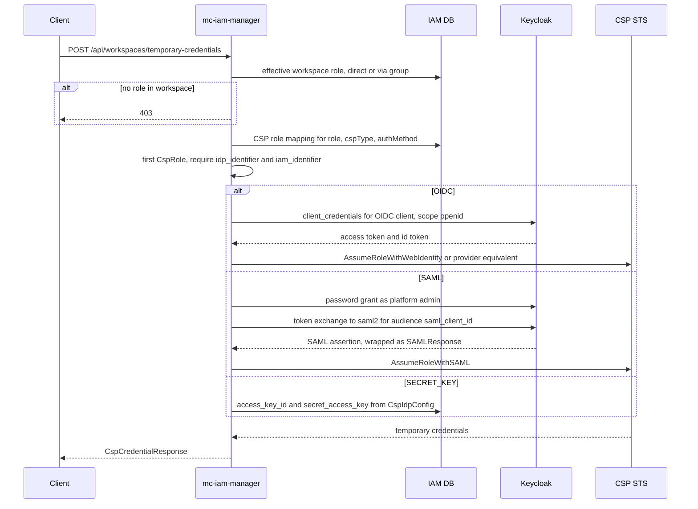

# CSP Integration

mc-iam-manager issues short-lived CSP credentials to users based on their **workspace role**. The chain is:

```
user ──(workspace role)──▶ RoleMaster ──(RoleMasterCspRoleMapping, auth method)──▶ CspRole ──▶ CspIdpConfig ──▶ CspAccount
```

Keycloak is the identity provider trusted by each CSP (OIDC or SAML). For `SECRET_KEY` the stored static keys are returned instead.

Key sources: [src/service/csp_credential_service.go](https://github.com/m-cmp/mc-iam-manager/blob/main/src/service/csp_credential_service.go), the per-CSP `*_credential_service.go` files in [src/service](https://github.com/m-cmp/mc-iam-manager/tree/main/src/service), [src/service/csp_role_service.go](https://github.com/m-cmp/mc-iam-manager/blob/main/src/service/csp_role_service.go), [src/constants/constants.go](https://github.com/m-cmp/mc-iam-manager/blob/main/src/constants/constants.go).

## Entities

| Entity (table) | Purpose | Key fields |
|---|---|---|
| `CspAccount` (`mcmp_csp_accounts`) | A cloud account | `csp_type` (`aws`, `gcp`, `azure`, `alibaba`, `tencent`, `ibm`, `ncp`, `nhn`, `kt`, `openstack`), `account_info` JSON |
| `CspIdpConfig` (`mcmp_csp_idp_configs`) | Trust / auth configuration for an account | `auth_method` (`OIDC`, `SAML`, `SECRET_KEY`), `config` JSON, `is_active` |
| `CspRole` (`mcmp_role_csp_roles`) | A CSP IAM role usable for federation | `name`, `csp_type`, `idp_identifier` (provider ARN / WIF audience), `iam_identifier` (role ARN / service account), `csp_idp_config_id`, `extended_config` JSON |
| `RoleMasterCspRoleMapping` (`mcmp_role_csp_role_mappings`) | Workspace role → CSP role | PK (`role_id`, `auth_method`, `csp_role_id`) |
| `CspPolicy`, `CspRolePolicyMapping` | Policies attached to CSP roles | `policy_type` (`inline`, `managed`, `custom`), `policy_arn`, `policy_doc` |
| `TempCredential` (`mcmp_temp_credentials`) | Cached AWS credentials used by the server itself when creating AWS IAM roles | `provider`, `auth_type`, keys, `expires_at` |

`account_info` keys validated on create ([src/service/csp_account_service.go](https://github.com/m-cmp/mc-iam-manager/blob/main/src/service/csp_account_service.go) `validateAccountInfo`): AWS / Alibaba `account_id`; GCP `project_id`; Tencent `app_id`; Azure `subscription_id` and `tenant_id`. IBM, NCP, NHN, KT, OpenStack are not validated yet.

`account_info.region` is the account's default region for temporary credentials (see [Region](#region)). It is required for Tencent (`400 region_required`) and optional for the others; when present its format is checked (`400 invalid_region`). On `PUT /api/csp-accounts/id/:accountId`, an `account_info` without the `region` key keeps the stored region, and `"region": ""` removes it (not allowed for Tencent). Other `account_info` keys are replaced as a whole.

`config` keys read by the code ([src/model/csp_idp_config.go](https://github.com/m-cmp/mc-iam-manager/blob/main/src/model/csp_idp_config.go) and the credential dispatcher):

| Key | Used for |
|---|---|
| `role_arn` | AWS role for connection test and for `/api/csp/iam` |
| `audience` | Alibaba OIDC audience |
| `tenant_id`, `client_id` | Azure OIDC federated credential |
| `secret_id`, `secret_key` | Tencent STS request signing (OIDC and SAML) |
| `profile_id` | IBM trusted profile |
| `access_key_id`, `secret_access_key` | `SECRET_KEY` method |
| `oidc_provider_arn`, `saml_provider_arn`, `issuer_url`, `metadata_url`, `sts_endpoint`, ... | Descriptive / test helpers |

## Support Matrix

From the dispatcher `GetTemporaryCredentials` in [src/service/csp_credential_service.go](https://github.com/m-cmp/mc-iam-manager/blob/main/src/service/csp_credential_service.go) and the credential services:

| CSP | Temp credential via OIDC | via SAML | SECRET_KEY | Server-side IAM role create | Validate API (`/credentials/validate`) | Credential returned |
|---|---|---|---|---|---|---|
| AWS | STS `AssumeRoleWithWebIdentity` | STS `AssumeRoleWithSAML` | yes | yes (`mciam-` prefix, trust policy generated) | OIDC, SAML, SECRET_KEY | access key, secret, session token |
| GCP | STS token exchange + `generateAccessToken` (WIF) | same, `saml2` subject | yes | no (DB record only) | OIDC | OAuth2 access token |
| Alibaba | STS `AssumeRoleWithOIDC` | STS `AssumeRoleWithSAML` | yes | no | — | access key, secret, security token |
| Azure | `login.microsoftonline.com` federated credential | — | yes | no | — | ARM access token |
| Tencent | STS `AssumeRoleWithWebIdentity` | STS `AssumeRoleWithSAML` | yes | no | — | tmp secret id/key, token |
| IBM | IAM trusted profile token | — | yes | no | — | IAM access token |
| NCP, NHN, KT, OpenStack | — | — | yes | no | — | static keys |

When the CSP role has no linked `CspIdpConfig`, AWS, GCP and Alibaba default to OIDC; others then fail with `unsupported auth method`.

## Temporary Credential Issuance

`POST /api/workspaces/temporary-credentials` (token required), body `{"workspaceId": "1", "cspType": "aws", "region": "ap-northeast-2", "authMethod": "OIDC"}` (`authMethod` optional).



Details:

- **Authorization** is decided by mc-iam-manager (workspace role → CSP role mapping). The token presented to the CSP is a **service-account token** of the OIDC client (`MC_IAM_MANAGER_KEYCLOAK_OIDC_CLIENT_NAME` / `MC_IAM_MANAGER_KEYCLOAK_OIDC_CLIENT_SECRET`, `client_credentials`), not the end user's token ([src/service/keycloak_service.go](https://github.com/m-cmp/mc-iam-manager/blob/main/src/service/keycloak_service.go) `GetImpersonationTokenByServiceAccount`). AWS records the user in the role session name `mciam-<kcUserId>-<unix>` (OIDC). For SAML the session name comes from the assertion's `RoleSessionName`, which is the platform admin account because the assertion is built from that session.
- GCP, Alibaba and Tencent receive the **ID token** (single `aud`); AWS, Azure and IBM receive the access token.
- **SAML** uses a password grant with `MC_IAM_MANAGER_PLATFORMADMIN_ID` / `MC_IAM_MANAGER_PLATFORMADMIN_PASSWORD` to obtain a user session, then RFC 8693 token exchange to `urn:ietf:params:oauth:token-type:saml2` (`GetSamlAssertionByServiceAccount`). The Keycloak OIDC client needs token-exchange permission for the SAML client.
- For AWS and Alibaba SAML the CSP role must have `extended_config.saml_client_id` (the Keycloak SAML client id, e.g. `urn:amazon:webservices`); otherwise the call fails (the error message quotes `SAML_CLIENT_ID_AWS` / `SAML_CLIENT_ID_ALIBABA` only as an example value). GCP and Tencent SAML fall back to `idp_identifier` as the audience.
- AWS SAML pre-checks before STS: `saml_client_id` present, Keycloak SAML client present, and the SAML provider exists in AWS (checked with the management credentials). If the provider that will be used (the CSP role `idp_identifier`) does not exist, the request fails with **400 `invalid_request`** and STS is not called; other lookup failures (for example AccessDenied) only log a warning.
- Tencent uses the provider **name** (the part after the last `/` of `idp_identifier`) as `ProviderId`.
- Region: see [Region](#region).

### Region

The issue and validate APIs take an optional `region`. The region is decided in this order ([src/service/csp_region.go](https://github.com/m-cmp/mc-iam-manager/blob/main/src/service/csp_region.go) `ResolveCspRegion`):

1. `region` in the request (`regionSource: "request"`)
2. `account_info.region` of the CSP account that owns the target CSP role (`regionSource: "account"`)
3. Neither is set (`regionSource: "none"`):
   - Tencent: `400 region_required`; STS is not called (Tencent STS rejects an empty region).
   - AWS: the STS call uses the global endpoint (`us-east-1`). The response `region` is empty and `warnings` reports that the account region is not set.
   - Alibaba, GCP and others: proceed without a region.

- The issue and validate responses include `region` (the value actually used), `regionSource` and `warnings`.
- An invalid `region` format returns `400 invalid_region` (for example `ap-northeast-2`, `cn-hangzhou` and `asia-northeast3` are valid).
- The running server does not read `AWS_REGION` and has no hard-coded default region. Readiness `?checkIssue=true`, the IdP config `test` and account validation also use the account region, or the global endpoint when it is not set.
- mc-admin-cli sets the initial region of the AWS default account (`aws-default`) from `MC_IAM_MANAGER_AWS_DEFAULT_REGION` in its `.env` (default `ap-northeast-2`), only when the account is created at initial setup. Change it later with `PUT /api/csp-accounts/id/:accountId` or the Cloud SP screen.

`POST /api/workspaces/credentials/validate` runs the same chain step by step and returns per-step results and remediation hints. The provider and trust policy steps use the management credentials of the IdP config (no server AWS credentials are needed) ([src/service/csp_validation_service.go](https://github.com/m-cmp/mc-iam-manager/blob/main/src/service/csp_validation_service.go)).

## CSP Roles and Mappings

| Method | Path | Middleware | Purpose |
|---|---|---|---|
| POST | `/api/roles/csp` | PlatformAdmin | Create or register a CSP role (`CreateCspRoleRequest`: `cspRoleName`, `cspType`, `authMethod`, `idpIdentifier`, `iamIdentifier`, `cspIdpConfigId`, `extendedConfig`) |
| POST | `/api/roles/csp/batch` | PlatformAdmin | Create several |
| POST | `/api/roles/csp/check` | Write | Check target CSP roles by name: exists in DB / in CSP / not found / protected, plus trust policy verdict. No writes |
| POST | `/api/roles/csp/list`, GET `/api/roles/csp/id/:roleId`, `/name/:roleName` | Read | Read |
| PUT / DELETE | `/api/roles/csp/id/:roleId` | PlatformAdmin | Update / delete (see below) |
| POST | `/api/csp-target-roles/id/:roleId/trust-policy/sync` | PlatformAdmin | Re-sync the trust policy of one target role with its IdP config (`dryRun` default true, `allowRegistered`) |
| POST / DELETE | `/api/roles/csp-roles` | Manage | Add / remove workspace role ↔ CSP role mappings (mapping only, no CSP calls) |
| POST | `/api/roles/csp-roles/list` (Read), GET `/api/roles/csp-roles/id/:roleId` (token) | | Read mappings |
| POST | `/api/roles/csp-roles/master`, PUT/DELETE `/api/roles/csp-roles/master/id/:roleId` | Write | Manage the CSP-type `RoleMaster` |
| POST / PUT | `/api/roles`, `/api/roles/id/:roleId` with `cspRoles` | Write | Save a Master Role and map target CSP roles in one call (registers or creates missing AWS roles, per-item `cspRoleResults`) |

`CreateCspRole` ([src/service/csp_role_service.go](https://github.com/m-cmp/mc-iam-manager/blob/main/src/service/csp_role_service.go)):

1. Prefixes the name with `mciam-` (`constants.CspRoleNamePrefix`) if missing.
2. Resolves the owning IdP config: `cspIdpConfigId` if given (must exist, be active and match the CSP type and auth method), otherwise the single active config of the same CSP type and auth method (AWS: 0 or 2+ → 400).
3. Refuses the **management role** (any IdP config `role_arn`) with 409 `protected`. The same guard applies to update, delete, mapping, policy attach/detach and trust policy sync. Removing a mapping is allowed.
4. **AWS**: uses the management credentials (the IdP config `role_arn`, or the account's single active AWS OIDC config for SAML roles) and calls `GetRole`:
   - Role exists → registers it (`origin=registered`) and fills `idpIdentifier` (request → config provider ARN → first `Federated` of the actual trust policy).
   - Role missing → checks the OIDC provider and audience (`GetOpenIDConnectProvider`, 400 if missing, skipped on AccessDenied), then creates it (`origin=created`) with a trust policy built from the **IdP config**:
     - OIDC: `Federated: config.oidc_provider_arn`, condition `<provider host path>:aud = config.audience` (empty or `notyet` → 400).
     - SAML: `Federated: idpIdentifier or config.saml_provider_arn`, `SAML:aud = https://signin.aws.amazon.com/saml`.
   - No environment variable is used for the trust policy.
5. **Other CSPs**: stores the DB record only. The admin creates the role, provider and trust relation in the CSP console and registers the ARN / identifiers.

`UpdateCspRole`: AWS roles cannot be renamed (400). A new `cspIdpConfigId` must exist, be active and match the CSP type (400); the role's account follows that config.

`DeleteCspRole` (AWS): detaches the policies IAM attached first (`200 result=detach_failed` if that fails, nothing else changes), then by origin: `created` → deletes the AWS role unless policies or instance profiles attached outside IAM remain (409 `conflict` with the lists); `registered` → keeps the AWS role and only removes the registration. Mappings, policy bindings and the record are removed in one transaction (204).

## CSP Accounts, IdP Configs, Policies

| Group | Middleware | Endpoints |
|---|---|---|
| `/api/csp-accounts` | Read; writes `PlatformAdminMiddleware` | `/list`, create, GET/PUT/DELETE `/id/:accountId`, `/validate`, `/activate`, `/deactivate`, GET `/id/:accountId/readiness` (Read) |
| `/api/csp-idp-configs` | Read; writes `PlatformAdminMiddleware` | `/list`, create, GET/PUT/DELETE `/id/:configId`, `/test`, `/activate`, `/deactivate`, `/summary`, `/health-check`, `/id/:configId/trust-policy/check` (Write), `/id/:configId/trust-policy/sync` (PlatformAdmin) |
| `/api/csp-policies` | Read; writes `PlatformAdminMiddleware` | `/list`, create, GET/PUT/DELETE `/id/:policyId`, `/document`, `/sync`, `/attach`, `/detach`, `/role/:roleId` |
| `/api/csp/iam` | `PlatformAdminMiddleware` | GET `/roles/:roleName?csp_account_id=N` only. POST `/roles`, PUT/DELETE `/roles/:roleName` always return 400 |
| `/api/auth/temp-credential-csps` | token | Static method list |

- **Management credentials**: every AWS write or lookup (role create/register, provider and trust checks, policy attach/detach and definitions, role delete, trust policy sync, `/api/csp/iam` GET) assumes the IdP config `role_arn` with the OIDC client token (session `mcmp-iam-manager-session`). The config is the role's own active AWS OIDC config, otherwise the account's single active AWS OIDC config. Credentials are cached in memory per config.
- Account validation checks each AWS role of the account (provider exists and trust policy verdict, `results[].trustPolicy`); other CSPs get a generic check.
- Readiness (`GET /api/csp-accounts/id/:accountId/readiness`): stages `keycloak_oidc_client`, `csp_account`, `idp_config`, `provider_trust`, `csp_role`, `role_mapping`, `issue` with `ok | failed | pending | skipped | not_applicable`, plus `canMapRoles` / `canIssue`. `?checkIssue=true` tries a real assume for AWS OIDC roles in the account region, or the global endpoint when it is not set (credentials discarded) and adds `cspRoles[].trustPolicy`. Live checks run only for platform admins.
- Trust policy check / sync: verdicts `ok | missing | mismatch | not_found | error` (+ informational `extra`). Sync changes only the statement that trusts the IdP config provider (`statement_added | action_added | aud_set | aud_removed`) and keeps other statements. Registered roles need `allowRegistered`; management roles are refused.
- IdP config `test`: AWS OIDC (STS `AssumeRoleWithWebIdentity` with `role_arn`) and AWS `SECRET_KEY`; GCP/Azure OIDC and all SAML tests return "not implemented".
- Policies (AWS only) are applied in AWS: `managed` (AWS managed ARN, attach/detach only), `custom` (customer managed, shared; IAM can create, version and delete `mciam-*` policies), `inline` (one role only, `PutRolePolicy`). Attach/detach body `{csp_role_id, csp_policy_id}`; an AWS failure returns 200 with `result=failed|detach_failed` and the binding keeps `aws_status` / `last_error` until the same request is sent again. Non-`mciam-` roles, `AdministratorAccess` / `IAMFullAccess` / `PowerUserAccess`, and documents allowing `*` or `iam:*` (or using `NotAction`) are refused with 403 `forbidden_policy`.
- Policy sync (`{csp_account_id, policy_scope}`): `Local` (default) imports `mciam-*` customer managed policies, `AWS` imports AWS managed policies. It uses the account's first active IdP config.
- `/api/csp/iam`: writes are blocked (they replaced the whole trust policy without `Federated` / `Condition`). Use `/api/roles/csp` and trust policy sync instead.

## CSP-Side Setup (Outline)

1. In the CSP IAM console, register Keycloak as an identity provider:
   - OIDC issuer `https://<public Keycloak host>/auth/realms/<realm>`, audience = the OIDC client (`MC_IAM_MANAGER_KEYCLOAK_OIDC_CLIENT_NAME`) (AWS, Alibaba, Tencent, GCP WIF pool, Azure federated credential, IBM trusted profile), or
   - SAML metadata from the Keycloak SAML client (AWS, Alibaba, Tencent, GCP).
     For AWS SAML step by step (Keycloak SAML client, token exchange permission, AWS SAML provider, IdP config, CSP role, issuance, trust policy check and sync), see [AWS SAML 구성 절차 (KO)](CSP-AWS-SAML-Guide-ko).
2. AWS: create the management role (trusts the provider, may manage `role/mciam-*` and `policy/mciam-*`). Other CSPs: create the user roles named with the `mciam-` prefix, attach permissions, and set the trust relation to the provider.
3. In mc-iam-manager: create the CSP account and the IdP config (AWS OIDC `config`: `role_arn` = management role, `oidc_provider_arn`, `audience`), then the CSP role (AWS: created or registered by mc-iam-manager; others: with `idpIdentifier`, `iamIdentifier`, `cspIdpConfigId`, and `extendedConfig.saml_client_id` for SAML), attach policies, and map workspace roles to it.

Step-by-step (Korean): [CSP 임시자격증명 설정·발급 절차](CSP-Temporary-Credential-Guide-ko).

## Environment Variables

| Variable | Read in | Purpose |
|---|---|---|
At runtime the CSP values (management role, provider ARN, audience) come only from the **IdP config in the database**. The `.env` values below are for start-up and the installer.

| Variable | Read in | Purpose |
|---|---|---|
| `MC_IAM_MANAGER_KEYCLOAK_OIDC_CLIENT_NAME`, `MC_IAM_MANAGER_KEYCLOAK_OIDC_CLIENT_SECRET` | [keycloak.go](https://github.com/m-cmp/mc-iam-manager/blob/main/src/config/keycloak.go) | Service-account login for OIDC federation and token exchange; the client is created by `POST /api/initial-admin` if missing |
| `MC_IAM_MANAGER_KEYCLOAK_OIDC_CLIENT_ID` | [keycloak.go](https://github.com/m-cmp/mc-iam-manager/blob/main/src/config/keycloak.go) | Must be non-empty at start-up. Not used in trust policies |
| `AWS_STS_ENDPOINT` | [csp/aws/iam.go](https://github.com/m-cmp/mc-iam-manager/blob/main/src/csp/aws/iam.go) | STS endpoint for the `/api/csp/iam` client |
| `SAML_CLIENT_ID_AWS`, `SAML_CLIENT_ID_ALIBABA` | csp_credential_service.go, csp_role_service.go, csp_validation_service.go | Only an example value in error messages, a warning-only check at SAML role creation, and a fallback in the validate API. The real value is the CSP role `extendedConfig.saml_client_id` |
| `MC_IAM_MANAGER_PLATFORMADMIN_ID`, `MC_IAM_MANAGER_PLATFORMADMIN_PASSWORD` | keycloak_service.go | User session for SAML token exchange |

`MC_IAM_MANAGER_AWS_ACCOUNT_ID`, `MC_IAM_MANAGER_KEYCLOAK_EXTERNAL_URL` (for trust policies), `MC_IAM_MANAGER_AWS_IDENTITY_ROLE_ARN`, `MC_IAM_MANAGER_CSP_ROLE_PREFIX`, `MC_IAM_MANAGER_AWS_IDENTITY_PROVIDER_ARN`, `TEMPORARY_SECURITY_CREDENTIALS_ENDPOINT_AWS` and `AWS_REGION` are not read by the running server (the role prefix is the constant `mciam-`); the mc-admin-cli bootstrap uses some of them to create the IdP config. See [Configuration Reference](Configuration-Reference).

## Caveats

- The mc-web-console CSP Roles screen sends `roleId` / `policyId` for policy attach and detach, while the API expects `csp_role_id` / `csp_policy_id`, so attaching from that screen fails with 400. Use the API.
- Policy sync uses the account's first active IdP config, so it can fail when that config is SAML.
- Only the first CSP role of a mapping is used.
- If several groups grant different roles in the same workspace (and there is no direct assignment), the role with the lowest id is used ([src/repository/user_repository.go](https://github.com/m-cmp/mc-iam-manager/blob/main/src/repository/user_repository.go) `FindEffectiveUserRoleInWorkspace`).
- `/api/auth/temp-credential-csps` returns a fixed list (AWS OIDC/SAML, GCP OIDC, Alibaba OIDC) that does not reflect the matrix above.
