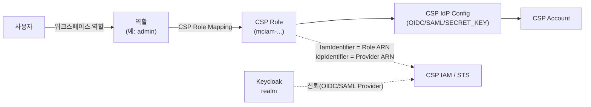

# CSP 임시자격증명 설정·발급 절차

> 내부 운영자용 실무 절차서입니다. **모든 작업을 브라우저에서** 할 수 있게 썼습니다(Keycloak Admin Console, AWS 콘솔, mc-web-console, 브라우저 개발자 도구). CLI로 하는 방법은 각 단계의 "CLI로 할 때"를 펼쳐 보세요.
> 개념·엔티티·API 전체 목록은 [CSP Integration](CSP-Integration)을 참고하세요. 이 문서는 **AWS + OIDC**를 기준으로 쓰고, 다른 CSP·SAML은 [CSP별 차이](#8-csp별-차이)에 차이점만 정리합니다.

## 개요

mc-iam-manager는 사용자의 **워크스페이스 역할**에 매핑된 **CSP 역할**로 CSP의 STS를 호출해 짧은 수명의 자격증명을 발급합니다. CSP는 mc-iam-manager 뒤의 Keycloak을 IdP로 신뢰해야 합니다.



AWS 쪽은 **최초 1회만** 사람이 설정합니다. 이때 만드는 **관리용 Role**(예: `mciam-admin`)로 mc-iam-manager가 사용자용 Role을 AWS에 직접 만듭니다.

| 단계 | 수행 위치 | 작업 | 빈도 | 담당 |
|---|---|---|---|---|
| 1-1 | **Keycloak Admin Console** | `<OIDC_CLIENT>` 클라이언트가 있는지 확인, 없으면 추가 | 환경마다 1회 | 시스템 관리자 |
| 1-2 | **서버(VM)**: mc-iam-manager가 실행되는 호스트 | 환경변수 설정, 컨테이너 재생성 | 환경마다 1회 | 시스템 관리자 |
| 2 | **Provider(AWS) 콘솔** | 해당 환경의 OIDC Provider 생성 | 환경마다 1회 | AWS 관리자 |
| 3-1 | **Provider(AWS) 콘솔** | 관리용 Role(`<ADMIN_ROLE>`)이 있는지 확인 | 환경마다 1회 | AWS 관리자 |
| 3-2 | **Provider(AWS) 콘솔** | 없으면 관리용 Role 생성 | 계정마다 1회 | AWS 관리자 |
| 3-3 | **Provider(AWS) 콘솔** | 있으면 관리용 Role 신뢰 관계에 해당 환경 문장 추가 | 환경마다 1회 | AWS 관리자 |
| 4 | **mc-web-console**, **브라우저 개발자 도구** | CSP Account, IdP Config 등록 | 환경마다 1회 | 플랫폼 관리자 |
| 5 | **mc-web-console**, **Provider(AWS) 콘솔** | 사용자용 CSP Role 등록(→ AWS에 자동 생성), 권한 정책 부여 | 역할마다 | 플랫폼 관리자 |
| 6 | **mc-web-console** | 역할 ↔ CSP Role 매핑, 사용자에게 워크스페이스 역할 할당 | 필요할 때 | 플랫폼 관리자 |
| 7 | **브라우저 개발자 도구**, **Provider(AWS) CloudShell** | 임시자격증명 발급·검증 | 필요할 때 | 사용자 / 관리자 |

"환경"은 Keycloak issuer 하나(예: dev, stage, prod 서버 각각)를 말합니다. 서버(VM) 작업만 SSH가 필요하고 나머지는 모두 브라우저에서 합니다.

### mc-web-console 화면 지원 현황과 대안

mc-web-console 화면이 없는 작업은 **❌ 화면 없음**으로 표시했습니다. 그중 mc-iam-manager API로 대신할 수 있는 것은 [개발자 도구](#개발자-도구에서-api-호출하기)에서 호출합니다.

| 단계 | 작업 | mc-web-console 화면 | mc-iam-manager API 대안 |
|---|---|---|---|
| 1-1 | Keycloak OIDC 클라이언트 추가 | ❌ 화면 없음 | ❌ 없음 (`/api/initial-admin`은 `mciamClient`만 생성) → Keycloak Admin Console |
| 1-2 | 환경변수 설정 | ❌ 화면 없음 | ❌ 없음 → 서버(VM) |
| 2 | AWS OIDC Provider 생성 | ❌ 화면 없음 | ❌ 없음 → AWS 콘솔 |
| 3 | 관리용 Role 확인·생성·신뢰 관계 추가 | ❌ 화면 없음 | ❌ 없음 → AWS 콘솔 (관리용 Role이 이 환경을 신뢰하기 전에는 mc-iam-manager가 AWS에 접근할 수 없으므로 구조상 불가) |
| 4-1 | CSP Account 등록 | ✅ Settings > Environment > Cloud SPs > CSP Accounts | `POST /api/csp-accounts` |
| 4-2 | IdP Config 등록·수정 | ❌ 화면 없음 | ✅ `POST /api/csp-idp-configs`, `PUT /api/csp-idp-configs/id/{id}` |
| 4-2 | IdP Config 연결 테스트·활성화 | ❌ 화면 없음 | ✅ `POST /api/csp-idp-configs/id/{id}/test`, `/activate`, `/deactivate` |
| 5-1 | 사용자용 CSP Role 등록 (AWS Role 자동 생성) | ✅ Operations > Manage > Workspaces > CSP Roles | `POST /api/roles/csp` |
| 5-1 | IDP Identifier 수정 | ✅ CSP Roles → Edit | `PUT /api/roles/csp/id/{id}` |
| 5-2 | AWS Role에 권한 정책 부여 | ⚠️ CSP Roles 화면에 정책 등록·attach가 있으나 **mc-iam-manager DB에만 기록되고 AWS에는 반영 안 됨** | ❌ 없음 (`/api/csp-policies/attach`도 DB만) → AWS 콘솔 |
| 5-2 | AWS Role 신뢰 정책 수정 | ❌ 화면 없음 | ❌ **사용 불가, 호출 금지**: `PUT /api/csp/iam/roles/{roleName}`이 있으나 ① 호출자 로그인 토큰(`azp`=`mciamClient`)으로 관리용 Role을 assume해서 AWS가 `InvalidIdentityToken`으로 거부(플랫폼 관리자 토큰으로 실증), ② 통과하더라도 신뢰 정책에 `Federated`·`Condition`을 담지 못한 채 **정책 전체를 교체**해 OIDC 신뢰가 사라짐 → AWS 콘솔 (3-3 방식) |
| 5-3 | CSP Role에 IdP Config 연결, SAML 클라이언트 ID | ❌ 화면 없음 | ✅ `PUT /api/roles/csp/id/{id}` (`cspIdpConfigId`, `extendedConfig`) |
| 6-1 | 역할 ↔ CSP Role 매핑 | ⚠️ Workspaces > Roles → CSP Role Mapping 카드가 있으나 **선택한 CSP Role 대신 `mciam-<역할명>` Role을 AWS에 새로 만들어 매핑함**(stage 실증) | ✅ `POST /api/roles/csp-roles` (매핑만, AWS 호출 없음). `POST/PUT /api/roles`의 `cspRoles`는 쓰지 말 것 |
| 6-2 | 사용자 워크스페이스 역할 할당 | ✅ Workspaces → 멤버 추가 | `POST /api/roles/assign/workspace-role` |
| 7-1 | 임시자격증명 발급 | ❌ 화면 없음 | ✅ `POST /api/workspaces/temporary-credentials` |
| 7-3 | 단계별 진단 | ❌ 화면 없음 | ⚠️ `POST /api/workspaces/credentials/validate`가 있으나 서버에 AWS 자격증명이 없는 기본 배포에서는 4단계가 항상 실패(stage 실증) |

정리하면 mc-iam-manager 쪽에서 화면이 없는 작업(4-2, 5-3, 7-1, 7-3)은 모두 API로 대신할 수 있습니다. 반면 Keycloak·서버·AWS 쪽 작업(1-1, 1-2, 2, 3)과 AWS 정책 부여(5-2)는 API 대안이 없어 각 콘솔에서 해야 합니다.

### 표기

실제 계정 정보는 문서·티켓·채팅에 남기지 말고 아래 표기로 바꿔 씁니다.

| 표기 | 의미 | 예 (가상) |
|---|---|---|
| `<IAM_URL>` | mc-iam-manager 외부 URL | `https://mcmp.example.com` |
| `<KC_DOMAIN>` | `MC_IAM_MANAGER_KEYCLOAK_EXTERNAL_DOMAIN` (보통 `MC_IAM_MANAGER_PUBLIC_DOMAIN`과 같음) | `mcmp.example.com` |
| `<REALM>` | `MC_IAM_MANAGER_KEYCLOAK_REALM` | `mciam` |
| `<OIDC_CLIENT>` | `MC_IAM_MANAGER_KEYCLOAK_OIDC_CLIENT_NAME` | `mciam-oidc-Client` |
| `<ISSUER>` | Keycloak realm issuer | `https://<KC_DOMAIN>/auth/realms/<REALM>` |
| `<ACCOUNT_ID>` | AWS 계정 ID 12자리 | `123456789012` |
| `<ADMIN_ROLE>` | 관리용 Role 이름 | `mciam-admin` |
| `<PROVIDER_ARN>` | 2단계에서 만든 OIDC Provider ARN | `arn:aws:iam::<ACCOUNT_ID>:oidc-provider/<KC_DOMAIN>/auth/realms/<REALM>` |

### 개발자 도구에서 API 호출하기

IdP Config 등록 등 일부 작업은 mc-web-console에 화면이 없어 mc-iam-manager API를 직접 불러야 합니다. Swagger UI(`/swagger/index.html`)도 인증 헤더를 요구해 브라우저로 바로 열리지 않으므로, 아래처럼 **브라우저 개발자 도구 콘솔**을 씁니다.

1. 새 탭에서 `<IAM_URL>/readyz`를 엽니다(mc-iam-manager와 같은 주소여야 CORS 문제가 없습니다).
2. F12 → **Console** 탭에 아래 도우미를 붙여 넣고 Enter. Chrome이 붙여넣기를 막으면 안내대로 `allow pasting`을 먼저 입력합니다.

```js
const IAM = location.origin;
async function login() {
  const r = await fetch(`${IAM}/api/auth/login`, { method: 'POST', headers: { 'Content-Type': 'application/json' },
    body: JSON.stringify({ id: prompt('ID'), password: prompt('Password') }) });
  const j = await r.json(); if (!j.access_token) throw new Error(JSON.stringify(j)); return j.access_token;
}
async function api(method, path, body) {
  const r = await fetch(`${IAM}${path}`, { method, headers: { 'Content-Type': 'application/json', Authorization: `Bearer ${TOKEN}` },
    body: body === undefined ? undefined : JSON.stringify(body) });
  const t = await r.text(); let b; try { b = JSON.parse(t); } catch { b = t; }
  console.log(r.status, b); return b;
}
var TOKEN = await login();   // 플랫폼 관리자 계정
```

비밀번호는 `prompt` 창으로만 입력하므로 콘솔 기록에 남지 않습니다. 탭을 닫으면 토큰도 사라집니다.

---

## 1. 사전 점검

### 1-1. Keycloak OIDC 클라이언트 (❌ mc-web-console 화면 없음, API 대안 없음)

> **수행 위치: Keycloak Admin Console** (`https://<KC_DOMAIN>/auth/admin/`)

mc-iam-manager는 발급할 때 이 클라이언트의 서비스 계정 토큰을 CSP에 제출합니다.

> **설치 직후에는 이 클라이언트가 없습니다.** mc-admin-cli로 설치한 환경도 realm에는 `mciamClient`만 있고 `<OIDC_CLIENT>`는 자동으로 만들어지지 않습니다. 없으면 발급 시 Keycloak `401 invalid_client`가 나므로 처음 구성할 때 직접 만듭니다.

Keycloak Admin Console(`https://<KC_DOMAIN>/auth/admin/`)에 `MC_IAM_MANAGER_KEYCLOAK_ADMIN` 계정으로 로그인 → 왼쪽 위 realm 선택에서 `<REALM>` → **Clients**

**목록에 `<OIDC_CLIENT>`가 없으면** Create client:

| 화면 | 항목 | 값 |
|---|---|---|
| General settings | Client type | OpenID Connect |
| | Client ID | `<OIDC_CLIENT>` |
| Capability config | Client authentication | ON |
| | Authentication flow | **Service accounts roles**, **Direct access grants**만 체크 (Standard flow 해제) |
| Login settings | (모두 비움) | |

Save 후 **Credentials** 탭 → Client secret을 서버의 `MC_IAM_MANAGER_KEYCLOAK_OIDC_CLIENT_SECRET` 값으로 맞춥니다. Keycloak 24 화면에서는 secret을 직접 입력할 수 없으므로, 생성된 secret을 복사해 서버 `.env`의 `MC_IAM_MANAGER_KEYCLOAK_OIDC_CLIENT_SECRET`에 넣고 mc-iam-manager를 재기동하거나, 아래 API 방법으로 env 값을 지정해 만듭니다.

**이미 있으면** Settings에서 위 표의 값과 같은지, Credentials의 secret이 env 값과 같은지 확인합니다. secret이 다르면 `invalid_client`가 납니다.

<details>
<summary>CLI로 할 때 (서버에서, secret을 env 값으로 지정해 생성)</summary>

```bash
# mc-iam-manager 컨테이너 env에서 값을 읽어 씁니다
eval "$(docker exec mc-iam-manager env | grep -E '^MC_IAM_MANAGER_KEYCLOAK_(ADMIN|ADMIN_PASSWORD|OIDC_CLIENT_NAME|OIDC_CLIENT_SECRET|REALM)=' | sed 's/^/export /')"
KC=https://<KC_DOMAIN>/auth
ADMIN_TOKEN=$(curl -s -X POST "$KC/realms/master/protocol/openid-connect/token" \
  -d grant_type=password -d client_id=admin-cli \
  -d username="$MC_IAM_MANAGER_KEYCLOAK_ADMIN" --data-urlencode password="$MC_IAM_MANAGER_KEYCLOAK_ADMIN_PASSWORD" | jq -r .access_token)

jq -n --arg id "$MC_IAM_MANAGER_KEYCLOAK_OIDC_CLIENT_NAME" --arg s "$MC_IAM_MANAGER_KEYCLOAK_OIDC_CLIENT_SECRET" \
  '{clientId:$id, protocol:"openid-connect", enabled:true, publicClient:false, secret:$s,
    serviceAccountsEnabled:true, directAccessGrantsEnabled:true, standardFlowEnabled:false}' |
curl -s -o /dev/null -w '%{http_code}\n' -X POST "$KC/admin/realms/$MC_IAM_MANAGER_KEYCLOAK_REALM/clients" \
  -H "Authorization: Bearer $ADMIN_TOKEN" -H 'Content-Type: application/json' -d @-
# 201이면 생성 완료
```

</details>

**토큰 발급 확인** (체크리스트 A1~A4): `<IAM_URL>` 탭의 개발자 도구 콘솔에서

```js
const KC_TOKEN = `${location.origin}/auth/realms/${prompt('Realm', 'mciam')}/protocol/openid-connect/token`;
const kc = await (await fetch(KC_TOKEN, { method: 'POST', body: new URLSearchParams({
  grant_type: 'client_credentials', scope: 'openid',
  client_id: prompt('OIDC client', 'mciam-oidc-Client'), client_secret: prompt('OIDC client secret') }) })).json();
const jwt = t => JSON.parse(atob(t.split('.')[1].replace(/-/g, '+').replace(/_/g, '/')));
console.log(kc.error ?? { access: (({iss, azp, aud}) => ({iss, azp, aud}))(jwt(kc.access_token)),
                          id:     (({iss, azp, aud}) => ({iss, azp, aud}))(jwt(kc.id_token)) });
```

정상이면 `iss`가 `<ISSUER>`, access token의 `azp`와 id token의 `aud`가 `<OIDC_CLIENT>`입니다(access token의 `aud`가 `account`인 것은 정상). `iss`가 `http://mc-iam-manager-kc:8080/...` 같은 내부 주소면 Keycloak 컨테이너에 `KC_HOSTNAME_URL=https://<KC_DOMAIN>/auth`가 설정됐는지 확인하세요.

### 1-2. mc-iam-manager 환경변수 (❌ 화면 없음, API 대안 없음)

> **수행 위치: 서버(VM)**: mc-iam-manager 컨테이너가 실행되는 호스트에 SSH로 접속해서 합니다. 브라우저로는 할 수 없습니다.

5단계에서 mc-iam-manager가 AWS에 사용자용 Role을 만들 때 신뢰 정책을 아래 값으로 조립합니다. 샘플 기본값(`notyet`, 빈 값) 그대로면 Role 생성이 실패하거나 **동작하지 않는 Role이 만들어집니다.**

| 변수 | 값 | 비우거나 틀리면 |
|---|---|---|
| `MC_IAM_MANAGER_KEYCLOAK_EXTERNAL_URL` | `https://<KC_DOMAIN>/auth` | 내부 주소(`MC_IAM_MANAGER_KEYCLOAK_HOST`)로 대체되어 신뢰 정책의 Provider가 틀어짐 |
| `MC_IAM_MANAGER_KEYCLOAK_OIDC_CLIENT_ID` | `<OIDC_CLIENT>`와 같은 값 | 신뢰 정책의 `aud`가 틀어져 assume 거부 |
| `MC_IAM_MANAGER_AWS_ACCOUNT_ID` | `<ACCOUNT_ID>` | `MC_IAM_MANAGER_AWS_ACCOUNT_ID environment variable is not set`. 시스템 전체에서 AWS 계정 1개만 지원 |
| `MC_IAM_MANAGER_KEYCLOAK_OIDC_CLIENT_SECRET` | 1-1 클라이언트의 secret | `401 invalid_client` |
| `SAML_CLIENT_ID_AWS` | SAML을 쓸 때만. 보통 `urn:amazon:webservices` | |

**mc-admin-cli로 설치한 서버**에서는:

1. 수정할 파일: `<mc-admin-cli 경로>/conf/docker/conf/mc-iam-manager/.env`
   - mc-iam-manager 컨테이너는 이 파일을 `env_file`로 읽습니다. 같은 이름의 값이 `conf/docker/.env`에도 있지만 그 파일은 compose 변수 치환용이라 **컨테이너에는 들어가지 않습니다.**
2. 반영: `conf/docker` 폴더에서 컨테이너를 **재생성**합니다. `docker restart`로는 env 파일이 다시 읽히지 않습니다. 재생성하는 30초 남짓 동안 로그인·API가 끊깁니다.

```bash
cd <mc-admin-cli 경로>/conf/docker
docker compose -p mcc up -d --no-deps --force-recreate mc-iam-manager   # -p 는 기존 compose 프로젝트명
docker exec mc-iam-manager env | grep -E 'KEYCLOAK_(EXTERNAL_URL|OIDC_CLIENT_ID)|AWS_ACCOUNT_ID'   # 반영 확인
```

compose 프로젝트명은 `docker inspect mc-iam-manager --format '{{index .Config.Labels "com.docker.compose.project"}}'`로 확인합니다.

---

## 2. AWS: 해당 환경의 OIDC Provider 생성 (환경마다 1회, ❌ mc-web-console 화면 없음, API 대안 없음)

> **수행 위치: Provider(AWS) 콘솔**: IAM 관리 권한이 있는 계정으로 로그인 → **IAM** → 왼쪽 **Identity providers**

1. 목록에서 Provider 이름이 `<KC_DOMAIN>/auth/realms/<REALM>`인 항목이 있는지 찾습니다.
   - **있으면** 클릭 → **Audiences**에 `<OIDC_CLIENT>`가 있는지 확인합니다. 없으면 Actions → **Add audience**로 추가하고 3단계로 갑니다.
2. 없으면 **Add provider**

| 항목 | 값 |
|---|---|
| Provider type | OpenID Connect |
| Provider URL | `https://<KC_DOMAIN>/auth/realms/<REALM>` (끝에 `/` 없이) |
| Audience | `<OIDC_CLIENT>` |

3. **Add provider** → 상세 화면의 ARN이 `<PROVIDER_ARN>`입니다. 이후 CSP Role의 **IDP Identifier**가 됩니다.

<details>
<summary>CLI로 할 때</summary>

```bash
export ACCOUNT_ID="<AWS 계정 ID>" KC_DOMAIN="<KC_DOMAIN>" REALM="<REALM>" OIDC_CLIENT="<OIDC_CLIENT>"
export ISSUER_HOSTPATH="${KC_DOMAIN}/auth/realms/${REALM}"
export PROVIDER_ARN="arn:aws:iam::${ACCOUNT_ID}:oidc-provider/${ISSUER_HOSTPATH}"

aws iam list-open-id-connect-providers --query "OpenIDConnectProviderList[?ends_with(Arn, '${ISSUER_HOSTPATH}')]"
aws iam create-open-id-connect-provider --url "https://${ISSUER_HOSTPATH}" --client-id-list "${OIDC_CLIENT}"
# 이미 있는데 audience만 없으면:
# aws iam add-client-id-to-open-id-connect-provider --open-id-connect-provider-arn "$PROVIDER_ARN" --client-id "$OIDC_CLIENT"
```

</details>

---

## 3. AWS: 관리용 Role 준비 (환경마다 1회, ❌ mc-web-console 화면 없음, API 대안 없음)

> **수행 위치: Provider(AWS) 콘솔** → **IAM** → 왼쪽 **Roles**

관리용 Role은 `role/mciam-*` Role을 만들고 고칠 권한을 갖고, mc-iam-manager가 이 Role로 사용자용 Role을 만듭니다. AWS 계정마다 하나를 두고 여러 환경이 함께 씁니다.

### 3-1. 관리용 Role이 있는지 확인

Roles 검색창에 `<ADMIN_ROLE>` 입력.

- **없으면** → 3-2 (생성하면 이 환경의 신뢰 관계까지 함께 들어가므로 3-3은 건너뜁니다)
- **있으면** → Role 클릭 → **Trust relationships** 탭에서 2단계의 `<PROVIDER_ARN>` 문장이 있는지 봅니다. 있으면 3단계 완료, 없으면 3-3

<details>
<summary>CLI로 할 때</summary>

```bash
aws iam get-role --role-name "<ADMIN_ROLE>" --query 'Role.AssumeRolePolicyDocument.Statement[].Principal.Federated'
# NoSuchEntity 오류면 Role 없음
```

</details>

### 3-2. 없으면 관리용 Role 생성

1. **Create role**
2. Trusted entity type: **Web identity** → Identity provider: `<KC_DOMAIN>/auth/realms/<REALM>` → Audience: `<OIDC_CLIENT>` → Next
3. Add permissions: 아무것도 고르지 않고 Next (권한은 6번에서 inline으로 붙입니다)
4. Role name: `<ADMIN_ROLE>` (반드시 `mciam-`로 시작), Description: `mc-iam-manager management role` → **Create role**
5. 만든 Role 클릭 → **Permissions** 탭 → Add permissions → **Create inline policy** → **JSON** 탭에 아래를 붙여 넣고 `<ACCOUNT_ID>`를 실제 계정 ID로 바꿉니다.

```json
{
  "Version": "2012-10-17",
  "Statement": [{
    "Effect": "Allow",
    "Action": [
      "iam:CreateRole", "iam:GetRole", "iam:UpdateRole", "iam:UpdateRoleDescription", "iam:UpdateAssumeRolePolicy",
      "iam:DeleteRole", "iam:TagRole", "iam:UntagRole",
      "iam:AttachRolePolicy", "iam:DetachRolePolicy", "iam:PutRolePolicy", "iam:DeleteRolePolicy",
      "iam:ListAttachedRolePolicies", "iam:ListRolePolicies", "iam:GetRolePolicy",
      "iam:GetOpenIDConnectProvider", "iam:GetSAMLProvider"
    ],
    "Resource": [
      "arn:aws:iam::<ACCOUNT_ID>:role/mciam-*",
      "arn:aws:iam::<ACCOUNT_ID>:oidc-provider/*",
      "arn:aws:iam::<ACCOUNT_ID>:saml-provider/*"
    ]
  }]
}
```

6. Next → Policy name `mciam-role-management` → **Create policy**

권한 범위를 `role/mciam-*`로 묶어 두면 mc-iam-manager는 그 밖의 Role을 건드릴 수 없습니다.

### 3-3. 있으면 신뢰 관계에 해당 환경 문장 추가

1. `<ADMIN_ROLE>` 클릭 → **Trust relationships** 탭
2. 기존 정책 JSON 전체를 복사해 따로 보관합니다(되돌릴 때 사용).
3. **Edit trust policy** → `"Statement": [ ... ]` 배열의 **마지막 문장 뒤에 쉼표를 찍고** 아래 문장을 추가합니다. `<ACCOUNT_ID>`, `<KC_DOMAIN>`, `<REALM>`, `<OIDC_CLIENT>`를 실제 값으로 바꿉니다.

```json
{
  "Effect": "Allow",
  "Principal": {
    "Federated": "arn:aws:iam::<ACCOUNT_ID>:oidc-provider/<KC_DOMAIN>/auth/realms/<REALM>"
  },
  "Action": "sts:AssumeRoleWithWebIdentity",
  "Condition": {
    "StringEquals": {
      "<KC_DOMAIN>/auth/realms/<REALM>:aud": "<OIDC_CLIENT>"
    }
  }
}
```

4. **Update policy**

> **기존 문장은 절대 지우지 마세요.** 다른 환경(다른 Keycloak)이 같은 관리용 Role을 쓰고 있어서, 문장을 지우면 그 환경의 Role 생성이 모두 멈춥니다. 저장 전에 편집기에서 문장 수가 "기존 + 1"인지 확인합니다.

5. **Permissions** 탭에서 inline 정책이 3-2의 5번 내용을 포함하는지 확인합니다.

<details>
<summary>CLI로 할 때 (기존 문장을 유지하며 추가)</summary>

```bash
export ADMIN_ROLE="<관리용 Role 이름>"   # 2단계 CLI의 변수도 함께 설정
cat > trust-statement.json <<EOF
{"Effect":"Allow","Principal":{"Federated":"${PROVIDER_ARN}"},"Action":"sts:AssumeRoleWithWebIdentity",
 "Condition":{"StringEquals":{"${ISSUER_HOSTPATH}:aud":"${OIDC_CLIENT}"}}}
EOF
aws iam get-role --role-name "$ADMIN_ROLE" --query Role.AssumeRolePolicyDocument --output json > trust-current.json
cp trust-current.json "trust-backup-$(date +%Y%m%d%H%M%S).json"
jq --slurpfile s trust-statement.json \
  'if any(.Statement[]; .Principal.Federated == $s[0].Principal.Federated) then . else .Statement += $s end' \
  trust-current.json > trust-new.json
diff <(jq . trust-current.json) <(jq . trust-new.json)   # 추가된 문장 하나만 보여야 함
aws iam update-assume-role-policy --role-name "$ADMIN_ROLE" --policy-document file://trust-new.json
```

</details>

**확인**: Trust relationships 탭에 `<PROVIDER_ARN>`과 `aud`=`<OIDC_CLIENT>` 문장이 보이면 됩니다. 실제로 assume되는지는 [체크리스트 B3](#9-점검-체크리스트)에서 확인합니다.

---

## 4. mc-iam-manager: CSP Account, IdP Config 등록 (환경마다 1회)

> **수행 위치: mc-web-console**(4-1), **브라우저 개발자 도구**(4-2, [사용법](#개발자-도구에서-api-호출하기))

### 4-1. CSP Account

mc-web-console → **Settings > Environment > Cloud SPs > CSP Accounts** → Add

| 항목 | 값 |
|---|---|
| Account Name | 예: `aws-main` |
| CSP Provider | AWS |
| Credential Data (JSON) | `{"account_id": "<ACCOUNT_ID>", "region": "ap-northeast-2"}` |

> **Credential Data 칸에는 액세스 키가 아니라 계정 정보를 넣습니다.** 입력란 예시가 `{"accessKey": ...}`로 되어 있지만 실제로는 계정 정보(`account_info`)로 저장되고, 필수 키가 없으면 등록이 거부됩니다. CSP별 필수 키: AWS·Alibaba `account_id`, GCP `project_id`, Tencent `app_id`, Azure `subscription_id`와 `tenant_id` (`region`은 선택).

등록한 계정의 id를 확인합니다(개발자 도구 콘솔):

```js
await api('POST', '/api/csp-accounts/list', {});
```

응답에서 해당 계정의 `id`가 `<CSP_ACCOUNT_ID>`입니다.

### 4-2. IdP Config (❌ 화면 없음 → API로)

```js
await api('POST', '/api/csp-idp-configs', {
  name: 'aws-oidc',
  csp_account_id: <CSP_ACCOUNT_ID>,          // 숫자
  auth_method: 'OIDC',
  config: { role_arn: 'arn:aws:iam::<ACCOUNT_ID>:role/<ADMIN_ROLE>' },
  description: 'Keycloak OIDC trust for AWS'
});
```

- `config.role_arn`에는 **관리용 Role**을 넣습니다(사용자용 Role 아님).
- 응답의 `id`가 `<IDP_CONFIG_ID>`입니다.
- 연결 테스트(AWS OIDC만 지원): `await api('POST', '/api/csp-idp-configs/id/<IDP_CONFIG_ID>/test');`

---

## 5. 사용자용 CSP Role 등록 (역할마다)

> **수행 위치: mc-web-console**(5-1), **Provider(AWS) 콘솔**(5-2), **브라우저 개발자 도구**(5-3)

### 5-1. mc-web-console에서 등록 → AWS에 Role 자동 생성

mc-web-console → **Operations > Manage > Workspaces > CSP Roles** → Add CSP Role

| 항목 | 값 |
|---|---|
| CSP Type | AWS |
| CSP Role Name | 예: `ec2ro` (자동으로 `mciam-ec2ro`가 됨) |
| Auth Method | OIDC |
| Description | 용도 설명 |
| IDP Identifier, IAM Identifier, IAM Role ID | 비워 둡니다 (자동 생성 시 채워짐) |

저장하면 mc-iam-manager가 4-2의 관리용 Role로 AWS에 접속해:

- **같은 이름의 Role이 없으면**: 1-2 환경변수로 신뢰 정책을 만들어 `mciam-<이름>` Role을 **생성**하고, IDP Identifier와 IAM Identifier(Role ARN)를 채웁니다.
- **이미 있으면**: Role ARN 등 정보를 AWS에서 가져와 저장합니다. 단, 이때는 **IDP Identifier가 저장되지 않으므로** 목록에서 해당 Role을 **Edit**해 IDP Identifier에 `<PROVIDER_ARN>`을 넣으세요. 비어 있으면 발급 시 `IDP ARN이 설정되지 않았습니다`로 실패합니다.

목록에서 Status가 `created`인지 확인합니다. `failed`면 원인을 고친 뒤 같은 이름으로 다시 등록할 수 있습니다.

### 5-2. 권한 정책 부여 (⚠️ 화면은 있으나 AWS 미반영, API 대안 없음 → AWS 콘솔)

> **현재 mc-iam-manager로는 AWS Role에 권한 정책을 붙일 수 없습니다.** CSP Policy의 attach API(`/api/csp-policies/attach`)는 mc-iam-manager DB에만 기록하고 AWS에는 반영하지 않습니다. 그래서 정책은 AWS 콘솔에서 붙입니다.

AWS IAM → Roles → `mciam-<이름>` → **Permissions** → Add permissions → **Attach policies** → 필요한 정책 선택(예: `AmazonEC2ReadOnlyAccess`) → Add permissions.

**Trust relationships** 탭에서 자동 생성된 신뢰 정책이 `<PROVIDER_ARN>`과 `aud`=`<OIDC_CLIENT>`인지도 확인합니다. Provider가 `mc-iam-manager-kc...` 같은 내부 주소거나 `aud`가 `notyet`이면 1-2 환경변수가 잘못된 것입니다. 이 경우 환경변수를 고친 뒤 Role의 신뢰 정책을 3-3의 문장으로 바꿉니다.

### 5-3. 화면에서 입력할 수 없는 값 (❌ 화면 없음 → API로)

**IdP Config 연결(`cspIdpConfigId`)**과 **SAML 클라이언트 ID(`extendedConfig.saml_client_id`)**는 화면에 입력란이 없습니다. AWS OIDC는 둘 다 없어도 동작하지만(IdP Config가 없으면 OIDC로 간주), SAML이나 다른 CSP는 개발자 도구에서 채웁니다. CSP Role id는 `await api('POST', '/api/roles/csp/list', {})`로 확인합니다.

```js
await api('PUT', '/api/roles/csp/id/<CSP_ROLE_ID>', { cspIdpConfigId: <IDP_CONFIG_ID> });
// SAML이면: { cspIdpConfigId: <IDP_CONFIG_ID>, extendedConfig: { saml_client_id: 'urn:amazon:webservices' } }
```

---

## 6. 역할 매핑과 사용자 할당

> **수행 위치: mc-web-console**

### 6-1. 역할 ↔ CSP Role 매핑 (⚠️ 화면 결함 → API로)

> **⚠️ 현재 Roles 화면의 CSP Role Mapping은 쓰지 마세요.** 화면에서 CSP Role을 골라 저장하면, 선택한 Role이 아니라 **`mciam-<역할 이름>` Role을 AWS에 새로 만들고(권한 정책 없음) 그것을 매핑**합니다. stage에서 `viewer` 역할에 `mciam-ec2ro`를 골랐는데 `mciam-viewer`가 생성·매핑된 것으로 확인했습니다. 원인은 화면이 고른 이름을 `roleName`으로 보내는데 서버는 `cspRoleName`만 읽기 때문입니다. 같은 이유로 API의 `POST /api/roles`, `PUT /api/roles/id/{id}`에 `cspRoles`를 넣는 것도 피합니다.

**대안: 매핑 API** (AWS를 호출하지 않고 DB 매핑만 만듭니다). 역할은 Roles 화면에서 CSP Role Mapping 없이 만들어 둔 뒤, 개발자 도구에서:

```js
await api('POST', '/api/roles/list', {});        // 역할 id 확인
await api('POST', '/api/roles/csp/list', {});    // CSP Role id 확인
await api('POST', '/api/roles/csp-roles', { roleId: '<ROLE_ID>', cspRoleId: '<CSP_ROLE_ID>', cspType: 'aws', authMethod: 'OIDC' });
await api('GET', '/api/roles/csp-roles/id/<ROLE_ID>');   // 매핑 확인
```

잘못 매핑된 것을 지울 때: `await api('DELETE', '/api/roles/csp-roles', { roleId: '<ROLE_ID>', cspRoleId: '<CSP_ROLE_ID>', authMethod: 'OIDC' });`

- 하나의 역할에 CSP별·인증방식별로 여러 CSP Role을 매핑할 수 있습니다.
- **같은 역할 + CSP + 인증방식 조합에 CSP Role을 둘 이상 매핑하지 마세요.** 우선순위 규칙이 없어 첫 번째 것만 쓰입니다.

### 6-2. 사용자에게 워크스페이스 역할 할당

mc-web-console → **Operations > Manage > Workspaces** → 워크스페이스 선택 → 멤버 추가에서 사용자와 6-1의 역할을 할당합니다.

- 사용자에게 직접 할당한 역할이 우선이고, 없으면 사용자가 속한 그룹의 워크스페이스 역할을 씁니다.
- 여러 그룹이 같은 워크스페이스에 서로 다른 역할을 주면 id가 가장 작은 역할이 쓰입니다.

---

## 7. 발급과 검증

> **수행 위치: 브라우저 개발자 도구**(7-1, 7-3), **Provider(AWS) CloudShell**(7-2)

### 7-1. 발급 (❌ 화면 없음 → API로)

**발급받을 사용자**로 로그인한 토큰을 씁니다. 관리자 토큰으로 호출하면 관리자의 역할 기준으로 발급됩니다. 개발자 도구 콘솔에서:

```js
await api('POST', '/api/workspaces/list', {});   // (관리자 토큰으로) 워크스페이스 id 확인
TOKEN = await login();                           // 발급받을 사용자 계정으로 전환
var cred = await api('POST', '/api/workspaces/temporary-credentials',
  { workspaceId: '<WORKSPACE_ID>', cspType: 'aws', authMethod: 'OIDC', region: 'ap-northeast-2' });
```

- 워크스페이스 목록 조회는 관리자 권한이 필요하므로 사용자로 전환하기 **전에** 확인합니다. `workspaceId`는 문자열로 넣습니다.
- `cspType`은 소문자(`aws`, `gcp`, `alibaba`, `tencent`, `azure`)입니다.
- `authMethod`는 생략할 수 있지만, 한 역할에 OIDC·SAML 매핑이 둘 다 있으면 지정하세요.

정상 응답(AWS):

```json
{
  "cspType": "aws",
  "accessKeyId": "ASIA...",
  "secretAccessKey": "...",
  "sessionToken": "...",
  "expiration": "2026-01-01T01:00:00Z",
  "region": "ap-northeast-2"
}
```

> 발급받은 키는 실제 권한이 있는 자격증명입니다. 화면 캡처·채팅·티켓에 붙이지 마세요.

### 7-2. 발급받은 키로 확인 (AWS CloudShell)

AWS 콘솔 상단의 **CloudShell** 아이콘을 열고, 발급받은 값으로 환경변수를 설정합니다. 개발자 도구 콘솔에서 아래를 실행하면 붙여 넣을 명령이 클립보드에 복사됩니다.

```js
copy(`export AWS_ACCESS_KEY_ID='${cred.accessKeyId}' AWS_SECRET_ACCESS_KEY='${cred.secretAccessKey}' AWS_SESSION_TOKEN='${cred.sessionToken}'`);
```

CloudShell에 붙여 넣은 뒤:

```bash
aws sts get-caller-identity
# "Arn": "arn:aws:sts::<ACCOUNT_ID>:assumed-role/mciam-<이름>/mciam-<keycloak-user-id>-<unix-time>"
aws ec2 describe-regions --query 'Regions[0].RegionName'   # 허용된 작업 → 성공
aws s3 ls                                                   # 허용 안 된 작업 → AccessDenied
unset AWS_ACCESS_KEY_ID AWS_SECRET_ACCESS_KEY AWS_SESSION_TOKEN   # 끝나면 해제
```

세션 이름에 Keycloak 사용자 ID가 들어가므로 CloudTrail에서 누가 발급받았는지 추적할 수 있습니다.

### 7-3. 실패 원인 단계별 진단 (❌ 화면 없음 → API로)

같은 체인을 단계별로 점검하고 조치 힌트를 돌려주는 API입니다.

> **⚠️ 기본 배포에서는 4단계 "AWS OIDC Provider 확인"이 항상 실패합니다.** 이 단계는 관리용 Role이 아니라 서버 자체 AWS 자격증명으로 IAM을 조회하는데, 컨테이너에 AWS 자격증명이 없어 `AWS 자격증명 없음 (degraded mode)`가 나고 이후 단계는 건너뜁니다. 실제 발급(7-1)은 정상이어도 그렇습니다. 그래서 1~3단계(DB 매핑, CspRole 설정, Keycloak 토큰) 확인용으로만 쓰고, 최종 판단은 7-1 발급 결과와 [체크리스트 B3](#9-점검-체크리스트)로 합니다.

```js
await api('POST', '/api/workspaces/credentials/validate', { workspaceId: '<WORKSPACE_ID>', cspType: 'aws', authMethod: 'OIDC' });
```

### 7-4. 자주 나는 오류

| 오류 메시지 | 원인 | 조치 |
|---|---|---|
| `403 No suitable CSP role mapping found ...` | 사용자에게 해당 워크스페이스 역할이 없거나, 그 역할에 해당 CSP(+인증방식) 매핑이 없음 | 6-1, 6-2 확인 |
| `IDP ARN이 설정되지 않았습니다` | CSP Role의 IDP Identifier가 비어 있음 | CSP Roles → Edit에서 `<PROVIDER_ARN>` 입력 |
| `Role ARN이 설정되지 않았습니다` | CSP Role의 IAM Identifier가 비어 있음 | CSP Roles → Edit에서 Role ARN 입력 |
| `no active AWS OIDC IDP config found` (CSP Role 등록 시) | AWS 계정에 활성 OIDC IdP Config가 없음 | 4-2 등록, 비활성이면 `api('POST','/api/csp-idp-configs/id/<id>/activate')` |
| `role_arn not configured in active AWS OIDC IDP config` | IdP Config의 `config.role_arn` 누락 | 관리용 Role ARN을 `config.role_arn`에 추가 |
| `failed to assume role with web identity` (CSP Role 등록 시) | 관리용 Role 신뢰 관계에 이 환경이 없음 | 3-3 |
| `AccessDenied ... iam:CreateRole` (CSP Role 등록 시) | 관리용 Role 권한 부족 또는 Role 이름이 `mciam-`로 시작하지 않음 | 3-2의 5번 정책 확인 |
| `MC_IAM_MANAGER_AWS_ACCOUNT_ID environment variable is not set` | 환경변수 미설정 | 1-2 설정 후 재기동 |
| Keycloak `401 invalid_client` | OIDC 클라이언트가 없거나 secret 불일치 | 1-1 |
| AWS `InvalidIdentityToken` / `Not authorized to perform sts:AssumeRoleWithWebIdentity` (발급 시) | 사용자용 Role 신뢰 정책의 Provider·`aud`가 틀림, 또는 Provider Audience에 `<OIDC_CLIENT>` 없음 | 5-2의 신뢰 정책 확인, 2단계 Audiences 확인 |
| `unsupported auth method` | CSP Role에 IdP Config가 연결되지 않음 (AWS·GCP·Alibaba 외 CSP는 기본 인증방식이 없음) | 5-3 |
| `[설정 누락: DB] ... saml_client_id 미등록` | AWS·Alibaba SAML인데 `extendedConfig.saml_client_id` 없음 | 5-3 |

---

## 8. CSP별 차이

AWS OIDC와 다른 부분만 적었습니다. 4~7단계의 화면·API 흐름은 같고, **CSP 콘솔 작업과 IdP Config의 `config` 키**가 다릅니다.

### 8-1. 지원 현황

| CSP | OIDC | SAML | SECRET_KEY | 응답에 오는 값 |
|---|---|---|---|---|
| AWS | ✅ | ✅ | ✅ | access key / secret / session token |
| GCP | ✅ | ✅ | ✅ | OAuth2 access token |
| Alibaba | ✅ | ✅ | ✅ | access key / secret / security token |
| Tencent | ✅ | ✅ | ✅ | 임시 secret id / key / token |
| Azure | ✅ | ❌ (Azure에 대응 API 없음) | ✅ | ARM access token |
| IBM | ❌ (코드는 있으나 실환경에서 federation 불가 확인) | ❌ | ✅ | 등록한 고정 키 |
| NCP, NHN, KT, OpenStack | ❌ (federation 미지원) | ❌ | ✅ | 등록한 고정 키 |

SECRET_KEY는 임시자격증명이 아니라 IdP Config에 저장한 고정 키(`access_key_id`, `secret_access_key`)를 그대로 돌려주는 방식입니다.

### 8-2. CSP 콘솔 설정과 등록값

**AWS 외 CSP는 mc-iam-manager가 클라우드에 Role을 만들지 않습니다.** 사용자용 역할까지 CSP 콘솔에서 만들고, CSP Roles 화면에서 IDP Identifier·IAM Identifier를 직접 입력한 뒤 5-3으로 `cspIdpConfigId`를 연결합니다(Alibaba·Tencent·Azure는 연결해야 `config` 키를 읽음).

| CSP | IdP 등록 | 사용자용 역할 | IDP Identifier | IAM Identifier | IdP Config `config` |
|---|---|---|---|---|---|
| GCP | IAM → Workload Identity Federation → Pool/Provider(OIDC). issuer=`<ISSUER>`, allowed audiences=`<OIDC_CLIENT>`. 권한 부여 방식은 **"서비스 계정 가장(impersonation)"** 선택 | Service Account 생성 후 `roles/iam.workloadIdentityUser` **와** `roles/iam.serviceAccountTokenCreator` 둘 다 부여 + 실제 리소스 권한(예: `roles/compute.viewer`) | WIF Provider 리소스 경로 | Service Account 이메일 | 없음 |
| Alibaba | RAM → OIDC Provider. issuer=`<ISSUER>`, **Client ID 목록에 `<OIDC_CLIENT>` 필수** | RAM Role, `Federated`=Provider ARN | OIDC Provider ARN | RAM Role ARN | `audience` (= `<OIDC_CLIENT>`) |
| Tencent | CAM OIDC Provider. ClientId=`<OIDC_CLIENT>`, **IdentityKey(JWKS)는 base64 인코딩** | CAM Role. 신뢰 정책 `action`은 정확히 `sts:AssumeRoleWithWebIdentity` (`sts:AssumeRole` 아님) | Provider ARN (`qcs::cam::uin/<UIN>:oidc-provider/<이름>`) | Role ARN | `secret_id`, `secret_key` (STS·CAM 권한 있는 sub-account 키) |
| Azure | Entra ID App Registration → Federated credentials. issuer=`<ISSUER>`, subject=`<OIDC_CLIENT>` 서비스 계정의 `sub` UUID, audience=토큰 `aud`와 동일 | 대상 구독 Access control(IAM)에서 App에 `Reader` 등 할당 (신규 App은 이름 검색이 안 될 수 있어 Object ID로 검색) | 발급에 쓰이지 않지만 비우면 안 됨. Federated credential 이름 등 식별 가능한 값 권장 | 발급에 쓰이지 않지만 비우면 안 됨. App(Client) ID 권장 | `tenant_id`, `client_id` |
| NCP/NHN/KT 등 | 없음 | 없음 | 형식상 필수 | 형식상 필수 | `access_key_id`, `secret_access_key` (`auth_method`=`SECRET_KEY`) |

Azure의 `sub` UUID는 1-1의 토큰 확인 스니펫에서 `jwt(kc.access_token).sub`로 볼 수 있습니다.

### 8-3. SAML을 쓸 때 추가로 필요한 것 (AWS 기준)

Keycloak Admin Console과 AWS 콘솔에서 합니다.

1. Keycloak 기동 옵션에 `KC_FEATURES: token-exchange,admin-fine-grained-authz`가 있어야 합니다(기본 compose에 포함).
2. Keycloak → Clients → Create client → Client type **SAML**, Client ID `urn:amazon:webservices`
   - Valid redirect URIs, Assertion Consumer Service POST Binding URL = `https://signin.aws.amazon.com/saml`. **Admin URL도 설정해야 합니다.** 비우면 "assertion consumer url" 오류가 납니다.
   - Name ID format `username`, Keys 탭 Client signature required OFF.
   - Client scopes 탭: Full scope allowed OFF, 기본 scope `role_list` 제거.
   - Client scopes → dedicated → Mappers 3개: `RoleSessionName`(User Property `username`), `SessionDuration`(Hardcoded attribute `3600`), `Role`(Hardcoded attribute, 값 `<사용자용 Role ARN>,<SAML Provider ARN>`, 순서 중요·공백 없음). Keycloak 24의 role-list mapper는 속성 이름을 무시하므로 Hardcoded attribute를 써야 합니다. 그래서 **SAML 클라이언트 하나가 AWS Role 하나에 고정**됩니다.
3. `<OIDC_CLIENT>`에 Direct access grants ON (1-1).
4. SAML 클라이언트 → **Permissions** 탭 → `token-exchange` permission에 `<OIDC_CLIENT>` 클라이언트 policy 연결. permission을 다시 저장할 때 이름을 원래 값과 다르게 바꾸면 연결이 깨집니다.
5. AWS IAM → Identity providers → Add provider → **SAML**, 메타데이터 문서는 `<ISSUER>/protocol/saml/descriptor`를 브라우저로 열어 저장한 XML.
6. 사용자용 Role 신뢰 정책: `Federated`=SAML Provider ARN, `Action`=`sts:AssumeRoleWithSAML`, `Condition.StringEquals["SAML:aud"]="https://signin.aws.amazon.com/saml"`.
7. mc-iam-manager: IdP Config를 `auth_method: 'SAML'`로 등록, CSP Role을 Auth Method SAML로 등록한 뒤 5-3으로 `cspIdpConfigId`와 `extendedConfig.saml_client_id` 연결.
8. 발급 시 `authMethod: 'SAML'`.

GCP SAML은 Keycloak SAML 클라이언트 ID가 **WIF Provider 리소스 경로와 같아야** audience 검증을 통과합니다. Tencent SAML은 메타데이터를 base64로 인코딩해 등록합니다.

---

## 9. 점검 체크리스트

새 환경을 구성할 때, 또는 발급이 실패해 원인을 좁힐 때 위에서부터 차례로 확인합니다. 앞 항목이 실패하면 뒤 항목은 볼 필요가 없습니다. **B3**은 mc-iam-manager를 거치지 않고 Keycloak 토큰으로 AWS를 직접 호출하므로, 문제가 Keycloak·AWS 쪽인지 mc-iam-manager 쪽인지 가르는 기준점입니다.

### A. Keycloak·서버 (Keycloak Admin Console, 브라우저 개발자 도구, 서버 VM)

| ID | 점검 항목 | 확인 방법 (브라우저) | 기대 결과 |
|---|---|---|---|
| A1 | issuer가 외부에서 열림 | `<ISSUER>/.well-known/openid-configuration`을 브라우저로 열기 | `"issuer"`가 `<ISSUER>`와 정확히 같음 |
| A2 | Keycloak에 OIDC 클라이언트가 추가되어 있는가 | Keycloak Admin Console → realm `<REALM>` → Clients 목록에서 `<OIDC_CLIENT>` 검색 → Settings, Credentials 탭 | 목록에 있음(**설치 직후에는 없음**, 1-1로 추가). Client authentication ON, Service accounts roles ON, Direct access grants ON, Credentials의 secret = 서버 `MC_IAM_MANAGER_KEYCLOAK_OIDC_CLIENT_SECRET` |
| A3 | 토큰 발급 | 1-1의 토큰 확인 스니펫 | 오류 없이 출력 (`invalid_client`면 클라이언트 없음 또는 secret 불일치) |
| A4 | 토큰 `iss`·audience | 같은 스니펫 출력 | `iss`=`<ISSUER>`, access `azp`=`<OIDC_CLIENT>`, id `aud`=`<OIDC_CLIENT>` |
| A5 | 환경변수 (서버) | `docker exec mc-iam-manager env \| grep -E 'KEYCLOAK_(EXTERNAL_URL\|OIDC_CLIENT_ID)\|AWS_ACCOUNT_ID'` | 1-2 표의 값. `notyet`이나 빈 값이 없음 |
| A6 | (SAML) Keycloak 설정 | 8-3의 1~4 | 모두 충족 |

### B. AWS (Provider(AWS) 콘솔, CloudShell)

| ID | 점검 항목 | 확인 방법 (AWS 콘솔) | 기대 결과 |
|---|---|---|---|
| B1 | OIDC Provider | IAM → Identity providers → `<KC_DOMAIN>/auth/realms/<REALM>` | 존재, Audiences에 `<OIDC_CLIENT>` |
| B2 | 관리용 Role | IAM → Roles → `<ADMIN_ROLE>` → Trust relationships, Permissions | 신뢰 정책에 `<PROVIDER_ARN>`·`aud`=`<OIDC_CLIENT>` 문장, inline 정책에 `iam:CreateRole` 등 (`role/mciam-*`) |
| B3 | Keycloak 토큰으로 직접 assume | CloudShell에서 `aws sts assume-role-with-web-identity --role-arn arn:aws:iam::<ACCOUNT_ID>:role/<ADMIN_ROLE> --role-session-name check --web-identity-token '<토큰>'` (토큰은 1-1 스니펫 뒤 `copy(kc.access_token)`으로 복사) | `Credentials` 반환. 실패하면 원인은 2·3단계(mc-iam-manager 아님) |
| B4 | 사용자용 Role | IAM → Roles → `mciam-<이름>` | 신뢰 정책이 B2와 같은 Provider·`aud`, 권한 정책이 붙어 있음 |

### C. mc-iam-manager 등록 (mc-web-console, 브라우저 개발자 도구)

| ID | 점검 항목 | 확인 방법 | 기대 결과 |
|---|---|---|---|
| C1 | CSP Account | CSP Accounts 화면 | 대상 계정이 활성, 계정 정보의 `account_id`가 맞음 |
| C2 | IdP Config | `await api('POST', '/api/csp-idp-configs/list', {})` | 해당 계정에 `auth_method`가 맞는 설정이 활성, AWS OIDC는 `config.role_arn`=관리용 Role |
| C3 | IdP Config 연결 테스트 | `await api('POST', '/api/csp-idp-configs/id/<id>/test')` (AWS OIDC만) | 성공 |
| C4 | CSP Role | CSP Roles 화면 또는 `await api('GET', '/api/roles/csp/id/<id>')` | Status `created`, IAM Identifier=Role ARN, IDP Identifier=`<PROVIDER_ARN>` (비어 있으면 안 됨) |
| C5 | (AWS OIDC 외) 연결값 | C4 응답 | `cspIdpConfigId`가 C2의 id, SAML이면 `extendedConfig.saml_client_id` 존재 |

### D. 매핑·할당 (mc-web-console)

| ID | 점검 항목 | 확인 방법 | 기대 결과 |
|---|---|---|---|
| D1 | 역할 ↔ CSP Role 매핑 | `await api('GET', '/api/roles/csp-roles/id/<roleId>')` | C4의 CSP Role이 매핑되어 있고, 같은 CSP·인증방식 매핑이 하나뿐 |
| D2 | 사용자 할당 | Workspaces 화면의 멤버 목록 | 대상 사용자가 D1의 역할로 할당 (그룹 상속도 인정) |

### E. 발급 (브라우저 개발자 도구, CloudShell)

| ID | 점검 항목 | 확인 방법 | 기대 결과 |
|---|---|---|---|
| E1 | 단계별 진단 | 7-3 | 1~3단계 `ok` (4단계 `failed`는 기본 배포에서 정상, 7-3 참고) |
| E2 | 발급 | 7-1 (사용자 토큰) | 200, 자격증명과 `expiration` 반환 |
| E3 | 발급 주체 | 7-2 `aws sts get-caller-identity` | `assumed-role/mciam-<이름>/mciam-<keycloak-user-id>-<unix>` |
| E4 | 권한 범위 | 7-2의 허용·비허용 작업 | 허용 작업은 성공, 비허용 작업은 `AccessDenied` |
| E5 | 차단 확인 | 매핑이 없는 역할의 사용자로 7-1 | `403 No suitable CSP role mapping found ...` |

## 관련 문서

- [CSP Integration](CSP-Integration): 엔티티, 지원 매트릭스, API 목록, 환경변수 (영문)
- [Configuration Reference](Configuration-Reference): 환경변수 전체
- [Troubleshooting](Troubleshooting) ([KO](Troubleshooting-ko))
