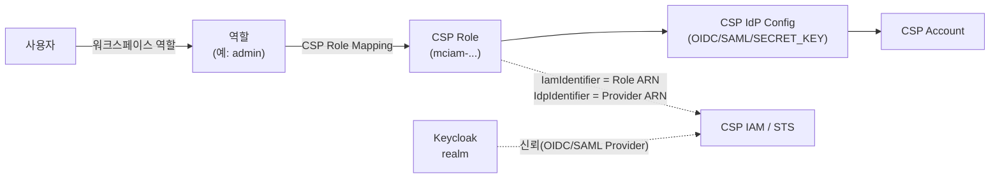

# CSP 임시자격증명 설정·발급 절차

> 기준: mc-iam-manager **develop (0.7.4 예정)**, mc-web-console develop (0.7.5 예정). 0.7.1 이하와 다른 점은 [10. 알려진 제약](#10-알려진-제약)과 [11. 검증 기록](#11-검증-기록)을 참고하세요.
>
> 내부 운영자용 실무 절차서입니다. **모든 작업을 브라우저에서** 할 수 있게 썼습니다(Keycloak Admin Console, AWS 콘솔, mc-web-console, 브라우저 개발자 도구). CLI로 하는 방법은 각 단계의 "CLI로 할 때"를 펼쳐 보세요.
> 개념·엔티티·API 전체 목록은 [CSP Integration](CSP-Integration)을 참고하세요. 이 문서는 **AWS + OIDC**를 기준으로 쓰고, 다른 CSP는 [CSP별 차이](#8-csp별-차이)에 차이점만 정리합니다. AWS SAML은 [AWS SAML 구성 절차](CSP-AWS-SAML-Guide-ko)에 따로 있습니다.

## 개요

mc-iam-manager는 사용자의 **워크스페이스 역할**에 매핑된 **CSP 역할**로 CSP의 STS를 호출해 짧은 수명의 자격증명을 발급합니다. CSP는 mc-iam-manager 뒤의 Keycloak을 IdP로 신뢰해야 합니다.



AWS 쪽은 **최초 1회만** 사람이 설정합니다. 이때 만드는 **관리용 Role**(예: `mciam-platformadmin`)로 mc-iam-manager가 사용자용 Role을 AWS에 만들고, 권한 정책을 붙이고, 신뢰 정책을 맞춥니다.

- **관리용 Role은 사용자에게 매핑하지 않습니다.** IdP Config의 `config.role_arn`에 들어간 Role은 mc-iam-manager가 등록·수정·삭제·매핑·정책 연결·신뢰 정책 변경을 모두 거부합니다(HTTP 409, `protected`). 매핑 해제만 허용합니다.
- 서버 `.env`는 최초 설치(부트스트랩)에만 씁니다. 실행 중의 AWS 연동 값(관리용 Role, Provider ARN, audience)은 **DB의 IdP Config**에서만 읽습니다.

| 단계 | 수행 위치 | 작업 | 빈도 | 담당 |
|---|---|---|---|---|
| 1-1 | **Keycloak Admin Console** | `<OIDC_CLIENT>` 클라이언트 확인 (설치 시 자동 생성) | 환경마다 1회 | 시스템 관리자 |
| 1-2 | **서버(VM)** | 환경변수 확인 | 환경마다 1회 | 시스템 관리자 |
| 2 | **Provider(AWS) 콘솔** | 해당 환경의 OIDC Provider 생성 | 환경마다 1회 | AWS 관리자 |
| 3 | **Provider(AWS) 콘솔** | 관리용 Role 확인·생성·신뢰 관계 추가 | 환경마다 1회 | AWS 관리자 |
| 4 | **mc-web-console**, **브라우저 개발자 도구** | CSP Account, IdP Config 등록 | 환경마다 1회 | 플랫폼 관리자 |
| 5 | **mc-web-console**, **브라우저 개발자 도구** | 사용자용 CSP Role 등록(→ AWS에 자동 생성), 권한 정책 연결 | 역할마다 | 플랫폼 관리자 |
| 6 | **mc-web-console** | 역할 ↔ CSP Role 매핑, 사용자에게 워크스페이스 역할 할당 | 필요할 때 | 플랫폼 관리자 |
| 7 | **mc-web-console**, **브라우저 개발자 도구**, **CloudShell** | 임시자격증명 발급·검증, 준비 상태·신뢰 정책 점검 | 필요할 때 | 사용자 / 관리자 |

"환경"은 Keycloak issuer 하나(예: dev, stage, prod 서버 각각)를 말합니다. 서버(VM) 작업만 SSH가 필요하고 나머지는 모두 브라우저에서 합니다.

> **mc-admin-cli로 설치한 환경**은 부트스트랩이 4단계(CSP Account `aws-default`, IdP Config `aws-oidc`)와 기본 역할 매핑(Master Role `X` → `mciam-X`, 없으면 AWS에 생성)까지 해 둡니다. 이때 만들어지는 `mciam-admin`, `mciam-operator`, `mciam-viewer`, `mciam-billadmin`, `mciam-billviewer`에는 **권한 정책이 없으므로** 5-2에서 붙여야 합니다. 업그레이드한 기존 설치는 mc-admin-cli 문서 `docs/csp-role-mapping-upgrade.md`를 따르세요.

### mc-web-console 화면 지원 현황과 대안

mc-web-console 화면이 없는 작업은 **❌ 화면 없음**, 화면은 있으나 제약이 있는 것은 **⚠️**로 표시했습니다. 대안 API는 [개발자 도구](#개발자-도구에서-api-호출하기)에서 호출합니다.

| 단계 | 작업 | mc-web-console 화면 | mc-iam-manager API 대안 |
|---|---|---|---|
| 1-1 | Keycloak OIDC 클라이언트 | ❌ 화면 없음 (설치 시 `POST /api/initial-admin`이 자동 생성) | ❌ 없음 → Keycloak Admin Console에서 확인 |
| 1-2 | 환경변수 | ❌ 화면 없음 | ❌ 없음 → 서버(VM) |
| 2 | AWS OIDC Provider 생성 | ❌ 화면 없음 | ❌ 없음 → AWS 콘솔 |
| 3 | 관리용 Role 확인·생성·신뢰 관계 추가 | ❌ 화면 없음 | ❌ 없음 → AWS 콘솔 (관리용 Role이 이 환경을 신뢰하기 전에는 mc-iam-manager가 AWS에 접근할 수 없으므로 구조상 불가) |
| 4-1 | CSP Account 등록 | ✅ Settings > Environment > Cloud SPs > CSP Accounts (Credential Data 예시 문구는 실제 입력값과 다름, 4-1 참고) | `POST /api/csp-accounts` |
| 4-2 | IdP Config 등록·수정 | ❌ 화면 없음 | ✅ `POST /api/csp-idp-configs`, `PUT /api/csp-idp-configs/id/{id}` |
| 4-2 | IdP Config 연결 테스트·활성화 | ❌ 화면 없음 | ✅ `POST /api/csp-idp-configs/id/{id}/test`, `/activate`, `/deactivate` |
| 5-1 | 사용자용 CSP Role 등록 (AWS Role 자동 생성) | ✅ Operations > Manage > Workspaces > CSP Roles | `POST /api/roles/csp` |
| 5-1 | CSP Role 삭제 | ✅ CSP Roles → Delete | `DELETE /api/roles/csp/id/{id}` (5-4) |
| 5-2 | 권한 정책 정의·연결 (AWS에 반영) | ⚠️ CSP Roles 화면에 정책 추가·해제가 있으나 현재 요청 형식이 서버와 맞지 않아 400으로 실패 | ✅ `POST /api/csp-policies`, `/attach`, `/detach` |
| 5-3 | CSP Role에 IdP Config 연결, SAML 클라이언트 ID | ❌ 화면 없음 | ✅ `PUT /api/roles/csp/id/{id}` (`cspIdpConfigId`, `extendedConfig`) |
| 6-1 | 역할 ↔ CSP Role 매핑 | ✅ Workspaces > Roles → CSP Role Mapping (존재 확인 배지, 없으면 AWS에 생성) | `POST /api/roles/csp-roles`, 또는 `POST/PUT /api/roles`의 `cspRoles` |
| 6-2 | 사용자 워크스페이스 역할 할당 | ✅ Workspaces → 멤버 추가 | `POST /api/roles/assign/workspace-role` |
| 7-1 | 임시자격증명 발급 | ✅ 콘솔 상단 **CSP Credentials** 창 | `POST /api/workspaces/temporary-credentials` |
| 7-3 | 단계별 진단 | ❌ 화면 없음 | ✅ `POST /api/workspaces/credentials/validate` |
| 7-5 | 계정 준비 상태, 신뢰 정책 점검·재동기화 | ❌ 화면 없음 | ✅ `GET /api/csp-accounts/id/{id}/readiness`, `POST /api/roles/csp/check`, `POST /api/csp-target-roles/id/{id}/trust-policy/sync`, `POST /api/csp-idp-configs/id/{id}/trust-policy/{check,sync}` |

정리하면 mc-iam-manager 쪽 작업은 모두 화면이나 API로 할 수 있습니다. Keycloak·서버·AWS 쪽 최초 설정(1, 2, 3)만 각 콘솔에서 합니다.

### 표기

실제 계정 정보는 문서·티켓·채팅에 남기지 말고 아래 표기로 바꿔 씁니다.

| 표기 | 의미 | 예 (가상) |
|---|---|---|
| `<IAM_URL>` | mc-iam-manager 외부 URL | `https://mcmp.example.com` |
| `<KC_DOMAIN>` | `MC_IAM_MANAGER_KEYCLOAK_EXTERNAL_DOMAIN` (보통 `MC_IAM_MANAGER_PUBLIC_DOMAIN`과 같음) | `mcmp.example.com` |
| `<REALM>` | `MC_IAM_MANAGER_KEYCLOAK_REALM` | `mciam` |
| `<OIDC_CLIENT>` | `MC_IAM_MANAGER_KEYCLOAK_OIDC_CLIENT_NAME` | `mciam-oidc-Client` |
| `<ISSUER>` | Keycloak realm issuer | `https://<KC_DOMAIN>/auth/realms/<REALM>` |
| `<ACCOUNT_ID>` | AWS 계정 ID 12자리 | `123456789012` |
| `<ADMIN_ROLE>` | 관리용 Role 이름 | `mciam-platformadmin` |
| `<PROVIDER_ARN>` | 2단계에서 만든 OIDC Provider ARN | `arn:aws:iam::<ACCOUNT_ID>:oidc-provider/<KC_DOMAIN>/auth/realms/<REALM>` |

### 개발자 도구에서 API 호출하기

IdP Config 등록 등 일부 작업은 mc-web-console에 화면이 없어 mc-iam-manager API를 직접 불러야 합니다. Swagger UI(`/swagger/index.html`)도 인증 헤더를 요구해 브라우저로 바로 열리지 않으므로, 아래처럼 **브라우저 개발자 도구 콘솔**을 씁니다.

1. 새 탭에서 `<IAM_URL>/readyz`를 엽니다(mc-iam-manager와 같은 주소여야 CORS 문제가 없습니다).
2. F12 → **Console** 탭에 아래 도우미를 붙여 넣고 Enter. Chrome이 붙여넣기를 막으면 안내대로 `allow pasting`을 먼저 입력합니다.

```js
const IAM = location.origin;
async function login() {
  const r = await fetch(`${IAM}/api/auth/login`, { method: 'POST', headers: { 'Content-Type': 'application/json' },
    body: JSON.stringify({ id: prompt('ID'), password: prompt('Password') }) });
  const j = await r.json(); if (!j.access_token) throw new Error(JSON.stringify(j)); return j.access_token;
}
async function api(method, path, body) {
  const r = await fetch(`${IAM}${path}`, { method, headers: { 'Content-Type': 'application/json', Authorization: `Bearer ${TOKEN}` },
    body: body === undefined ? undefined : JSON.stringify(body) });
  const t = await r.text(); let b; try { b = JSON.parse(t); } catch { b = t; }
  console.log(r.status, b); return b;
}
var TOKEN = await login();   // 플랫폼 관리자 계정
```

비밀번호는 `prompt` 창으로만 입력하므로 콘솔 기록에 남지 않습니다. 탭을 닫으면 토큰도 사라집니다.

---

## 1. 사전 점검

### 1-1. Keycloak OIDC 클라이언트 (❌ mc-web-console 화면 없음)

> **수행 위치: Keycloak Admin Console** (`https://<KC_DOMAIN>/auth/admin/`)

mc-iam-manager는 발급할 때 이 클라이언트의 서비스 계정 토큰을 CSP에 제출합니다.

설치 시 `POST /api/initial-admin`(mc-admin-cli 부트스트랩이 호출)이 `<OIDC_CLIENT>`를 만듭니다. 없으면 `MC_IAM_MANAGER_KEYCLOAK_OIDC_CLIENT_NAME`·`MC_IAM_MANAGER_KEYCLOAK_OIDC_CLIENT_SECRET` 값으로 만들고(confidential, Service accounts·Direct access grants ON, Standard flow OFF, audience mapper 포함), 이미 있으면 audience mapper만 없을 때 추가합니다. secret이 다르거나 Service accounts가 꺼져 있으면 서버 로그에 WARN만 남기고 고치지는 않습니다. 플랫폼 관리자가 이미 있는 환경에서 `POST /api/initial-admin`을 다시 부르면 403이므로, 기존 환경에 클라이언트가 없으면 아래처럼 직접 만듭니다.

Keycloak Admin Console(`https://<KC_DOMAIN>/auth/admin/`)에 `MC_IAM_MANAGER_KEYCLOAK_ADMIN` 계정으로 로그인 → 왼쪽 위 realm 선택에서 `<REALM>` → **Clients**

**목록에 `<OIDC_CLIENT>`가 없으면** Create client:

| 화면 | 항목 | 값 |
|---|---|---|
| General settings | Client type | OpenID Connect |
| | Client ID | `<OIDC_CLIENT>` |
| Capability config | Client authentication | ON |
| | Authentication flow | **Service accounts roles**, **Direct access grants**만 체크 (Standard flow 해제) |
| Login settings | (모두 비움) | |

Save 후 **Credentials** 탭 → Client secret을 서버의 `MC_IAM_MANAGER_KEYCLOAK_OIDC_CLIENT_SECRET` 값으로 맞춥니다. Keycloak 24 화면에서는 secret을 직접 입력할 수 없으므로, 생성된 secret을 복사해 서버 `.env`의 `MC_IAM_MANAGER_KEYCLOAK_OIDC_CLIENT_SECRET`에 넣고 mc-iam-manager를 재생성하거나, 아래 API 방법으로 env 값을 지정해 만듭니다.

**이미 있으면** Settings에서 위 표의 값과 같은지, Credentials의 secret이 env 값과 같은지 확인합니다. secret이 다르면 `invalid_client`가 납니다.

<details>
<summary>CLI로 할 때 (서버에서, secret을 env 값으로 지정해 생성)</summary>

```bash
# mc-iam-manager 컨테이너 env에서 값을 읽어 씁니다
eval "$(docker exec mc-iam-manager env | grep -E '^MC_IAM_MANAGER_KEYCLOAK_(ADMIN|ADMIN_PASSWORD|OIDC_CLIENT_NAME|OIDC_CLIENT_SECRET|REALM)=' | sed 's/^/export /')"
KC=https://<KC_DOMAIN>/auth
ADMIN_TOKEN=$(curl -s -X POST "$KC/realms/master/protocol/openid-connect/token" \
  -d grant_type=password -d client_id=admin-cli \
  -d username="$MC_IAM_MANAGER_KEYCLOAK_ADMIN" --data-urlencode password="$MC_IAM_MANAGER_KEYCLOAK_ADMIN_PASSWORD" | jq -r .access_token)

jq -n --arg id "$MC_IAM_MANAGER_KEYCLOAK_OIDC_CLIENT_NAME" --arg s "$MC_IAM_MANAGER_KEYCLOAK_OIDC_CLIENT_SECRET" \
  '{clientId:$id, protocol:"openid-connect", enabled:true, publicClient:false, secret:$s,
    serviceAccountsEnabled:true, directAccessGrantsEnabled:true, standardFlowEnabled:false}' |
curl -s -o /dev/null -w '%{http_code}\n' -X POST "$KC/admin/realms/$MC_IAM_MANAGER_KEYCLOAK_REALM/clients" \
  -H "Authorization: Bearer $ADMIN_TOKEN" -H 'Content-Type: application/json' -d @-
# 201이면 생성 완료
```

</details>

**토큰 발급 확인** (체크리스트 A1~A4): `<IAM_URL>` 탭의 개발자 도구 콘솔에서

```js
const KC_TOKEN = `${location.origin}/auth/realms/${prompt('Realm', 'mciam')}/protocol/openid-connect/token`;
const kc = await (await fetch(KC_TOKEN, { method: 'POST', body: new URLSearchParams({
  grant_type: 'client_credentials', scope: 'openid',
  client_id: prompt('OIDC client', 'mciam-oidc-Client'), client_secret: prompt('OIDC client secret') }) })).json();
const jwt = t => JSON.parse(atob(t.split('.')[1].replace(/-/g, '+').replace(/_/g, '/')));
console.log(kc.error ?? { access: (({iss, azp, aud}) => ({iss, azp, aud}))(jwt(kc.access_token)),
                          id:     (({iss, azp, aud}) => ({iss, azp, aud}))(jwt(kc.id_token)) });
```

정상이면 `iss`가 `<ISSUER>`, access token의 `azp`와 id token의 `aud`가 `<OIDC_CLIENT>`입니다(access token의 `aud`가 `account`인 것은 정상). `iss`가 `http://mc-iam-manager-kc:8080/...` 같은 내부 주소면 Keycloak 컨테이너에 `KC_HOSTNAME_URL=https://<KC_DOMAIN>/auth`가 설정됐는지 확인하세요.

### 1-2. mc-iam-manager 환경변수 (❌ 화면 없음, API 대안 없음)

> **수행 위치: 서버(VM)**: mc-iam-manager 컨테이너가 실행되는 호스트에 SSH로 접속해서 합니다.

AWS Role의 신뢰 정책은 환경변수가 아니라 **IdP Config 값**(`oidc_provider_arn`, `audience`, 4-2)으로 만듭니다. 그래서 CSP 연동에 필요한 서버 환경변수는 아래뿐입니다.

| 변수 | 값 | 비우거나 틀리면 |
|---|---|---|
| `MC_IAM_MANAGER_KEYCLOAK_OIDC_CLIENT_NAME` | `<OIDC_CLIENT>` | 발급 토큰을 받지 못함 |
| `MC_IAM_MANAGER_KEYCLOAK_OIDC_CLIENT_SECRET` | 1-1 클라이언트의 secret | `401 invalid_client` |
| `MC_IAM_MANAGER_KEYCLOAK_OIDC_CLIENT_ID` | 비어 있지 않은 값 (보통 `<OIDC_CLIENT>`) | 비어 있으면 기동 실패. 신뢰 정책에는 쓰이지 않음 |
| `MC_IAM_MANAGER_PLATFORMADMIN_ID`, `MC_IAM_MANAGER_PLATFORMADMIN_PASSWORD` | 플랫폼 관리자 계정 | SAML 발급만 실패 |

`MC_IAM_MANAGER_AWS_ACCOUNT_ID`, `MC_IAM_MANAGER_KEYCLOAK_EXTERNAL_URL`, `MC_IAM_MANAGER_AWS_IDENTITY_ROLE_ARN`은 mc-iam-manager가 실행 중에 읽지 않습니다. mc-admin-cli 부트스트랩이 IdP Config를 만들 때만 씁니다.

`AWS_REGION`도 실행 중에는 읽지 않습니다. 발급 리전은 요청의 `region`, 없으면 CSP Account의 `account_info.region`으로 정합니다([7-1](#7-1-발급)의 리전 규칙). mc-admin-cli `.env`의 `MC_IAM_MANAGER_AWS_DEFAULT_REGION`(기본 `ap-northeast-2`)은 최초 설정 때 `aws-default` 계정의 `account_info.region`으로만 쓰입니다.

**mc-admin-cli로 설치한 서버**에서는:

1. 수정할 파일: `<mc-admin-cli 경로>/conf/docker/conf/mc-iam-manager/.env`
   - mc-iam-manager 컨테이너는 이 파일을 `env_file`로 읽습니다. 같은 이름의 값이 `conf/docker/.env`에도 있지만 그 파일은 compose 변수 치환용이라 **컨테이너에는 들어가지 않습니다.**
2. 반영: `conf/docker` 폴더에서 컨테이너를 **재생성**합니다. `docker restart`로는 env 파일이 다시 읽히지 않습니다. 재생성하는 30초 남짓 동안 로그인·API가 끊깁니다.

```bash
cd <mc-admin-cli 경로>/conf/docker
docker compose -p mcc up -d --no-deps --force-recreate mc-iam-manager   # -p 는 기존 compose 프로젝트명
docker exec mc-iam-manager env | grep -E 'KEYCLOAK_OIDC_CLIENT_(NAME|ID)|PLATFORMADMIN_ID'   # 반영 확인
```

compose 프로젝트명은 `docker inspect mc-iam-manager --format '{{index .Config.Labels "com.docker.compose.project"}}'`로 확인합니다.

---

## 2. AWS: 해당 환경의 OIDC Provider 생성 (환경마다 1회, ❌ mc-web-console 화면 없음, API 대안 없음)

> **수행 위치: Provider(AWS) 콘솔**: IAM 관리 권한이 있는 계정으로 로그인 → **IAM** → 왼쪽 **Identity providers**

1. 목록에서 Provider 이름이 `<KC_DOMAIN>/auth/realms/<REALM>`인 항목이 있는지 찾습니다.
   - **있으면** 클릭 → **Audiences**에 `<OIDC_CLIENT>`가 있는지 확인합니다. 없으면 Actions → **Add audience**로 추가하고 3단계로 갑니다.
2. 없으면 **Add provider**

| 항목 | 값 |
|---|---|
| Provider type | OpenID Connect |
| Provider URL | `https://<KC_DOMAIN>/auth/realms/<REALM>` (끝에 `/` 없이) |
| Audience | `<OIDC_CLIENT>` |

3. **Add provider** → 상세 화면의 ARN이 `<PROVIDER_ARN>`입니다. 4-2 IdP Config의 `oidc_provider_arn`이 되고, CSP Role의 **IDP Identifier**에 자동으로 들어갑니다.

mc-iam-manager는 AWS Role을 만들기 전에 이 Provider와 Audience가 있는지 확인합니다. 없으면 Role을 만들지 않고 400으로 알려 줍니다(관리용 Role에 `iam:GetOpenIDConnectProvider` 권한이 없으면 확인을 건너뜁니다).

<details>
<summary>CLI로 할 때</summary>

```bash
export ACCOUNT_ID="<AWS 계정 ID>" KC_DOMAIN="<KC_DOMAIN>" REALM="<REALM>" OIDC_CLIENT="<OIDC_CLIENT>"
export ISSUER_HOSTPATH="${KC_DOMAIN}/auth/realms/${REALM}"
export PROVIDER_ARN="arn:aws:iam::${ACCOUNT_ID}:oidc-provider/${ISSUER_HOSTPATH}"

aws iam list-open-id-connect-providers --query "OpenIDConnectProviderList[?ends_with(Arn, '${ISSUER_HOSTPATH}')]"
aws iam create-open-id-connect-provider --url "https://${ISSUER_HOSTPATH}" --client-id-list "${OIDC_CLIENT}"
# 이미 있는데 audience만 없으면:
# aws iam add-client-id-to-open-id-connect-provider --open-id-connect-provider-arn "$PROVIDER_ARN" --client-id "$OIDC_CLIENT"
```

</details>

---

## 3. AWS: 관리용 Role 준비 (환경마다 1회, ❌ mc-web-console 화면 없음, API 대안 없음)

> **수행 위치: Provider(AWS) 콘솔** → **IAM** → 왼쪽 **Roles**

관리용 Role은 `role/mciam-*` Role과 `policy/mciam-*` 정책을 만들고 고칠 권한을 갖고, mc-iam-manager가 이 Role로 AWS에 씁니다. AWS 계정마다 하나를 두고 여러 환경이 함께 씁니다. **사용자에게 매핑하지 않습니다.**

### 3-1. 관리용 Role이 있는지 확인

Roles 검색창에 `<ADMIN_ROLE>` 입력.

- **없으면** → 3-2 (생성하면 이 환경의 신뢰 관계까지 함께 들어가므로 3-3은 건너뜁니다)
- **있으면** → Role 클릭 → **Trust relationships** 탭에서 2단계의 `<PROVIDER_ARN>` 문장이 있는지 봅니다. 있으면 3-4로, 없으면 3-3

<details>
<summary>CLI로 할 때</summary>

```bash
aws iam get-role --role-name "<ADMIN_ROLE>" --query 'Role.AssumeRolePolicyDocument.Statement[].Principal.Federated'
# NoSuchEntity 오류면 Role 없음
```

</details>

### 3-2. 없으면 관리용 Role 생성

1. **Create role**
2. Trusted entity type: **Web identity** → Identity provider: `<KC_DOMAIN>/auth/realms/<REALM>` → Audience: `<OIDC_CLIENT>` → Next
3. Add permissions: 아무것도 고르지 않고 Next (권한은 5번에서 inline으로 붙입니다)
4. Role name: `<ADMIN_ROLE>` (반드시 `mciam-`로 시작), Description: `mc-iam-manager management role` → **Create role**
5. 만든 Role 클릭 → **Permissions** 탭 → Add permissions → **Create inline policy** → **JSON** 탭에 아래를 붙여 넣고 `<ACCOUNT_ID>`를 실제 계정 ID로 바꿉니다.

```json
{
  "Version": "2012-10-17",
  "Statement": [
    {
      "Sid": "MciamRoleManagement",
      "Effect": "Allow",
      "Action": [
        "iam:CreateRole", "iam:GetRole", "iam:UpdateRole", "iam:UpdateRoleDescription", "iam:UpdateAssumeRolePolicy",
        "iam:DeleteRole", "iam:TagRole", "iam:UntagRole",
        "iam:AttachRolePolicy", "iam:DetachRolePolicy", "iam:PutRolePolicy", "iam:DeleteRolePolicy",
        "iam:ListAttachedRolePolicies", "iam:ListRolePolicies", "iam:GetRolePolicy", "iam:ListInstanceProfilesForRole",
        "iam:GetOpenIDConnectProvider", "iam:GetSAMLProvider"
      ],
      "Resource": [
        "arn:aws:iam::<ACCOUNT_ID>:role/mciam-*",
        "arn:aws:iam::<ACCOUNT_ID>:oidc-provider/*",
        "arn:aws:iam::<ACCOUNT_ID>:saml-provider/*"
      ]
    },
    {
      "Sid": "MciamPolicyDefinition",
      "Effect": "Allow",
      "Action": ["iam:GetPolicy", "iam:GetPolicyVersion", "iam:ListPolicyVersions", "iam:CreatePolicy",
                 "iam:CreatePolicyVersion", "iam:DeletePolicyVersion", "iam:DeletePolicy"],
      "Resource": "arn:aws:iam::<ACCOUNT_ID>:policy/mciam-*"
    },
    { "Sid": "MciamPolicyList", "Effect": "Allow", "Action": ["iam:ListPolicies"], "Resource": "*" },
    { "Sid": "MciamAwsManagedPolicyRead", "Effect": "Allow",
      "Action": ["iam:GetPolicy", "iam:GetPolicyVersion"], "Resource": "arn:aws:iam::aws:policy/*" }
  ]
}
```

6. Next → Policy name `mciam-role-management` → **Create policy**

권한 범위를 `role/mciam-*`·`policy/mciam-*`로 묶어 두면 mc-iam-manager는 그 밖의 Role·고객 관리형 정책을 바꿀 수 없습니다. 권한이 모자라면 해당 요청이 502로 실패하거나, 정책 연결이 `aws_status=failed`로 남습니다(5-2).

| 권한 | 쓰는 곳 |
|---|---|
| `CreateRole`, `GetRole`, `UpdateAssumeRolePolicy` | 5-1 Role 생성·등록, 7-5 신뢰 정책 재동기화 |
| `GetOpenIDConnectProvider`, `GetSAMLProvider` | Role 생성 전 Provider 확인, 7-3 진단, 7-5 점검, SAML 발급 사전 확인 |
| `AttachRolePolicy`, `DetachRolePolicy`, `PutRolePolicy`, `DeleteRolePolicy` | 5-2 정책 연결·해제 |
| `policy/mciam-*` 정책 권한 | 5-2 고객 관리형(custom) 정책 생성·수정·삭제 |
| `ListPolicies`, `aws:policy/*` 읽기 | 5-2 정책 동기화, AWS 관리형 정책 문서 조회 |
| `ListAttachedRolePolicies`, `ListRolePolicies`, `ListInstanceProfilesForRole`, `DeleteRole` | 5-4 CSP Role 삭제 |

### 3-3. 있으면 신뢰 관계에 해당 환경 문장 추가

1. `<ADMIN_ROLE>` 클릭 → **Trust relationships** 탭
2. 기존 정책 JSON 전체를 복사해 따로 보관합니다(되돌릴 때 사용).
3. **Edit trust policy** → `"Statement": [ ... ]` 배열의 **마지막 문장 뒤에 쉼표를 찍고** 아래 문장을 추가합니다. `<ACCOUNT_ID>`, `<KC_DOMAIN>`, `<REALM>`, `<OIDC_CLIENT>`를 실제 값으로 바꿉니다.

```json
{
  "Effect": "Allow",
  "Principal": {
    "Federated": "arn:aws:iam::<ACCOUNT_ID>:oidc-provider/<KC_DOMAIN>/auth/realms/<REALM>"
  },
  "Action": "sts:AssumeRoleWithWebIdentity",
  "Condition": {
    "StringEquals": {
      "<KC_DOMAIN>/auth/realms/<REALM>:aud": "<OIDC_CLIENT>"
    }
  }
}
```

4. **Update policy**

> **기존 문장은 절대 지우지 마세요.** 다른 환경(다른 Keycloak)이 같은 관리용 Role을 쓰고 있어서, 문장을 지우면 그 환경의 AWS 쓰기가 모두 멈춥니다. 저장 전에 편집기에서 문장 수가 "기존 + 1"인지 확인합니다. 관리용 Role의 신뢰 정책은 mc-iam-manager의 재동기화 API로 바꿀 수 없습니다(409).

<details>
<summary>CLI로 할 때 (기존 문장을 유지하며 추가)</summary>

```bash
export ADMIN_ROLE="<관리용 Role 이름>"   # 2단계 CLI의 변수도 함께 설정
cat > trust-statement.json <<EOF
{"Effect":"Allow","Principal":{"Federated":"${PROVIDER_ARN}"},"Action":"sts:AssumeRoleWithWebIdentity",
 "Condition":{"StringEquals":{"${ISSUER_HOSTPATH}:aud":"${OIDC_CLIENT}"}}}
EOF
aws iam get-role --role-name "$ADMIN_ROLE" --query Role.AssumeRolePolicyDocument --output json > trust-current.json
cp trust-current.json "trust-backup-$(date +%Y%m%d%H%M%S).json"
jq --slurpfile s trust-statement.json \
  'if any(.Statement[]; .Principal.Federated == $s[0].Principal.Federated) then . else .Statement += $s end' \
  trust-current.json > trust-new.json
diff <(jq . trust-current.json) <(jq . trust-new.json)   # 추가된 문장 하나만 보여야 함
aws iam update-assume-role-policy --role-name "$ADMIN_ROLE" --policy-document file://trust-new.json
```

</details>

### 3-4. 있으면 권한 확인

**Permissions** 탭에서 inline 정책이 3-2의 5번 내용을 포함하는지 확인합니다. 예전 버전 문서로 만든 Role은 `ListInstanceProfilesForRole`과 `policy/mciam-*` 정책 권한이 없을 수 있습니다. `IAMFullAccess`가 붙어 있으면 이미 허용됩니다.

<details>
<summary>CLI로 할 때</summary>

```bash
aws iam simulate-principal-policy \
  --policy-source-arn "arn:aws:iam::<ACCOUNT_ID>:role/<ADMIN_ROLE>" \
  --action-names iam:CreatePolicy iam:CreatePolicyVersion iam:ListPolicyVersions iam:DeletePolicyVersion iam:DeletePolicy iam:GetPolicy iam:GetPolicyVersion \
  --resource-arns "arn:aws:iam::<ACCOUNT_ID>:policy/mciam-check" \
  --query 'EvaluationResults[].[EvalActionName,EvalDecision]' --output text
# 모두 allowed 면 그대로 둡니다
```

</details>

**확인**: Trust relationships 탭에 `<PROVIDER_ARN>`과 `aud`=`<OIDC_CLIENT>` 문장이 보이면 됩니다. 실제로 assume되는지는 4-2의 연결 테스트나 [체크리스트 B3](#9-점검-체크리스트)에서 확인합니다.

---

## 4. mc-iam-manager: CSP Account, IdP Config 등록 (환경마다 1회)

> **수행 위치: mc-web-console**(4-1), **브라우저 개발자 도구**(4-2, [사용법](#개발자-도구에서-api-호출하기))
>
> mc-admin-cli로 설치했다면 부트스트랩이 `aws-default` 계정과 `aws-oidc` IdP Config를 만들어 둡니다. 값이 맞는지만 확인하세요. `aws-default`의 `region`은 mc-admin-cli `.env`의 `MC_IAM_MANAGER_AWS_DEFAULT_REGION`(기본 `ap-northeast-2`) 값입니다.

### 4-1. CSP Account

mc-web-console → **Settings > Environment > Cloud SPs > CSP Accounts** → Add

| 항목 | 값 |
|---|---|
| Account Name | 예: `aws-main` |
| CSP Provider | AWS |
| Credential Data (JSON) | `{"account_id": "<ACCOUNT_ID>", "region": "ap-northeast-2"}` |

> **Credential Data 칸에는 액세스 키가 아니라 계정 정보를 넣습니다.** 입력란 예시가 `{"accessKey": ...}`로 되어 있지만 실제로는 계정 정보(`account_info`)로 저장되고, 필수 키가 없으면 등록이 거부됩니다. CSP별 필수 키: AWS·Alibaba `account_id`, GCP `project_id`, Tencent `app_id`, Azure `subscription_id`와 `tenant_id`.
>
> `region`은 계정의 기본 리전입니다. 발급 요청에 `region`이 없으면 이 값을 씁니다. Tencent는 필수(`400 region_required`)이고 다른 CSP는 선택이며, 값이 있으면 형식을 검사합니다(`400 invalid_region`). 나중에 바꿀 때 `PUT /api/csp-accounts/id/{id}`의 `account_info`에 `region` 키를 빼면 기존 값이 유지되고, `"region": ""`은 삭제입니다(Tencent는 삭제 불가).

등록한 계정의 id를 확인합니다(개발자 도구 콘솔):

```js
await api('POST', '/api/csp-accounts/list', {});
```

응답에서 해당 계정의 `id`가 `<CSP_ACCOUNT_ID>`입니다.

### 4-2. IdP Config (❌ 화면 없음 → API로)

```js
await api('POST', '/api/csp-idp-configs', {
  name: 'aws-oidc',
  csp_account_id: <CSP_ACCOUNT_ID>,          // 숫자
  auth_method: 'OIDC',
  config: {
    role_arn: 'arn:aws:iam::<ACCOUNT_ID>:role/<ADMIN_ROLE>',
    oidc_provider_arn: '<PROVIDER_ARN>',
    audience: '<OIDC_CLIENT>'
  },
  description: 'Keycloak OIDC trust for AWS'
});
```

| `config` 키 | 용도 | 비우거나 틀리면 |
|---|---|---|
| `role_arn` | **관리용 Role**(사용자용 Role 아님). mc-iam-manager가 AWS에 쓸 때 assume | AWS 쓰기 전부 실패, readiness `idp_config` 실패 |
| `oidc_provider_arn` | 사용자용 Role 신뢰 정책의 `Federated`, 신뢰 정책 점검 기대값 | Role 생성 400 (`arn:aws:iam::...:oidc-provider/...` 형식이어야 함) |
| `audience` | 신뢰 정책 `<host>:aud` 값 | 비었거나 `notyet`이면 Role 생성 400 |

- 응답의 `id`가 `<IDP_CONFIG_ID>`입니다.
- 연결 테스트(AWS OIDC만 지원): `await api('POST', '/api/csp-idp-configs/id/<IDP_CONFIG_ID>/test');`
- 같은 계정에 **활성 AWS OIDC IdP Config는 하나만** 두세요. CSP Role에 IdP Config를 지정하지 않았을 때 mc-iam-manager는 그 하나를 고르고, 0개이거나 둘 이상이면 400으로 거부합니다.
- IdP Config 값을 바꾼 뒤에는 이미 만든 Role의 신뢰 정책이 예전 값으로 남습니다. 7-5에서 점검하고 재동기화하세요.

---

## 5. 사용자용 CSP Role (역할마다)

> **수행 위치: mc-web-console**(5-1, 5-4), **브라우저 개발자 도구**(5-2, 5-3)

### 5-1. 등록 → AWS에 Role 자동 생성

mc-web-console → **Operations > Manage > Workspaces > CSP Roles** → Add CSP Role

| 항목 | 값 |
|---|---|
| CSP Type | AWS |
| CSP Role Name | 예: `ec2ro` (자동으로 `mciam-ec2ro`가 됨). 반드시 입력합니다 |
| Auth Method | OIDC |
| Description | 용도 설명 |
| IDP Identifier, IAM Identifier, IAM Role ID | 비워 둡니다 (자동으로 채워짐) |

저장하면 mc-iam-manager가 IdP Config의 관리용 Role로 AWS에 접속해:

- **같은 이름의 Role이 없으면**: IdP Config의 `oidc_provider_arn`·`audience`로 신뢰 정책을 만들어 `mciam-<이름>` Role을 **생성**합니다(origin `created`). 만들기 전에 Provider와 Audience가 AWS에 있는지 확인합니다.
- **이미 있으면**: Role을 **등록**합니다(origin `registered`). IDP Identifier도 채워집니다(요청 값 → IdP Config의 Provider ARN → AWS 신뢰 정책의 첫 Provider 순). 고른 값이 AWS 신뢰 정책과 다르면 경고가 나오니, 7-5에서 신뢰 정책을 점검하세요.
- CSP Role이 쓸 IdP Config는 `cspIdpConfigId`로 지정하고, 지정하지 않으면 같은 CSP·인증방식의 활성 IdP Config가 하나일 때 그것을 씁니다(화면에는 입력란이 없음).
- 관리용 Role 이름(`<ADMIN_ROLE>`)은 등록할 수 없습니다(409).

목록에서 Status가 `created`인지 확인합니다. AWS 생성이 실패하면 `failed` 레코드가 남고, 원인을 고친 뒤 같은 이름으로 다시 등록하면 이어서 처리합니다.

### 5-2. 권한 정책 부여 (⚠️ 화면 실패 → API로, AWS에 반영)

정책 **연결·해제와 정의 변경은 AWS에 반영됩니다.** mc-web-console CSP Roles 화면의 정책 추가·해제는 현재 요청 필드 이름(`roleId`/`policyId`)이 서버(`csp_role_id`/`csp_policy_id`)와 달라 400 `CSP Role ID is required`로 실패하므로 API를 씁니다.

정책 정의의 세 가지 타입:

| `policy_type` | 의미 | 만들 때 | 연결 시 AWS 호출 |
|---|---|---|---|
| `managed` | AWS 관리형 정책 (`arn:aws:iam::aws:policy/...`) | `policy_arn` 필수, 문서 지정 불가 | `AttachRolePolicy` / `DetachRolePolicy` |
| `custom` | 고객 관리형 정책. 여러 Role이 공유 | `policy_arn`으로 기존 정책 등록, 또는 `policy_doc`만 주면 AWS에 `mciam-<이름>` 정책을 **생성**(`CreatePolicy`) | `AttachRolePolicy` / `DetachRolePolicy` |
| `inline` | Role 하나 전용 inline 정책 | `policy_doc` 필수 (DB에만 저장) | `PutRolePolicy` / `DeleteRolePolicy` |

```js
// 1) 정책 정의 (예: AWS 관리형 읽기 전용)
var pol = await api('POST', '/api/csp-policies', {
  name: 'ec2-readonly', csp_account_id: <CSP_ACCOUNT_ID>, policy_type: 'managed',
  policy_arn: 'arn:aws:iam::aws:policy/AmazonEC2ReadOnlyAccess', description: 'EC2 읽기 전용' });
// 2) CSP Role 에 연결 → AWS 에 AttachRolePolicy
await api('POST', '/api/csp-policies/attach', { csp_role_id: <CSP_ROLE_ID>, csp_policy_id: pol.id });
// 3) 상태 확인 (aws_status, last_error, applied_at)
await api('GET', '/api/csp-policies/role/<CSP_ROLE_ID>');
// 해제: await api('POST', '/api/csp-policies/detach', { csp_role_id: <CSP_ROLE_ID>, csp_policy_id: pol.id });
```

- 응답 `result`: `applied`, `detached`, `failed`, `detach_failed`. AWS 호출이 실패해도 HTTP는 200이고 `result: failed`(또는 `detach_failed`)와 `warnings`가 옵니다. 연결 행에 `aws_status`·`last_error`가 기록되며, **같은 요청을 다시 보내면** 다시 맞춥니다.
- 거부(아무것도 바꾸지 않음): 대상 Role 이름이 `mciam-`로 시작하지 않음, `AdministratorAccess`·`IAMFullAccess`·`PowerUserAccess` 연결, 문서에 `Allow` + `Action: "*"`·`"iam:*"` 또는 `NotAction` → 403 `forbidden_policy`. 관리용 Role → 409 `protected`. 없는 Role·정책 → 404.
- `inline` 정책은 Role 하나에만 연결합니다(다른 Role에 이미 연결돼 있으면 400). 공유가 필요하면 `custom`을 씁니다.
- 정의 수정(`PUT /api/csp-policies/id/{id}`): `custom` 문서 수정은 새 기본 버전을 만들고(버전이 5개면 가장 오래된 것 삭제), `inline` 문서 수정은 연결된 Role에 다시 넣습니다. 연결 중에는 이름·ARN을 바꿀 수 없습니다(409). `custom` 생성·수정·삭제는 이름이 `mciam-*`인 정책만 됩니다.
- 정의 삭제: 연결이 남아 있으면 409. `mciam-*` custom 정책은 AWS에서도 지우는데, IAM 밖에서 붙인 연결이 있으면 409.
- 동기화(`POST /api/csp-policies/sync`, `{csp_account_id, policy_scope}`): `Local`(기본)은 `mciam-*` 고객 관리형만, `AWS`는 AWS 관리형을 가져옵니다. 이 기능은 **계정의 첫 활성 IdP Config**의 `role_arn`을 쓰므로, 같은 계정에 SAML IdP Config가 먼저 있으면 실패할 수 있습니다.

**Trust relationships**: 신뢰 정책은 AWS 콘솔에서 고치지 말고 7-5의 점검·재동기화를 쓰세요.

### 5-3. 화면에서 입력할 수 없는 값 (❌ 화면 없음 → API로)

**IdP Config 연결(`cspIdpConfigId`)**과 **SAML 클라이언트 ID(`extendedConfig.saml_client_id`)**는 화면에 입력란이 없습니다. CSP Role id는 `await api('POST', '/api/roles/csp/list', {})`로 확인합니다.

```js
await api('PUT', '/api/roles/csp/id/<CSP_ROLE_ID>', { cspIdpConfigId: <IDP_CONFIG_ID> });
// SAML이면: { cspIdpConfigId: <IDP_CONFIG_ID>, extendedConfig: { saml_client_id: 'urn:amazon:webservices' } }
```

- `cspIdpConfigId`는 존재하고, 활성이고, CSP 타입이 같은 IdP Config여야 합니다(아니면 400). 통과하면 CSP Role의 소속 계정도 그 IdP Config의 계정으로 맞춥니다.
- AWS Role 이름은 바꿀 수 없습니다(400). AWS IAM이 Role 이름 변경을 지원하지 않기 때문입니다.

### 5-4. CSP Role 삭제

mc-web-console CSP Roles → Delete, 또는 `await api('DELETE', '/api/roles/csp/id/<CSP_ROLE_ID>')`.

1. mc-iam-manager가 연결한 권한 정책을 AWS에서 먼저 해제합니다. 해제가 실패하면 200 `result: detach_failed`로 멈추고 나머지는 그대로 둡니다(다시 요청하면 이어서 처리).
2. origin에 따라:
   - `created`(mc-iam-manager가 만든 Role): IAM 밖에서 붙인 정책이나 instance profile이 있으면 **409 `conflict`**와 그 목록(`unmanagedAttachedPolicies`, `unmanagedInlinePolicies`, `instanceProfiles`)을 돌려주고 아무것도 지우지 않습니다. 없으면 AWS Role을 지웁니다(이미 없으면 성공으로 처리).
   - `registered`(AWS에 있던 Role을 등록): **AWS Role은 남기고** mc-iam-manager 등록만 해제합니다.
3. 역할 매핑, 정책 연결, CSP Role 레코드를 한 번에 지우고 204를 돌려줍니다.

관리용 Role은 삭제할 수 없습니다(409). 관리용 Role에 `ListInstanceProfilesForRole` 권한이 없으면 `created` Role 삭제가 502로 실패합니다(3-2 표).

---

## 6. 역할 매핑과 사용자 할당

> **수행 위치: mc-web-console**

### 6-1. 역할 ↔ CSP Role 매핑

mc-web-console → **Operations > Manage > Workspaces > Roles** → 역할 생성·편집 → **CSP Role Mapping** 카드에서 CSP Type, Auth Method, CSP Role 이름을 넣고 행을 추가합니다.

- 행을 추가하면 이름이 `mciam-` 규칙으로 바뀌고, 존재 여부 배지가 붙습니다: **Registered**(mc-iam-manager에 등록됨) / **Exists in CSP - will register**(AWS에만 있음, 저장 시 등록) / **Not found - will create**(저장 시 AWS에 생성) / **Protected**(관리용 Role, 매핑 불가) / **Invalid** / **Check failed**.
- 저장하면 항목별 결과(`mapped`, `registered_and_mapped`, `created_and_mapped`, `unchanged`, `unmapped`, `failed`)와 경고가 알림으로 나옵니다. 한 항목이 실패해도 역할은 저장됩니다.
- API로 `cspRoles`를 보낼 때는 역할 타입(`roleTypes`)에 `csp`가 있어야 합니다(없으면 400). 매핑 API(`/api/roles/csp-roles`)는 `csp`를 자동으로 추가합니다.
- 편집 저장 시 목록에서 뺀 매핑은 해제됩니다. 역할 타입에서 `csp`를 빼면 CSP 매핑이 모두 해제됩니다.
- 이름 입력란의 기본값이 `MCIAM_<역할명>`이라 그대로 두면 `mciam-MCIAM_<역할명>`이 됩니다. 원하는 Role 이름으로 바꿔 넣으세요.
- 새로 만들어진 Role에는 권한 정책이 없으니 5-2에서 붙입니다.

**API로 할 때**: 매핑만 만드는 API(AWS에 Role을 만들지 않음, 없는 CSP Role이면 400)

```js
await api('POST', '/api/roles/list', {});        // 역할 id 확인
await api('POST', '/api/roles/csp/list', {});    // CSP Role id 확인
await api('POST', '/api/roles/csp-roles', { roleId: '<ROLE_ID>', cspRoleId: '<CSP_ROLE_ID>', cspType: 'aws', authMethod: 'OIDC' });
await api('GET', '/api/roles/csp-roles/id/<ROLE_ID>');   // 매핑 확인
```

잘못 매핑된 것을 지울 때: `await api('DELETE', '/api/roles/csp-roles', { roleId: '<ROLE_ID>', cspRoleId: '<CSP_ROLE_ID>', authMethod: 'OIDC' });`

화면과 같은 동작(없으면 생성)은 `POST /api/roles`·`PUT /api/roles/id/{id}`의 `cspRoles: [{ cspRoleName, cspType, authMethod, cspIdpConfigId }]`로 합니다. 이때 `cspRoleName`은 필수입니다.

- 하나의 역할에 CSP별·인증방식별로 여러 CSP Role을 매핑할 수 있습니다.
- **같은 역할 + CSP + 인증방식 조합에 CSP Role을 둘 이상 매핑하지 마세요.** 우선순위 규칙이 없어 첫 번째 것만 쓰입니다.
- 매핑할 CSP Role은 IdP Config가 연결돼 있고, 인증방식·CSP 타입이 맞고, IDP·IAM Identifier가 채워져 있어야 합니다(아니면 400).

### 6-2. 사용자에게 워크스페이스 역할 할당

mc-web-console → **Operations > Manage > Workspaces** → 워크스페이스 선택 → 멤버 추가에서 사용자와 6-1의 역할을 할당합니다.

- 사용자에게 직접 할당한 역할이 우선이고, 없으면 사용자가 속한 그룹의 워크스페이스 역할을 씁니다.
- 여러 그룹이 같은 워크스페이스에 서로 다른 역할을 주면 id가 가장 작은 역할이 쓰입니다.

---

## 7. 발급과 검증

> **수행 위치: mc-web-console**(7-1), **브라우저 개발자 도구**(7-1, 7-3, 7-5), **Provider(AWS) CloudShell**(7-2)

### 7-1. 발급

**화면**: 발급받을 사용자로 mc-web-console에 로그인 → 상단의 **CSP Credentials** 창에서 발급합니다. 창에 보이는 발급 가능 CSP는 사용자 워크스페이스 역할의 CSP Role 매핑으로 판단합니다.

**API**: 발급받을 사용자로 로그인한 토큰을 씁니다. 관리자 토큰으로 호출하면 관리자의 역할 기준으로 발급됩니다. 개발자 도구 콘솔에서:

```js
await api('POST', '/api/workspaces/list', {});   // (관리자 토큰으로) 워크스페이스 id 확인
TOKEN = await login();                           // 발급받을 사용자 계정으로 전환
var cred = await api('POST', '/api/workspaces/temporary-credentials',
  { workspaceId: '<WORKSPACE_ID>', cspType: 'aws', authMethod: 'OIDC', region: 'ap-northeast-2' });
```

- 워크스페이스 목록 조회는 관리자 권한이 필요하므로 사용자로 전환하기 **전에** 확인합니다. `workspaceId`는 문자열로 넣습니다.
- `cspType`은 소문자(`aws`, `gcp`, `alibaba`, `tencent`, `azure`)입니다.
- `authMethod`는 생략할 수 있지만, 한 역할에 OIDC·SAML 매핑이 둘 다 있으면 지정하세요.
- `region`은 생략할 수 있습니다. 리전은 다음 순서로 정합니다.
  1. 요청의 `region` (`regionSource: "request"`)
  2. CSP Account의 `account_info.region` (`regionSource: "account"`)
  3. 둘 다 없으면(`regionSource: "none"`) Tencent는 `400 region_required`, AWS는 글로벌 STS(`us-east-1`)로 발급하고 응답 `region`을 비운 채 `warnings`에 계정 리전 미설정을 알립니다. Alibaba·GCP는 리전 없이 진행합니다.
  - 형식이 잘못된 `region`(예: `Seoul`)은 `400 invalid_region`입니다.

정상 응답(AWS):

```json
{
  "cspType": "aws",
  "accessKeyId": "ASIA...",
  "secretAccessKey": "...",
  "sessionToken": "...",
  "expiration": "2026-01-01T01:00:00Z",
  "region": "ap-northeast-2",
  "regionSource": "request"
}
```

> 발급받은 키는 실제 권한이 있는 자격증명입니다. 화면 캡처·채팅·티켓에 붙이지 마세요.

### 7-2. 발급받은 키로 확인 (AWS CloudShell)

AWS 콘솔 상단의 **CloudShell** 아이콘을 열고, 발급받은 값으로 환경변수를 설정합니다. 개발자 도구 콘솔에서 아래를 실행하면 붙여 넣을 명령이 클립보드에 복사됩니다.

```js
copy(`export AWS_ACCESS_KEY_ID='${cred.accessKeyId}' AWS_SECRET_ACCESS_KEY='${cred.secretAccessKey}' AWS_SESSION_TOKEN='${cred.sessionToken}'`);
```

CloudShell에 붙여 넣은 뒤:

```bash
aws sts get-caller-identity
# "Arn": "arn:aws:sts::<ACCOUNT_ID>:assumed-role/mciam-<이름>/mciam-<keycloak-user-id>-<unix-time>"
aws ec2 describe-instances --region ap-northeast-2 \
  --query 'Reservations[].Instances[].[InstanceId, State.Name, InstanceType, VpcId, Tags[?Key==`Name`]|[0].Value]' --output table   # EC2 목록
aws ec2 describe-vpcs --region ap-northeast-2 \
  --query 'Vpcs[].[VpcId, CidrBlock, IsDefault, Tags[?Key==`Name`]|[0].Value]' --output table                                       # VPC 목록
aws ec2 create-tags --resources <VPC_ID> --tags Key=test,Value=1 --dry-run   # 쓰기 → UnauthorizedOperation (읽기 전용 정책일 때)
aws s3 ls                                                                     # 허용 안 된 서비스 → AccessDenied
unset AWS_ACCESS_KEY_ID AWS_SECRET_ACCESS_KEY AWS_SESSION_TOKEN   # 끝나면 해제
```

OIDC 세션 이름에 Keycloak 사용자 ID가 들어가므로 CloudTrail에서 누가 발급받았는지 추적할 수 있습니다(SAML은 다름, [SAML 가이드](CSP-AWS-SAML-Guide-ko#개요) 참고).

### 7-3. 실패 원인 단계별 진단 (❌ 화면 없음 → API로)

같은 체인을 단계별로 점검하고 실패한 단계에 조치 안내를 붙여 돌려주는 API입니다. Provider·신뢰 정책 단계는 IdP Config의 관리용 자격증명으로 AWS를 조회합니다.

```js
await api('POST', '/api/workspaces/credentials/validate', { workspaceId: '<WORKSPACE_ID>', cspType: 'aws', authMethod: 'OIDC' });
```

AWS OIDC 6단계: ① DB 매핑 조회 ② CspRole 설정 확인 ③ Keycloak OIDC 토큰 발급 ④ AWS OIDC Provider 확인 ⑤ IAM Role WebIdentity Trust 확인(IdP Config 기대값과 일치해야 통과) ⑥ 임시자격증명 발급. SAML은 7단계입니다([SAML 가이드 6-2](CSP-AWS-SAML-Guide-ko#6-2-단계별-진단--화면-없음--api로)).

계정 단위로는 `POST /api/csp-accounts/id/<CSP_ACCOUNT_ID>/validate`(플랫폼 관리자, mc-web-console CSP Accounts의 Validate 버튼)가 계정에 속한 CSP Role마다 Provider와 신뢰 정책을 확인해 `results[].trustPolicy`로 돌려줍니다.

### 7-4. 자주 나는 오류

| 오류 메시지 | 원인 | 조치 |
|---|---|---|
| `403 No suitable CSP role mapping found ...` | 사용자에게 해당 워크스페이스 역할이 없거나, 그 역할에 해당 CSP(+인증방식) 매핑이 없음 | 6-1, 6-2 확인 |
| `IDP ARN이 설정되지 않았습니다` | CSP Role의 IDP Identifier가 비어 있음 | CSP Roles → Edit에서 `<PROVIDER_ARN>` 입력 |
| `Role ARN이 설정되지 않았습니다` | CSP Role의 IAM Identifier가 비어 있음 | CSP Roles → Edit에서 Role ARN 입력 |
| CSP Role 등록 400 (활성 IdP Config 없음·여럿) | 계정에 활성 AWS OIDC IdP Config가 0개이거나 둘 이상 | 4-2. 하나만 활성화하거나 `cspIdpConfigId` 지정(5-3) |
| CSP Role 등록 400 (`oidc_provider_arn`·`audience`) | IdP Config에 값이 없거나 `notyet` | 4-2 표 |
| CSP Role 등록 400 (Provider 없음·audience 없음) | AWS에 OIDC Provider가 없거나 Audiences에 `<OIDC_CLIENT>` 없음 | 2단계 |
| `409 ... is the management role of IdP config ...` (`protected`) | 관리용 Role을 등록·수정·삭제·매핑·정책 연결하려 함 | 사용자용 Role(`mciam-<이름>`)을 따로 만들어 씀 |
| `failed to assume role with web identity` (CSP Role 등록·정책 연결 시) | 관리용 Role 신뢰 관계에 이 환경이 없음 | 3-3 |
| `AccessDenied ... iam:CreateRole` 등 (502) | 관리용 Role 권한 부족 또는 Role 이름이 `mciam-`로 시작하지 않음 | 3-2의 5번 정책 확인 |
| 정책 연결 200 `result: failed` | AWS 호출 실패 (`last_error` 참고) | 원인 해결 후 같은 attach 요청 재전송 |
| 정책 연결 403 `forbidden_policy` | `mciam-` 아닌 Role, 금지 정책, `*`·`iam:*` 권한 | 5-2 |
| Keycloak `401 invalid_client` | OIDC 클라이언트가 없거나 secret 불일치 | 1-1 |
| AWS `InvalidIdentityToken` / `Not authorized to perform sts:AssumeRoleWithWebIdentity` (발급 시) | 사용자용 Role 신뢰 정책의 Provider·`aud`가 틀림, 또는 Provider Audience에 `<OIDC_CLIENT>` 없음 | 7-5 점검 후 재동기화, 2단계 Audiences 확인 |
| `/api/csp/iam/roles` POST·PUT·DELETE 400 | 신뢰 정책을 통째로 덮어쓰던 API라 쓰기를 막음 | Role 생성은 5-1, 신뢰 정책은 7-5 재동기화 |
| `unsupported auth method` | CSP Role에 IdP Config가 연결되지 않음 (AWS·GCP·Alibaba 외 CSP는 기본 인증방식이 없음) | 5-3 |
| `[설정 누락: DB] ... saml_client_id 미등록` | AWS·Alibaba SAML인데 `extendedConfig.saml_client_id` 없음 | 5-3 |

### 7-5. 준비 상태와 신뢰 정책 점검·재동기화 (❌ 화면 없음 → API로)

**계정 준비 상태(readiness)**: 계정 하나의 연동 단계를 한 번에 봅니다.

```js
await api('GET', '/api/csp-accounts/id/<CSP_ACCOUNT_ID>/readiness');                  // 설정 단계만
await api('GET', '/api/csp-accounts/id/<CSP_ACCOUNT_ID>/readiness?checkIssue=true');  // 실제 assume 까지
```

| 단계 | 키 | 보는 것 |
|---|---|---|
| ① | `keycloak_oidc_client` | Keycloak OIDC 클라이언트 |
| ② | `csp_account` | 계정 정보 |
| ③ | `idp_config` | 활성 IdP Config, AWS OIDC는 `role_arn` |
| ④ | `provider_trust` | 연결 테스트 (AWS OIDC·SECRET_KEY만) |
| ⑤ | `csp_role` | 계정의 CSP Role 설정 → `canMapRoles` |
| ⑥ | `role_mapping` | 역할 매핑 |
| ⑦ | `issue` | `checkIssue=true`일 때 CSP Role마다 실제 assume(자격증명은 버림, AWS OIDC만) → `canIssue` |

- 상태 값: `ok`, `failed`, `pending`(⑦을 요청하지 않음), `skipped`, `not_applicable`. 각 단계에 `detail`과 `nextAction`이 붙습니다.
- 조회는 Read 권한으로 되고, AWS를 실제로 부르는 ④·⑦은 **플랫폼 관리자일 때만** 합니다(아니면 `skipped`).
- `checkIssue=true`이면 `cspRoles[].trustPolicy`에 Role별 신뢰 정책 판정이 붙습니다. `missing`·`mismatch`면 `nextAction`이 아래 재동기화를 안내합니다. ⑦ 판정은 실제 assume 결과 그대로입니다.

**신뢰 정책 점검(읽기만)**: IdP Config의 Provider·Action·`aud`를 기대값으로 AWS의 실제 신뢰 정책과 비교합니다. 판정 값은 `ok`, `missing`(이 Provider 문장 없음), `mismatch`(Action·`aud`가 다름), `not_found`(AWS에 Role 없음), `error`이고, IAM이 쓰지 않은 다른 문장은 `extra`로 알려 주기만 합니다.

```js
// Role 이름으로 (DB·AWS 존재 여부와 신뢰 정책 판정, 쓰기 없음)
await api('POST', '/api/roles/csp/check', { cspRoles: [{ cspType: 'aws', authMethod: 'OIDC', cspRoleName: 'ec2ro' }] });
// IdP Config 에 소속된 Role 전체
await api('POST', '/api/csp-idp-configs/id/<IDP_CONFIG_ID>/trust-policy/check');
```

check 응답의 `status`: `exists_in_db`, `exists_in_csp`, `not_found`(만들 수 없으면 이유가 `message`에), `protected`, `invalid`, `error`. `trustPolicy`는 AWS Role이 있을 때만 붙습니다.

**재동기화(플랫폼 관리자)**: IAM이 관리하는 문장(IdP Config의 Provider를 신뢰하는 문장)의 Action과 `aud`만 맞추고, 문장이 없으면 추가합니다. 같은 Role의 다른 문장은 그대로 둡니다.

```js
await api('POST', '/api/csp-target-roles/id/<CSP_ROLE_ID>/trust-policy/sync', {});                  // 변경안만 (기본 dryRun)
await api('POST', '/api/csp-target-roles/id/<CSP_ROLE_ID>/trust-policy/sync', { dryRun: false });   // 반영
// AWS 에 있던 Role 을 등록한 경우(origin registered)는 allowRegistered: true 가 필요 (없으면 409 registered_role + 변경안)
await api('POST', '/api/csp-idp-configs/id/<IDP_CONFIG_ID>/trust-policy/sync', { dryRun: false });  // Config 소속 Role 일괄
```

- 응답 `changes[].change`: `statement_added`, `action_added`, `aud_set`, `aud_removed`. 일괄은 `items[].status`로 `unchanged`, `would_change`, `applied`, `registered_role`, `protected`, `not_found`, `invalid_request`, `error`를 돌려주고 하나가 실패해도 계속합니다.
- 관리용 Role은 바꾸지 않습니다(409 `protected`).

---

## 8. CSP별 차이

AWS OIDC와 다른 부분만 적었습니다. 4~7단계의 화면·API 흐름은 같고, **CSP 콘솔 작업과 IdP Config의 `config` 키**가 다릅니다.

### 8-1. 지원 현황

| CSP | OIDC | SAML | SECRET_KEY | 응답에 오는 값 |
|---|---|---|---|---|
| AWS | ✅ | ✅ | ✅ | access key / secret / session token |
| GCP | ✅ | ✅ | ✅ | OAuth2 access token |
| Alibaba | ✅ | ✅ | ✅ | access key / secret / security token |
| Tencent | ✅ | ✅ | ✅ | 임시 secret id / key / token |
| Azure | ✅ | ❌ (Azure에 대응 API 없음) | ✅ | ARM access token |
| IBM | ❌ (코드는 있으나 실환경에서 federation 불가 확인) | ❌ | ✅ | 등록한 고정 키 |
| NCP, NHN, KT, OpenStack | ❌ (federation 미지원) | ❌ | ✅ | 등록한 고정 키 |

SECRET_KEY는 임시자격증명이 아니라 IdP Config에 저장한 고정 키(`access_key_id`, `secret_access_key`)를 그대로 돌려주는 방식입니다.

AWS가 아닌 CSP에는 Role 자동 생성, 권한 정책 반영, 신뢰 정책 점검·재동기화, readiness ⑦이 없습니다.

### 8-2. CSP 콘솔 설정과 등록값

**AWS 외 CSP는 mc-iam-manager가 클라우드에 Role을 만들지 않습니다.** 사용자용 역할까지 CSP 콘솔에서 만들고, CSP Roles 화면에서 IDP Identifier·IAM Identifier를 직접 입력한 뒤 5-3으로 `cspIdpConfigId`를 연결합니다(Alibaba·Tencent·Azure는 연결해야 `config` 키를 읽음).

| CSP | IdP 등록 | 사용자용 역할 | IDP Identifier | IAM Identifier | IdP Config `config` |
|---|---|---|---|---|---|
| GCP | IAM → Workload Identity Federation → Pool/Provider(OIDC). issuer=`<ISSUER>`, allowed audiences=`<OIDC_CLIENT>`. 권한 부여 방식은 **"서비스 계정 가장(impersonation)"** 선택 | Service Account 생성 후 `roles/iam.workloadIdentityUser` **와** `roles/iam.serviceAccountTokenCreator` 둘 다 부여 + 실제 리소스 권한(예: `roles/compute.viewer`) | WIF Provider 리소스 경로 | Service Account 이메일 | 없음 |
| Alibaba | RAM → OIDC Provider. issuer=`<ISSUER>`, **Client ID 목록에 `<OIDC_CLIENT>` 필수** | RAM Role, `Federated`=Provider ARN | OIDC Provider ARN | RAM Role ARN | `audience` (= `<OIDC_CLIENT>`) |
| Tencent | CAM OIDC Provider. ClientId=`<OIDC_CLIENT>`, **IdentityKey(JWKS)는 base64 인코딩** | CAM Role. 신뢰 정책 `action`은 정확히 `sts:AssumeRoleWithWebIdentity` (`sts:AssumeRole` 아님) | Provider ARN (`qcs::cam::uin/<UIN>:oidc-provider/<이름>`) | Role ARN | `secret_id`, `secret_key` (STS·CAM 권한 있는 sub-account 키) |
| Azure | Entra ID App Registration → Federated credentials. issuer=`<ISSUER>`, subject=`<OIDC_CLIENT>` 서비스 계정의 `sub` UUID, audience=토큰 `aud`와 동일 | 대상 구독 Access control(IAM)에서 App에 `Reader` 등 할당 (신규 App은 이름 검색이 안 될 수 있어 Object ID로 검색) | 발급에 쓰이지 않지만 비우면 안 됨. Federated credential 이름 등 식별 가능한 값 권장 | 발급에 쓰이지 않지만 비우면 안 됨. App(Client) ID 권장 | `tenant_id`, `client_id` |
| NCP/NHN/KT 등 | 없음 | 없음 | 형식상 필수 | 형식상 필수 | `access_key_id`, `secret_access_key` (`auth_method`=`SECRET_KEY`) |

Azure의 `sub` UUID는 1-1의 토큰 확인 스니펫에서 `jwt(kc.access_token).sub`로 볼 수 있습니다.

### 8-3. SAML을 쓸 때 (AWS 기준)

**상세 절차는 [AWS SAML 구성 절차](CSP-AWS-SAML-Guide-ko)에 있습니다.** 요약:

1. Keycloak에 SAML 클라이언트 `urn:amazon:webservices`를 만들고(Admin URL 필수, mapper 3개), `<OIDC_CLIENT>`에 토큰 교환 권한을 줍니다. 기동 옵션 `KC_FEATURES: token-exchange,admin-fine-grained-authz`가 필요합니다(기본 compose에 포함).
2. AWS에 SAML Provider를 등록합니다(Keycloak `<ISSUER>/protocol/saml/descriptor`).
3. SAML IdP Config(`config.saml_provider_arn`)를 등록하고, CSP Role을 `authMethod: 'SAML'`, `cspIdpConfigId`, `extendedConfig.saml_client_id`로 만듭니다. AWS Role과 SAML 신뢰 정책은 mc-iam-manager가 만듭니다. AWS 쓰기에는 같은 계정의 활성 OIDC IdP Config(관리용 Role)를 씁니다.
4. 발급 시 `authMethod: 'SAML'`.

GCP SAML은 Keycloak SAML 클라이언트 ID가 **WIF Provider 리소스 경로와 같아야** audience 검증을 통과합니다. Tencent SAML은 메타데이터를 base64로 인코딩해 등록합니다.

---

## 9. 점검 체크리스트

새 환경을 구성할 때, 또는 발급이 실패해 원인을 좁힐 때 위에서부터 차례로 확인합니다. 앞 항목이 실패하면 뒤 항목은 볼 필요가 없습니다. 먼저 7-5의 readiness로 전체를 훑어보면 실패한 단계로 바로 갈 수 있습니다. **B3**은 mc-iam-manager를 거치지 않고 Keycloak 토큰으로 AWS를 직접 호출하므로, 문제가 Keycloak·AWS 쪽인지 mc-iam-manager 쪽인지 가르는 기준점입니다.

### A. Keycloak·서버 (Keycloak Admin Console, 브라우저 개발자 도구, 서버 VM)

| ID | 점검 항목 | 확인 방법 (브라우저) | 기대 결과 |
|---|---|---|---|
| A1 | issuer가 외부에서 열림 | `<ISSUER>/.well-known/openid-configuration`을 브라우저로 열기 | `"issuer"`가 `<ISSUER>`와 정확히 같음 |
| A2 | Keycloak에 OIDC 클라이언트가 있는가 | Keycloak Admin Console → realm `<REALM>` → Clients 목록에서 `<OIDC_CLIENT>` 검색 → Settings, Credentials 탭 | 목록에 있음. Client authentication ON, Service accounts roles ON, Direct access grants ON, Credentials의 secret = 서버 `MC_IAM_MANAGER_KEYCLOAK_OIDC_CLIENT_SECRET` |
| A3 | 토큰 발급 | 1-1의 토큰 확인 스니펫 | 오류 없이 출력 (`invalid_client`면 클라이언트 없음 또는 secret 불일치) |
| A4 | 토큰 `iss`·audience | 같은 스니펫 출력 | `iss`=`<ISSUER>`, access `azp`=`<OIDC_CLIENT>`, id `aud`=`<OIDC_CLIENT>` |
| A5 | 환경변수 (서버) | `docker exec mc-iam-manager env \| grep -E 'KEYCLOAK_OIDC_CLIENT_(NAME\|ID)'` | 1-2 표의 값 |
| A6 | (SAML) Keycloak 설정 | [SAML 가이드](CSP-AWS-SAML-Guide-ko) 0·1단계 | 모두 충족 |

### B. AWS (Provider(AWS) 콘솔, CloudShell)

| ID | 점검 항목 | 확인 방법 (AWS 콘솔) | 기대 결과 |
|---|---|---|---|
| B1 | OIDC Provider | IAM → Identity providers → `<KC_DOMAIN>/auth/realms/<REALM>` | 존재, Audiences에 `<OIDC_CLIENT>` |
| B2 | 관리용 Role | IAM → Roles → `<ADMIN_ROLE>` → Trust relationships, Permissions | 신뢰 정책에 `<PROVIDER_ARN>`·`aud`=`<OIDC_CLIENT>` 문장, inline 정책이 3-2의 5번 내용 포함 |
| B3 | Keycloak 토큰으로 직접 assume | CloudShell에서 `aws sts assume-role-with-web-identity --role-arn arn:aws:iam::<ACCOUNT_ID>:role/<ADMIN_ROLE> --role-session-name check --web-identity-token '<토큰>'` (토큰은 1-1 스니펫 뒤 `copy(kc.access_token)`으로 복사) | `Credentials` 반환. 실패하면 원인은 2·3단계(mc-iam-manager 아님) |
| B4 | 사용자용 Role | IAM → Roles → `mciam-<이름>` (또는 7-5 check) | 신뢰 정책이 IdP Config의 Provider·`aud`와 같음(7-5 판정 `ok`), 권한 정책이 붙어 있음 |

### C. mc-iam-manager 등록 (mc-web-console, 브라우저 개발자 도구)

| ID | 점검 항목 | 확인 방법 | 기대 결과 |
|---|---|---|---|
| C1 | CSP Account | CSP Accounts 화면 | 대상 계정이 활성, 계정 정보의 `account_id`가 맞음 |
| C2 | IdP Config | `await api('POST', '/api/csp-idp-configs/list', {})` | 해당 계정에 활성 AWS OIDC 설정이 하나, `config`의 `role_arn`=관리용 Role, `oidc_provider_arn`=`<PROVIDER_ARN>`, `audience`=`<OIDC_CLIENT>` |
| C3 | IdP Config 연결 테스트 | `await api('POST', '/api/csp-idp-configs/id/<id>/test')` (AWS OIDC만) | 성공 |
| C4 | CSP Role | CSP Roles 화면 또는 `await api('GET', '/api/roles/csp/id/<id>')` | Status `created`, IAM Identifier=Role ARN, IDP Identifier=`<PROVIDER_ARN>` |
| C5 | 연결값 | C4 응답 | `cspIdpConfigId`가 C2의 id, SAML이면 `extendedConfig.saml_client_id` 존재 |
| C6 | 권한 정책 | `await api('GET', '/api/csp-policies/role/<id>')` | 필요한 정책이 `aws_status: applied` |

### D. 매핑·할당 (mc-web-console)

| ID | 점검 항목 | 확인 방법 | 기대 결과 |
|---|---|---|---|
| D1 | 역할 ↔ CSP Role 매핑 | Roles 화면 CSP Role Mapping 또는 `await api('GET', '/api/roles/csp-roles/id/<roleId>')` | C4의 CSP Role이 매핑되어 있고, 같은 CSP·인증방식 매핑이 하나뿐 |
| D2 | 사용자 할당 | Workspaces 화면의 멤버 목록 | 대상 사용자가 D1의 역할로 할당 (그룹 상속도 인정) |

### E. 발급 (mc-web-console, 브라우저 개발자 도구, CloudShell)

| ID | 점검 항목 | 확인 방법 | 기대 결과 |
|---|---|---|---|
| E1 | 단계별 진단 | 7-3 | 모든 단계 `ok` |
| E2 | 발급 | 7-1 (사용자 토큰 또는 CSP Credentials 창) | 200, 자격증명과 `expiration` 반환 |
| E3 | 발급 주체 | 7-2 `aws sts get-caller-identity` | `assumed-role/mciam-<이름>/mciam-<keycloak-user-id>-<unix>` |
| E4 | 권한 범위 | 7-2의 허용·비허용 작업 | 허용 작업은 성공, 비허용 작업은 `AccessDenied` |
| E5 | 차단 확인 | 매핑이 없는 역할의 사용자로 7-1 | `403 No suitable CSP role mapping found ...` |

## 10. 알려진 제약

### 10-1. 현재 (mc-iam-manager develop 0.7.4 예정, mc-web-console develop 0.7.5 예정)

| # | 제약 | 영향 | 우회 |
|---|---|---|---|
| 1 | mc-web-console CSP Roles 화면의 정책 추가·해제 요청 필드가 서버와 다름 | 화면에서 정책 연결 400 | 5-2 API |
| 2 | mc-web-console에 IdP Config 등록, `cspIdpConfigId`·SAML 클라이언트 ID 입력, 진단·readiness·신뢰 정책 점검 화면 없음. CSP Accounts의 Credential Data 예시가 실제 입력값과 다름 | 화면만으로는 일부 작업 불가 | 개발자 도구에서 API |
| 3 | mc-web-console CSP Accounts의 계정 Validate가 결과에 문제가 있어도 성공처럼 보일 수 있음 | 실패를 놓침 | 응답의 `valid`·`results[].trustPolicy`를 직접 확인(7-3) |
| 4 | Roles 화면 CSP Role 이름 기본값이 `MCIAM_<역할명>` | `mciam-MCIAM_<역할명>` Role이 생김 | 6-1, 이름을 직접 입력 |
| 5 | 정책 동기화(`/api/csp-policies/sync`)가 계정의 첫 활성 IdP Config를 씀 | 같은 계정에 SAML IdP Config가 먼저 있으면 실패할 수 있음 | 동기화 동안 SAML IdP Config 비활성화, 또는 정책을 `policy_arn`으로 직접 등록 |
| 6 | IdP Config 연결 테스트(`/test`)는 AWS OIDC·SECRET_KEY만 지원 | SAML·GCP·Azure는 "not implemented" | 7-3 진단 |
| 7 | SAML 발급의 STS 세션 이름이 플랫폼 관리자 계정 이름 | CloudTrail만으로 사용자 구분 불가 | mc-iam-manager 로그와 대조 |
| 8 | Swagger UI(`/swagger/index.html`)가 인증 헤더 없이는 401 | 브라우저에서 바로 열리지 않음 | 개발자 도구에서 API |

### 10-2. 해결된 제약 (0.7.1 기준이던 것)

| 예전 제약 | 지금 |
|---|---|
| 설치 시 Keycloak `<OIDC_CLIENT>` 클라이언트가 생성되지 않음 | `POST /api/initial-admin`이 생성(1-1) |
| AWS Role 신뢰 정책을 환경변수(`MC_IAM_MANAGER_KEYCLOAK_EXTERNAL_URL` 등)로 만들어, 값이 비면 잘못된 Role이 오류 없이 생김 | IdP Config 값으로 만들고, 값·Provider가 없으면 400(4-2, 5-1) |
| 정책 attach가 DB에만 기록되고 AWS에 반영 안 됨 | AWS에 반영, 실패는 `aws_status`로 남기고 재요청으로 맞춤(5-2) |
| 기존 Role을 등록하면 IDP Identifier가 저장되지 않음 | 자동으로 채움(5-1) |
| Roles 화면 CSP Role Mapping이 선택한 Role 대신 `mciam-<역할명>`을 만들어 매핑 | 고른 이름으로 매핑, 존재 확인 배지(6-1) |
| 진단 API 4단계가 서버 AWS 자격증명을 요구해 항상 실패 | 관리용 자격증명으로 조회(7-3) |
| `PUT /api/csp/iam/roles/{roleName}`이 신뢰 정책을 `Federated`·`Condition` 없이 통째로 교체 | 쓰기 API 400, 신뢰 정책은 재동기화 API(7-5) |
| 관리용 Role을 사용자에게 매핑할 수 있었음(부트스트랩도 그렇게 매핑) | 409로 거부, 부트스트랩은 `mciam-X`에 매핑 |
| CspRole 삭제가 정책을 해제하지 않아 AWS `DeleteConflict` | 정책 해제 후 origin별 삭제(5-4) |

## 11. 검증 기록

> 아래는 **mc-iam-manager 0.7.1** 당시 기록입니다. 표에 나오는 제약 번호는 그때의 제약 목록 기준이며, 대부분 [10-2](#10-2-해결된-제약-071-기준이던-것)에서 해결됐습니다. 지금 절차와 다른 부분(1-2 환경변수, 6-1 화면 매핑, 7-3 진단 4단계)은 본문을 따르세요.

### 2026-10-22, stage 환경 (mc-admin-cli 설치, mc-iam-manager 0.7.1), AWS + OIDC

계정 ID, 도메인, 사용자·역할 ID는 가렸습니다.

**API 경로** (이 문서의 절차를 개발자 도구·API로 수행)

| 단계 | 수행 내용 | 결과 |
|---|---|---|
| 1-1 | Keycloak에 `<OIDC_CLIENT>` 없음 확인 → 추가 | ✅ 추가 후 토큰 발급 (`iss`=공개 issuer, access `azp`·id `aud`=`<OIDC_CLIENT>`) |
| 1-2 | 서버 `conf/mc-iam-manager/.env` 3개 값 설정 → 컨테이너 재생성 | ✅ healthy, 로그인 정상 |
| 2 | OIDC Provider 생성 (AWS 콘솔) | ✅ |
| 3-3 | 기존 관리용 Role 신뢰 관계에 stage 문장 추가 (기존 문장 유지) | ✅ |
| 4-1 | `POST /api/csp-accounts` | ✅ 201 |
| 4-2 | `POST /api/csp-idp-configs` (`role_arn`=관리용 Role), `/test` | ✅ 201, `Connection test successful` |
| 5-1 | `POST /api/roles/csp` (`cspRoleName`=`state-api-ec2ro`) | ✅ 201. AWS에 `mciam-state-api-ec2ro` 자동 생성, 신뢰 정책 Provider·`aud` 정상, IDP·IAM Identifier 자동 채움 |
| 5-2 | `AmazonEC2ReadOnlyAccess` 부여 (AWS) | ✅ |
| 6-1 | `POST /api/roles` (cspRoles 없이) → `POST /api/roles/csp-roles` | ✅ 201. `POST /api/roles`에 `cspRoles`를 넣었을 때는 500 (제약 5와 같은 원인) |
| 6-2 | 테스트 사용자 생성·비밀번호 설정 → `POST /api/roles/assign/workspace-role` | ✅ |

| 체크리스트 | 결과 |
|---|---|
| A1~A5 | ✅ (A2·A3은 1-1 조치 후) |
| B1~B4 | ✅ B3: OIDC 클라이언트 토큰으로 관리용 Role assume 성공. 플랫폼 관리자 로그인 토큰(`azp`=`mciamClient`)은 `InvalidIdentityToken` |
| C1~C4 | ✅ |
| D1~D2 | ✅ |
| E1 | ⚠️ 1~3단계 `ok`, 4단계 `failed` (제약 6) |
| E2 | ✅ 200, 유효기간 1시간 |
| E3 | ✅ `assumed-role/mciam-state-api-ec2ro/mciam-<keycloak-user-id>-<unix>` |
| E4 | ✅ `describe-instances`(EC2 목록)·`describe-vpcs`(VPC 목록)·`describe-subnets` 성공, `create-tags --dry-run` → `UnauthorizedOperation`, `s3 ls`·`iam list-roles` → `AccessDenied` |
| E5 | ✅ 매핑 없는 조합 → 403 |

**브라우저 경로** (mc-web-console·AWS 콘솔·Keycloak Admin Console)

| 단계 | 수행 내용 | 결과 |
|---|---|---|
| 2, 3-3 | AWS 콘솔에서 OIDC Provider 추가, 관리용 Role 신뢰 관계에 stage 문장 추가 (기존 문장 유지, inline 정책 확인) | ✅ |
| 4-1 | CSP Accounts 화면에서 계정 등록 | ✅ |
| 4-2 | IdP Config 등록(`role_arn`=관리용 Role), 연결 테스트 | ✅ 화면 없음 → 개발자 도구에서 수행 |
| 5-1 | CSP Roles 화면에서 `ec2ro` 등록 → AWS에 `mciam-ec2ro` 자동 생성, Status `created` | ⚠️ **1-2 환경변수 설정 전에 수행해 신뢰 정책이 `arn:aws:iam::notyet:oidc-provider/<샘플 도메인>/...`, `aud`=`notyet`으로 생성**(제약 2). AWS 콘솔에서 신뢰 정책을 3-3 문장으로 수정하고, CSP Roles → Edit로 IDP Identifier 수정, 개발자 도구로 IdP Config 연결 |
| 5-2 | AWS 콘솔에서 `AmazonEC2ReadOnlyAccess` 부여 | ✅ |
| 6-1 | Roles 화면에서 `viewer`에 `mciam-ec2ro` 매핑 | ❌ 선택한 Role 대신 `mciam-viewer`가 AWS에 새로 생성·매핑됨(제약 5) → 매핑 API로 `mciam-ec2ro`에 다시 매핑 |
| 6-2 | Workspaces 화면에서 플랫폼 관리자 계정을 ws01에 `viewer`로 할당 | ✅ |
| 7-1 | 개발자 도구에서 발급 (ws01, aws, OIDC) | ✅ 200, 키 3종, 유효기간 1시간 |
| E3 | CloudTrail `AssumeRoleWithWebIdentity` | ✅ `assumed-role/mciam-ec2ro/mciam-<keycloak-user-id>-<unix>` — 계정 → 역할 → CSP Role 연결 확인 |
| E5 | 매핑 없는 조합(gcp, aws SAML) | ✅ 403 `No suitable CSP role mapping` |
| 7-3 | 진단 API | ⚠️ 4단계 실패 (제약 6) |

**정리**: 브라우저 경로도 발급까지 성공했지만, 화면만으로는 끝낼 수 없었습니다. 1-2 환경변수를 먼저 설정해야 하고(순서가 바뀌면 잘못된 Role이 생성됨), Roles 화면 매핑과 IdP Config는 API로 처리해야 합니다.

## 관련 문서

- [AWS SAML 구성 절차](CSP-AWS-SAML-Guide-ko)
- [CSP Integration](CSP-Integration): 엔티티, 지원 매트릭스, API 목록, 환경변수 (영문)
- [Configuration Reference](Configuration-Reference): 환경변수 전체
- [Troubleshooting](Troubleshooting) ([KO](Troubleshooting-ko))
