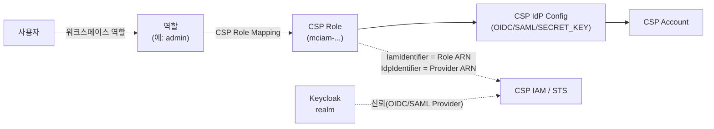

# CSP 임시자격증명 설정·발급 절차

> 내부 운영자용 실무 절차서입니다. 개념·엔티티·API 전체 목록은 [CSP Integration](CSP-Integration)을 참고하세요.
> 이 문서는 **AWS + OIDC**를 처음부터 끝까지 따라 하는 절차를 기준으로 쓰고, 다른 CSP·SAML은 [CSP별 차이](#8-csp별-차이)에 차이점만 정리합니다.

## 개요

mc-iam-manager는 사용자의 **워크스페이스 역할**에 매핑된 **CSP 역할**로 CSP의 STS를 호출해 짧은 수명의 자격증명을 발급합니다. CSP는 mc-iam-manager 뒤의 Keycloak을 IdP로 신뢰해야 합니다.



전체 순서:

| 단계 | 어디서 | 작업 | 담당 |
|---|---|---|---|
| 1 | mc-iam-manager 서버 / Keycloak | 사전 점검 (환경변수, OIDC 클라이언트) | 시스템 관리자 |
| 2 | CSP 콘솔 | Keycloak을 OIDC Provider로 등록 | CSP 관리자 |
| 3 | CSP 콘솔 | 관리용 Role, 사용자용 Role 생성 | CSP 관리자 |
| 4 | mc-web-console / API | CSP Account, IdP Config 등록 | 플랫폼 관리자 |
| 5 | mc-web-console | CSP Role 등록 | 플랫폼 관리자 |
| 6 | mc-web-console | 역할 ↔ CSP Role 매핑, 사용자에게 워크스페이스 역할 할당 | 플랫폼 관리자 |
| 7 | API | 임시자격증명 발급·검증 | 사용자 / 관리자 |

이 문서에서 쓰는 표기:

| 표기 | 의미 | 예 |
|---|---|---|
| `<IAM_URL>` | mc-iam-manager 외부 URL | `https://mcmp.example.com` |
| `<KC_DOMAIN>` | `MC_IAM_MANAGER_KEYCLOAK_EXTERNAL_DOMAIN` | `mcmp.example.com` |
| `<REALM>` | `MC_IAM_MANAGER_KEYCLOAK_REALM` | `mciam` |
| `<OIDC_CLIENT>` | `MC_IAM_MANAGER_KEYCLOAK_OIDC_CLIENT_NAME` | `mciam-oidc-Client` |
| `<ACCOUNT_ID>` | AWS 계정 ID | `123456789012` |
| `<ISSUER>` | Keycloak realm issuer | `https://<KC_DOMAIN>/auth/realms/<REALM>` |

`<ISSUER>`는 브라우저에서 `<ISSUER>/.well-known/openid-configuration`이 열려야 합니다. 이 URL이 CSP에서 접근되지 않으면 이후 단계가 모두 실패합니다.

---

## 1. 사전 점검

### 1-1. mc-iam-manager 환경변수

| 변수 | 확인 내용 |
|---|---|
| `MC_IAM_MANAGER_KEYCLOAK_EXTERNAL_URL` | 외부에서 접근 가능한 Keycloak URL (`https://<KC_DOMAIN>/auth`). AWS Role 자동 생성 시 trust policy의 Provider 경로가 이 값으로 만들어집니다. |
| `MC_IAM_MANAGER_KEYCLOAK_OIDC_CLIENT_NAME` | Keycloak OIDC 클라이언트의 Client ID. 기본 `mciam-oidc-Client`. |
| `MC_IAM_MANAGER_KEYCLOAK_OIDC_CLIENT_SECRET` | 위 클라이언트의 secret과 정확히 같아야 합니다. |
| `MC_IAM_MANAGER_KEYCLOAK_OIDC_CLIENT_ID` | AWS Role 자동 생성 시 trust policy의 `aud` 값으로 들어갑니다. 샘플 기본값 `notyet` 그대로면 자동 생성된 Role이 동작하지 않으므로 **`<OIDC_CLIENT>`와 같은 값**으로 맞춥니다. |
| `MC_IAM_MANAGER_AWS_ACCOUNT_ID` | AWS Role 자동 생성 시 사용. 기본값 `notyet` 그대로면 자동 생성이 실패합니다. 시스템 전체에서 AWS 계정 1개만 지원합니다. |
| `SAML_CLIENT_ID_AWS` | SAML을 쓸 때만. Keycloak SAML 클라이언트 ID (보통 `urn:amazon:webservices`). |

### 1-2. Keycloak OIDC 클라이언트

Keycloak Admin Console → realm `<REALM>` → Clients → `<OIDC_CLIENT>`:

| 항목 | 값 |
|---|---|
| Client authentication | ON (confidential) |
| Service accounts roles | ON — 발급 시 mc-iam-manager가 이 클라이언트의 `client_credentials` 토큰을 CSP에 제출합니다 |
| Direct access grants | ON — SAML 사용 시 필수 |
| Credentials → Client secret | `MC_IAM_MANAGER_KEYCLOAK_OIDC_CLIENT_SECRET`과 동일 |

클라이언트가 아예 없으면 발급 시 Keycloak `401 invalid_client`가 납니다. 위 사양대로 만들어 주세요.

토큰 발급이 되는지 서버에서 바로 확인할 수 있습니다.

```bash
curl -s -X POST "<ISSUER>/protocol/openid-connect/token" \
  -d grant_type=client_credentials -d scope=openid \
  -d client_id=<OIDC_CLIENT> -d client_secret='<OIDC_CLIENT_SECRET>' | jq '{access_token: (.access_token != null), id_token: (.id_token != null), error}'
# access_token, id_token 모두 true면 정상
```

---

## 2. AWS: Keycloak을 OIDC Provider로 등록

AWS 콘솔 → IAM → Identity providers → **Add provider**

| 항목 | 값 |
|---|---|
| Provider type | OpenID Connect |
| Provider URL | `<ISSUER>` (끝에 `/` 없이) |
| Audience | `<OIDC_CLIENT>` |

결과로 나오는 ARN을 기록합니다. 이후 **IDP Identifier**로 씁니다.

```
arn:aws:iam::<ACCOUNT_ID>:oidc-provider/<KC_DOMAIN>/auth/realms/<REALM>
```

CLI로 할 때:

```bash
aws iam create-open-id-connect-provider \
  --url "<ISSUER>" \
  --client-id-list "<OIDC_CLIENT>"
```

---

## 3. AWS: Role 생성

AWS에는 성격이 다른 Role이 두 개 필요합니다. 헷갈리기 쉬우니 구분해 두세요.

| Role | 용도 | 권한 | 등록 위치 |
|---|---|---|---|
| **관리용 Role** (예: `mciam-admin`) | mc-iam-manager 서버가 CSP Role을 조회·생성할 때 사용 | IAM Role 조회·생성 (`iam:GetRole`, `iam:CreateRole`, `iam:PutRolePolicy` 등. `role/mciam-*` 범위로 제한 권장) | IdP Config의 `config.role_arn` |
| **사용자용 Role** (예: `mciam-readonly`) | 최종 사용자가 임시자격증명으로 받는 권한 | 최소 권한 (예: `ReadOnlyAccess`) | CSP Role의 IAM Identifier |

> AWS CSP Role 등록(5단계)은 등록 시점에 서버가 **관리용 Role로 AWS를 호출**합니다. 그래서 사용자용 Role만 만들고 관리용 Role을 빼먹으면 5단계에서 `no active AWS OIDC IDP config found` 또는 `role_arn not configured ...`로 실패합니다.

두 Role의 trust policy는 같습니다.

```json
{
  "Version": "2012-10-17",
  "Statement": [
    {
      "Effect": "Allow",
      "Principal": {
        "Federated": "arn:aws:iam::<ACCOUNT_ID>:oidc-provider/<KC_DOMAIN>/auth/realms/<REALM>"
      },
      "Action": "sts:AssumeRoleWithWebIdentity",
      "Condition": {
        "StringEquals": {
          "<KC_DOMAIN>/auth/realms/<REALM>:aud": "<OIDC_CLIENT>"
        }
      }
    }
  ]
}
```

Role 이름은 반드시 **`mciam-`로 시작**하게 만듭니다. mc-iam-manager는 CSP Role 이름에 `mciam-`가 없으면 붙여서 AWS에서 찾습니다. 그래서 다른 이름으로 만든 Role은 찾지 못하고 같은 이름의 새 Role을 만들려고 시도합니다.

> 사용자용 Role은 콘솔에서 미리 만들지 않고 mc-iam-manager가 자동 생성하게 할 수도 있습니다(5단계). 이 경우 trust policy는 자동으로 들어가지만 **권한 정책은 붙지 않으므로** 콘솔에서 따로 attach해야 합니다.

---

## 4. mc-iam-manager: CSP Account, IdP Config 등록

### 4-1. CSP Account

mc-web-console → **Settings > Environment > Cloud SPs > CSP Accounts** → Add

| 항목 | 값 |
|---|---|
| Account Name | 예: `aws-main` |
| CSP Provider | AWS |
| Credential Data (JSON) | `{"account_id": "<ACCOUNT_ID>", "region": "ap-northeast-2"}` |

> **Credential Data 칸에는 액세스 키가 아니라 계정 정보를 넣습니다.** 입력란 예시가 `{"accessKey": ...}`로 되어 있지만 실제로는 계정 정보(`account_info`)로 저장되고, 필수 키가 없으면 등록이 거부됩니다. CSP별 필수 키는 AWS·Alibaba `account_id`, GCP `project_id`, Tencent `app_id`, Azure `subscription_id`와 `tenant_id`입니다(`region`은 선택).

API로 할 때:

```bash
TOKEN=$(curl -s -X POST "<IAM_URL>/api/auth/login" -H 'Content-Type: application/json' \
  -d '{"id":"<platform-admin-id>","password":"<password>"}' | jq -r .access_token)

curl -s -X POST "<IAM_URL>/api/csp-accounts" -H "Authorization: Bearer $TOKEN" -H 'Content-Type: application/json' -d '{
  "name": "aws-main",
  "csp_type": "aws",
  "account_info": {"account_id": "<ACCOUNT_ID>", "region": "ap-northeast-2"},
  "description": "AWS main account"
}'
```

응답의 `id`를 기록합니다(`<CSP_ACCOUNT_ID>`). `csp_type`은 소문자여야 합니다.

### 4-2. IdP Config (API만 가능)

**IdP Config 등록 화면은 mc-web-console에 아직 없습니다.** API로 등록합니다.

```bash
curl -s -X POST "<IAM_URL>/api/csp-idp-configs" -H "Authorization: Bearer $TOKEN" -H 'Content-Type: application/json' -d '{
  "name": "aws-oidc",
  "csp_account_id": <CSP_ACCOUNT_ID>,
  "auth_method": "OIDC",
  "config": {
    "role_arn": "arn:aws:iam::<ACCOUNT_ID>:role/mciam-admin"
  },
  "description": "Keycloak OIDC trust for AWS"
}'
```

- `config.role_arn`에는 **관리용 Role**을 넣습니다(사용자용 Role 아님).
- 응답의 `id`를 기록합니다(`<IDP_CONFIG_ID>`).
- 연결 테스트(AWS OIDC만 지원): `POST <IAM_URL>/api/csp-idp-configs/id/<IDP_CONFIG_ID>/test`

---

## 5. mc-iam-manager: CSP Role 등록

mc-web-console → **Operations > Manage > Workspaces > CSP Roles** → Add CSP Role

| 항목 | 값 |
|---|---|
| CSP Type | AWS |
| Auth Method | OIDC |
| CSP Role Name | 사용자용 Role 이름 (예: `mciam-readonly`) |
| IDP Identifier | 2단계의 Provider ARN |
| IAM Identifier | 사용자용 Role ARN (AWS는 등록 시 자동으로 채워짐) |

AWS는 저장할 때 서버가 관리용 Role로 AWS에서 같은 이름의 Role을 찾습니다.

- **이미 있으면**: Role ARN 등 정보를 AWS에서 가져와 저장합니다. 단, 이 경로에서는 **IDP Identifier가 저장되지 않습니다.** 저장 후 목록에서 해당 Role을 **Edit**해서 IDP Identifier를 다시 입력하세요. 비어 있으면 발급 시 `IDP ARN이 설정되지 않았습니다`로 실패합니다.
- **없으면**: 3단계의 trust policy로 AWS에 Role을 새로 만들고 IDP Identifier까지 채웁니다. 권한 정책은 콘솔에서 따로 attach합니다.

저장 후 목록에서 Status가 `created`인지 확인합니다. `failed`면 같은 이름으로 다시 등록할 수 있습니다.

> 화면에서 입력할 수 없는 값이 두 가지 있습니다. **IdP Config 연결(`cspIdpConfigId`)**과 **SAML 클라이언트 ID(`extendedConfig.saml_client_id`)**입니다. AWS OIDC는 둘 다 없어도 동작하지만(IdP Config가 없으면 OIDC로 간주), SAML이나 다른 CSP는 API로 채워야 합니다.
>
> ```bash
> curl -s -X PUT "<IAM_URL>/api/roles/csp/id/<CSP_ROLE_ID>" -H "Authorization: Bearer $TOKEN" -H 'Content-Type: application/json' \
>   -d '{"cspIdpConfigId": <IDP_CONFIG_ID>}'
> ```

---

## 6. 역할 매핑과 사용자 할당

### 6-1. 역할 ↔ CSP Role 매핑

별도 화면이 아닙니다. mc-web-console → **Operations > Manage > Workspaces > Roles** → 역할 Add 또는 Edit → **CSP Role Mapping** 카드에서 CSP Provider와 5단계의 CSP Role을 골라 추가한 뒤 역할을 저장합니다.

- 하나의 역할에 CSP별·인증방식별로 여러 CSP Role을 매핑할 수 있습니다.
- **같은 역할 + CSP + 인증방식 조합에 CSP Role을 둘 이상 매핑하지 마세요.** 우선순위 규칙이 없어 첫 번째 것만 쓰입니다.

### 6-2. 사용자에게 워크스페이스 역할 할당

mc-web-console → **Operations > Manage > Workspaces** → 워크스페이스 선택 → 멤버 추가에서 사용자와 6-1의 역할을 할당합니다.

- 사용자에게 직접 할당한 역할이 우선이고, 없으면 사용자가 속한 그룹의 워크스페이스 역할을 씁니다.
- 여러 그룹이 같은 워크스페이스에 서로 다른 역할을 주면 id가 가장 작은 역할이 쓰입니다.

---

## 7. 발급과 검증

### 7-1. 발급

발급받을 사용자로 로그인한 토큰을 씁니다(관리자 토큰으로 호출하면 관리자의 역할 기준으로 발급됩니다).

```bash
USER_TOKEN=$(curl -s -X POST "<IAM_URL>/api/auth/login" -H 'Content-Type: application/json' \
  -d '{"id":"<user-id>","password":"<password>"}' | jq -r .access_token)

curl -s -X POST "<IAM_URL>/api/workspaces/temporary-credentials" \
  -H "Authorization: Bearer $USER_TOKEN" -H 'Content-Type: application/json' \
  -d '{"workspaceId":"<WORKSPACE_ID>","cspType":"aws","authMethod":"OIDC","region":"ap-northeast-2"}'
```

- `cspType`은 소문자(`aws`, `gcp`, `alibaba`, `tencent`, `azure`)입니다.
- `authMethod`는 생략할 수 있지만, 한 역할에 OIDC·SAML 매핑이 둘 다 있으면 지정하세요.

정상 응답(AWS):

```json
{
  "cspType": "aws",
  "accessKeyId": "ASIA...",
  "secretAccessKey": "...",
  "sessionToken": "...",
  "expiration": "2026-01-01T01:00:00Z",
  "region": "ap-northeast-2"
}
```

받은 값으로 실제 권한까지 확인합니다.

```bash
AWS_ACCESS_KEY_ID=<accessKeyId> AWS_SECRET_ACCESS_KEY=<secretAccessKey> AWS_SESSION_TOKEN=<sessionToken> \
  aws sts get-caller-identity
# "Arn": "arn:aws:sts::<ACCOUNT_ID>:assumed-role/mciam-readonly/mciam-<keycloak-user-id>-<unix-time>"
```

세션 이름에 Keycloak 사용자 ID가 들어가므로 CloudTrail에서 누가 발급받았는지 추적할 수 있습니다.

### 7-2. 실패 원인 단계별 진단

발급이 실패하면 같은 체인을 단계별로 점검하는 API를 먼저 돌려 보세요. 각 단계의 성공/실패와 조치 힌트를 돌려줍니다.

```bash
curl -s -X POST "<IAM_URL>/api/workspaces/credentials/validate" \
  -H "Authorization: Bearer $USER_TOKEN" -H 'Content-Type: application/json' \
  -d '{"workspaceId":"<WORKSPACE_ID>","cspType":"aws","authMethod":"OIDC"}' | jq
```

### 7-3. 자주 나는 오류

| 오류 메시지 | 원인 | 조치 |
|---|---|---|
| `403 No suitable CSP role mapping found ...` | 사용자에게 해당 워크스페이스 역할이 없거나, 그 역할에 해당 CSP(+인증방식) 매핑이 없음 | 6-1, 6-2 확인 |
| `IDP ARN이 설정되지 않았습니다` | CSP Role의 IDP Identifier가 비어 있음 | CSP Roles → Edit에서 Provider ARN 입력 |
| `Role ARN이 설정되지 않았습니다` | CSP Role의 IAM Identifier가 비어 있음 | CSP Roles → Edit에서 Role ARN 입력 |
| `no active AWS OIDC IDP config found` (CSP Role 등록 시) | AWS 계정에 활성 OIDC IdP Config가 없음 | 4-2 등록, 비활성이면 `.../activate` |
| `role_arn not configured in active AWS OIDC IDP config` | IdP Config의 `config.role_arn` 누락 | 관리용 Role ARN을 `config.role_arn`에 추가 |
| `MC_IAM_MANAGER_AWS_ACCOUNT_ID environment variable is not set` | AWS Role 자동 생성인데 환경변수 미설정 | 1-1 설정 후 재기동 |
| Keycloak `401 invalid_client` | OIDC 클라이언트가 없거나 secret 불일치 | 1-2 확인 |
| AWS `InvalidIdentityToken` / `Not authorized to perform sts:AssumeRoleWithWebIdentity` | Provider Audience나 trust policy의 `aud`가 `<OIDC_CLIENT>`와 다름, 또는 Provider URL이 `<ISSUER>`와 다름 | 2단계, 3단계 값 대조 |
| `unsupported auth method` | CSP Role에 IdP Config가 연결되지 않음 (AWS·GCP·Alibaba 외 CSP는 기본 인증방식이 없음) | 5단계의 `PUT .../roles/csp/id/...`로 `cspIdpConfigId` 연결 |
| `[설정 누락: DB] ... saml_client_id 미등록` | AWS·Alibaba SAML인데 `extendedConfig.saml_client_id` 없음 | `PUT .../roles/csp/id/...`에 `{"extendedConfig":{"saml_client_id":"urn:amazon:webservices"}}` |

---

## 8. CSP별 차이

AWS OIDC와 다른 부분만 적었습니다. 4~7단계의 화면·API 흐름은 같고, **2~3단계(CSP 콘솔)와 IdP Config의 `config` 키**가 다릅니다.

### 8-1. 지원 현황

| CSP | OIDC | SAML | SECRET_KEY | 응답에 오는 값 |
|---|---|---|---|---|
| AWS | ✅ | ✅ | ✅ | access key / secret / session token |
| GCP | ✅ | ✅ | ✅ | OAuth2 access token |
| Alibaba | ✅ | ✅ | ✅ | access key / secret / security token |
| Tencent | ✅ | ✅ | ✅ | 임시 secret id / key / token |
| Azure | ✅ | ❌ (Azure에 대응 API 없음) | ✅ | ARM access token |
| IBM | ❌ (코드는 있으나 실환경에서 federation 불가 확인) | ❌ | ✅ | 등록한 고정 키 |
| NCP, NHN, KT, OpenStack | ❌ (federation 미지원) | ❌ | ✅ | 등록한 고정 키 |

SECRET_KEY는 임시자격증명이 아니라 IdP Config에 저장한 고정 키(`access_key_id`, `secret_access_key`)를 그대로 돌려주는 방식입니다.

### 8-2. CSP 콘솔 설정과 등록값

| CSP | IdP 등록 (2단계) | 사용자용 역할 (3단계) | IDP Identifier | IAM Identifier | IdP Config `config` |
|---|---|---|---|---|---|
| GCP | IAM → Workload Identity Federation → Pool/Provider(OIDC). issuer=`<ISSUER>`, allowed audiences=`<OIDC_CLIENT>`. 권한 부여 방식은 **"서비스 계정 가장(impersonation)"** 선택 | Service Account 생성 후 `roles/iam.workloadIdentityUser` **와** `roles/iam.serviceAccountTokenCreator` 둘 다 부여 + 실제 리소스 권한(예: `roles/compute.viewer`) | WIF Provider 리소스 경로 | Service Account 이메일 | 없음 |
| Alibaba | RAM → OIDC Provider. issuer=`<ISSUER>`, **Client ID 목록에 `<OIDC_CLIENT>` 필수** | RAM Role, `Federated`=Provider ARN | OIDC Provider ARN | RAM Role ARN | `audience` (= `<OIDC_CLIENT>`) |
| Tencent | CAM OIDC Provider(`CreateOIDCConfig`). ClientId=`<OIDC_CLIENT>`, **IdentityKey(JWKS)는 base64 인코딩** | CAM Role. trust의 `action`은 정확히 `sts:AssumeRoleWithWebIdentity` (`sts:AssumeRole` 아님) | Provider ARN (`qcs::cam::uin/<uin>:oidc-provider/<name>`) | Role ARN | `secret_id`, `secret_key` (STS·CAM 권한 있는 sub-account 키) |
| Azure | Entra ID App Registration → Federated credentials. issuer=`<ISSUER>`, subject=`<OIDC_CLIENT>` 서비스 계정의 `sub` UUID, audience=토큰 `aud`와 동일 | 대상 구독 Access control(IAM)에서 App에 `Reader` 등 할당 (신규 App은 이름 검색이 안 될 수 있어 Object ID로 검색) | 발급에 쓰이지 않지만 비우면 안 됨 (비우면 `IDP ARN이 설정되지 않았습니다`). Federated credential 이름 등 식별 가능한 값 권장 | 발급에 쓰이지 않지만 비우면 안 됨. App(Client) ID 권장 | `tenant_id`, `client_id` |
| NCP/NHN/KT 등 | 없음 | 없음 | 형식상 필수 | 형식상 필수 | `access_key_id`, `secret_access_key` (`auth_method`=`SECRET_KEY`) |

> AWS 외 CSP는 CSP Role 등록 시 클라우드에 아무것도 만들지 않고 DB에만 저장합니다. 콘솔에서 만든 Provider·Role의 값을 그대로 입력하세요. 또 OIDC여도 `cspIdpConfigId`를 연결해야 `config` 키를 읽을 수 있습니다(Alibaba·Tencent·Azure). 5단계의 `PUT` 예시를 쓰세요.

### 8-3. SAML을 쓸 때 추가로 필요한 것

SAML은 Keycloak 쪽 준비가 많습니다. AWS 기준 체크리스트입니다.

1. Keycloak 기동 옵션에 `KC_FEATURES: token-exchange,admin-fine-grained-authz`가 있어야 합니다(기본 compose에 포함).
2. Keycloak에 SAML 클라이언트 생성 (Client ID `urn:amazon:webservices`).
   - Valid redirect URIs, Assertion Consumer Service POST Binding URL = `https://signin.aws.amazon.com/saml`. **Admin URL도 설정해야 합니다.** 비우면 "assertion consumer url" 오류가 납니다.
   - Name ID format `username`, Client signature required OFF.
   - `fullScopeAllowed` OFF, 기본 scope `role_list` 제거.
   - Mapper 3개: `RoleSessionName`(User Property `username`), `SessionDuration`(Hardcoded `3600`), `Role`(Hardcoded attribute, 값 `<사용자용 Role ARN>,<SAML Provider ARN>`, 순서 중요·공백 없음). Keycloak 24의 role-list mapper는 속성 이름을 무시하므로 Hardcoded attribute를 써야 합니다. 그래서 **SAML 클라이언트 하나가 AWS Role 하나에 고정**됩니다.
3. `<OIDC_CLIENT>`에 Direct access grants ON (1-2).
4. SAML 클라이언트 → Permissions → `token-exchange` permission에 `<OIDC_CLIENT>` 클라이언트 policy 연결. permission을 다시 저장할 때 `name`을 원래 값과 다르게 주면 연결이 깨집니다.
5. AWS IAM → Identity providers → SAML, 메타데이터 = `<ISSUER>/protocol/saml/descriptor`에서 받은 XML.
6. 사용자용 Role trust: `Federated`=SAML Provider ARN, `Action`=`sts:AssumeRoleWithSAML`, `Condition.StringEquals["SAML:aud"]="https://signin.aws.amazon.com/saml"`.
7. mc-iam-manager: IdP Config를 `auth_method: "SAML"`로 등록, CSP Role Auth Method SAML로 등록 후 `PUT`으로 `cspIdpConfigId`와 `extendedConfig.saml_client_id` 연결.
8. 발급 시 `"authMethod":"SAML"`.

GCP SAML은 Keycloak SAML 클라이언트 ID가 **WIF Provider 리소스 경로와 같아야** audience 검증을 통과합니다. Tencent SAML은 메타데이터를 base64로 인코딩해 등록합니다.

---

## 관련 문서

- [CSP Integration](CSP-Integration): 엔티티, 지원 매트릭스, API 목록, 환경변수 (영문)
- [Configuration Reference](Configuration-Reference): 환경변수 전체
- [Troubleshooting](Troubleshooting) ([KO](Troubleshooting-ko))
