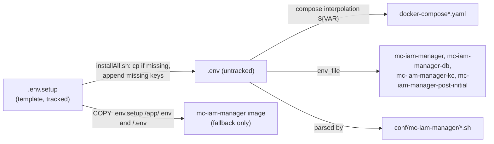

# Configuration Reference

mc-iam-manager is configured only through environment variables. In the bundled compose files they come from the project-root `.env`, which is created from [`.env.setup`](https://github.com/m-cmp/mc-iam-manager/blob/main/.env.setup) and passed to the containers with `env_file: ./.env`.

## Where values come from

- The binary calls `util.LoadEnvFiles()` at start-up ([`src/util/common.go`](https://github.com/m-cmp/mc-iam-manager/blob/main/src/util/common.go)). It tries `../.env`, then `./.env`, then `/.env`, and stops at the first file that loads. `godotenv.Load` never overrides variables that are already set, so values injected by compose always win.
- [`Dockerfile.mciammanager`](https://github.com/m-cmp/mc-iam-manager/blob/main/Dockerfile.mciammanager) copies `.env.setup` into the image as `/app/.env` and `/.env`. That copy is only a fallback for variables the container does not receive.
- `.env.setup` uses `${VAR}` references, for example `MC_IAM_MANAGER_PUBLIC_HOST=https://${MC_IAM_MANAGER_PUBLIC_DOMAIN}`. Docker Compose and godotenv both expand them.

> **`.env.setup` vs `.env_sample`.** `.env.setup` is the current template: `installAll.sh` copies it and the image embeds it. [`.env_sample`](https://github.com/m-cmp/mc-iam-manager/blob/main/.env_sample) is legacy. It lacks variables that the compose files and scripts require (`MC_IAM_MANAGER_PUBLIC_DOMAIN`, `MC_IAM_MANAGER_PUBLIC_HOST`, `MC_IAM_MANAGER_NGINX_HTTP_PORT`, `MC_IAM_MANAGER_NGINX_HTTPS_PORT`, `MC_IAM_MANAGER_DB_HOST_PORT`, the `MC_INFRA_*` credentials and others). It also uses names that nothing reads (`CONSOLE_POSTGRES_*`, `HEALTH_CHECK_RETIES`, `UID`, `GID`). The one useful thing it has that `.env.setup` lacks is `SAML_CLIENT_ID_AWS` / `SAML_CLIENT_ID_ALIBABA` (read by the code, see below).

> **Known defect in `.env.setup`:** `MC_IAM_MANAGER_HOST` is defined twice, and the last definition (`http://localhost:5000`) wins. That breaks the post-init container. See [Installation Guide, Known issue 1](Installation-Guide#before-you-start).

## Variables read by the mc-iam-manager binary

Found by searching `os.Getenv` under [`src/`](https://github.com/m-cmp/mc-iam-manager/tree/main/src) (tests excluded). The [`iamtokenvalidator`](https://github.com/m-cmp/mc-iam-manager/tree/main/iamtokenvalidator) module reads no environment variables. Its configuration is the URL passed to `Init`.

"Required" means start-up fails without it (Start), a specific feature fails without it (Feature), or it is optional.

### Server

| Variable | Default | Required | Purpose | Read in |
|---|---|---|---|---|
| `MC_IAM_MANAGER_PORT` | `5000` | Optional | HTTP listen port. Also used by compose for the published port and the health check. | [`src/main.go`](https://github.com/m-cmp/mc-iam-manager/blob/main/src/main.go) |
| `MC_IAM_MANAGER_DEBUG` | `false` | Optional | Echo debug mode. When `true`, error responses include internal error strings from the DB and Keycloak. Local development only. | [`src/config/debug.go`](https://github.com/m-cmp/mc-iam-manager/blob/main/src/config/debug.go) |

### Database

| Variable | Default | Required | Purpose | Read in |
|---|---|---|---|---|
| `MC_IAM_MANAGER_DATABASE_URL` | none | Start (or the five below) | Full PostgreSQL DSN. When set, it is used as-is and the individual variables are ignored. | [`src/config/database.go`](https://github.com/m-cmp/mc-iam-manager/blob/main/src/config/database.go) |
| `MC_IAM_MANAGER_DATABASE_HOST` | none | Start (if no URL) | DB host (`mc-iam-manager-db` in compose) | same |
| `MC_IAM_MANAGER_DATABASE_PORT` | none | Start (if no URL) | DB port inside the network (`5432`) | same |
| `MC_IAM_MANAGER_DATABASE_USER` | none | Start (if no URL) | DB user. Also used by compose as the PostgreSQL superuser and by Keycloak. | same |
| `MC_IAM_MANAGER_DATABASE_PASSWORD` | none | Start (if no URL) | DB password | same |
| `MC_IAM_MANAGER_DATABASE_NAME` | none | Start (if no URL) | IAM database name | same |
| `MC_IAM_MANAGER_DATABASE_SSLMODE` | none | Start (if no URL) | `sslmode` in the DSN (`disable`) | same |

### Keycloak

| Variable | Default | Required | Purpose | Read in |
|---|---|---|---|---|
| `MC_IAM_MANAGER_KEYCLOAK_HOST` | none | Start | Internal Keycloak base URL including `/auth`, e.g. `http://mc-iam-manager-kc:8080/auth` | [`src/config/keycloak.go`](https://github.com/m-cmp/mc-iam-manager/blob/main/src/config/keycloak.go) |
| `MC_IAM_MANAGER_KEYCLOAK_EXTERNAL_URL` | value of `MC_IAM_MANAGER_KEYCLOAK_HOST` | Optional | Public Keycloak URL. Its host part is used for the AWS OIDC provider ARN in CSP role trust policies. | same, [`src/service/csp_role_service.go`](https://github.com/m-cmp/mc-iam-manager/blob/main/src/service/csp_role_service.go) |
| `MC_IAM_MANAGER_KEYCLOAK_REALM` | none | Start | Application realm (`mciam`) | [`src/config/keycloak.go`](https://github.com/m-cmp/mc-iam-manager/blob/main/src/config/keycloak.go), [`src/service/company_service.go`](https://github.com/m-cmp/mc-iam-manager/blob/main/src/service/company_service.go) |
| `MC_IAM_MANAGER_KEYCLOAK_CLIENT_NAME` | none | Start | Main confidential client ID (`mciamClient`) | same |
| `MC_IAM_MANAGER_KEYCLOAK_CLIENT_SECRET` | none | Start | Secret of the main client | same |
| `MC_IAM_MANAGER_KEYCLOAK_OIDC_CLIENT_NAME` | none | Start | OIDC client used for CSP federation (`mciam-oidc-Client`) | [`src/config/keycloak.go`](https://github.com/m-cmp/mc-iam-manager/blob/main/src/config/keycloak.go) |
| `MC_IAM_MANAGER_KEYCLOAK_OIDC_CLIENT_ID` | none | Start | OIDC client ID. Must be non-empty at start-up (`.env.setup` ships `notyet`). Also used as the audience in AWS trust policies. | same, [`src/service/csp_role_service.go`](https://github.com/m-cmp/mc-iam-manager/blob/main/src/service/csp_role_service.go) |
| `MC_IAM_MANAGER_KEYCLOAK_OIDC_CLIENT_SECRET` | none | Start | Secret of the OIDC client | [`src/config/keycloak.go`](https://github.com/m-cmp/mc-iam-manager/blob/main/src/config/keycloak.go) |
| `MC_IAM_MANAGER_KEYCLOAK_ADMIN` | none | Feature (setup, admin operations) | Keycloak `master` realm admin user. Also passed to Keycloak as `KEYCLOAK_ADMIN`. | same |
| `MC_IAM_MANAGER_KEYCLOAK_ADMIN_PASSWORD` | none | Feature | Password of the above (Keycloak `KEYCLOAK_ADMIN_PASSWORD`) | same |
| `MC_IAM_MANAGER_ACCESS_TOKEN_LIFESPAN` | `1800` | Optional | Access token lifetime in seconds. It is applied only when the realm is **created**, so changing it later does not alter an existing realm (change it in the Keycloak admin console instead). Values below 300, or values that are not integers, fall back to 1800. Keep it longer than mc-web-console's 5-minute proactive refresh. | [`src/config/keycloak.go`](https://github.com/m-cmp/mc-iam-manager/blob/main/src/config/keycloak.go) |
| `KEYCLOAK_OIDC_CLIENT_ID`, `KEYCLOAK_OIDC_CLIENT_NAME`, `KEYCLOAK_CLIENT_NAME` | none | Feature (legacy) | Unprefixed legacy names read only by `GetImpersonationTokenByAdminToken`. Not in any sample file. | [`src/service/keycloak_service.go`](https://github.com/m-cmp/mc-iam-manager/blob/main/src/service/keycloak_service.go) |

### Platform admin and seed data

| Variable | Default | Required | Purpose | Read in |
|---|---|---|---|---|
| `MC_IAM_MANAGER_PLATFORMADMIN_ID` | none | Feature (`POST /api/initial-admin`, SAML exchange) | Username of the initial platform admin | [`src/service/keycloak_service.go`](https://github.com/m-cmp/mc-iam-manager/blob/main/src/service/keycloak_service.go), [`src/handler/admin_handler.go`](https://github.com/m-cmp/mc-iam-manager/blob/main/src/handler/admin_handler.go) |
| `MC_IAM_MANAGER_PLATFORMADMIN_PASSWORD` | none | Feature | Password, set in Keycloak only when the user is first created | [`src/service/keycloak_service.go`](https://github.com/m-cmp/mc-iam-manager/blob/main/src/service/keycloak_service.go) |
| `MC_IAM_MANAGER_PLATFORMADMIN_EMAIL` | none | Feature | E-mail of the platform admin | same |
| `MC_IAM_MANAGER_PLATFORMADMIN_FIRSTNAME` | none | Feature | First name | same, [`src/handler/admin_handler.go`](https://github.com/m-cmp/mc-iam-manager/blob/main/src/handler/admin_handler.go) |
| `MC_IAM_MANAGER_PLATFORMADMIN_LASTNAME` | none | Feature | Last name | same |
| `MC_IAM_MANAGER_PREDEFINED_PLATFORM_ROLE` | none | Feature | Comma-separated roles created in Keycloak and the DB by `POST /api/initial-admin` | [`src/handler/admin_handler.go`](https://github.com/m-cmp/mc-iam-manager/blob/main/src/handler/admin_handler.go), [`src/service/keycloak_service.go`](https://github.com/m-cmp/mc-iam-manager/blob/main/src/service/keycloak_service.go) |
| `MC_IAM_MANAGER_DEFAULT_WORKSPACE_NAME` | `ws01` in `admin_handler.go`, `default` in `project_service.go` | Optional | Default workspace created at initial setup and used by project sync. Set it explicitly so the two code paths agree. | [`src/handler/admin_handler.go`](https://github.com/m-cmp/mc-iam-manager/blob/main/src/handler/admin_handler.go), [`src/service/project_service.go`](https://github.com/m-cmp/mc-iam-manager/blob/main/src/service/project_service.go) |
| `MC_IAM_MANAGER_COMPANY_NAME` | `Default Company` | Optional | Name of the default company record | [`src/service/company_service.go`](https://github.com/m-cmp/mc-iam-manager/blob/main/src/service/company_service.go) |
| `MC_IAM_MANAGER_ORG` | bundled `asset/organization/organizations.yaml` | Optional | Organization seed YAML: a local path or an `http(s)` URL. A failed download falls back to the bundled file. | [`src/service/organization_service.go`](https://github.com/m-cmp/mc-iam-manager/blob/main/src/service/organization_service.go) |
| `MC_WEB_CONSOLE_MENUYAML` | bundled `asset/menu/menu.yaml` | Optional | Menu tree YAML: a local path or a URL. A failed download falls back to the bundled file. | [`src/service/menu_service.go`](https://github.com/m-cmp/mc-iam-manager/blob/main/src/service/menu_service.go) |
| `MC_WEB_CONSOLE_MENU_PERMISSIONS` | bundled `asset/menu/permission.yaml` | Optional | Role-menu permission seed: a path or URL with a `.yaml`/`.yml` extension. Other extensions fall back to the bundled file. | same |

### CSP integration

| Variable | Default | Required | Purpose | Read in |
|---|---|---|---|---|
| `MC_IAM_MANAGER_AWS_ACCOUNT_ID` | none | Feature (AWS role trust policy) | AWS account ID used in the OIDC provider ARN | [`src/service/csp_role_service.go`](https://github.com/m-cmp/mc-iam-manager/blob/main/src/service/csp_role_service.go) |
| `MC_IAM_MANAGER_AWS_IDENTITY_ROLE_ARN` | none | Optional | Fallback role ARN when an AWS IdP config has none | [`src/service/csp_idp_config_service.go`](https://github.com/m-cmp/mc-iam-manager/blob/main/src/service/csp_idp_config_service.go) |
| `AWS_REGION` | `ap-northeast-2` (where a default applies) | Optional | Region for AWS STS and credential checks | [`src/service/aws_credential_service.go`](https://github.com/m-cmp/mc-iam-manager/blob/main/src/service/aws_credential_service.go), [`src/service/csp_validation_service.go`](https://github.com/m-cmp/mc-iam-manager/blob/main/src/service/csp_validation_service.go) |
| `AWS_STS_ENDPOINT` | `https://sts.amazonaws.com` | Optional | STS endpoint for `AssumeRoleWithWebIdentity` | [`src/csp/aws/iam.go`](https://github.com/m-cmp/mc-iam-manager/blob/main/src/csp/aws/iam.go) |
| `SAML_CLIENT_ID_AWS` | none | Feature (AWS SAML) | Default Keycloak SAML client ID for AWS (`urn:amazon:webservices` in `.env_sample`) | [`src/service/csp_role_service.go`](https://github.com/m-cmp/mc-iam-manager/blob/main/src/service/csp_role_service.go), [`src/service/csp_credential_service.go`](https://github.com/m-cmp/mc-iam-manager/blob/main/src/service/csp_credential_service.go), [`src/service/csp_validation_service.go`](https://github.com/m-cmp/mc-iam-manager/blob/main/src/service/csp_validation_service.go) |
| `SAML_CLIENT_ID_ALIBABA` | none | Feature (Alibaba SAML) | Default Keycloak SAML client ID for Alibaba Cloud | [`src/service/csp_role_service.go`](https://github.com/m-cmp/mc-iam-manager/blob/main/src/service/csp_role_service.go), [`src/service/csp_credential_service.go`](https://github.com/m-cmp/mc-iam-manager/blob/main/src/service/csp_credential_service.go) |

### Health check overrides

| Variable | Default | Required | Purpose | Read in |
|---|---|---|---|---|
| `<FRAMEWORK>_HEALTH_URL`, e.g. `MC_INFRA_MANAGER_HEALTH_URL` | registered base URL + `/readyz` | Optional | Overrides the health URL of a registered framework. The name is the framework service name upper-cased with `-` replaced by `_`. Without it, `/readyz` uses the `mc-infra-manager` base URL from the service registry (`mcmp_api_services`), which exists only after [Initial Setup](Initial-Setup) Step 5-1. | [`src/handler/health_handler.go`](https://github.com/m-cmp/mc-iam-manager/blob/main/src/handler/health_handler.go) |

### Set by compose but not read by the code

The `mc-iam-manager` service in both compose files sets `DATABASE_URL` and `PORT` under `environment:`. The code reads only `MC_IAM_MANAGER_DATABASE_URL` and `MC_IAM_MANAGER_PORT`, so these two have no effect. `src/handler/mcmpapi_handler.go` declares a constant for `MC_ADMIN_CLI_APIYAML` but never reads it. The variable is used only by the setup scripts.

## Variables used only by scripts and compose

| Variable | `.env.setup` default | Used by | Purpose |
|---|---|---|---|
| `COMPOSE_PROJECT_NAME` | `mc-iam-manager` | Docker Compose | Project name. Also determines the network name `mc-iam-manager_mc-iam-manager-network` that `docker-compose.cert.yaml` expects. |
| `HEALTH_CHECK_INTERVAL`, `HEALTH_CHECK_TIMEOUT`, `HEALTH_CHECK_RETRIES`, `HEALTH_CHECK_START_PERIOD` | `1m`, `5s`, `3`, `60s` | compose `x-default-health-check` | Health check timing for most services |
| `MC_IAM_MANAGER_PUBLIC_DOMAIN` | sample FQDN (installer overwrites it) | `installAll.sh`, all presets, nginx (`DOMAIN_NAME`), certbot (`-d`), `1_setup_auto.sh` | Public host name or IP. This is the variable the README calls the external domain. |
| `MC_IAM_MANAGER_PUBLIC_HOST` | `https://${MC_IAM_MANAGER_PUBLIC_DOMAIN}` | Keycloak `KC_HOSTNAME_URL` (`${...}/auth`), `1_setup_auto.sh` Step 7 | Public base URL. `0_preset_local.sh` rewrites it to `http://`. |
| `MC_IAM_MANAGER_CERT_EMAIL` | `mcmp@cloud-barista.org` | `docker-compose.cert.yaml` | Let's Encrypt account e-mail |
| `MC_IAM_MANAGER_DOMAIN` | `mc-iam-manager` | presets (nginx upstream), `.env.setup` interpolation | Internal service name of mc-iam-manager. Do not change. |
| `MC_IAM_MANAGER_HOST` | `http://${MC_IAM_MANAGER_DOMAIN}:${MC_IAM_MANAGER_PORT}`, overridden by a trailing `http://localhost:5000` | `1_setup_auto.sh`, `1_setup_manual.sh` | Base URL the setup scripts call. Must be `http://mc-iam-manager:5000` inside the post-init container. |
| `MC_IAM_MANAGER_KEYCLOAK_DOMAIN` | `mc-iam-manager-kc` | presets (nginx upstream) | Internal service name of Keycloak |
| `MC_IAM_MANAGER_KEYCLOAK_PORT` | `8080` | compose (published port), presets | Keycloak host port and upstream port |
| `MC_IAM_MANAGER_KEYCLOAK_DATABASE_NAME` | `mc_iam_keycloak_db` | compose (`KC_DB_URL`), `init-db.sh` | Keycloak database in the shared PostgreSQL |
| `MC_IAM_MANAGER_DATABASE_RECREATE` | `false` | `conf/mc-iam-manager/init-db.sh` | Forces `CREATE DATABASE` in the init script. The script runs only when the data directory is empty. |
| `MC_IAM_MANAGER_DB_HOST_PORT` | `15432` | compose | Host port of `mc-iam-manager-db` |
| `MC_IAM_MANAGER_NGINX_HTTP_PORT`, `MC_IAM_MANAGER_NGINX_HTTPS_PORT` | `80`, `443` | compose | Host ports of nginx |
| `MC_IAM_MANAGER_PLATFORMADMIN_WORKSPACE_ROLE` | unset (commented) | `1_setup_auto.sh` Step 8-1 | Workspace role given to the platform admin. Defaults to the first entry of `PREDEFINED_ROLE`. |
| `PREDEFINED_ROLE` | `admin,operator,viewer,billadmin,billviewer` | `1_setup_auto.sh` Step 3 and 8-1, `1_setup_manual.sh` | Roles created through `POST /api/roles` |
| `MC_ADMIN_CLI_APIYAML` | mc-admin-cli `conf/api.yaml` URL | `1_setup_auto.sh` Step 5 and 5-1 | `api.yaml` from which the framework service registry is filled |
| `MC_WEB_CONSOLE_FRONT_PORT` | `3001` | compose (full set), `1_setup_auto.sh` Step 7 | Console port, added to Keycloak redirect URIs |
| `MC_WEB_CONSOLE_API_PORT`, `MC_WEB_CONSOLE_DB_HOST_PORT`, `MC_WEB_CONSOLE_POSTGRES_DB`, `MC_WEB_CONSOLE_POSTGRES_USER`, `MC_WEB_CONSOLE_POSTGRES_PASSWORD` | `3000`, `15433`, sample values | `docker-compose.yaml` only | mc-web-console services in the full set |
| `MC_OBSERVABILITY_GRAFANA_PROXY_PORT`, `MC_COST_OPTIMIZER_FE_PROXY_PORT`, `MC_COST_OPTIMIZER_FE_PORT` | `3010`, `3011`, `7780` | nginx templates, `1_setup_auto.sh` Step 5-2 | iframe proxy ports for other frameworks |
| `MC_COST_OPTIMIZER_BE_PORT`, `MC_COST_OPTIMIZER_ALARM_PORT`, `MC_WORKFLOW_MANAGER_PROXY_PORT`, `MC_DATA_MANAGER_PROXY_PORT`, `MC_APPLICATION_MANAGER_PROXY_PORT` | **missing** | `nginx.template.local.conf`, `0_preset_local.sh`, `0_preset_prod.sh` | Proxy ports. Missing values break the HTTP preset and the prod preset. See [Installation Guide, Known issue 2](Installation-Guide#before-you-start). |
| `MC_COST_OPTIMIZER_FE_PUBLIC_HOST`, `MC_WORKFLOW_MANAGER_PUBLIC_HOST`, `MC_DATA_MANAGER_PUBLIC_HOST`, `MC_APPLICATION_MANAGER_PUBLIC_HOST` | missing | `1_setup_auto.sh` Step 5-2, `0_preset_local.sh` | Public iframe URLs. Step 5-2 is non-fatal. |
| `MC_INFRA_CONNECTOR_PORT`, `MC_INFRA_MANAGER_PORT`, `MC_INFRA_MANAGER_ETCD_PORT`, `MC_INFRA_MANAGER_ETCD_PEER_PORT`, `MC_INFRA_MANAGER_POSTGRES_HOST_PORT`, `MC_INFRA_MANAGER_OPENBAO_PORT` | `1024`, `1323`, `2379`, `2380`, `6432`, `8200` | compose | Host ports of the infra frameworks |
| `MC_INFRA_CONNECTOR_API_USERNAME`, `MC_INFRA_CONNECTOR_API_PASSWORD`, `MC_INFRA_MANAGER_API_USERNAME`, `MC_INFRA_MANAGER_API_PASSWORD` | `spider` | compose, `1_setup_auto.sh` Step 5-1 | Basic-auth credentials of cb-spider and cb-tumblebug, stored in the service registry |
| `MC_INFRA_CONNECTOR_REST_URL`, `MC_INFRA_CONNECTOR_LOG_LEVEL`, `MC_INFRA_CONNECTOR_HISCALL_LOG_LEVEL` | URL, unset, unset | compose | cb-spider settings |
| `MC_INFRA_MANAGER_POSTGRES_USER`, `MC_INFRA_MANAGER_POSTGRES_PASSWORD`, `MC_INFRA_MANAGER_POSTGRES_DB`, `MC_INFRA_MANAGER_OPENBAO_VAULT_TOKEN`, `MC_INFRA_MANAGER_TERRARIUM_API_USERNAME`, `MC_INFRA_MANAGER_TERRARIUM_API_PASSWORD` | sample values | compose | cb-tumblebug settings |

## Present in `.env.setup` but unused

Nothing in `src/`, the compose files or the scripts reads these. They are kept for compatibility or used only to build other values inside `.env.setup`.

| Variable | Note |
|---|---|
| `MODE`, `DEFAULT_LANGUAGE`, `MC_IAM_MANAGER_USE_TICKET_VALID`, `PREDEFINED_WORKSPACE_ROLE` | Not read anywhere |
| `MC_IAM_MANAGER_HOST_FOR_INIT` | Referenced only in commented-out code in `1_setup_auto.sh` |
| `MC_IAM_MANAGER_PUBLIC_KEYCLOAK_HOST`, `MC_IAM_MANAGER_KEYCLOAK_CLIENT_PATH` | Not read anywhere |
| `MC_IAM_MANAGER_KEYCLOAK_EXTERNAL_DOMAIN`, `MC_IAM_MANAGER_CSP_ROLE_PREFIX` | Used only to build `MC_IAM_MANAGER_KEYCLOAK_EXTERNAL_URL` and the AWS ARNs inside `.env.setup` |
| `MC_IAM_MANAGER_AWS_IDENTITY_PROVIDER_ARN` | Not read. The code builds the provider ARN from `MC_IAM_MANAGER_AWS_ACCOUNT_ID` and `MC_IAM_MANAGER_KEYCLOAK_EXTERNAL_URL`. |
| `TEMPORARY_SECURITY_CREDENTIALS_ENDPOINT_AWS` | Not read. The code uses `AWS_STS_ENDPOINT`. |
| `MCINFRAMANAGER`, `MCINFRAMANAGER_APIUSERNAME`, `MCINFRAMANAGER_APIPASSWORD` | Not read. mc-infra-manager is reached through the service registry. |
| `MC_INFRA_MANAGER_POSTGRES_PORT` | Not read (compose uses `MC_INFRA_MANAGER_POSTGRES_HOST_PORT`) |
