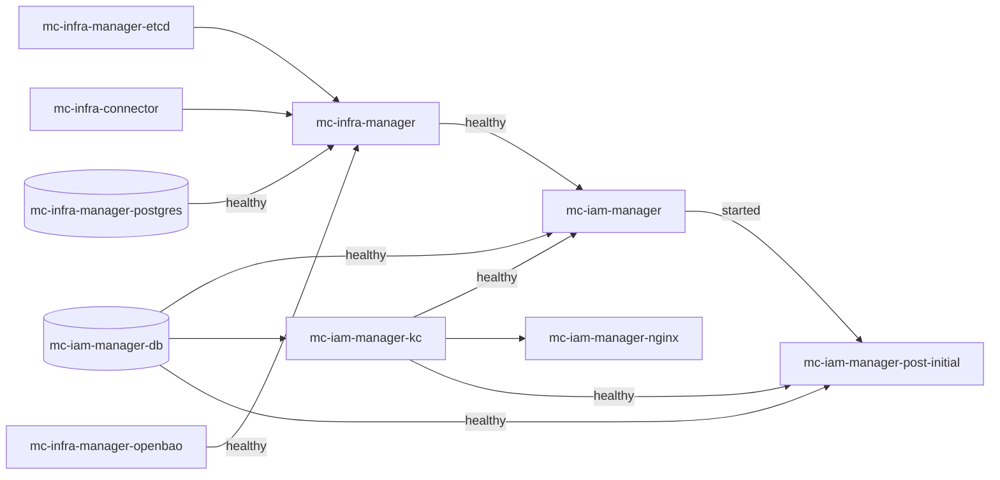

# Deployment Modes

mc-iam-manager can be deployed in four ways. All of them use the same `.env` (created from [`.env.setup`](https://github.com/m-cmp/mc-iam-manager/blob/main/.env.setup)) and the same generated `container-volume/mc-iam-manager/nginx/nginx.conf`.

| Mode | File(s) | Used by | When to use |
|---|---|---|---|
| Standalone | [`docker-compose-standalone.yaml`](https://github.com/m-cmp/mc-iam-manager/blob/main/docker-compose-standalone.yaml) | `installAll.sh`, `clearAll.sh` (both export `COMPOSE_FILE` to this file) | mc-iam-manager plus the infra frameworks it depends on, without mc-web-console |
| Full set | [`docker-compose.yaml`](https://github.com/m-cmp/mc-iam-manager/blob/main/docker-compose.yaml) | default for a plain `docker compose` in the repository root | Standalone plus mc-web-console (DB, API, front) |
| Certificate one-shot | [`docker-compose.cert.yaml`](https://github.com/m-cmp/mc-iam-manager/blob/main/docker-compose.cert.yaml) | `installAll.sh -m prod` | Issue or renew a Let's Encrypt certificate. Not a long-running stack. |
| Integrated platform | mc-admin-cli's own compose files | [mc-admin-cli](https://github.com/m-cmp/mc-admin-cli/wiki) | Production installs of the whole M-CMP platform |

## Services per file

Verified from the compose files on `main`.

| Service (container name) | Image | `docker-compose-standalone.yaml` | `docker-compose.yaml` | `docker-compose.cert.yaml` |
|---|---|:-:|:-:|:-:|
| `mc-infra-connector` | `cloudbaristaorg/cb-spider:0.12.18` | yes | yes | |
| `mc-infra-manager` | `cloudbaristaorg/cb-tumblebug:0.12.9` | yes | yes | |
| `mc-infra-manager-etcd` | `gcr.io/etcd-development/etcd:v3.5.21` | yes | yes | |
| `mc-infra-manager-postgres` | `postgres:16-alpine` | yes | yes | |
| `mc-infra-manager-openbao` | `openbao/openbao:2.5.1` | yes | yes | |
| `mc-iam-manager` (no fixed container name) | `cloudbaristaorg/mc-iam-manager:edge`, or a local build from `Dockerfile.mciammanager` | yes | yes | |
| `mc-iam-manager-db` | `postgres:14-alpine` | yes | yes | |
| `mc-iam-manager-kc` | `quay.io/keycloak/keycloak:24.0.1` | yes | yes | |
| `mc-iam-manager-nginx` | `nginx:1.25-alpine` | yes (80, 443) | yes (80, 443, `MC_WEB_CONSOLE_FRONT_PORT`) | |
| `mc-iam-manager-post-initial` (runs once, then exits) | `ubuntu:22.04` | yes | yes | |
| `mc-web-console-db` | `postgres:14-alpine` | | yes | |
| `mc-web-console-api` | `csescsta/mc-web-console-api:edge` | | yes | |
| `mc-web-console-front` | `csescsta/mc-web-console-front:edge` | | yes | |
| `mcmp-certbot` | `certbot/certbot:latest` | | | yes |

Notes:

- The `mc-iam-manager` service has no `container_name`, so Docker names it `<COMPOSE_PROJECT_NAME>-mc-iam-manager-1` (`mc-iam-manager-mc-iam-manager-1` with the default `COMPOSE_PROJECT_NAME=mc-iam-manager`). Use `docker compose logs mc-iam-manager` rather than `docker logs mc-iam-manager`. Other containers can still reach it by the service name `mc-iam-manager`.
- The `mc-iam-manager` service defines both `build:` and `image:`. `docker compose build mc-iam-manager` builds from [`Dockerfile.mciammanager`](https://github.com/m-cmp/mc-iam-manager/blob/main/Dockerfile.mciammanager). `docker compose pull mc-iam-manager` pulls the prebuilt `edge` image.
- In the full set, the console front end is not published directly. nginx publishes `MC_WEB_CONSOLE_FRONT_PORT` (default 3001) and proxies it to `mc-web-console-front:3001`, over TLS in the HTTPS templates.
- All state is kept in bind mounts under `./container-volume/`. No named volumes are declared.

## Start-up order



Edges are `depends_on` conditions from the compose files. An unlabeled edge means `service_started`.

- mc-iam-manager starts only after mc-infra-manager is **healthy**, so a slow or broken mc-infra-manager delays the whole IAM stack.
- nginx depends only on Keycloak. The HTTPS template ([`nginx.template.conf`](https://github.com/m-cmp/mc-iam-manager/blob/main/conf/mc-iam-manager/nginx.template.conf)) uses static `proxy_pass http://mc-iam-manager:...` upstreams. nginx cannot resolve that name until the mc-iam-manager container is running, so it restarts (`restart: unless-stopped`) until it can. The HTTP template ([`nginx.template.local.conf`](https://github.com/m-cmp/mc-iam-manager/blob/main/conf/mc-iam-manager/nginx.template.local.conf)) resolves upstreams at request time (`resolver 127.0.0.11`) and does not have this restart loop.
- mc-iam-manager's own health check (`/readyz`) calls `http://mc-iam-manager-nginx/nginx-health`. **Do not make nginx wait for mc-iam-manager to be healthy**, or the two will wait on each other forever. See [Troubleshooting](Troubleshooting#mc-iam-manager-and-nginx-wait-on-each-other).

## Standalone

```bash
./installAll.sh -m dev -d localhost -r background
# or, after configuration:
export COMPOSE_FILE=docker-compose-standalone.yaml
docker compose --env-file .env up -d
```

See [Installation Guide](Installation-Guide).

## Full set (with mc-web-console)

There is no installer flag for the full set. Configure with `installAll.sh` without starting anything, then start `docker-compose.yaml`:

```bash
./installAll.sh -m dev -d localhost -r skip
docker compose -f docker-compose.yaml --env-file .env up -d
```

`.env.setup` already contains the console variables (`MC_WEB_CONSOLE_POSTGRES_DB`, `MC_WEB_CONSOLE_POSTGRES_USER`, `MC_WEB_CONSOLE_POSTGRES_PASSWORD`, `MC_WEB_CONSOLE_API_PORT`, `MC_WEB_CONSOLE_FRONT_PORT`, `MC_WEB_CONSOLE_DB_HOST_PORT`).

`clearAll.sh` operates on the standalone file only. To stop a full-set deployment completely, use `docker compose -f docker-compose.yaml down`.

## Certificate one-shot (`docker-compose.cert.yaml`)

`docker-compose.cert.yaml` is **not an overlay**. It defines only `mcmp-certbot`, which runs `certbot certonly --webroot` once and exits. It joins the external network `mc-iam-manager_mc-iam-manager-network`, which exists only after the main stack (project `mc-iam-manager`) has been started at least once.

```bash
docker compose -f docker-compose.cert.yaml --env-file .env up                      # issue
docker compose -f docker-compose.cert.yaml run --rm mcmp-certbot renew             # renew
```

> [`readme.md`](https://github.com/m-cmp/mc-iam-manager/blob/main/readme.md) suggests `docker compose -f docker-compose.yaml -f docker-compose.cert.yaml up -d`. That is not needed to serve HTTPS: nginx only needs the certificate files on disk. Merging the files would also redefine `mc-iam-manager-network` as an external network. Use the commands above. Details: [Certificates](Certificates).

## Integrated with mc-admin-cli

mc-admin-cli deploys mc-iam-manager as part of the platform with its own compose files and `.env`. The preset scripts here share that heritage: their messages point to mc-admin-cli paths such as `../../bin/cleanAll.sh` and `./mcc infra run`. The compose files here note that mc-admin-cli uses `./conf/mc-iam-manager/.env`. Follow the [mc-admin-cli wiki](https://github.com/m-cmp/mc-admin-cli/wiki) for that mode. The mc-iam-manager pages on [Configuration Reference](Configuration-Reference) and [Initial Setup](Initial-Setup) still apply.

## Running from source

For development without containers for mc-iam-manager itself:

```bash
cd src
go run main.go
```

On start-up the binary loads `.env` from `../.env`, then `./.env`, then `/.env` ([`src/util/common.go`](https://github.com/m-cmp/mc-iam-manager/blob/main/src/util/common.go) `LoadEnvFiles`). It needs a reachable PostgreSQL and Keycloak. See [Development and Testing](Development-and-Testing).
