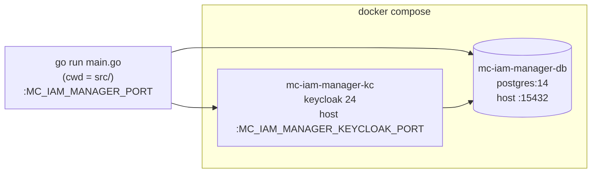
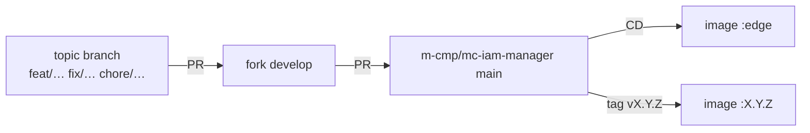
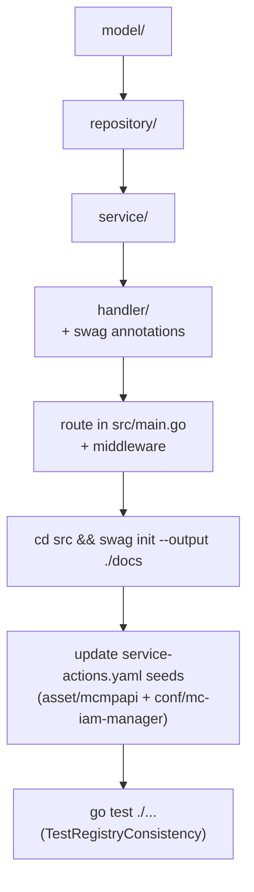

# Development and Testing

This page is for contributors: how the repository is laid out, how to run mc-iam-manager from source, how to build the image, how to run the tests and what CI checks, and how to add a new API.

## Repository Layout

| Path | Contents |
|---|---|
| [`src/`](https://github.com/m-cmp/mc-iam-manager/tree/main/src) | Go module `github.com/m-cmp/mc-iam-manager` (the API server) |
| `src/main.go` | Entry point: env loading, DB AutoMigrate, Keycloak init, **all route registrations**, swag general annotations |
| `src/handler/` | Echo handlers + swag annotations (`@Router`, `@Id`) |
| `src/service/` | Business logic, Keycloak and CSP integrations |
| `src/repository/` | GORM data access |
| `src/model/`, `src/model/mcmpapi/`, `src/model/idp/` | GORM models and request/response types |
| `src/middleware/` | `AuthMiddleware`, `PlatformAdminMiddleware`, `PlatformRoleMiddleware(Read/Write/Manage)` |
| `src/config/` | DB, Keycloak and debug configuration from env |
| `src/csp/{aws,gcp}/`, `src/pkg/apiparser/` | CSP IAM clients, Swagger/OpenAPI parser used by API import |
| `src/docs/` | Generated Swagger spec (canonical, see [API Reference](API-Reference#spec-files)) |
| `src/registry_consistency_test.go` | Cross-checks routes, swagger and the MCMP API seed files |
| [`iamtokenvalidator/`](https://github.com/m-cmp/mc-iam-manager/tree/main/iamtokenvalidator) | Separate Go module for other services (see [Token Validation for Services](Token-Validation-for-Services)) |
| [`asset/`](https://github.com/m-cmp/mc-iam-manager/tree/main/asset) | Seed data bundled into the image: `mcmpapi/service-actions.yaml`, `menu/menu.yaml`, `menu/permission.yaml`, `organization/` |
| [`conf/`](https://github.com/m-cmp/mc-iam-manager/tree/main/conf) | Runtime config mounted by compose (`conf/mc-iam-manager/`: init scripts, nginx templates, a second copy of `service-actions.yaml`) |
| [`tool/swagger-to-actions/`](https://github.com/m-cmp/mc-iam-manager/tree/main/tool/swagger-to-actions) | CLI that turns Swagger specs into `serviceActions` seed YAML |
| `scripts/` | `demo/` (optional demo RBAC), `migration/` (manual SQL), `sync-wiki.sh` |
| `Dockerfile.mciammanager` | Image build (used by CI/CD and compose) |
| `dockerfiles/` | Legacy Keycloak, nginx and postgres files. Neither the compose files nor the Dockerfile reference them |
| `docker-compose.yaml`, `docker-compose-standalone.yaml`, `docker-compose.cert.yaml` | Deployment stacks (see [Deployment Modes](Deployment-Modes)) |
| `docs/` | Stale copy of the swagger files plus role-permission backup docs; `docs/wiki/` holds these wiki sources |

## Prerequisites

| Tool | Version | Source |
|---|---|---|
| Go | **1.25.0** for `src/` ([`src/go.mod`](https://github.com/m-cmp/mc-iam-manager/blob/main/src/go.mod)); 1.25.6 for `iamtokenvalidator/` ([`go.mod`](https://github.com/m-cmp/mc-iam-manager/blob/main/iamtokenvalidator/go.mod)) | With `GOTOOLCHAIN=auto` (the default), an older local Go downloads the required toolchain automatically |
| C compiler (gcc) | any | Unit tests use `gorm.io/driver/sqlite` → `mattn/go-sqlite3` (cgo) |
| Docker + Compose v2 | recent | PostgreSQL and Keycloak for local runs; image builds |
| swag CLI | `v1.16.4` (matches `src/go.mod`) | Only when changing API annotations |

## Running Locally from Source

The server needs PostgreSQL and a configured Keycloak realm. The quickest setup: run those two from compose and run the API with `go run`.



### 1. Create `.env`

```bash
cp .env_sample .env
```

Edit the values as needed. Every variable is described in [Configuration Reference](Configuration-Reference).

### 2. Start the DB and Keycloak

```bash
docker compose up -d mc-iam-manager-db mc-iam-manager-kc
```

- The DB is published on host port `${MC_IAM_MANAGER_DB_HOST_PORT:-15432}`, and Keycloak on `${MC_IAM_MANAGER_KEYCLOAK_PORT}` (`8080` in `.env_sample`) under the path `/auth` ([`docker-compose.yaml`](https://github.com/m-cmp/mc-iam-manager/blob/main/docker-compose.yaml)).
- Do **not** run `docker compose up mc-iam-manager` for this setup. That service `depends_on` `mc-infra-manager` (healthy) as well, which pulls in cb-tumblebug and its dependencies. The README's "Run with Dependencies Only" section omits this.

### 3. Point the app at localhost

`.env_sample` uses container hostnames (`mc-iam-manager-db`, `mc-iam-manager-kc`). From the host, override them in your shell. [`util.LoadEnvFiles`](https://github.com/m-cmp/mc-iam-manager/blob/main/src/util/common.go) uses `godotenv.Load`, which never overwrites variables that are already set.

```bash
# MC_IAM_MANAGER_DATABASE_URL takes precedence over the individual
# MC_IAM_MANAGER_DATABASE_* vars when it is non-empty (src/config/database.go)
export MC_IAM_MANAGER_DATABASE_URL="postgres://<MC_IAM_MANAGER_DATABASE_USER>:<MC_IAM_MANAGER_DATABASE_PASSWORD>@localhost:15432/<MC_IAM_MANAGER_DATABASE_NAME>?sslmode=disable"
export MC_IAM_MANAGER_KEYCLOAK_HOST="http://localhost:8080/auth"
```

`InitKeycloak` ([`src/config/keycloak.go`](https://github.com/m-cmp/mc-iam-manager/blob/main/src/config/keycloak.go)) refuses to start unless all of these are set:
`MC_IAM_MANAGER_KEYCLOAK_HOST`, `MC_IAM_MANAGER_KEYCLOAK_REALM`, `MC_IAM_MANAGER_KEYCLOAK_CLIENT_NAME`, `MC_IAM_MANAGER_KEYCLOAK_CLIENT_SECRET`, `MC_IAM_MANAGER_KEYCLOAK_OIDC_CLIENT_ID`, `MC_IAM_MANAGER_KEYCLOAK_OIDC_CLIENT_NAME`, `MC_IAM_MANAGER_KEYCLOAK_OIDC_CLIENT_SECRET`.

### 4. Run from `src/`

```bash
cd src
go run main.go          # listens on MC_IAM_MANAGER_PORT, default 5000
curl -s localhost:5000/readyz
```

On first start, `main.go` runs GORM `AutoMigrate` for all tables. The Keycloak realm, clients and the first platform admin still have to be created; follow [Initial Setup](Initial-Setup).

### Working-directory assumptions

The code resolves several paths relative to the working directory. Run from `src/` locally; the container runs from `/app`.

| What | Path logic | From `src/` | In container (`/app`) |
|---|---|---|---|
| `.env` | `../.env`, then `.env`, then `<cwd>/../.env` if cwd ends in `src`, then `/.env` | repo-root `.env` | `/app/.env` and `/.env` (copied from `.env.setup`; compose `env_file` values win) |
| Log file | `filepath.Join("..", "app.log")` in `main.go` | repo-root `app.log` | `/app.log` |
| Menu, permission and organization seeds | `util.GetAssetPath()`: `asset` if it exists, else `../asset` | `../asset` | `asset` |
| MCMP API seed | **hardcoded** `asset/mcmpapi/service-actions.yaml` ([`mcmpapi_service.go`](https://github.com/m-cmp/mc-iam-manager/blob/main/src/service/mcmpapi_service.go)) | **not found** → `POST /api/setup/sync-mcmp-apis` fails | works |

> [!WARNING]
> When running from `src/`, `POST /api/setup/sync-mcmp-apis` fails with `failed to read service-actions.yaml`, because `localServiceActionsPath` does not use `GetAssetPath()`. Workaround: `ln -s ../asset src/asset` (do not commit it), or run the binary from the repo root with a copy of `.env` available.

## Building the Docker Image

```bash
docker build -f Dockerfile.mciammanager --target prod -t mc-iam-manager:dev .
# or via compose (the service has build: context . / dockerfile Dockerfile.mciammanager)
docker compose build mc-iam-manager
```

[`Dockerfile.mciammanager`](https://github.com/m-cmp/mc-iam-manager/blob/main/Dockerfile.mciammanager):

- Builder stage: `golang:1.25.0-alpine`. It copies `src/` plus `asset/mcmpapi`, `asset/menu` and `asset/organization`, then builds a static `CGO_ENABLED=0` binary.
- `prod` stage: `alpine:latest`, holding `/app/mc-iam-manager`, `/app/asset` and `.env.setup` copied to `/app/.env` and `/.env` as fallback defaults.
- `EXPOSE 8082` is metadata only. The server actually listens on `MC_IAM_MANAGER_PORT` (default `5000`).

## Tests

### Locations

| Package | Files | Kind |
|---|---|---|
| `src/` (root) | `registry_consistency_test.go` | Static: routes ↔ `@Router`/`@Id` ↔ `src/docs/swagger.json` ↔ both `service-actions.yaml` seeds |
| `src/handler/` | 12 `*_test.go` | Unit (SQLite / mocks) |
| `src/service/` | 24 `*_test.go` (2 are mock helpers) | Unit + **integration** (`csp_credential_integration_test.go`, `csp_validation_integration_test.go`, `organization_service_integration_test.go`) |
| `src/repository/` | 9 `*_test.go` | Unit (SQLite) + **integration** (`organization_repository_integration_test.go`) |
| `src/config/`, `src/csp/aws/` | `debug_test.go`, `iam_test.go` | Unit |
| `iamtokenvalidator/` | `iamtokenvalidator_test.go` | Unit (in-process JWKS server) |

### Running

```bash
cd src && go test ./...                 # unit tests; integration tests skip themselves
cd src && go test -run TestRegistryConsistency .
cd iamtokenvalidator && go test ./...   # separate module
```

### Integration tests

Integration tests skip unless `INTEGRATION_TEST=1`. When enabled, they connect to a **real** PostgreSQL through `config.NewDatabaseConfig()` and skip if the connection fails. The PostgreSQL-specific tests wrap each case in a transaction that is rolled back.

| Variable | Used by |
|---|---|
| `INTEGRATION_TEST=1` | All integration tests (gate) |
| `MC_IAM_MANAGER_DATABASE_HOST`, `MC_IAM_MANAGER_DATABASE_PORT`, `MC_IAM_MANAGER_DATABASE_USER`, `MC_IAM_MANAGER_DATABASE_PASSWORD`, `MC_IAM_MANAGER_DATABASE_NAME`, `MC_IAM_MANAGER_DATABASE_SSLMODE` (or `MC_IAM_MANAGER_DATABASE_URL`) | All DB-backed tests |
| `MC_IAM_MANAGER_KEYCLOAK_HOST`, `MC_IAM_MANAGER_KEYCLOAK_REALM`, `MC_IAM_MANAGER_KEYCLOAK_OIDC_CLIENT_NAME`, `MC_IAM_MANAGER_KEYCLOAK_OIDC_CLIENT_SECRET` | CSP credential/validation tests |
| `TEST_PLATFORMADMIN_ID`, `TEST_PLATFORMADMIN_PASSWORD` | Optional override of the platform admin in `csp_credential_integration_test.go` (ignored when empty or `notyet`) |
| `TEST_AWS_OIDC_PROVIDER_ARN`, `TEST_AWS_OIDC_ROLE_ARN`, `TEST_AWS_ACCESS_KEY_ID`, `TEST_AWS_SECRET_ACCESS_KEY` | AWS cases in `csp_validation_integration_test.go` (skip if unset) |

CSP credential tests also skip if the DB has no matching `CspRole` or `CspIdpConfig` rows.

```bash
cd src
INTEGRATION_TEST=1 go test ./repository -run TestOrgRepoPG -v -count=1
INTEGRATION_TEST=1 go test ./service -run TestOrgServicePG -v -count=1
INTEGRATION_TEST=1 go test ./service -run TestIntegration -v -count=1   # CSP validation + credentials
```

## CI/CD

Workflows live in [`.github/workflows/`](https://github.com/m-cmp/mc-iam-manager/tree/main/.github/workflows):

| Workflow | Trigger | What it actually does |
|---|---|---|
| [`continuous-integration.yaml`](https://github.com/m-cmp/mc-iam-manager/blob/main/.github/workflows/continuous-integration.yaml) | PR to `main` (ignores `**.md`, `docs/**`, `scripts/**`, ...) | (1) `go mod download` + `go build` in `src/` with **Go 1.23**; (2) `docker image build -f Dockerfile.mciammanager` (after copying `.env_sample` to `.env`, which the Dockerfile no longer uses) |
| [`continuous-delivery.yaml`](https://github.com/m-cmp/mc-iam-manager/blob/main/.github/workflows/continuous-delivery.yaml) | Push to `main`, tags `v*.*.*` | Builds the `prod` target for `linux/amd64` and pushes to Docker Hub `cloudbaristaorg/mc-iam-manager` and GHCR. Tags are `edge` for branch pushes and `X.Y.Z` for semver tags |
| [`no-ai-trace.yml`](https://github.com/m-cmp/mc-iam-manager/blob/main/.github/workflows/no-ai-trace.yml) | PR or push to `main`, `develop`, `master` | Fails if commit messages or author emails carry AI-tool attribution trailers (`Co-Authored-By: ...Claude/Copilot`, `Generated-By`, ...) |

> [!IMPORTANT]
> - **CI does not run `go test`.** Run the tests locally before opening a PR, especially `TestRegistryConsistency`.
> - **Go version mismatch:** CI pins `go-version: "1.23"`, but `src/go.mod` requires `go 1.25.0`. The build passes only if the toolchain auto-downloads. Aligning the matrix to `1.25` is recommended.

## Contribution Flow

The project has no `CONTRIBUTING.md`. Git history on `main` shows this flow:



- Use [Conventional Commits](https://www.conventionalcommits.org/) subjects, for example `fix(auth): ...`, `feat(menu): ...` or `chore(release): bump version to 0.7.0`.
- Release PRs (`chore(release): bump version to X.Y.Z`) update the `@version` annotation in `main.go`, the generated swagger files and the `_meta.version` of the `service-actions.yaml` and `frameworks.yaml` seeds. Maintainers then tag `vX.Y.Z`.
- External contributors can open PRs against `main` directly. CI runs on PRs to `main`.
- Commits must not carry AI attribution trailers (enforced by `no-ai-trace.yml`).

## Adding a New API



1. **Model**: add or extend a struct in `src/model/`. For a new table, also add it to the `db.AutoMigrate(...)` list in `src/main.go`.
2. **Repository** in `src/repository/`, then **Service** in `src/service/`. Follow the existing `NewXxxRepository(db)` / `NewXxxService(db)` constructors.
3. **Handler** in `src/handler/`, with swag annotations. `@Router` must use swagger `{param}` syntax and match the real route, `@Id` must be unique (it becomes `operationId` and the MCMP action name), and the `@Router` line must not carry a trailing comment:

   ```go
   // ListWidgets godoc
   // @Summary List widgets
   // @Tags widgets
   // @Accept json
   // @Produce json
   // @Success 200 {array} model.Widget
   // @Failure 500 {object} map[string]string "error: Internal Server Error"
   // @Security BearerAuth
   // @Router /api/widgets/list [post]
   // @Id listWidgets
   func (h *WidgetHandler) ListWidgets(c echo.Context) error { ... }
   ```

4. **Route**: register it in `src/main.go` under the right group, with the right middleware (`middleware.PlatformRoleMiddleware(middleware.Read|Write|Manage)` or `middleware.PlatformAdminMiddleware`). Routes are authenticated by default. Make a route public only by adding it to `skipAuthPaths`, and treat that as a security decision.
5. **Regenerate the spec**: `cd src && swag init --output ./docs` (see [API Reference](API-Reference#regenerating-the-spec)).
6. **Update the MCMP API seeds.** Every `operationId` in `src/docs/swagger.json` must appear, with the same method and path, under `serviceActions.mc-iam-manager` in **both** [`asset/mcmpapi/service-actions.yaml`](https://github.com/m-cmp/mc-iam-manager/blob/main/asset/mcmpapi/service-actions.yaml) and [`conf/mc-iam-manager/service-actions.yaml`](https://github.com/m-cmp/mc-iam-manager/blob/main/conf/mc-iam-manager/service-actions.yaml). Regenerate them with [`tool/swagger-to-actions`](https://github.com/m-cmp/mc-iam-manager/tree/main/tool/swagger-to-actions) (`-c frameworks.yaml`, which reads `src/docs/swagger.yaml`). Note that `--append` cannot remove deleted actions. At runtime, `POST /api/setup/sync-mcmp-apis` loads the seed into `mcmp_api_services` and `mcmp_api_actions`; see [MCMP API Permissions](MCMP-API-Permissions).
7. **Menu or role exposure (if UI-facing)**: role-to-menu grants come from [`asset/menu/permission.yaml`](https://github.com/m-cmp/mc-iam-manager/blob/main/asset/menu/permission.yaml); see [Menu and Role Permission](Menu-and-Role-Permission).
8. **Test**: add unit tests next to the code (SQLite in-memory is the common pattern), then run `cd src && go test ./...`. `TestRegistryConsistency` fails on any drift between route, annotation, swagger and seeds.
