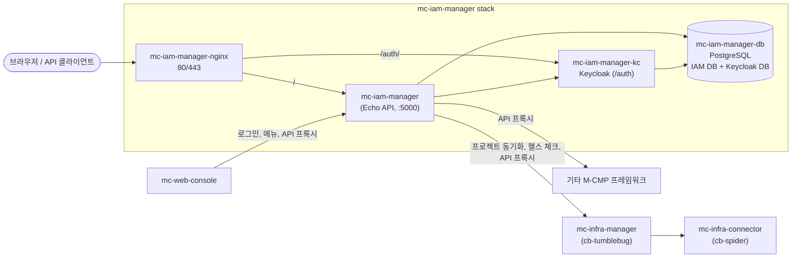

> 이 문서는 [mc-iam-manager](Home)의 한국어판입니다. 내용이 다르면 영문판이 기준입니다.

# mc-iam-manager

mc-iam-manager는 [M-CMP](https://github.com/m-cmp/docs) 멀티클라우드 관리 플랫폼의 인증·접근·권한 서비스입니다.
[Keycloak](https://www.keycloak.org/)(인증, 토큰)과 PostgreSQL 데이터베이스(사용자, 역할, 워크스페이스, 메뉴, API 권한)를 하나의 REST API 뒤에 감싸 제공하며, 다른 M-CMP 프레임워크가 의존하는 토큰 발급자이자 권한 판단 주체입니다.

- 언어 및 프레임워크: Go, [Echo](https://echo.labstack.com/) ([`src/main.go`](https://github.com/m-cmp/mc-iam-manager/blob/main/src/main.go))
- ID 공급자(IdP): Keycloak 24 ([`docker-compose.yaml`](https://github.com/m-cmp/mc-iam-manager/blob/main/docker-compose.yaml)의 `quay.io/keycloak/keycloak:24.0.1`)
- 저장소: PostgreSQL 14 인스턴스 하나에 IAM 데이터베이스와 Keycloak 데이터베이스 두 개를 둡니다 ([`conf/mc-iam-manager/init-db.sh`](https://github.com/m-cmp/mc-iam-manager/blob/main/conf/mc-iam-manager/init-db.sh))
- API 문서: mc-iam-manager 포트의 `/swagger/index.html`에서 Swagger UI 제공 (라우트는 [`src/main.go`](https://github.com/m-cmp/mc-iam-manager/blob/main/src/main.go)에 등록)

## M-CMP에서의 위치

| 구성 요소 | mc-iam-manager와의 관계 |
|---|---|
| [mc-web-console](https://github.com/m-cmp/mc-web-console/wiki) | mc-iam-manager를 통해 사용자를 로그인시키고(`POST /api/auth/login`), 메뉴 트리와 역할별 메뉴 권한을 불러오며, 다른 프레임워크는 mc-iam-manager API 프록시(`POST /api/mcmp-apis/call`)를 거쳐 호출합니다. `docker-compose.yaml`에서 콘솔 API는 `MCIAM_USE: "true"`로 실행됩니다. |
| mc-infra-manager ([cb-tumblebug](https://github.com/cloud-barista/cb-tumblebug)) | mc-iam-manager는 mc-infra-manager 네임스페이스로부터 프로젝트를 동기화합니다(`POST /api/setup/sync-projects`가 `GetAllNs` 액션을 호출, [`src/service/project_service.go`](https://github.com/m-cmp/mc-iam-manager/blob/main/src/service/project_service.go) 참고). `/readyz` 헬스 체크도 mc-infra-manager가 정상이어야 통과합니다. |
| mc-infra-connector ([cb-spider](https://github.com/cloud-barista/cb-spider)) | 번들 compose 파일에서 mc-infra-manager의 의존 서비스로 함께 기동됩니다. mc-iam-manager는 [Initial Setup](Initial-Setup) 과정에서 이 서비스의 base URL과 자격 증명을 프레임워크 서비스 레지스트리에 등록합니다. |
| [mc-admin-cli](https://github.com/m-cmp/mc-admin-cli/wiki) | 플랫폼 전체를 설치하는 표준 방법입니다. mc-iam-manager를 다른 모든 프레임워크와 함께 배포합니다. 이 레포지토리의 자체 설치 스크립트(`installAll.sh`)는 mc-iam-manager를 의존하는 인프라 프레임워크와 함께 단독(standalone)으로 실행합니다. |
| 기타 Go 서비스 | 이 서비스를 import하지 않고도 [`iamtokenvalidator`](https://github.com/m-cmp/mc-iam-manager/tree/main/iamtokenvalidator) 모듈로 mc-iam-manager 토큰을 검증할 수 있습니다. [Token Validation for Services](Token-Validation-for-Services)를 참고하세요. |

## 주요 기능

아래 항목은 모두 [`src/main.go`](https://github.com/m-cmp/mc-iam-manager/blob/main/src/main.go)에 등록된 라우트에 대응합니다.

- **인증**: 로그인, 로그아웃, 토큰 갱신·검증, JWKS 엔드포인트(`/api/auth/*`)를 Keycloak 기반으로 제공합니다. [Authentication and Authorization](Authentication-and-Authorization) 참고.
- **플랫폼·워크스페이스 RBAC**: 플랫폼 역할, 워크스페이스 역할 또는 둘 다로 쓸 수 있는 역할(`/api/roles/*`)을 사용자와 그룹(`/api/groups/*`)에 할당합니다.
- **워크스페이스와 프로젝트**: 워크스페이스는 프로젝트를 묶는 단위입니다. 프로젝트는 mc-infra-manager 네임스페이스로부터 동기화됩니다(`/api/workspaces/*`, `/api/projects/*`, `/api/setup/sync-projects`).
- **메뉴 권한**: 콘솔 메뉴 트리와 역할-메뉴 매핑은 최초 한 번 YAML에서 시드된 뒤 데이터베이스에서 관리됩니다(`/api/menus/*`, `/api/setup/initial-menus`). [Menu and Role Permission](Menu-and-Role-Permission) 참고.
- **MCMP API 권한과 프록시**: 프레임워크 서비스·액션 레지스트리, 권한-액션 매핑, 권한 검사를 거치는 프록시 호출 엔드포인트(`/api/mcmp-apis/*`)를 제공합니다. [MCMP API Permissions](MCMP-API-Permissions) 참고.
- **CSP 연동**: CSP 계정, IdP 설정, CSP 역할과 정책, 임시 CSP 자격 증명(`/api/csp-accounts/*`, `/api/csp-idp-configs/*`, `/api/csp-policies/*`, `/api/workspaces/temporary-credentials`)을 다룹니다. `GET /api/auth/temp-credential-csps`는 AWS(OIDC, SAML), GCP(OIDC), Alibaba Cloud(OIDC)를 반환합니다. [CSP Integration](CSP-Integration) 참고.
- **조직, 그룹, 회사**: YAML에서 시드되는 조직 트리, 사용자-조직 소속, 단일 회사 레코드(`/api/organizations/*`, `/api/company`)를 관리합니다. [Organizations, Groups and Company](Organizations-Groups-Company) 참고.
- **헬스 체크**: `/readyz`는 Keycloak, 데이터베이스, nginx, mc-infra-manager를 점검합니다. [Operations](Operations#health-checks) 참고.

## 바로가기

| 하고 싶은 일 | 참고 문서 |
|---|---|
| mc-iam-manager만 단독 설치 | [설치 가이드](Installation-Guide-ko) |
| compose 파일 선택 | [Deployment Modes](Deployment-Modes) |
| 자체 서명 또는 Let's Encrypt 인증서 사용 | [인증서](Certificates-ko) |
| 환경 변수 찾아보기 | [Configuration Reference](Configuration-Reference) |
| 설치 후 초기화 작업 이해 | [Initial Setup](Initial-Setup) |
| 내부 구조 이해 | [Architecture](Architecture) |
| API 호출 | [API Reference](API-Reference) |
| 백업, 업그레이드, 초기화 | [Operations](Operations) |
| 설치 실패 해결 | [문제 해결](Troubleshooting-ko) |
| 소스에서 빌드·테스트 | [Development and Testing](Development-and-Testing) |

플랫폼 전체(모든 프레임워크와 mc-web-console) 설치는 보통 [mc-admin-cli](https://github.com/m-cmp/mc-admin-cli/wiki)로 진행합니다.
