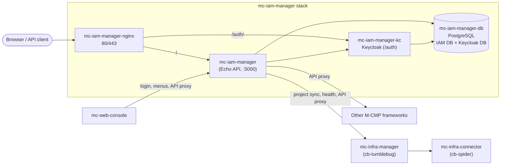

# mc-iam-manager

mc-iam-manager is the identity, access and permission service of the [M-CMP](https://github.com/m-cmp/docs) multi-cloud management platform.
It wraps [Keycloak](https://www.keycloak.org/) (authentication, tokens) and a PostgreSQL database (users, roles, workspaces, menus, API permissions) behind one REST API, and is the token issuer and permission authority that the other M-CMP frameworks rely on.

- Language and framework: Go, [Echo](https://echo.labstack.com/) ([`src/main.go`](https://github.com/m-cmp/mc-iam-manager/blob/main/src/main.go))
- Identity provider: Keycloak 24 (`quay.io/keycloak/keycloak:24.0.1` in [`docker-compose.yaml`](https://github.com/m-cmp/mc-iam-manager/blob/main/docker-compose.yaml))
- Storage: one PostgreSQL 14 instance holding two databases, the IAM database and the Keycloak database ([`conf/mc-iam-manager/init-db.sh`](https://github.com/m-cmp/mc-iam-manager/blob/main/conf/mc-iam-manager/init-db.sh))
- API docs: Swagger UI at `/swagger/index.html` on the mc-iam-manager port (route registered in [`src/main.go`](https://github.com/m-cmp/mc-iam-manager/blob/main/src/main.go))

## Place in M-CMP

| Component | Relationship to mc-iam-manager |
|---|---|
| [mc-web-console](https://github.com/m-cmp/mc-web-console/wiki) | Logs users in through mc-iam-manager (`POST /api/auth/login`), loads the menu tree and per-role menu permissions, and calls other frameworks through the mc-iam-manager API proxy (`POST /api/mcmp-apis/call`). In `docker-compose.yaml` the console API runs with `MCIAM_USE: "true"`. |
| mc-infra-manager ([cb-tumblebug](https://github.com/cloud-barista/cb-tumblebug)) | mc-iam-manager syncs its projects from mc-infra-manager namespaces (`POST /api/setup/sync-projects` calls the `GetAllNs` action, see [`src/service/project_service.go`](https://github.com/m-cmp/mc-iam-manager/blob/main/src/service/project_service.go)). The `/readyz` health check also requires mc-infra-manager to be healthy. |
| mc-infra-connector ([cb-spider](https://github.com/cloud-barista/cb-spider)) | Started by the bundled compose files as a dependency of mc-infra-manager. mc-iam-manager registers its base URL and credentials in the framework service registry during [Initial Setup](Initial-Setup). |
| [mc-admin-cli](https://github.com/m-cmp/mc-admin-cli/wiki) | The normal way to install the whole platform. It ships mc-iam-manager together with every other framework. This repository's own installer (`installAll.sh`) runs mc-iam-manager standalone, together with the infra frameworks it depends on. |
| Other Go services | Can validate mc-iam-manager tokens without importing this service, using the [`iamtokenvalidator`](https://github.com/m-cmp/mc-iam-manager/tree/main/iamtokenvalidator) module. See [Token Validation for Services](Token-Validation-for-Services). |

## Key features

All items below map to routes registered in [`src/main.go`](https://github.com/m-cmp/mc-iam-manager/blob/main/src/main.go).

- **Authentication**: login, logout, token refresh and validation, and the JWKS endpoint (`/api/auth/*`), backed by Keycloak. See [Authentication and Authorization](Authentication-and-Authorization).
- **Platform and workspace RBAC**: roles that can act as platform roles, workspace roles or both (`/api/roles/*`), assigned to users and to groups (`/api/groups/*`).
- **Workspaces and projects**: workspaces group projects. Projects are synced from mc-infra-manager namespaces (`/api/workspaces/*`, `/api/projects/*`, `/api/setup/sync-projects`).
- **Menu permissions**: the console menu tree and the role-to-menu mappings are seeded from YAML once and then managed in the database (`/api/menus/*`, `/api/setup/initial-menus`). See [Menu and Role Permission](Menu-and-Role-Permission).
- **MCMP API permissions and proxy**: a registry of framework services and actions, permission-to-action mappings, and an authorized proxy call endpoint (`/api/mcmp-apis/*`). See [MCMP API Permissions](MCMP-API-Permissions).
- **CSP integration**: CSP accounts, IdP configurations, CSP roles and policies, and temporary CSP credentials (`/api/csp-accounts/*`, `/api/csp-idp-configs/*`, `/api/csp-policies/*`, `/api/workspaces/temporary-credentials`). `GET /api/auth/temp-credential-csps` lists AWS (OIDC, SAML), GCP (OIDC) and Alibaba Cloud (OIDC). See [CSP Integration](CSP-Integration).
- **Organizations, groups and company**: an organization tree seeded from YAML, user-organization membership, and a single company record (`/api/organizations/*`, `/api/company`). See [Organizations, Groups and Company](Organizations-Groups-Company).
- **Health checks**: `/readyz` checks Keycloak, the database, nginx and mc-infra-manager. See [Operations](Operations#health-checks).

## Quick links

| I want to... | Go to |
|---|---|
| Install mc-iam-manager on its own | [Installation Guide](Installation-Guide) |
| Choose between the compose files | [Deployment Modes](Deployment-Modes) |
| Use self-signed or Let's Encrypt certificates | [Certificates](Certificates) |
| Look up an environment variable | [Configuration Reference](Configuration-Reference) |
| Understand what the post-install initialization does | [Initial Setup](Initial-Setup) |
| Understand the internals | [Architecture](Architecture) |
| Call the API | [API Reference](API-Reference) |
| Back up, upgrade or reset | [Operations](Operations) |
| Fix a failing install | [Troubleshooting](Troubleshooting) |
| Build and test from source | [Development and Testing](Development-and-Testing) |

Installing the full platform (all frameworks plus mc-web-console) is normally done with [mc-admin-cli](https://github.com/m-cmp/mc-admin-cli/wiki).
