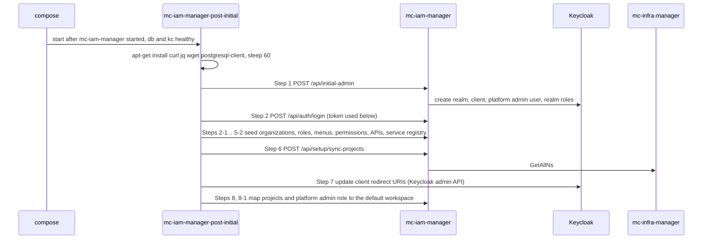

# Initial Setup

A fresh mc-iam-manager has an empty Keycloak realm list and an empty IAM database (apart from the tables `AutoMigrate` creates). Initial setup creates the realm, the platform admin, roles, menus, API permissions, the framework service registry and the workspace/project mapping.

It is performed by the one-shot container `mc-iam-manager-post-initial`. That container runs [`conf/mc-iam-manager/docker-post-init.sh`](https://github.com/m-cmp/mc-iam-manager/blob/main/conf/mc-iam-manager/docker-post-init.sh), which runs [`conf/mc-iam-manager/1_setup_auto.sh`](https://github.com/m-cmp/mc-iam-manager/blob/main/conf/mc-iam-manager/1_setup_auto.sh).



## The post-init container

From [`docker-compose-standalone.yaml`](https://github.com/m-cmp/mc-iam-manager/blob/main/docker-compose-standalone.yaml):

- image `ubuntu:22.04`, `env_file: ./.env`, `./conf/mc-iam-manager/` mounted at `/app/mc-iam-manager` (also the working directory)
- `depends_on`: `mc-iam-manager` **started** (not healthy), `mc-iam-manager-db` healthy, `mc-iam-manager-kc` healthy
- no restart policy: it runs once and exits

`docker-post-init.sh` installs `curl`, `jq`, `wget` and `postgresql-client`, prints debug information, **sleeps 60 seconds** so mc-iam-manager can finish booting, and runs `bash 1_setup_auto.sh`. If that fails, it prints recovery instructions and exits with status 1.

`1_setup_auto.sh` first runs `source .env` from its working directory. That file normally does not exist (`conf/mc-iam-manager/.env` is used by mc-admin-cli), so the values come from the container environment (`env_file`). All API calls go to `$MC_IAM_MANAGER_HOST`.

> **Known issue:** `.env.setup` ends with `MC_IAM_MANAGER_HOST=http://localhost:5000`, which overrides the correct `http://mc-iam-manager:5000`. Inside the post-init container that address does not reach mc-iam-manager, so Step 1 fails. Fix `.env` as described in [Installation Guide, Known issue 1](Installation-Guide#before-you-start), then [re-run](#re-running).

## Steps in `1_setup_auto.sh`

A step marked **fatal** stops the script with `Setup failed with errors!` (exit 1). A step marked **warn** only prints a warning.

| Step | Function | Call | On failure |
|---|---|---|---|
| 1 | `init_platform_admin` | `POST /api/initial-admin` with `{email, password, username}` from `MC_IAM_MANAGER_PLATFORMADMIN_*` | fatal (HTTP not 200 or 201, or `.error` in the body) |
| 2 | `login` | `POST /api/auth/login` with `{id, password}`. Stores `access_token` for the following steps. | fatal |
| 2-1 | `init_organizations` | `POST /api/setup/initial-organizations`. Passes `filePath` if `MC_IAM_MANAGER_ORG` is a local file. Otherwise the server resolves the URL or the bundled `asset/organization/organizations.yaml`. Upsert. | fatal |
| 3 | `init_predefined_roles` | For each role in `PREDEFINED_ROLE`: `POST /api/roles` with `roleTypes: ["workspace","platform"]`. An existing role with the same name is reused. | fatal |
| 4 | `init_menu` | Downloads `MC_WEB_CONSOLE_MENUYAML` to `./menu.yaml` with `wget` (exits on failure), then `POST /api/setup/initial-menus`. The server reads the menu source itself and **skips** if menus already exist. | fatal |
| 4-1 | `init_menu_permissions` | `GET /api/setup/initial-role-menu-permission-yaml`, with `filePath` when `MC_WEB_CONSOLE_MENU_PERMISSIONS` is a local file. Additive. | fatal (HTTP not 200) |
| 5 | `init_api_resources` | Downloads `MC_ADMIN_CLI_APIYAML` to `./api.yaml`, keeping the local copy if the download fails, then `POST /api/setup/sync-mcmp-apis`. The server loads the bundled `asset/mcmpapi/service-actions.yaml`, not the downloaded file ([`src/service/mcmpapi_service.go`](https://github.com/m-cmp/mc-iam-manager/blob/main/src/service/mcmpapi_service.go)). | fatal |
| 5-1 | `register_framework_services` | Parses the `services:` section of `./api.yaml`. For every service except `mc-iam-manager` it calls `POST /api/mcmp-apis` with name, version, base URL and auth. mc-infra-manager and mc-infra-connector get the `MC_INFRA_*_API_USERNAME/PASSWORD` credentials. On HTTP 409 it updates the row directly with `psql` (`UPDATE mcmp_api_services ...`). | fatal |
| 5-2 | `update_public_service_urls` | Registers `mc-cost-optimizer-fe`, `mc-workflow-manager-fe`, `mc-data-manager-fe` and `mc-application-manager-fe`, then sets each base URL to its public iframe URL with `PUT /api/mcmp-apis/name/<service>` | warn |
| 6 | `sync_projects` | Checks `http://mc-infra-manager:1323/tumblebug/readyz` (result is only logged), then calls `POST /api/setup/sync-projects`, which reads mc-infra-manager namespaces (`GetAllNs`) | fatal |
| 7 | `configure_keycloak_client_uris` | Gets an admin token from the `master` realm with `MC_IAM_MANAGER_KEYCLOAK_ADMIN`. For `MC_IAM_MANAGER_KEYCLOAK_CLIENT_NAME` and `MC_IAM_MANAGER_KEYCLOAK_OIDC_CLIENT_NAME` it sets `rootUrl`/`baseUrl` to `MC_IAM_MANAGER_PUBLIC_HOST`, `redirectUris` to `[<public host>/*, <scheme>://<PUBLIC_DOMAIN>:<MC_WEB_CONSOLE_FRONT_PORT>/*]` and `webOrigins` to the same two origins. A missing client is skipped. | warn |
| 8 | `map_workspace_projects` | `POST /api/workspaces/list`, takes the **first** workspace, `POST /api/projects/list`, then `POST /api/workspaces/assign/projects` with all project IDs | fatal |
| 8-1 | `assign_platformadmin_workspace_role` | `POST /api/roles/assign/workspace-role` giving the platform admin `MC_IAM_MANAGER_PLATFORMADMIN_WORKSPACE_ROLE` (default: first entry of `PREDEFINED_ROLE`) in that workspace | warn |

On success the script prints `=== Automated setup completed successfully ===` and `Setup completed successfully!`, and the container exits with 0.

### What `POST /api/initial-admin` does

Implemented in `SetupInitialAdmin` ([`src/handler/admin_handler.go`](https://github.com/m-cmp/mc-iam-manager/blob/main/src/handler/admin_handler.go)) and `SetupInitialKeycloakAdmin` ([`src/service/keycloak_service.go`](https://github.com/m-cmp/mc-iam-manager/blob/main/src/service/keycloak_service.go)). The route needs no authentication (`/initial-admin` is in the auth skip list in [`src/main.go`](https://github.com/m-cmp/mc-iam-manager/blob/main/src/main.go)).

1. Logs in to Keycloak as `MC_IAM_MANAGER_KEYCLOAK_ADMIN`.
2. Creates the realm `MC_IAM_MANAGER_KEYCLOAK_REALM` (access token lifetime `MC_IAM_MANAGER_ACCESS_TOKEN_LIFESPAN`) and the client `MC_IAM_MANAGER_KEYCLOAK_CLIENT_NAME`, if they do not exist.
3. Creates the Keycloak user `MC_IAM_MANAGER_PLATFORMADMIN_ID` with first name, last name and e-mail from `MC_IAM_MANAGER_PLATFORMADMIN_*`, if it does not exist, and sets `MC_IAM_MANAGER_PLATFORMADMIN_PASSWORD`. **An existing user's password is not changed.** All five `MC_IAM_MANAGER_PLATFORMADMIN_*` variables must be set.
4. Syncs the user into the IAM DB, using the request body's `email`.
5. Creates the `MC_IAM_MANAGER_PREDEFINED_PLATFORM_ROLE` roles in Keycloak and in the DB (as platform and workspace roles).
6. Creates the default workspace `MC_IAM_MANAGER_DEFAULT_WORKSPACE_NAME` (fallback `ws01`).
7. Loads menus and role-menu permissions from YAML (skipped if already seeded), loads the default organizations, and creates the default company if none exists.

Most sub-step errors are only logged, and the handler still returns 200. Check `docker compose logs mc-iam-manager` for `[ERROR]` lines if the result looks incomplete.

> The request body's `username` and `password` fields are not used for the Keycloak account. The username and password always come from the environment variables.

## Known issues: dead endpoints in the setup scripts

> **Known issue.** Both setup scripts define functions that call endpoints which are **not registered** in [`src/main.go`](https://github.com/m-cmp/mc-iam-manager/blob/main/src/main.go):
>
> | Function | Endpoint | `1_setup_auto.sh` | `1_setup_manual.sh` |
> |---|---|---|---|
> | `init_cloud_resources` | `POST /api/resource/file/framework/all` | defined, never called | menu option 7 |
> | `map_api_cloud_resources` | `POST /api/resource/mapping/api-cloud` | defined, never called | menu option 8 |
> | `map_workspace_csp_roles` | `POST /api/workspace-roles/csp-mapping` | defined, never called | menu option 9 |
> | `map_workspace_projects` (manual version) | `POST /api/workspaces/projects/mapping` | not used (the auto script uses `/api/workspaces/assign/projects`) | menu option 11 |
>
> These calls return 404, and the functions print the response without checking it. The automatic setup is not affected because it never calls them. In the manual script, use the automatic script's flow instead.

## Manual setup (`1_setup_manual.sh`)

[`conf/mc-iam-manager/1_setup_manual.sh`](https://github.com/m-cmp/mc-iam-manager/blob/main/conf/mc-iam-manager/1_setup_manual.sh) is an interactive menu meant to run on the host:

```bash
cd conf/mc-iam-manager
./1_setup_manual.sh        # runs "source ../../.env"; needs curl, jq, wget
```

Run it from `conf/mc-iam-manager/`, because it sources `../../.env`. From the host, `MC_IAM_MANAGER_HOST=http://localhost:5000` is the right value.

The menu labels do not match what the options do:

| Input | Label shown | Actually runs |
|---|---|---|
| 1 | Init Platform And PlatformAdmin | `POST /api/initial-admin` |
| 2 | PlatformAdmin Login | prompts for ID and password, then `POST /api/auth/login` |
| 3 | Init Role Data | `POST /api/roles` per `PREDEFINED_ROLE` |
| 4 | Init Menu Data | `POST /api/setup/initial-menus`, then the YAML permission seed |
| 4a | Init Menu Role Permissions (YAML) | YAML permission seed only |
| 5 | Init API Resource Data | `POST /api/setup/sync-mcmp-apis` |
| 6 | Init Cloud Resource Data | nothing (no `case` branch, prints "Invalid option") |
| 7 | Map API-Cloud Resources | `init_cloud_resources` (dead endpoint) |
| 8 | Init Workspace Roles | `map_api_cloud_resources` (dead endpoint) |
| 9 | Map Workspace-CSP Roles | `map_workspace_csp_roles` (dead endpoint) |
| 10 | Sync Projects | `POST /api/setup/sync-projects` |
| 11 | Map Workspace-All Projects | prompts for a workspace ID, then calls the dead `POST /api/workspaces/projects/mapping` |

The prompt says `(0-8)` although options go up to 11. The manual script also has no equivalent of Steps 2-1, 5-1, 5-2, 7 and 8-1. Prefer re-running the automatic setup.

## Re-running

The setup is designed to be re-run, and the recovery message in `docker-post-init.sh` describes it as idempotent:

```bash
export COMPOSE_FILE=docker-compose-standalone.yaml
docker rm mc-iam-manager-post-initial 2>/dev/null
docker compose up -d mc-iam-manager-post-initial
docker logs -f mc-iam-manager-post-initial
```

What a re-run does to existing data:

| Step | Effect on re-run |
|---|---|
| 1 | Realm, client and user are kept. The password is **not** reset. Roles and workspace are reused. |
| 2-1 | Organizations are upserted from the seed |
| 3 | Existing roles are reused |
| 4 | Skipped if menus already exist (`skipped: true`) |
| 4-1 | **Additive**: mappings you removed at runtime that are still in the YAML come back |
| 5, 5-1 | API actions are upserted, and service registry rows are updated (base URL, version, credentials) |
| 6 | Projects are re-synced from mc-infra-manager |
| 7 | Client `rootUrl`, `baseUrl`, `redirectUris` and `webOrigins` are **overwritten**, and custom redirect URIs are lost |
| 8 | **All projects are re-assigned to the first workspace.** A project belongs to one workspace at a time ([`src/repository/workspace_repository.go`](https://github.com/m-cmp/mc-iam-manager/blob/main/src/repository/workspace_repository.go) `AddProjectAssociation` deletes other associations), so projects you moved to other workspaces are moved back. |
| 8-1 | The workspace role is assigned again |

To re-run only some steps on a system in use, call the corresponding API endpoints yourself with a platform admin token instead of re-running the whole container.

## After setup

- `curl -s http://localhost:${MC_IAM_MANAGER_PORT}/readyz` should return `{"status":"healthy"}`. Steps 1 (realm and client) and 5-1 (`mc-infra-manager` registry entry) are prerequisites of that check.
- Log in with the platform admin (see [Installation Guide](Installation-Guide#verify)).
- Optional demo roles: [`scripts/demo/setup-demo-rbac.sh`](https://github.com/m-cmp/mc-iam-manager/blob/main/scripts/demo/setup-demo-rbac.sh) (manual, not part of initial setup).
- Menu and permission details: [Menu and Role Permission](Menu-and-Role-Permission).
