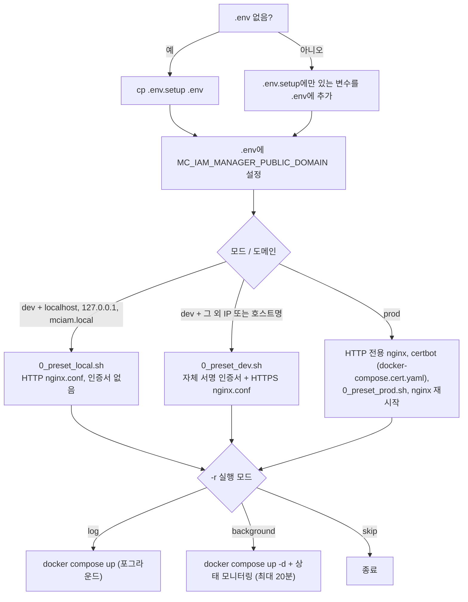

> 이 문서는 [Installation Guide](Installation-Guide)의 한국어판입니다. 내용이 다르면 영문판이 기준입니다.

# 설치 가이드

이 문서는 이 레포지토리의 [`installAll.sh`](https://github.com/m-cmp/mc-iam-manager/blob/main/installAll.sh)로 mc-iam-manager를 **단독(standalone)** 설치하는 방법을 설명합니다.

> M-CMP 플랫폼 전체(모든 프레임워크와 mc-web-console) 설치는 보통 [mc-admin-cli](https://github.com/m-cmp/mc-admin-cli/wiki)로 진행합니다. 개발이나 테스트 목적으로 mc-iam-manager만 따로 띄울 때 이 문서를 참고하세요.

## 사전 요구사항

- Docker와 Docker Compose v2(`docker compose`)가 설치된 Linux 호스트. [`readme.md`](https://github.com/m-cmp/mc-iam-manager/blob/main/readme.md) 기준으로 검증된 플랫폼은 Ubuntu 22.04입니다.
- `git`, `openssl`(dev 모드 인증서 생성용), `sudo`(`/etc/hosts` 수정과 root 소유 디렉터리 소유권 회수에 사용).
- 사용 가능한 호스트 포트. 기본값은 [`.env.setup`](https://github.com/m-cmp/mc-iam-manager/blob/main/.env.setup) 기준으로 80, 443(nginx), 5000(mc-iam-manager), 8080(Keycloak), 15432(IAM PostgreSQL), 1024(mc-infra-connector), 1323(mc-infra-manager), 2379·2380(etcd), 6432(mc-infra-manager PostgreSQL), 8200(OpenBao)입니다.
- 원격 VM이라면 인바운드 80, 443 포트가 열려 있어야 합니다. 운영(prod) 모드에서는 Let's Encrypt HTTP-01 챌린지를 위해 80 포트가 인터넷에서 접근 가능해야 합니다.
- 운영 모드에서는 DNS A 레코드가 호스트를 가리키는 실제 FQDN과, Let's Encrypt용 메일 주소(`MC_IAM_MANAGER_CERT_EMAIL`)가 필요합니다.

## `installAll.sh` 동작 방식



스크립트는 `COMPOSE_FILE=docker-compose-standalone.yaml`을 export하므로, 스크립트 내부의 모든 `docker compose` 호출은 standalone 파일(mc-web-console 제외)을 사용합니다. [Deployment Modes](Deployment-Modes)를 참고하세요.

### 옵션

[`installAll.sh`](https://github.com/m-cmp/mc-iam-manager/blob/main/installAll.sh) 기준으로 확인한 내용입니다.

| 옵션 | 값 | 의미 |
|---|---|---|
| `-m`, `--mode` | `dev` 또는 `prod` | `dev`: 로컬 이름이면 일반 HTTP, 그 외에는 자체 서명 HTTPS. `prod`: Let's Encrypt 인증서. 생략하면 입력을 요청합니다. |
| `-d`, `--domain` | 도메인 또는 IP | `.env`의 `MC_IAM_MANAGER_PUBLIC_DOMAIN`에 기록됩니다. dev 모드에서는 입력 기본값이 `localhost`이고, prod 모드에서는 반드시 지정해야 합니다. |
| `-r`, `--run` | `log`, `background`, `skip` | 설정 후 컨테이너를 어떻게 기동할지 지정합니다. 생략하면 입력을 요청합니다. |
| `-h`, `--help` | | 사용법을 출력합니다. |

옵션 없이 `./installAll.sh`를 실행하면 모든 값을 대화형으로 입력받습니다.

## 시작하기 전에

1. 레포지토리를 클론합니다.

   ```bash
   git clone https://github.com/m-cmp/mc-iam-manager.git
   cd mc-iam-manager
   ```

2. 선택 사항이지만 권장: 첫 기동 전에 시크릿을 바꿀 수 있도록 `.env`를 직접 만들어 둡니다. `.env`가 이미 있으면 `installAll.sh`는 기존 파일을 유지하고 누락된 변수만 추가합니다.

   ```bash
   cp .env.setup .env
   ```

   최소한 아래 값은 기본값에서 변경하세요. 전체 목록은 [Configuration Reference](Configuration-Reference)에 있습니다.

   | 변수 | `.env.setup` 기본값 |
   |---|---|
   | `MC_IAM_MANAGER_PLATFORMADMIN_ID` / `MC_IAM_MANAGER_PLATFORMADMIN_PASSWORD` | `mcmp` / `mcmp_password` |
   | `MC_IAM_MANAGER_KEYCLOAK_ADMIN` / `MC_IAM_MANAGER_KEYCLOAK_ADMIN_PASSWORD` | `admin` / `admin_password` |
   | `MC_IAM_MANAGER_DATABASE_PASSWORD` | `mciamdbpassword` |
   | `MC_IAM_MANAGER_KEYCLOAK_CLIENT_SECRET`, `MC_IAM_MANAGER_KEYCLOAK_OIDC_CLIENT_SECRET` | 샘플 시크릿 |
   | `MC_IAM_MANAGER_CERT_EMAIL` (prod 전용) | `mcmp@cloud-barista.org` |

   > `.env_sample`은 레거시 샘플입니다. 현재 compose 파일에 필요한 변수(예: `MC_IAM_MANAGER_PUBLIC_DOMAIN`, nginx 포트 변수)가 빠져 있으므로 항상 `.env.setup`에서 시작하세요.

3. 아래 두 가지 `.env.setup` 결함에 대한 우회 조치를 적용합니다. 적용하지 않으면 standalone 설치가 실패합니다.

> **알려진 이슈 1: `MC_IAM_MANAGER_HOST`가 `http://localhost:5000`으로 덮어써짐**
> [`.env.setup`](https://github.com/m-cmp/mc-iam-manager/blob/main/.env.setup)의 마지막 줄이 `MC_IAM_MANAGER_HOST=http://localhost:5000`으로 재정의하면서, 앞에서 정의한 `http://${MC_IAM_MANAGER_DOMAIN}:${MC_IAM_MANAGER_PORT}`를 덮어씁니다. 초기화 컨테이너 `mc-iam-manager-post-initial`은 `env_file`로 `.env`를 읽어 `$MC_IAM_MANAGER_HOST`로 API를 호출합니다. 그런데 이 컨테이너 안에서 `localhost:5000`은 mc-iam-manager가 아니므로 [Initial Setup](Initial-Setup) Step 1이 연결에 실패합니다(`docker compose config`로 보면 실제 적용값이 `http://localhost:5000`입니다).
> 우회 방법: `.env`에서 해당 마지막 줄을 삭제하거나 `MC_IAM_MANAGER_HOST=http://mc-iam-manager:5000`으로 바꿉니다. `localhost:5000`이 맞는 경우는 호스트에서 `1_setup_manual.sh`를 직접 실행할 때뿐입니다.

> **알려진 이슈 2: `.env.setup`에 nginx 포트 변수 누락**
> [`nginx.template.local.conf`](https://github.com/m-cmp/mc-iam-manager/blob/main/conf/mc-iam-manager/nginx.template.local.conf)에는 `listen ${MC_COST_OPTIMIZER_BE_PORT};`, `listen ${MC_COST_OPTIMIZER_ALARM_PORT};`, `listen ${MC_WORKFLOW_MANAGER_PROXY_PORT};`, `listen ${MC_DATA_MANAGER_PROXY_PORT};`, `listen ${MC_APPLICATION_MANAGER_PROXY_PORT};`가 있습니다. 이 변수들은 `.env.setup`에 하나도 정의되어 있지 않아서, localhost(HTTP) 프리셋은 `listen ;`을 생성하고 nginx가 기동을 거부합니다(`invalid number of arguments in "listen" directive`).
> [`0_preset_prod.sh`](https://github.com/m-cmp/mc-iam-manager/blob/main/conf/mc-iam-manager/0_preset_prod.sh)는 `set -euo pipefail`로 실행되며 각 변수를 `grep`으로 읽습니다. 변수가 하나라도 없으면 `grep`이 실패하고, 스크립트는 `nginx.conf`를 쓰기 전에 종료 코드 1로 끝납니다.
> 우회 방법: `installAll.sh` 실행 전에 `.env`에 변수를 추가합니다. 아래 값은 mc-admin-cli 기본값과 같습니다. localhost 프리셋에서는 사용하지 않는 포트라면 아무 값이나 괜찮고, prod 프리셋은 키가 존재하기만 하면 됩니다.
>
> ```bash
> cat >> .env <<'EOF'
> MC_COST_OPTIMIZER_BE_PORT=9090
> MC_COST_OPTIMIZER_ALARM_PORT=9000
> MC_WORKFLOW_MANAGER_PROXY_PORT=18083
> MC_DATA_MANAGER_PROXY_PORT=3300
> MC_APPLICATION_MANAGER_PROXY_PORT=18084
> EOF
> ```
>
> 자체 서명 프리셋([`0_preset_dev.sh`](https://github.com/m-cmp/mc-iam-manager/blob/main/conf/mc-iam-manager/0_preset_dev.sh) + [`nginx.template.conf`](https://github.com/m-cmp/mc-iam-manager/blob/main/conf/mc-iam-manager/nginx.template.conf))은 영향을 받지 않습니다.

## 시나리오 A: 로컬 PC 개발 환경 (HTTP, `localhost`)

```bash
./installAll.sh -m dev -d localhost -r background
```

- 프리셋: [`conf/mc-iam-manager/0_preset_local.sh`](https://github.com/m-cmp/mc-iam-manager/blob/main/conf/mc-iam-manager/0_preset_local.sh). 도메인이 `localhost`, `127.0.0.1`, `mciam.local`일 때 실행됩니다.
- 인증서를 생성하지 않습니다. `.env`의 `MC_IAM_MANAGER_PUBLIC_HOST`와 다른 프레임워크의 `*_PUBLIC_HOST` 변수에서 `https://`를 `http://`로 바꿉니다.
- `nginx.template.local.conf`로부터 `container-volume/mc-iam-manager/nginx/nginx.conf`를 생성합니다.
- `mciam.local`이면 `/etc/hosts`에 `127.0.0.1 mciam.local`을 추가합니다(가능하면 `sudo -n` 사용). `localhost`와 `127.0.0.1`은 `/etc/hosts`를 건드리지 않습니다.

접속 주소: `http://localhost/`(nginx), `http://localhost:5000/`(mc-iam-manager 직접), `http://localhost/auth/`(nginx를 거친 Keycloak).

## 시나리오 B: IP로 접속하는 VM 개발 환경 (자체 서명 HTTPS)

```bash
./installAll.sh -m dev -d <VM_PUBLIC_IP> -r background
```

- 프리셋: [`conf/mc-iam-manager/0_preset_dev.sh`](https://github.com/m-cmp/mc-iam-manager/blob/main/conf/mc-iam-manager/0_preset_dev.sh).
- 유효기간 365일의 RSA 2048 자체 서명 인증서를 새로 만들어 `container-volume/mc-iam-manager/certs/live/<PUBLIC_DOMAIN>/{fullchain.pem,privkey.pem}`에 씁니다. SAN은 IP이면 `IP:<address>`, 호스트명이면 `DNS:<name>`입니다. 실행할 때마다 인증서를 새로 발급합니다.
- IP가 아닌 호스트명이면 `/etc/hosts`에 `127.0.0.1 <hostname>` 추가도 시도합니다.
- `nginx.template.conf`로부터 `nginx.conf`를 생성합니다. 80 포트는 443의 HTTPS로 리다이렉트됩니다.

브라우저에 인증서 경고가 표시됩니다. 자체 서명 모드에서는 CSP IdP 연동(federation)을 사용할 수 없습니다. [인증서](Certificates-ko)를 참고하세요.

## 시나리오 C: FQDN 기반 운영 환경 (Let's Encrypt)

```bash
./installAll.sh -m prod -d iam.example.com -r background
```

수행 단계([`installAll.sh`](https://github.com/m-cmp/mc-iam-manager/blob/main/installAll.sh)의 `prod)` 분기 참고):

1. `container-volume/certbot/www`에서 `/.well-known/acme-challenge/`를 제공하는 임시 HTTP 전용 `nginx.conf`를 쓰고 `mc-iam-manager-nginx`를 기동합니다.
2. `docker compose -f docker-compose.cert.yaml --env-file .env up`을 실행합니다. Certbot이 `MC_IAM_MANAGER_CERT_EMAIL`로 `MC_IAM_MANAGER_PUBLIC_DOMAIN` 인증서를 발급받으면, 스크립트가 `sudo chown`으로 `container-volume/`의 소유권을 현재 사용자에게 돌려줍니다.
3. [`conf/mc-iam-manager/0_preset_prod.sh`](https://github.com/m-cmp/mc-iam-manager/blob/main/conf/mc-iam-manager/0_preset_prod.sh)를 실행해 `nginx.template.conf`로부터 HTTPS `nginx.conf`를 생성합니다. 이 단계에는 알려진 이슈 2의 우회 조치가 필요합니다.
4. nginx를 재시작합니다.

인증서 갱신은 수동입니다. [인증서](Certificates-ko#갱신)를 참고하세요.

## 실행되는 구성 요소

`-r background`를 지정하면 스크립트는 `docker-compose-standalone.yaml`로 `docker compose --env-file .env up -d`를 실행한 뒤, 최대 20분 동안 10초 간격으로 `docker ps`를 확인합니다. 다음 컨테이너가 모두 올라오고 `unhealthy`, `starting`, `restarting` 상태가 아니게 될 때까지 기다립니다: `mc-infra-connector`, `mc-infra-manager`, `mc-infra-manager-etcd`, `mc-infra-manager-postgres`, `mc-infra-manager-openbao`, `mc-iam-manager*`, `mc-iam-manager-db`, `mc-iam-manager-kc`, `mc-iam-manager-nginx`.

`mc-iam-manager-post-initial`은 mc-iam-manager가 시작된 뒤 기동하여 60초 대기 후 [Initial Setup](Initial-Setup)을 실행하고 종료합니다. **이 초기화가 끝날 때까지 mc-iam-manager는 `unhealthy`로 표시됩니다.** `/readyz`가 Keycloak realm(Step 1에서 생성)과 `mc-infra-manager` 서비스 등록(Step 5-1에서 생성)을 필요로 하기 때문입니다.

> 모니터링 마지막에 출력되는 URL(`http://localhost:${MC_IAM_PORT}/readyz`, `http://localhost:${MC_KC_PORT}/admin/`)은 틀릴 수 있습니다. 스크립트가 자기 셸에 `.env`를 로드하지 않아 IAM 포트가 `5005`로 대체되기 때문입니다. 또 Keycloak은 `/auth` 아래에서 서비스되므로 관리 콘솔 주소는 `/auth/admin/`입니다. [확인](#확인)의 URL을 사용하세요.

> 스크립트가 끝나면 현재 셸에는 `COMPOSE_FILE`이 설정되어 있지 않습니다. 이 상태로 레포지토리에서 그냥 `docker compose up -d`를 실행하면 `docker-compose.yaml`이 사용되어 mc-web-console 서비스까지 기동됩니다. standalone 구성으로 계속 작업하려면 먼저 `export COMPOSE_FILE=docker-compose-standalone.yaml`을 실행하거나 `-f docker-compose-standalone.yaml`을 지정하세요.

## 확인

```bash
export COMPOSE_FILE=docker-compose-standalone.yaml

# 1. Containers
docker compose ps

# 2. Initialization finished? Look for "Setup completed successfully!"
docker logs mc-iam-manager-post-initial | tail -n 30

# 3. Health (direct to mc-iam-manager; port = MC_IAM_MANAGER_PORT)
curl -s http://localhost:5000/readyz
# {"status":"healthy"}

# 4. Health through nginx
curl -s  http://localhost/health              # Scenario A
curl -sk https://<PUBLIC_DOMAIN>/health        # Scenarios B and C
curl -s  http://localhost/nginx-health         # nginx itself

# 5. Login as the platform admin (values from .env)
curl -s -X POST http://localhost:5000/api/auth/login \
  -H 'Content-Type: application/json' \
  -d '{"id":"<MC_IAM_MANAGER_PLATFORMADMIN_ID>","password":"<MC_IAM_MANAGER_PLATFORMADMIN_PASSWORD>"}'
# Response contains "access_token"
```

- Keycloak 관리 콘솔: `http://localhost:8080/auth/admin/` 또는 nginx를 거쳐 `https://<PUBLIC_DOMAIN>/auth/admin/`. `MC_IAM_MANAGER_KEYCLOAK_ADMIN` / `MC_IAM_MANAGER_KEYCLOAK_ADMIN_PASSWORD`로 로그인합니다. 애플리케이션 realm은 `MC_IAM_MANAGER_KEYCLOAK_REALM`(기본값 `mciam`)입니다.
- Swagger UI: `http://localhost:5000/swagger/index.html`.

## 기본 계정

| 계정 | 위치 | 출처 |
|---|---|---|
| 플랫폼 관리자 | Keycloak realm `MC_IAM_MANAGER_KEYCLOAK_REALM` + IAM DB | `MC_IAM_MANAGER_PLATFORMADMIN_ID`, `_PASSWORD`, `_EMAIL`, `_FIRSTNAME`, `_LASTNAME`. `POST /api/initial-admin`으로 생성됩니다([Initial Setup](Initial-Setup)). |
| Keycloak 관리자 | Keycloak `master` realm | `MC_IAM_MANAGER_KEYCLOAK_ADMIN`, `MC_IAM_MANAGER_KEYCLOAK_ADMIN_PASSWORD` (Keycloak에는 `KEYCLOAK_ADMIN` / `KEYCLOAK_ADMIN_PASSWORD`로 전달) |
| PostgreSQL 슈퍼유저 | `mc-iam-manager-db` | `MC_IAM_MANAGER_DATABASE_USER`, `MC_IAM_MANAGER_DATABASE_PASSWORD` |

플랫폼 관리자 비밀번호는 사용자가 처음 생성될 때만 Keycloak에 설정됩니다. 나중에 `MC_IAM_MANAGER_PLATFORMADMIN_PASSWORD`를 바꿔도 반영되지 않습니다. [문제 해결](Troubleshooting-ko#env에서-비밀번호-변경-후-플랫폼-관리자-로그인-실패)을 참고하세요.

## 다음 단계

- [Initial Setup](Initial-Setup): post-init 컨테이너가 설정한 내용과 재실행 방법
- [Operations](Operations): 로그, 백업, 업그레이드
- [문제 해결](Troubleshooting-ko)
