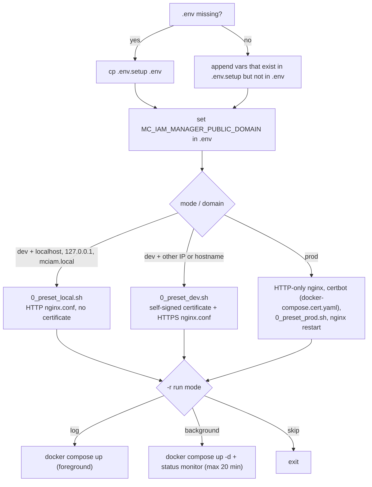

# Installation Guide

This page covers installing mc-iam-manager **standalone** from this repository with [`installAll.sh`](https://github.com/m-cmp/mc-iam-manager/blob/main/installAll.sh).

> Installing the whole M-CMP platform (all frameworks plus mc-web-console) is normally done with [mc-admin-cli](https://github.com/m-cmp/mc-admin-cli/wiki). Use this page when you want mc-iam-manager on its own, for development or for testing.

## Prerequisites

- Linux host with Docker and Docker Compose v2 (`docker compose`). Ubuntu 22.04 is the tested platform per [`readme.md`](https://github.com/m-cmp/mc-iam-manager/blob/main/readme.md).
- `git`, `openssl` (dev mode certificate generation), and `sudo` (used for `/etc/hosts` edits and for reclaiming root-owned directories).
- Free host ports. The defaults come from [`.env.setup`](https://github.com/m-cmp/mc-iam-manager/blob/main/.env.setup): 80, 443 (nginx), 5000 (mc-iam-manager), 8080 (Keycloak), 15432 (IAM PostgreSQL), 1024 (mc-infra-connector), 1323 (mc-infra-manager), 2379 and 2380 (etcd), 6432 (mc-infra-manager PostgreSQL), 8200 (OpenBao).
- For a remote VM, inbound 80 and 443 must be open. For production mode, port 80 must also be reachable from the internet for the Let's Encrypt HTTP-01 challenge.
- For production mode, a real FQDN whose DNS A record points to the host, and a mail address for Let's Encrypt (`MC_IAM_MANAGER_CERT_EMAIL`).

## What `installAll.sh` does



The script exports `COMPOSE_FILE=docker-compose-standalone.yaml`, so every `docker compose` call it makes uses the standalone file (no mc-web-console). See [Deployment Modes](Deployment-Modes).

### Options

Verified against [`installAll.sh`](https://github.com/m-cmp/mc-iam-manager/blob/main/installAll.sh):

| Option | Values | Meaning |
|---|---|---|
| `-m`, `--mode` | `dev` or `prod` | `dev`: plain HTTP for local names, self-signed HTTPS otherwise. `prod`: Let's Encrypt certificate. Prompted if omitted. |
| `-d`, `--domain` | domain or IP | Written to `MC_IAM_MANAGER_PUBLIC_DOMAIN` in `.env`. In dev mode the prompt defaults to `localhost`. In prod mode a value is required. |
| `-r`, `--run` | `log`, `background` or `skip` | How to start the containers after configuration. Prompted if omitted. |
| `-h`, `--help` | | Print usage. |

Running `./installAll.sh` with no options is fully interactive.

## Before you start

1. Clone the repository:

   ```bash
   git clone https://github.com/m-cmp/mc-iam-manager.git
   cd mc-iam-manager
   ```

2. Optional but recommended: create `.env` yourself so you can change secrets before the first start. If `.env` already exists, `installAll.sh` keeps it and only appends missing variables.

   ```bash
   cp .env.setup .env
   ```

   Change at least these values from their defaults. All are listed in [Configuration Reference](Configuration-Reference).

   | Variable | Default in `.env.setup` |
   |---|---|
   | `MC_IAM_MANAGER_PLATFORMADMIN_ID` / `MC_IAM_MANAGER_PLATFORMADMIN_PASSWORD` | `mcmp` / `mcmp_password` |
   | `MC_IAM_MANAGER_KEYCLOAK_ADMIN` / `MC_IAM_MANAGER_KEYCLOAK_ADMIN_PASSWORD` | `admin` / `admin_password` |
   | `MC_IAM_MANAGER_DATABASE_PASSWORD` | `mciamdbpassword` |
   | `MC_IAM_MANAGER_KEYCLOAK_CLIENT_SECRET`, `MC_IAM_MANAGER_KEYCLOAK_OIDC_CLIENT_SECRET` | sample secrets |
   | `MC_IAM_MANAGER_CERT_EMAIL` (prod only) | `mcmp@cloud-barista.org` |

   > `.env_sample` is a legacy sample. It lacks variables the current compose files need (for example `MC_IAM_MANAGER_PUBLIC_DOMAIN` and the nginx port variables). Always start from `.env.setup`.

3. Apply the workarounds for the two `.env.setup` defects below. Without them a standalone install fails.

> **Known issue 1: `MC_IAM_MANAGER_HOST` is overridden to `http://localhost:5000`.**
> The last line of [`.env.setup`](https://github.com/m-cmp/mc-iam-manager/blob/main/.env.setup) redefines `MC_IAM_MANAGER_HOST=http://localhost:5000`, which overrides the earlier `http://${MC_IAM_MANAGER_DOMAIN}:${MC_IAM_MANAGER_PORT}`. The initialization container `mc-iam-manager-post-initial` reads `.env` through `env_file` and calls the API at `$MC_IAM_MANAGER_HOST`. Inside that container `localhost:5000` is not mc-iam-manager, so [Initial Setup](Initial-Setup) Step 1 cannot connect. (`docker compose config` shows the effective value as `http://localhost:5000`.)
> Workaround: delete that last line from `.env`, or change it to `MC_IAM_MANAGER_HOST=http://mc-iam-manager:5000`. Running `1_setup_manual.sh` from the host is the only case where `localhost:5000` is correct.

> **Known issue 2: nginx port variables missing from `.env.setup`.**
> [`nginx.template.local.conf`](https://github.com/m-cmp/mc-iam-manager/blob/main/conf/mc-iam-manager/nginx.template.local.conf) contains `listen ${MC_COST_OPTIMIZER_BE_PORT};`, `listen ${MC_COST_OPTIMIZER_ALARM_PORT};`, `listen ${MC_WORKFLOW_MANAGER_PROXY_PORT};`, `listen ${MC_DATA_MANAGER_PROXY_PORT};` and `listen ${MC_APPLICATION_MANAGER_PROXY_PORT};`. None of these is defined in `.env.setup`, so the localhost (HTTP) preset generates `listen ;` and nginx refuses to start (`invalid number of arguments in "listen" directive`).
> [`0_preset_prod.sh`](https://github.com/m-cmp/mc-iam-manager/blob/main/conf/mc-iam-manager/0_preset_prod.sh) runs with `set -euo pipefail` and reads each of these variables with `grep`. A missing variable makes `grep` fail, and the script exits with status 1 before it writes `nginx.conf`.
> Workaround: add the variables to `.env` before running `installAll.sh`. The values below match mc-admin-cli's defaults. Any unused port works for the localhost preset. The prod preset only needs the keys to exist.
>
> ```bash
> cat >> .env <<'EOF'
> MC_COST_OPTIMIZER_BE_PORT=9090
> MC_COST_OPTIMIZER_ALARM_PORT=9000
> MC_WORKFLOW_MANAGER_PROXY_PORT=18083
> MC_DATA_MANAGER_PROXY_PORT=3300
> MC_APPLICATION_MANAGER_PROXY_PORT=18084
> EOF
> ```
>
> The self-signed preset ([`0_preset_dev.sh`](https://github.com/m-cmp/mc-iam-manager/blob/main/conf/mc-iam-manager/0_preset_dev.sh) with [`nginx.template.conf`](https://github.com/m-cmp/mc-iam-manager/blob/main/conf/mc-iam-manager/nginx.template.conf)) is not affected.

## Scenario A: development on a local PC (HTTP, `localhost`)

```bash
./installAll.sh -m dev -d localhost -r background
```

- Preset: [`conf/mc-iam-manager/0_preset_local.sh`](https://github.com/m-cmp/mc-iam-manager/blob/main/conf/mc-iam-manager/0_preset_local.sh), which runs for `localhost`, `127.0.0.1` or `mciam.local`.
- No certificate is generated. In `.env`, `https://` is rewritten to `http://` for `MC_IAM_MANAGER_PUBLIC_HOST` and for the other frameworks' `*_PUBLIC_HOST` variables.
- `nginx.conf` is generated from `nginx.template.local.conf` into `container-volume/mc-iam-manager/nginx/nginx.conf`.
- With `mciam.local`, the script adds `127.0.0.1 mciam.local` to `/etc/hosts`, using `sudo -n` when available. `localhost` and `127.0.0.1` leave `/etc/hosts` untouched.

Access: `http://localhost/` (nginx), `http://localhost:5000/` (mc-iam-manager directly), `http://localhost/auth/` (Keycloak through nginx).

## Scenario B: development on a VM reached by IP (self-signed HTTPS)

```bash
./installAll.sh -m dev -d <VM_PUBLIC_IP> -r background
```

- Preset: [`conf/mc-iam-manager/0_preset_dev.sh`](https://github.com/m-cmp/mc-iam-manager/blob/main/conf/mc-iam-manager/0_preset_dev.sh).
- A new RSA 2048 self-signed certificate, valid for 365 days, is written to `container-volume/mc-iam-manager/certs/live/<PUBLIC_DOMAIN>/{fullchain.pem,privkey.pem}`. The SAN is `IP:<address>` for an IP and `DNS:<name>` for a hostname. Every run replaces the certificate.
- For a hostname (not an IP), the script also tries to append `127.0.0.1 <hostname>` to `/etc/hosts`.
- `nginx.conf` is generated from `nginx.template.conf`: port 80 redirects to HTTPS on 443.

Browsers show a certificate warning. Self-signed mode cannot be used for CSP IdP federation. See [Certificates](Certificates).

## Scenario C: production with an FQDN (Let's Encrypt)

```bash
./installAll.sh -m prod -d iam.example.com -r background
```

Steps performed (see the `prod)` branch of [`installAll.sh`](https://github.com/m-cmp/mc-iam-manager/blob/main/installAll.sh)):

1. Writes a temporary HTTP-only `nginx.conf` that serves `/.well-known/acme-challenge/` from `container-volume/certbot/www`, then starts `mc-iam-manager-nginx`.
2. Runs `docker compose -f docker-compose.cert.yaml --env-file .env up`. Certbot obtains a certificate for `MC_IAM_MANAGER_PUBLIC_DOMAIN` using `MC_IAM_MANAGER_CERT_EMAIL`, then the script `sudo chown`s `container-volume/` back to the current user.
3. Runs [`conf/mc-iam-manager/0_preset_prod.sh`](https://github.com/m-cmp/mc-iam-manager/blob/main/conf/mc-iam-manager/0_preset_prod.sh) to render the HTTPS `nginx.conf` from `nginx.template.conf`. This step requires the Known issue 2 workaround.
4. Restarts nginx.

Certificate renewal is manual. See [Certificates](Certificates#renewal).

## What runs

With `-r background` the script runs `docker compose --env-file .env up -d` against `docker-compose-standalone.yaml`, then polls `docker ps` every 10 seconds for up to 20 minutes, until these containers are up and not `unhealthy`, `starting` or `restarting`: `mc-infra-connector`, `mc-infra-manager`, `mc-infra-manager-etcd`, `mc-infra-manager-postgres`, `mc-infra-manager-openbao`, `mc-iam-manager*`, `mc-iam-manager-db`, `mc-iam-manager-kc`, `mc-iam-manager-nginx`.

`mc-iam-manager-post-initial` starts after mc-iam-manager, waits 60 seconds, runs [Initial Setup](Initial-Setup) and exits. **mc-iam-manager reports `unhealthy` until that setup has finished**, because `/readyz` needs the Keycloak realm (created in Step 1) and the `mc-infra-manager` service registration (created in Step 5-1).

> The URLs printed at the end of the monitor (`http://localhost:${MC_IAM_PORT}/readyz`, `http://localhost:${MC_KC_PORT}/admin/`) can be wrong. The script does not load `.env` into its own shell, so the IAM port falls back to `5005`. Keycloak also serves under `/auth`, so its admin console is at `/auth/admin/`. Use the URLs in [Verify](#verify).

> After the script exits, your shell no longer has `COMPOSE_FILE` set. A plain `docker compose up -d` in the repository then uses `docker-compose.yaml`, which also starts the mc-web-console services. To keep working with the standalone set, run `export COMPOSE_FILE=docker-compose-standalone.yaml` first, or pass `-f docker-compose-standalone.yaml`.

## Verify

```bash
export COMPOSE_FILE=docker-compose-standalone.yaml

# 1. Containers
docker compose ps

# 2. Initialization finished? Look for "Setup completed successfully!"
docker logs mc-iam-manager-post-initial | tail -n 30

# 3. Health (direct to mc-iam-manager; port = MC_IAM_MANAGER_PORT)
curl -s http://localhost:5000/readyz
# {"status":"healthy"}

# 4. Health through nginx
curl -s  http://localhost/health              # Scenario A
curl -sk https://<PUBLIC_DOMAIN>/health        # Scenarios B and C
curl -s  http://localhost/nginx-health         # nginx itself

# 5. Login as the platform admin (values from .env)
curl -s -X POST http://localhost:5000/api/auth/login \
  -H 'Content-Type: application/json' \
  -d '{"id":"<MC_IAM_MANAGER_PLATFORMADMIN_ID>","password":"<MC_IAM_MANAGER_PLATFORMADMIN_PASSWORD>"}'
# Response contains "access_token"
```

- Keycloak admin console: `http://localhost:8080/auth/admin/`, or `https://<PUBLIC_DOMAIN>/auth/admin/` through nginx. Log in with `MC_IAM_MANAGER_KEYCLOAK_ADMIN` / `MC_IAM_MANAGER_KEYCLOAK_ADMIN_PASSWORD`. The application realm is `MC_IAM_MANAGER_KEYCLOAK_REALM` (default `mciam`).
- Swagger UI: `http://localhost:5000/swagger/index.html`.

## Default accounts

| Account | Where it lives | Comes from |
|---|---|---|
| Platform admin | Keycloak realm `MC_IAM_MANAGER_KEYCLOAK_REALM` + IAM DB | `MC_IAM_MANAGER_PLATFORMADMIN_ID`, `_PASSWORD`, `_EMAIL`, `_FIRSTNAME`, `_LASTNAME`, created by `POST /api/initial-admin` ([Initial Setup](Initial-Setup)) |
| Keycloak administrator | Keycloak `master` realm | `MC_IAM_MANAGER_KEYCLOAK_ADMIN`, `MC_IAM_MANAGER_KEYCLOAK_ADMIN_PASSWORD` (passed to Keycloak as `KEYCLOAK_ADMIN` / `KEYCLOAK_ADMIN_PASSWORD`) |
| PostgreSQL superuser | `mc-iam-manager-db` | `MC_IAM_MANAGER_DATABASE_USER`, `MC_IAM_MANAGER_DATABASE_PASSWORD` |

The platform admin password is set in Keycloak only when the user is first created. Changing `MC_IAM_MANAGER_PLATFORMADMIN_PASSWORD` later does not update it. See [Troubleshooting](Troubleshooting#platform-admin-login-fails-after-changing-the-password-in-env).

## Next steps

- [Initial Setup](Initial-Setup): what the post-init container configured, and how to re-run it
- [Operations](Operations): logs, backup and upgrade
- [Troubleshooting](Troubleshooting)
