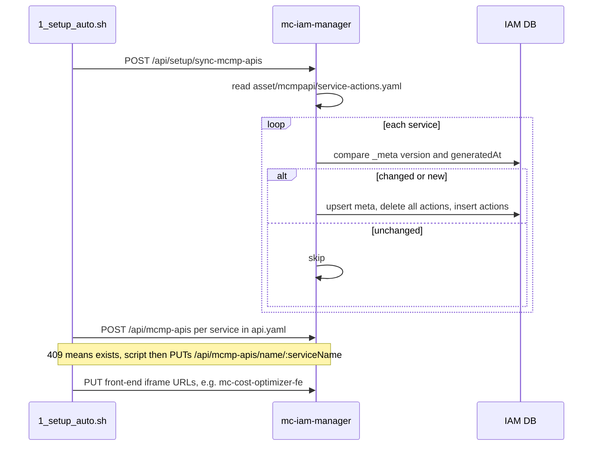
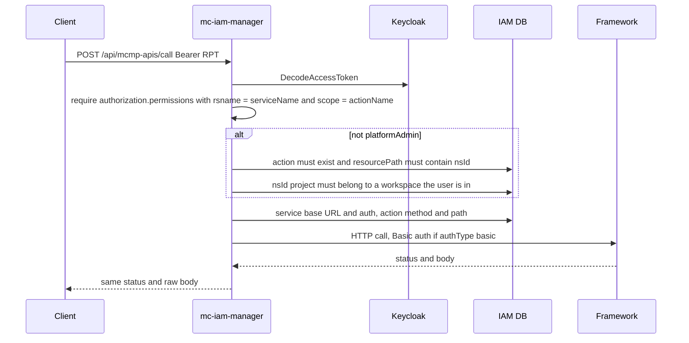

# MCMP API Permissions

mc-iam-manager keeps a registry of every M-CMP framework (where it lives, how to authenticate) and of every API action those frameworks expose. The registry is used to:

- proxy framework calls through `POST /api/mcmp-apis/call`,
- call mc-infra-manager for project/namespace sync,
- serve as the **framework service registry** for mc-web-console (service base URLs and iframe front-end URLs are registered here by the setup scripts),
- map M-CMP permissions to API actions.

Key sources: [src/service/mcmpapi_service.go](https://github.com/m-cmp/mc-iam-manager/blob/main/src/service/mcmpapi_service.go), [src/handler/mcmpapi_handler.go](https://github.com/m-cmp/mc-iam-manager/blob/main/src/handler/mcmpapi_handler.go), [src/model/mcmpapi](https://github.com/m-cmp/mc-iam-manager/tree/main/src/model/mcmpapi).

## Data Model

| Table | Struct | Key fields |
|---|---|---|
| `mcmp_api_services` | `McmpApiService` | `name` (PK), `version`, `base_url`, `auth_type` (`basic`, `bearer`, `none`), `auth_user`, `auth_pass`, `is_active` |
| `mcmp_api_actions` | `McmpApiAction` | `service_name`, `action_name` (operationId), `method`, `resource_path`, `description` |
| `mcmp_api_service_meta` | `McmpApiServiceMeta` | `service_name` (PK), `version`, `repository`, `generated_at`, `synced_at` |
| `mcmp_api_permission_action_mappings` | `McmpApiPermissionActionMapping` | `permission_id`, `action_id`, `action_name` |
| `mcmp_mciam_permissions` | `MciamPermission` | `id` = `<framework_id>:<resource_type_id>:<action>` |

Services (base URL, credentials) and actions (endpoints) are registered **separately**: `sync-mcmp-apis` loads actions only.

## Seed Files (`asset/mcmpapi/`)

| File | Used by | Content |
|---|---|---|
| [service-actions.yaml](https://github.com/m-cmp/mc-iam-manager/blob/main/asset/mcmpapi/service-actions.yaml) | `POST /api/setup/sync-mcmp-apis` | `serviceActions.<service>._meta` (`version`, `repository`, `generatedAt`) + `<operationId>: {method, resourcePath, description}`. Currently: mc-application-manager, mc-cost-optimizer, mc-iam-manager, mc-infra-connector, mc-infra-manager, mc-workflow-manager |
| [frameworks.yaml](https://github.com/m-cmp/mc-iam-manager/blob/main/asset/mcmpapi/frameworks.yaml) | `tool/swagger-to-actions -c` | Input for generating `service-actions.yaml`: per framework `name`, `version`, `repository`, `swagger` (local path or URL) |
| [mcmp_api.yaml](https://github.com/m-cmp/mc-iam-manager/blob/main/asset/mcmpapi/mcmp_api.yaml) | not read by Go code | Legacy combined `services` + `serviceActions` file (copied from mc-admin-cli `conf/api.yaml`) |

Service base URLs for a deployment are registered from `conf/mc-iam-manager/api.yaml` by the setup script (see below).

## Sync Flow



- `SyncMcmpAPIsFromYAML` reads the fixed relative path `asset/mcmpapi/service-actions.yaml`, so the process must run from the directory that contains `asset/` (the container does).
- Per service, actions are fully replaced only when `_meta.version` or `_meta.generatedAt` changed; a service without `_meta` is always replaced.
- Service registration: [conf/mc-iam-manager/1_setup_auto.sh](https://github.com/m-cmp/mc-iam-manager/blob/main/conf/mc-iam-manager/1_setup_auto.sh) `register_framework_services` / `update_public_service_urls`.

## Endpoints

| Method | Path | Middleware | Purpose |
|---|---|---|---|
| POST | `/api/setup/sync-mcmp-apis` | `PlatformAdminMiddleware` | Load `service-actions.yaml` into the DB |
| POST | `/api/mcmp-apis/list[?serviceName=&actionName=]` | Manage | Services (with auth info) and actions |
| POST | `/api/mcmp-apis` | Manage | Register a service: `name`, `version`, `baseUrl`, `authType`, `authUser`, `authPass`, `isActive`; 409 if it exists |
| PUT | `/api/mcmp-apis/name/:serviceName` | Manage | Update service fields (`name`, `version` are ignored) |
| PUT | `/api/mcmp-apis/name/:serviceName/versions/:version/activate` | Manage | Set `is_active` for that name/version |
| POST | `/api/mcmp-apis/import` | Manage | Fetch Swagger/OpenAPI from URLs and store actions (and the service when `baseUrl` is given) |
| POST | `/api/mcmp-apis/call` | token + handler checks | Proxy a framework API call |
| GET | `/api/mcmp-apis/test/mc-infra-manager/getallns` | Manage | Connectivity test |

`/import` body:

```json
{
  "frameworks": [{
    "name": "mc-infra-manager",
    "version": "0.13.2",
    "repository": "https://github.com/cloud-barista/cb-tumblebug",
    "sourceType": "swagger",
    "sourceUrl": "https://raw.githubusercontent.com/cloud-barista/cb-tumblebug/v0.13.2/src/interface/rest/docs/swagger.yaml",
    "baseUrl": "http://mc-infra-manager:1323/tumblebug",
    "authType": "basic", "authUser": "default", "authPass": "default"
  }]
}
```

## Calling a Framework API

`POST /api/mcmp-apis/call` body ([src/model/request.go](https://github.com/m-cmp/mc-iam-manager/blob/main/src/model/request.go)):

```json
{
  "serviceName": "mc-infra-manager",
  "actionName": "GetAllNs",
  "requestParams": { "pathParams": {}, "queryParams": {}, "body": null }
}
```



1. **RPT check** — the token must carry a Keycloak UMA permission whose `rsname` equals `serviceName` and whose scopes include `actionName`. mc-iam-manager does not create these UMA resources or scopes; they must exist in Keycloak authorization settings.
2. **Ownership check** (`authorizeMcmpApiAction`) — `platformAdmin` bypasses it. Others may only call actions whose path contains `{nsId}`, and only for an `nsId` that belongs to a project mapped to one of their workspaces.
3. **Proxy** — path parameters are substituted, query parameters appended; only `basic` auth is attached to the outbound request (`bearer` is not forwarded).

Action names are matched case-insensitively ([src/repository/mcmpapi_repository.go](https://github.com/m-cmp/mc-iam-manager/blob/main/src/repository/mcmpapi_repository.go)).

## Permission to Action Mappings

Maps `MciamPermission` ids to API actions. Workspace permission ids are prefixed `mc-iam-manager:`; platform permission ids are not ([src/service/mcmpapi_permission_action_mapping_service.go](https://github.com/m-cmp/mc-iam-manager/blob/main/src/service/mcmpapi_permission_action_mapping_service.go)).

| Method | Path (`/api/mcmp-apis/permission-action-mappings`) | Middleware |
|---|---|---|
| POST | `/list` | Read; returns **501 Not Implemented** |
| GET | `/platforms/id/:permissionId/actions` | Read |
| GET | `/workspaces/id/:permissionId/actions` | Read |
| GET | `/actions/:actionId/permissions` | Read |
| POST | `` (create) | Manage |
| PUT / DELETE | `/permissions/:permissionId/actions/:actionId` | Manage |

These mappings are stored and queryable but are **not consulted** by `/api/mcmp-apis/call` (`CheckPermissionForAction` has no caller). MC-IAM permissions themselves are managed under `/api/permissions/mciam` and assigned to roles via `/api/roles/:roleType/:roleId/mciam-permissions/:permissionId`.

## Adding a Framework's APIs

Use [tool/swagger-to-actions](https://github.com/m-cmp/mc-iam-manager/tree/main/tool/swagger-to-actions) ([README](https://github.com/m-cmp/mc-iam-manager/blob/main/tool/swagger-to-actions/README.md)). It supports Swagger 2.0 and OpenAPI 3.x, JSON or YAML, local files or URLs.

1. Add the framework to [asset/mcmpapi/frameworks.yaml](https://github.com/m-cmp/mc-iam-manager/blob/main/asset/mcmpapi/frameworks.yaml):
   ```yaml
   - name: mc-example-manager
     version: "1.0.0"
     repository: https://github.com/m-cmp/mc-example-manager
     swagger: https://raw.githubusercontent.com/m-cmp/mc-example-manager/v1.0.0/swagger.yaml
   ```
2. Regenerate (output path is `./service-actions.yaml` relative to the config):
   ```bash
   cd tool/swagger-to-actions
   go build -o swagger-to-actions .
   ./swagger-to-actions -c ../../asset/mcmpapi/frameworks.yaml
   ```
   Single-framework mode: `./swagger-to-actions -i <swagger> -o <file> -s <service> [-V <version>] [-r <repo>] [--append]`.
3. Commit `asset/mcmpapi/service-actions.yaml`, deploy, and run `POST /api/setup/sync-mcmp-apis`. Only services whose `_meta` changed are rewritten.
4. Register the service base URL once with `POST /api/mcmp-apis` (or add it to `conf/mc-iam-manager/api.yaml` so the setup script does it).
5. Alternatively, skip steps 1–3 and call `POST /api/mcmp-apis/import` at runtime.

For mc-iam-manager's own entries the delivery chain is: handler `@Router` annotation → `swagger.json` → `service-actions.yaml` → `mcmp_api_actions` → mc-web-console BFF, which builds backend URLs from the registry `resourcePath`. [src/registry_consistency_test.go](https://github.com/m-cmp/mc-iam-manager/blob/main/src/registry_consistency_test.go) compares the real routes in `main.go`, the Swagger spec and the seed (path and method), so regenerate `src/docs` with swag and then `service-actions.yaml` whenever routes change.

## Caveats

- `McmpApiService.name` is the primary key, so only one version per service can exist; `versions/:version/activate` therefore only toggles that single row, and `McmpApiCall` uses the row by name regardless of `is_active`.
- `mcmp_api.yaml` is not loaded by the server; keeping it in sync is not required.
