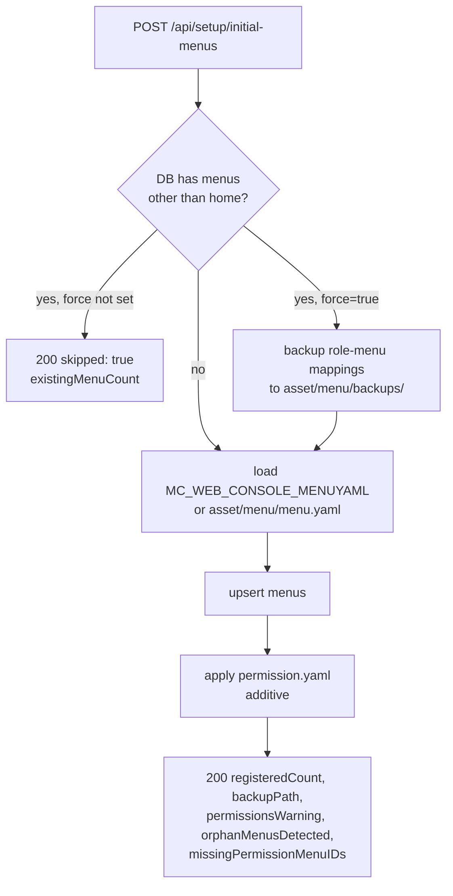

# Menu and Role Permission

mc-iam-manager stores the platform console menu tree and which platform role may see which menu. mc-web-console renders its sidebar from `POST /api/users/menus-tree/list`.

> **The IAM DB is the source of truth.** `asset/menu/menu.yaml` and `asset/menu/permission.yaml` are seed snapshots applied once at first install. After that, change menus and mappings through the API or the console's Menus / Access Controls screens.

Key sources: [src/service/menu_service.go](https://github.com/m-cmp/mc-iam-manager/blob/main/src/service/menu_service.go), [src/handler/menu_handler.go](https://github.com/m-cmp/mc-iam-manager/blob/main/src/handler/menu_handler.go), [src/handler/admin_handler.go](https://github.com/m-cmp/mc-iam-manager/blob/main/src/handler/admin_handler.go).

## Data Model

| Table | Content |
|---|---|
| `mcmp_menus` (`Menu`) | `id` (string PK), `parent_id`, `display_name`, `res_type`, `is_action`, `priority`, `menu_number`, `view_type` (default `local`), `framework_service` (default `mc-web-console-front`), `path`, `icon` |
| `mcmp_role_menu_mappings` (`RoleMenuMapping`) | `role_id` → `mcmp_role_masters.id`, `menu_id` → `mcmp_menus.id` (no DB foreign key) |

The `home` menu is the tree root and is treated specially by the seed guard.

## Seed Files

| File / variable | Purpose |
|---|---|
| [asset/menu/menu.yaml](https://github.com/m-cmp/mc-iam-manager/blob/main/asset/menu/menu.yaml) | Menu tree (`menus:` list). A **fallback / download cache**: the platform-wide canonical catalog is mc-web-console's `conf/webconsole_menu_resources.yaml`. |
| `MC_WEB_CONSOLE_MENUYAML` | Optional. Local path (read as-is, relative to the working directory) or `http(s)://` URL. A URL is downloaded and **overwrites** `asset/menu/menu.yaml`; on download failure the local file is used. Unset → `asset/menu/menu.yaml`. |
| [asset/menu/permission.yaml](https://github.com/m-cmp/mc-iam-manager/blob/main/asset/menu/permission.yaml) | Role-centric seed: `permissions → role → menus / operations / csps`. Only `menus` is applied; `operations` and `csps` are reserved. Shipped roles: `admin`, `billadmin`, `billviewer`, `operator`, `viewer`. |
| `MC_WEB_CONSOLE_MENU_PERMISSIONS` | Optional path or URL of the permission seed; must end in `.yaml` / `.yml`, otherwise it is ignored with a warning and the local file is used. URLs are downloaded to a temp file. |

Seed rules ([src/service/menu_service.go](https://github.com/m-cmp/mc-iam-manager/blob/main/src/service/menu_service.go)):

- Every `role` in `permission.yaml` must already exist as a DB role, otherwise the whole permission seed fails (`role not found`). The predefined roles are created by `POST /api/initial-admin` from `MC_IAM_MANAGER_PREDEFINED_PLATFORM_ROLE`.
- Menu ids that are not in the DB are skipped and reported as `missingPermissionMenuIDs`.
- Parent (non-action) menus must be listed too, or the sidebar tree breaks.

In an mc-admin-cli deployment a copy of the mc-web-console catalog is mounted into the container and `MC_WEB_CONSOLE_MENUYAML` points at it; see [Deployment Modes](Deployment-Modes).

## Seed Once, Then Edit the DB



| Endpoint (all `PlatformAdminMiddleware`) | Behavior |
|---|---|
| `POST /api/setup/initial-menus[?filePath=&force=true]` | Seeds from `filePath`, `MC_WEB_CONSOLE_MENUYAML` or the local file. Skips with `200 {skipped: true, existingMenuCount}` if menus already exist. `force=true` backs up mappings first (`backupPath`, or `backupWarning` if the backup failed) and upserts. Chains into the permission seed; a permission failure only adds `permissionsWarning`. DB menus absent from the YAML are reported in `orphanMenusDetected` (never deleted). |
| `POST /api/setup/initial-menus2[?force=true]` | Same guard and force semantics, YAML in the request body, **no** permission chaining. Useful for testing unmerged catalog changes. |
| `GET /api/setup/initial-role-menu-permission-yaml[?filePath=]` | Applies `permission.yaml` (also runs inside `/api/initial-admin` via the menu seed). **Additive**: existing mappings stay, but a mapping removed at runtime that is still in the YAML comes back. |

`GET /api/setup/initial-role-menu-permission` (CSV) no longer exists.

The setup scripts call `initial-menus` (step 4) and then `initial-role-menu-permission-yaml` without `filePath` (step 4-1) ([conf/mc-iam-manager/1_setup_auto.sh](https://github.com/m-cmp/mc-iam-manager/blob/main/conf/mc-iam-manager/1_setup_auto.sh)). Because of the guard, re-running the scripts does not overwrite menu edits.

## Day-to-Day APIs

### Menus

| Method | Path | Middleware | Notes |
|---|---|---|---|
| POST | `/api/menus/list` | token | Flat list |
| POST | `/api/menus/menus-tree/list` | token | Full tree |
| GET | `/api/menus/id/:menuId` | token | |
| POST | `/api/menus` | Write (`admin`, `platformAdmin`) | Optional `roleIds` maps the new menu to roles in the same call |
| PUT | `/api/menus/id/:menuId` | `PlatformAdminMiddleware` | |
| DELETE | `/api/menus/id/:menuId` | `PlatformAdminMiddleware` | |

### Role to Menu Mappings

| Method | Path | Middleware | Body / query |
|---|---|---|---|
| POST | `/api/menus/platform-roles/list` | Write | `{"roleId": ["<id>", ...]}` → menus mapped to those roles |
| POST | `/api/menus/platform-roles` | `PlatformAdminMiddleware` | `{"roleId": "<id>", "menuIds": ["..."]}` |
| DELETE | `/api/menus/platform-roles?roleId=<id>&menuId=<menuId>` | `PlatformAdminMiddleware` | One mapping |
| POST | `/api/roles` | Write | `CreateRoleRequest` may carry `menuIds` to map on creation |

### Current User

| Method | Path | Notes |
|---|---|---|
| POST | `/api/users/menus-tree/list` | Tree of menus mapped to the caller's platform roles (from the token) plus their ancestors |
| POST | `/api/users/menus/list` | Flat variant |

Platform role names from the token are resolved to DB role ids. A user whose only platform role is `platformAdmin` (no DB role of that name) falls back to the mappings of the `admin` role ([src/handler/menu_handler.go](https://github.com/m-cmp/mc-iam-manager/blob/main/src/handler/menu_handler.go) `resolveUserPlatformRoleIDs`). Roles with no mappings get an empty tree.

## Backup and Restore

A backup is a snapshot of actual DB mappings; `permission.yaml` is the desired seed template. Both endpoints require `PlatformAdminMiddleware`.

| Method | Path | Query |
|---|---|---|
| GET | `/api/setup/backup-role-permissions` | `roles` (CSV, default all platform roles), `sections` (default `menus`), `format` (`yaml` default, or `json`), `save` (`true`/`1` writes `asset/menu/backups/role-permission-backup-*.yaml`; path in header `X-Role-Permission-Backup-Path`) |
| POST | `/api/setup/restore-role-permissions` | `mode` (`additive` default, or `replace-role`), `sections`, `filePath` (server-side file) or a YAML / JSON body |

| Mode | Effect |
|---|---|
| `additive` | Adds (role, menu) pairs from the backup that are missing; keeps custom mappings |
| `replace-role` | For each role present in the backup, deletes its menu mappings and recreates exactly the backup set |

```bash
# Snapshot before risky changes
curl -sk -H "Authorization: Bearer $TOKEN" \
  'https://<host>/api/setup/backup-role-permissions?save=true' -o role-permission-backup.yaml

# Restore missing mappings only
curl -sk -X POST -H "Authorization: Bearer $TOKEN" -H 'Content-Type: application/yaml' \
  --data-binary @role-permission-backup.yaml \
  'https://<host>/api/setup/restore-role-permissions?mode=additive'
```

Backup document format:

```yaml
kind: role-permission-backup
backupAt: "2026-07-15T13:00:00+09:00"
source: db
sections: [menus]
permissions:
  - role: admin            # mcmp_role_masters.name, no numeric id
    menus: [operations, observability]
    operations: []         # reserved
    csps: []               # reserved
```

Recommended order before re-running a seed: backup with `save=true` → re-seed → restore if needed → use the mapping APIs for daily changes. Test cases: [docs/ROLE-PERMISSION-BACKUP-TC.md](https://github.com/m-cmp/mc-iam-manager/blob/main/docs/ROLE-PERMISSION-BACKUP-TC.md).

## Demo RBAC (Optional)

[scripts/demo/setup-demo-rbac.sh](https://github.com/m-cmp/mc-iam-manager/blob/main/scripts/demo/setup-demo-rbac.sh) provisions 15 role slots (5 modules: Workflow, Application, Data, Cost, Observability × 3 tiers: viewer, operator, admin). 13 roles are new; `billviewer` and `billadmin` reuse the base roles. It also creates demo teams and users, and applies menu mappings from [asset/menu/backups/role-permission-backup-demo-rbac.yaml](https://github.com/m-cmp/mc-iam-manager/blob/main/asset/menu/backups/role-permission-backup-demo-rbac.yaml) through `POST /api/setup/restore-role-permissions?mode=additive`.

- Manual and idempotent; no install script calls it.
- Inputs: `MC_IAM_MANAGER_HOST`, `MC_IAM_MANAGER_PLATFORMADMIN_ID`, `MC_IAM_MANAGER_PLATFORMADMIN_PASSWORD`, `DEMO_RBAC_PASSWORD`, optional `WORKSPACE_NAME` (default `ws01`); missing values are prompted.
- Undo with [scripts/demo/teardown-demo-rbac.sh](https://github.com/m-cmp/mc-iam-manager/blob/main/scripts/demo/teardown-demo-rbac.sh).

## Caveats

- `filePath` on `initial-menus`, `initial-role-menu-permission-yaml` and `restore-role-permissions` reads any path on the server; it is limited to platform admins.
- `MenuMappingFilterRequest` uses JSON key `roleId` for a list of role ids and `menuIds` for a single menu id ([src/model/request.go](https://github.com/m-cmp/mc-iam-manager/blob/main/src/model/request.go)).
- Menu visibility is UI-level. API authorization is enforced separately by route middleware (see [Authentication and Authorization](Authentication-and-Authorization#middleware-to-route-matrix)).
