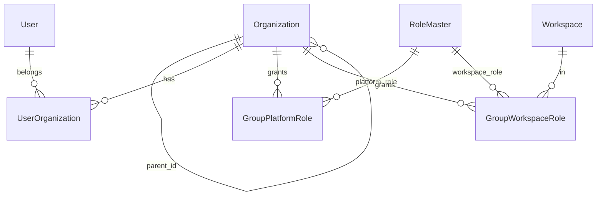

# Organizations, Groups and Company

| Concept | Storage | Keycloak counterpart | Purpose |
|---|---|---|---|
| Company | `mcmp_companies` (`Company`) | Realm (`realm_name`) and client | Singleton tenant profile |
| Organization | `mcmp_organizations` (`Organization`), tree via `parent_id` | Group named by `organization_code` | Org chart; user membership |
| Group | Same rows as organizations (`/api/groups` is an alias) | Same group | Role inheritance: platform roles and workspace roles granted to a group apply to its members |

Key sources: [src/service/organization_service.go](https://github.com/m-cmp/mc-iam-manager/blob/main/src/service/organization_service.go), [src/service/group_role_service.go](https://github.com/m-cmp/mc-iam-manager/blob/main/src/service/group_role_service.go), [src/service/company_service.go](https://github.com/m-cmp/mc-iam-manager/blob/main/src/service/company_service.go), routes in [src/main.go](https://github.com/m-cmp/mc-iam-manager/blob/main/src/main.go).

## Company

A single company record describes the installation ([src/model/company.go](https://github.com/m-cmp/mc-iam-manager/blob/main/src/model/company.go)): `name`, `description`, `realm_name` (unique), `kc_client_id`, `kc_client_secret` (never returned in responses), `status` (`active` / `inactive`).

| Method | Path | Middleware | Behavior |
|---|---|---|---|
| POST | `/api/company` | `PlatformAdminMiddleware` | Body `name`, `realm_name`, `kc_client_id`, `kc_client_secret`, `description`. 409 if `realm_name` already exists; creates the Keycloak realm if missing |
| GET | `/api/company` | Read (any authenticated user) | Returns the first record |
| PUT | `/api/company` | `PlatformAdminMiddleware` | Updates `name`, `description` only |
| DELETE | `/api/company` | `PlatformAdminMiddleware` | Sets `status = inactive` (idempotent, no row deletion) |
| POST | `/api/company/activate` | `PlatformAdminMiddleware` | Sets `status = active` |

`POST /api/initial-admin` creates a default company when none exists: name `MC_IAM_MANAGER_COMPANY_NAME` (fallback `Default Company`), realm `MC_IAM_MANAGER_KEYCLOAK_REALM`, client `MC_IAM_MANAGER_KEYCLOAK_CLIENT_NAME` / `MC_IAM_MANAGER_KEYCLOAK_CLIENT_SECRET`. Failure is non-fatal.

Notes:

- The routes have no id; every read and update targets the first row. `POST` only checks `realm_name` uniqueness, so a second company with another realm can be inserted but is never returned.
- `status` is informational; no authentication path checks it.

## Organizations

- `organization_code`: unique, up to 20 characters. When omitted on create it is generated hierarchically in 2-digit steps: top level `01`, `02`, …; children `<parent>01`, `<parent>02`, … (max 99 per level) ([src/repository/organization_repository.go](https://github.com/m-cmp/mc-iam-manager/blob/main/src/repository/organization_repository.go)).
- Names must be unique under the same parent.
- Moving an organization rejects circular references.
- Delete is refused while children or members exist unless `?cascade=true`; cascade removes the subtree and then deletes the Keycloak groups best-effort.

### Seed

[asset/organization/organizations.yaml](https://github.com/m-cmp/mc-iam-manager/blob/main/asset/organization/organizations.yaml) defines the default tree (root `01 mcmp` with one child per framework, `0101`…`0108`).

| Source order | |
|---|---|
| 1 | `filePath` query parameter |
| 2 | `MC_IAM_MANAGER_ORG` (local path, or `http(s)://` URL downloaded to a temp file; on failure the default file is used) |
| 3 | `asset/organization/organizations.yaml` |

The seed is an **upsert** by `organization_code` (parents first) and a missing file is skipped. It runs inside `POST /api/initial-admin` and through `POST /api/setup/initial-organizations` (`PlatformAdminMiddleware`), which the setup script calls as step 2-1 ([conf/mc-iam-manager/1_setup_auto.sh](https://github.com/m-cmp/mc-iam-manager/blob/main/conf/mc-iam-manager/1_setup_auto.sh)).

### Endpoints (`/api/organizations`, group-level Write: `admin` or `platformAdmin`)

| Method | Path | Notes |
|---|---|---|
| POST | `` | `name`, `description`, `parent_id`, `organization_code` (optional) |
| GET | `` | `?tree=true` for a tree; `?name=` / `?code=` filters |
| GET | `/tree`, `/id/:organizationId/subtree` | Tree views with `level`, `path`, `user_count` |
| GET | `/id/:organizationId`, `/code/:code`, `/id/:organizationId/users` | |
| PUT | `/id/:organizationId` | Name, description, parent, code |
| PUT | `/id/:organizationId/move` | `new_parent_id` (null = top level) |
| GET | `/id/:organizationId/deletable` | `deletable`, `reason` |
| DELETE | `/id/:organizationId[?cascade=true]` | |

User membership:

| Method | Path | Middleware |
|---|---|---|
| POST | `/api/users/id/:userId/organizations` (`organization_ids`) | Write |
| GET | `/api/users/id/:userId/organizations[?hierarchy=true]` | Read |
| DELETE | `/api/users/id/:userId/organizations/:organizationId` | Write |

Membership changes are written to `mcmp_user_organizations` and synchronized to the Keycloak group whose name is the `organization_code`.

`POST /api/setup/migrate-kc-group-identifiers` (`PlatformAdminMiddleware`) renames legacy Keycloak groups named after `organization.name` to `organization_code`; it is idempotent and reports per-organization failures.

## Groups

`/api/groups` (group-level Write) exposes the same organization CRUD (`POST`, `GET`, `/id/:organizationId`, `/code/:code`, `PUT`, `DELETE`, `/id/:organizationId/users`) plus role inheritance:

| Method | Path | Effect |
|---|---|---|
| POST | `/api/groups/id/:groupId/users` (`user_ids`) | Add members (DB + Keycloak group) |
| DELETE | `/api/groups/id/:groupId/users/:userId`, `/api/groups/id/:groupId/users` (`user_ids`) | Remove members |
| POST | `/api/groups/id/:groupId/platform-roles` (`role_id`) | DB row in `mcmp_group_platform_roles` **and** realm role added to the Keycloak group (realm role created if missing); DB is rolled back if Keycloak fails |
| GET | `/api/groups/id/:groupId/platform-roles`, `/platform-roles/available` | |
| DELETE | `/api/groups/id/:groupId/platform-roles/:roleId` | DB + Keycloak |
| POST | `/api/groups/id/:groupId/workspaces` (`workspace_id`, `role_id`) | `mcmp_group_workspace_roles`, **DB only** |
| GET | `/api/groups/id/:groupId/workspaces`, `/workspaces/available` | |
| PUT / DELETE | `/api/groups/id/:groupId/workspaces/:workspaceId` | Change / remove the workspace role |

User-side group endpoints (all `PlatformAdminMiddleware`):

| Method | Path | Notes |
|---|---|---|
| POST | `/api/users/id/:userId/groups` (`group_ids`) | Add to groups |
| GET | `/api/users/id/:userId/groups` | Same handler as user organizations |
| PUT | `/api/users/id/:userId/groups` (`groupIds`) | Replace the user's group set |
| DELETE | `/api/users/id/:userId/groups/:groupId` | |
| GET | `/api/users/id/:userId/effective-platform-roles` | Direct + inherited roles, each with `source` = `direct` or `group:<name>` |
| GET | `/api/users/id/:userId/access-summary` | Direct roles and per-group roles |

Reverse lookups: `GET /api/roles/mappings/platform-roles/id/:roleId/groups` and `GET /api/roles/mappings/workspace-roles/id/:roleId/groups` (Write).

### How Inheritance Is Enforced

- **Platform roles** reach users only through Keycloak: group members receive the group's realm roles in `realm_access.roles`, which the route middleware reads. A DB-only group record would show as inherited in the query APIs without granting access ([src/service/organization_service.go](https://github.com/m-cmp/mc-iam-manager/blob/main/src/service/organization_service.go) `AssignUserToOrganizations`). New roles appear after the user's next token refresh.
- **Workspace roles** are resolved from the DB. For temporary CSP credentials a direct assignment wins; otherwise the group workspace role with the lowest role id is used ([src/repository/user_repository.go](https://github.com/m-cmp/mc-iam-manager/blob/main/src/repository/user_repository.go) `FindEffectiveUserRoleInWorkspace`). See [CSP Integration](CSP-Integration).

Related: [Authentication and Authorization](Authentication-and-Authorization), [API Reference](API-Reference).
