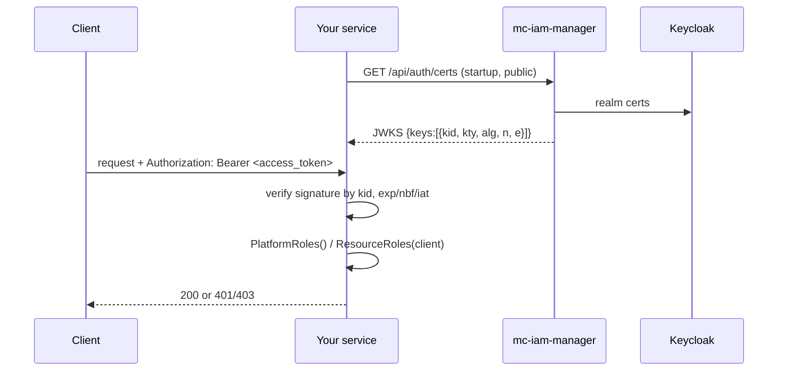

# Token Validation for Services

Other M-CMP services, such as cb-tumblebug, cb-spider and mc-web-console, receive the access tokens that mc-iam-manager issues. This page shows how those services can check that a token is genuine and read the caller's roles.

There are three options:

| Option | When to use | Network cost |
|---|---|---|
| **A. Go SDK** [`iamtokenvalidator`](https://github.com/m-cmp/mc-iam-manager/tree/main/iamtokenvalidator) | Go services | JWKS fetched once and refreshed in the background |
| **B. Local JWT verification in any language** against `GET /api/auth/certs` | Non-Go services | Same as A |
| **C. Remote check** with `POST /api/auth/validate` | You do not want to verify JWTs yourself | One round-trip per request; needs the caller's refresh token |

Full reference: [`iamtokenvalidator/README.md`](https://github.com/m-cmp/mc-iam-manager/blob/main/iamtokenvalidator/README.md).



## Public Endpoints Involved

Both endpoints are on the auth-skip list in [`src/main.go`](https://github.com/m-cmp/mc-iam-manager/blob/main/src/main.go), so mc-iam-manager's own middleware never blocks them.

| Endpoint | Handler | Behavior |
|---|---|---|
| `GET /api/auth/certs` | `AuthCerts` in [`auth_handler.go`](https://github.com/m-cmp/mc-iam-manager/blob/main/src/handler/auth_handler.go) | Returns the Keycloak realm JWKS (`gocloak.CertResponse`). No auth |
| `POST /api/auth/validate` | `Validate` in [`auth_handler.go`](https://github.com/m-cmp/mc-iam-manager/blob/main/src/handler/auth_handler.go) | Needs `Authorization: Bearer <access_token>` and body `{"refresh_token": "..."}`. Decodes and verifies the access token against the realm. If that fails, tries a refresh |

## Option A: Go SDK (`iamtokenvalidator`)

`iamtokenvalidator` is a separate Go module (`github.com/m-cmp/mc-iam-manager/iamtokenvalidator`). It depends only on `golang-jwt/jwt/v5` and `MicahParks/keyfunc/v3`, so it does not pull in gorm, gocloak or echo.

```bash
go get github.com/m-cmp/mc-iam-manager/iamtokenvalidator
```

> [!NOTE]
> - Its [`go.mod`](https://github.com/m-cmp/mc-iam-manager/blob/main/iamtokenvalidator/go.mod) declares `go 1.25.6`. Adding it raises the consumer module's `go` directive to at least that version.
> - There are no `iamtokenvalidator/vX.Y.Z` tags yet, so `go get` resolves to a pseudo-version of the default branch. Pin the resulting version in your `go.mod`.

### API

| Function / method | Purpose |
|---|---|
| `Init(certURL string) error` | Call once at startup with `https://<iam>/api/auth/certs`. Probes the URL (fails fast on non-200), then starts a self-refreshing JWKS that also refreshes on an unknown `kid` |
| `IsTokenValid(token string) error` | Verifies the signature and `exp`/`nbf`/`iat` |
| `GetClaims(token string) (*IamManagerClaims, error)` | Same verification, then returns the parsed claims |
| `claims.PlatformRoles() []string` | Top-level `roles` + `realm_access.roles`, minus `offline_access`, `uma_authorization` and `default-roles-{realm}` (realm taken from `iss`), deduplicated |
| `claims.ResourceRoles(client string) []string` | `resource_access.<client>.roles` |
| `HasAnyRole(granted, userRoles []string) bool` | Returns true if the two lists share at least one role |

`PlatformRoles()` uses the same extraction rules as mc-iam-manager's own [`AuthMiddleware`](https://github.com/m-cmp/mc-iam-manager/blob/main/src/middleware/auth.go), so every service agrees on who holds which role.

### Minimal usage

```go
import "github.com/m-cmp/mc-iam-manager/iamtokenvalidator"

func main() {
    if err := iamtokenvalidator.Init("https://mciam.example.com/api/auth/certs"); err != nil {
        log.Fatalf("failed to initialize iamtokenvalidator: %v", err)
    }
    // ...
}

claims, err := iamtokenvalidator.GetClaims(tokenString)
if err != nil {
    // reject: missing, expired, or signed by an untrusted key
}
if iamtokenvalidator.HasAnyRole([]string{"admin", "platformAdmin"}, claims.PlatformRoles()) {
    // authorized
}
```

### Echo middleware

```go
func IamAuthMiddleware(next echo.HandlerFunc) echo.HandlerFunc {
    return func(c echo.Context) error {
        authHeader := c.Request().Header.Get("Authorization")
        if !strings.HasPrefix(authHeader, "Bearer ") {
            return echo.NewHTTPError(http.StatusUnauthorized, "missing bearer token")
        }
        claims, err := iamtokenvalidator.GetClaims(strings.TrimPrefix(authHeader, "Bearer "))
        if err != nil {
            return echo.NewHTTPError(http.StatusUnauthorized, "invalid token")
        }
        c.Set("platformRoles", claims.PlatformRoles())
        c.Set("kcUserId", claims.Subject)
        return next(c)
    }
}
```

### net/http middleware

```go
func IamAuthMiddleware(next http.Handler) http.Handler {
    return http.HandlerFunc(func(w http.ResponseWriter, r *http.Request) {
        token := strings.TrimPrefix(r.Header.Get("Authorization"), "Bearer ")
        claims, err := iamtokenvalidator.GetClaims(token)
        if err != nil {
            http.Error(w, "invalid token", http.StatusUnauthorized)
            return
        }
        ctx := context.WithValue(r.Context(), userClaimsKey, claims)
        next.ServeHTTP(w, r.WithContext(ctx))
    })
}
```

## Option B: Verify Locally in Any Language

1. Fetch and cache the JWKS: `curl https://mciam.example.com/api/auth/certs`.
2. Verify the token signature against the key whose `kid` matches the token header. Allow RS256/RS384/RS512 only.
3. Extract roles with the same rule as `PlatformRoles()`. See the [Go SDK API](#api) above.

Python example (`pip install pyjwt cryptography`), taken from the README:

```python
import jwt
from jwt import PyJWKClient

jwk_client = PyJWKClient("https://mciam.example.com/api/auth/certs")  # reuse this client

def validate(token: str) -> dict:
    signing_key = jwk_client.get_signing_key_from_jwt(token)
    return jwt.decode(token, signing_key.key, algorithms=["RS256", "RS384", "RS512"])
```

The README also has a Node.js (`jsonwebtoken` + `jwks-rsa`) example.

> [!TIP]
> PyJWT checks `aud` only when you pass `audience=`. Decide whether your service should pin `aud`/`iss`. See [Security notes](#security-notes).

## Option C: Remote Validation

```bash
curl -X POST https://mciam.example.com/api/auth/validate \
  -H "Authorization: Bearer $ACCESS_TOKEN" \
  -H "Content-Type: application/json" \
  -d "{\"refresh_token\": \"$REFRESH_TOKEN\"}"
```

| Response | Meaning |
|---|---|
| `200 {"valid": true, "message": "Token is valid", "user_id": "<sub>"}` | Access token is valid |
| `200 {"valid": false, "message": "Token was expired and has been refreshed", "token": {...}}` | Access token was invalid or expired; a new token issued from the refresh token is returned |
| `400 {"error": "Refresh token is required"}` | Body missing `refresh_token` (it is required even when the access token is valid) |
| `401 {"error": "Token validation failed and refresh failed", "details": "..."}` | Both checks failed |

This endpoint returns no role claims. To get roles, decode the access token (or the refreshed one) yourself as in Option B.

`/api/auth/validate` was added to the auth-skip list in v0.7.0. Before that, the global middleware rejected expired tokens with `401` before the handler could refresh them.

## Security Notes

- **No audience or issuer check.** `iamtokenvalidator` calls `jwt.Parse` / `jwt.ParseWithClaims` without `jwt.WithAudience` or `jwt.WithIssuer` ([`iamtokenvalidator.go`](https://github.com/m-cmp/mc-iam-manager/blob/main/iamtokenvalidator/iamtokenvalidator.go)). It accepts any unexpired token signed by the realm's keys. If several clients share the realm, add your own `aud`/`azp` check.
- **Algorithms.** mc-iam-manager's own middleware accepts RS256 only ([`src/util/token.go`](https://github.com/m-cmp/mc-iam-manager/blob/main/src/util/token.go)). `iamtokenvalidator` does not set `jwt.WithValidMethods`; it relies on the `alg` declared on each JWKS key. The README's "RS256/RS384/RS512 only" statement depends on Keycloak publishing only RSA signing keys.
- **No fine-grained authorization.** Both the SDK and `/api/auth/validate` answer only two questions: is this token valid, and which roles does it carry. Workspace-scoped or MCMP-API-scoped permission decisions belong to mc-iam-manager. See [Authentication and Authorization](Authentication-and-Authorization) and [MCMP API Permissions](MCMP-API-Permissions).
- Call `Init` exactly once per process, before `IsTokenValid` or `GetClaims`. Otherwise those calls return `Init must be called before validating tokens`.
