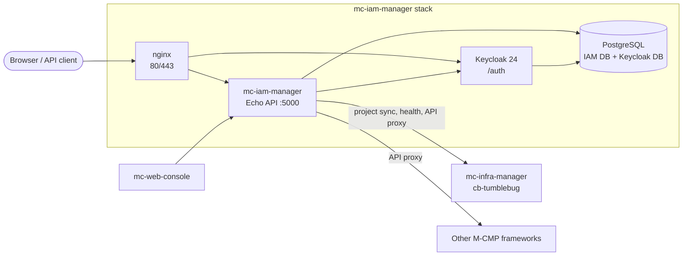

[](https://app.fossa.com/projects/git%2Bgithub.com%2Fm-cmp%2Fmc-iam-manager?ref=badge_shield)
[](https://github.com/m-cmp/mc-iam-manager/blob/main/src/go.mod)
[](https://github.com/m-cmp/mc-iam-manager/releases)
[](https://www.apache.org/licenses/LICENSE-2.0)
[](https://github.com/m-cmp/mc-iam-manager/wiki)

# M-CMP IAM Manager

[English](readme.md) | [한국어](readme_kr.md)

mc-iam-manager is the identity, access and permission service of the [M-CMP platform](https://github.com/m-cmp/docs).
It wraps Keycloak and PostgreSQL behind one REST API and acts as the token issuer and permission authority for the other M-CMP frameworks.

**Full documentation lives in the [Wiki](https://github.com/m-cmp/mc-iam-manager/wiki).**

## Features

- **Authentication**: login, refresh, validation and JWKS (`/api/auth/*`), backed by Keycloak
- **Platform and workspace RBAC**: roles assigned to users and groups, workspaces and projects synced from mc-infra-manager
- **Menu permissions**: the mc-web-console menu tree and role-to-menu mappings, seeded once from YAML and managed in the database
- **MCMP API permissions**: a registry of framework services and actions, plus an authorized API proxy
- **CSP integration**: CSP accounts, IdP configurations (OIDC/SAML), CSP roles and temporary CSP credentials
- **Organizations, groups and company** management

## Architecture



See [Architecture](https://github.com/m-cmp/mc-iam-manager/wiki/Architecture) and [Authentication and Authorization](https://github.com/m-cmp/mc-iam-manager/wiki/Authentication-and-Authorization).

## Quick Start

> To install the whole M-CMP platform (every framework plus mc-web-console), use [mc-admin-cli](https://github.com/m-cmp/mc-admin-cli).
> The steps below install mc-iam-manager **standalone**, together with the infra frameworks it depends on.

**Prerequisites**: Linux (Ubuntu 22.04 tested), Docker with Compose v2, `git`, `openssl`, and free ports 80/443. See [Installation Guide](https://github.com/m-cmp/mc-iam-manager/wiki/Installation-Guide#prerequisites) for the full list.

```bash
git clone https://github.com/m-cmp/mc-iam-manager.git
cd mc-iam-manager
cp .env.setup .env      # change the default passwords and secrets here
```

Before the first start, apply the two `.env` workarounds described in
[Installation Guide › Before you start](https://github.com/m-cmp/mc-iam-manager/wiki/Installation-Guide#before-you-start).
Then pick one scenario:

| Scenario | Command | Access |
|---|---|---|
| Local PC, plain HTTP | `./installAll.sh -m dev -d localhost -r background` | `http://localhost/` |
| VM by IP, self-signed HTTPS | `./installAll.sh -m dev -d <VM_PUBLIC_IP> -r background` | `https://<VM_PUBLIC_IP>/` |
| Production FQDN, Let's Encrypt | `./installAll.sh -m prod -d <FQDN> -r background` | `https://<FQDN>/` |

The installer starts the containers, and the `mc-iam-manager-post-initial` container then runs the [Initial Setup](https://github.com/m-cmp/mc-iam-manager/wiki/Initial-Setup) (platform admin, roles, menus, service registry, projects).

Verify the installation:

```bash
docker compose -f docker-compose-standalone.yaml ps
curl -s http://localhost:5000/readyz
```

Log in with `MC_IAM_MANAGER_PLATFORMADMIN_ID` / `MC_IAM_MANAGER_PLATFORMADMIN_PASSWORD` from `.env`.

## Documentation

| Topic | Wiki page |
|---|---|
| Install, deployment modes and certificates | [Installation Guide](https://github.com/m-cmp/mc-iam-manager/wiki/Installation-Guide) · [Deployment Modes](https://github.com/m-cmp/mc-iam-manager/wiki/Deployment-Modes) · [Certificates](https://github.com/m-cmp/mc-iam-manager/wiki/Certificates) |
| Environment variables | [Configuration Reference](https://github.com/m-cmp/mc-iam-manager/wiki/Configuration-Reference) |
| Post-install initialization | [Initial Setup](https://github.com/m-cmp/mc-iam-manager/wiki/Initial-Setup) |
| Menus and role permissions, backup and restore | [Menu and Role Permission](https://github.com/m-cmp/mc-iam-manager/wiki/Menu-and-Role-Permission) |
| Framework API registry and permissions | [MCMP API Permissions](https://github.com/m-cmp/mc-iam-manager/wiki/MCMP-API-Permissions) |
| CSP accounts, IdP and temporary credentials | [CSP Integration](https://github.com/m-cmp/mc-iam-manager/wiki/CSP-Integration) |
| Organizations, groups and company | [Organizations, Groups and Company](https://github.com/m-cmp/mc-iam-manager/wiki/Organizations-Groups-Company) |
| REST API and Swagger | [API Reference](https://github.com/m-cmp/mc-iam-manager/wiki/API-Reference) |
| Validating IAM tokens in other services | [Token Validation for Services](https://github.com/m-cmp/mc-iam-manager/wiki/Token-Validation-for-Services) · [`iamtokenvalidator`](iamtokenvalidator/README.md) |
| Logs, backup, upgrade and reset | [Operations](https://github.com/m-cmp/mc-iam-manager/wiki/Operations) |
| Known problems and fixes | [Troubleshooting](https://github.com/m-cmp/mc-iam-manager/wiki/Troubleshooting) |
| Building, running locally and testing | [Development and Testing](https://github.com/m-cmp/mc-iam-manager/wiki/Development-and-Testing) |

The wiki is generated from [`docs/wiki/`](docs/wiki/). To improve the documentation, edit the files there and open a pull request.

## Repository Layout

| Path | Contents |
|---|---|
| `src/` | Go service (Echo): `handler` → `service` → `repository` → `model`, plus `middleware`, `config`, `csp`, `docs` (Swagger) |
| `asset/` | Seed data: menus, menu permissions, MCMP API actions, organizations |
| `conf/mc-iam-manager/` | Preset scripts (`0_preset_*.sh`), setup scripts (`1_setup_*.sh`), nginx templates |
| `iamtokenvalidator/` | Go module for validating mc-iam-manager tokens in other services |
| `tool/swagger-to-actions/` | Tool that converts framework Swagger specs into MCMP API action seeds |
| `scripts/` | Demo RBAC and database migration scripts |
| `docs/wiki/` | Wiki page sources |

## Contributing

- Report bugs and request features in [GitHub Issues](https://github.com/m-cmp/mc-iam-manager/issues).
- Ask questions in [GitHub Discussions](https://github.com/m-cmp/mc-iam-manager/discussions).
- See [Development and Testing](https://github.com/m-cmp/mc-iam-manager/wiki/Development-and-Testing) for the build, test and pull request workflow.

## License

This project is distributed under the [Apache License 2.0](https://www.apache.org/licenses/LICENSE-2.0).

[](https://app.fossa.com/projects/git%2Bgithub.com%2Fm-cmp%2Fmc-iam-manager?ref=badge_large)
