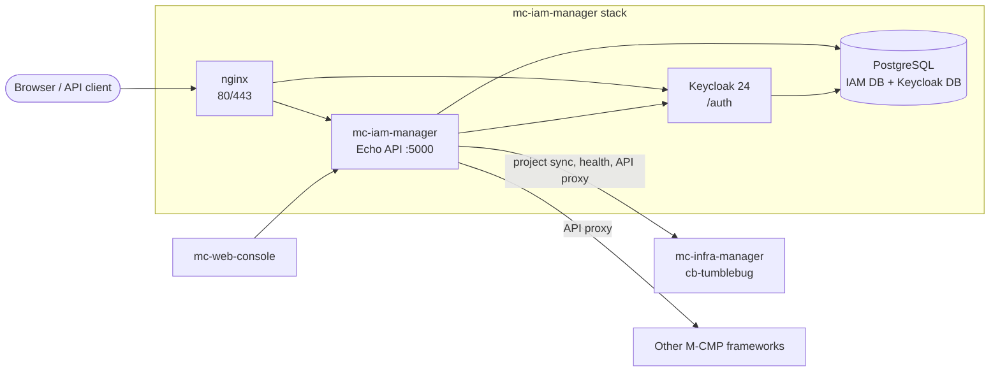

[](https://app.fossa.com/projects/git%2Bgithub.com%2Fm-cmp%2Fmc-iam-manager?ref=badge_shield)
[](https://github.com/m-cmp/mc-iam-manager/blob/main/src/go.mod)
[](https://github.com/m-cmp/mc-iam-manager/releases)
[](https://www.apache.org/licenses/LICENSE-2.0)
[](https://github.com/m-cmp/mc-iam-manager/wiki/Home-ko)

# M-CMP IAM Manager

[English](readme.md) | [한국어](readme_kr.md)

mc-iam-manager는 [M-CMP 플랫폼](https://github.com/m-cmp/docs)의 인증·접근제어·권한 서비스입니다.
Keycloak과 PostgreSQL을 하나의 REST API로 감싸고, 다른 M-CMP 프레임워크가 사용하는 토큰 발급자이자 권한 판단 주체 역할을 합니다.

**전체 문서는 [Wiki](https://github.com/m-cmp/mc-iam-manager/wiki/Home-ko)에 있습니다.** 영문 위키가 기준이며, 핵심 페이지는 한국어판을 함께 제공합니다.

## 주요 기능

- **인증**: 로그인, 토큰 갱신·검증, JWKS (`/api/auth/*`), Keycloak 기반
- **플랫폼·워크스페이스 RBAC**: 사용자와 그룹에 역할 할당, mc-infra-manager와 동기화되는 워크스페이스·프로젝트
- **메뉴 권한**: mc-web-console 메뉴 트리와 역할별 메뉴 매핑. YAML로 최초 1회 시드한 뒤 DB에서 관리
- **MCMP API 권한**: 프레임워크 서비스·액션 레지스트리와 권한 검사가 포함된 API 프록시
- **CSP 연동**: CSP 계정, IdP 설정(OIDC/SAML), CSP 역할, CSP 임시 자격증명
- **조직·그룹·회사** 관리

## 아키텍처



자세한 내용은 [Architecture](https://github.com/m-cmp/mc-iam-manager/wiki/Architecture), [Authentication and Authorization](https://github.com/m-cmp/mc-iam-manager/wiki/Authentication-and-Authorization)을 참고하세요.

## 빠른 시작

> M-CMP 플랫폼 전체(모든 프레임워크 + mc-web-console)를 설치하려면 [mc-admin-cli](https://github.com/m-cmp/mc-admin-cli)를 사용하세요.
> 아래 절차는 mc-iam-manager를 의존 인프라 프레임워크와 함께 **단독(standalone)** 으로 설치합니다.

**사전 요구사항**: Linux(Ubuntu 22.04에서 테스트), Docker 및 Compose v2, `git`, `openssl`, 80/443 포트. 전체 목록은 [설치 가이드](https://github.com/m-cmp/mc-iam-manager/wiki/Installation-Guide-ko)를 참고하세요.

```bash
git clone https://github.com/m-cmp/mc-iam-manager.git
cd mc-iam-manager
cp .env.setup .env      # 기본 비밀번호와 시크릿을 여기서 변경
```

처음 기동하기 전에 [설치 가이드](https://github.com/m-cmp/mc-iam-manager/wiki/Installation-Guide-ko)의 "시작하기 전에"에 있는 `.env` 우회 설정 2가지를 적용하세요.
그다음 시나리오를 하나 고릅니다.

| 시나리오 | 명령 | 접속 주소 |
|---|---|---|
| 로컬 PC, HTTP | `./installAll.sh -m dev -d localhost -r background` | `http://localhost/` |
| IP로 접속하는 VM, 자체 서명 HTTPS | `./installAll.sh -m dev -d <VM_PUBLIC_IP> -r background` | `https://<VM_PUBLIC_IP>/` |
| 운영 FQDN, Let's Encrypt | `./installAll.sh -m prod -d <FQDN> -r background` | `https://<FQDN>/` |

설치 스크립트가 컨테이너를 기동하면 `mc-iam-manager-post-initial` 컨테이너가 [Initial Setup](https://github.com/m-cmp/mc-iam-manager/wiki/Initial-Setup)(플랫폼 관리자, 역할, 메뉴, 서비스 레지스트리, 프로젝트)을 수행합니다.

설치 확인:

```bash
docker compose -f docker-compose-standalone.yaml ps
curl -s http://localhost:5000/readyz
```

`.env`의 `MC_IAM_MANAGER_PLATFORMADMIN_ID` / `MC_IAM_MANAGER_PLATFORMADMIN_PASSWORD`로 로그인합니다.

## 문서

| 주제 | 위키 페이지 |
|---|---|
| 설치, 배포 모드, 인증서 | [설치 가이드](https://github.com/m-cmp/mc-iam-manager/wiki/Installation-Guide-ko) · [Deployment Modes](https://github.com/m-cmp/mc-iam-manager/wiki/Deployment-Modes) · [인증서](https://github.com/m-cmp/mc-iam-manager/wiki/Certificates-ko) |
| 환경변수 | [Configuration Reference](https://github.com/m-cmp/mc-iam-manager/wiki/Configuration-Reference) |
| 설치 후 초기화 | [Initial Setup](https://github.com/m-cmp/mc-iam-manager/wiki/Initial-Setup) |
| 메뉴·역할 권한, 백업과 복구 | [Menu and Role Permission](https://github.com/m-cmp/mc-iam-manager/wiki/Menu-and-Role-Permission) |
| 프레임워크 API 레지스트리와 권한 | [MCMP API Permissions](https://github.com/m-cmp/mc-iam-manager/wiki/MCMP-API-Permissions) |
| CSP 계정, IdP, 임시 자격증명 | [CSP Integration](https://github.com/m-cmp/mc-iam-manager/wiki/CSP-Integration) |
| 조직, 그룹, 회사 | [Organizations, Groups and Company](https://github.com/m-cmp/mc-iam-manager/wiki/Organizations-Groups-Company) |
| REST API와 Swagger | [API Reference](https://github.com/m-cmp/mc-iam-manager/wiki/API-Reference) |
| 다른 서비스에서 IAM 토큰 검증 | [Token Validation for Services](https://github.com/m-cmp/mc-iam-manager/wiki/Token-Validation-for-Services) · [`iamtokenvalidator`](iamtokenvalidator/README.md) |
| 로그, 백업, 업그레이드, 초기화 | [Operations](https://github.com/m-cmp/mc-iam-manager/wiki/Operations) |
| 알려진 문제와 해결 | [문제 해결](https://github.com/m-cmp/mc-iam-manager/wiki/Troubleshooting-ko) |
| 빌드, 로컬 실행, 테스트 | [Development and Testing](https://github.com/m-cmp/mc-iam-manager/wiki/Development-and-Testing) |

위키는 [`docs/wiki/`](docs/wiki/)에서 생성됩니다. 문서를 고치려면 해당 파일을 수정해 Pull Request를 올려 주세요.

## 레포지토리 구성

| 경로 | 내용 |
|---|---|
| `src/` | Go 서비스(Echo): `handler` → `service` → `repository` → `model`, 그 외 `middleware`, `config`, `csp`, `docs`(Swagger) |
| `asset/` | 시드 데이터: 메뉴, 메뉴 권한, MCMP API 액션, 조직 |
| `conf/mc-iam-manager/` | 프리셋 스크립트(`0_preset_*.sh`), 셋업 스크립트(`1_setup_*.sh`), nginx 템플릿 |
| `iamtokenvalidator/` | 다른 서비스에서 mc-iam-manager 토큰을 검증하기 위한 Go 모듈 |
| `tool/swagger-to-actions/` | 프레임워크 Swagger 명세를 MCMP API 액션 시드로 변환하는 도구 |
| `scripts/` | 데모 RBAC, DB 마이그레이션 스크립트 |
| `docs/wiki/` | 위키 페이지 원본 |

## 기여

- 버그 제보와 기능 요청은 [GitHub Issues](https://github.com/m-cmp/mc-iam-manager/issues)에 남겨 주세요.
- 질문은 [GitHub Discussions](https://github.com/m-cmp/mc-iam-manager/discussions)를 이용해 주세요.
- 빌드, 테스트, Pull Request 절차는 [Development and Testing](https://github.com/m-cmp/mc-iam-manager/wiki/Development-and-Testing)을 참고하세요.

## 라이선스

이 프로젝트는 [Apache License 2.0](https://www.apache.org/licenses/LICENSE-2.0)으로 배포됩니다.

[](https://app.fossa.com/projects/git%2Bgithub.com%2Fm-cmp%2Fmc-iam-manager?ref=badge_large)
